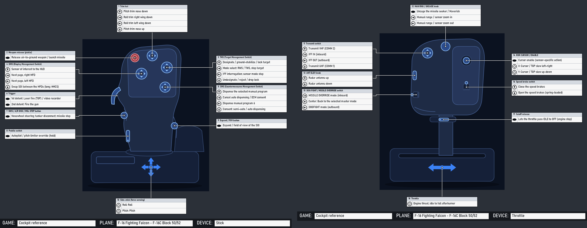

# Cockpit database

JoyPro's reference of real and fictional cockpits, shown like the cockpit chapter of a flight manual: pick an aircraft,
its version (block, tranche, lot, mark, ship) and seat, and read

- the **overview** of the cockpit with its numbered areas (HUD, front dash, consoles, throttles, stick ...);
- a page per **grip** (stick and throttle, cyclic and collective, yoke and quadrant, side-stick, hand controllers): JoyPro's
  drawing with numbered callouts and the **HOTAS table**: a row per control, direction, press (short, long, hold ...) and
  condition (on the ground / in the air), a column per **mode or sensor of interest** (TAD, TGP, HUD ...; NAV, A-A, A-G;
  SCM, NAV, quantum), colour-coded per control;
- a page per **panel** with JoyPro's drawing, numbered callouts and the numbered list (switch positions, what each does);
- where every item comes from (manual and page) and links to real photos.

The **Cockpits** page in the bottom bar shows it; `engine cockpits ...` gives the same data to scripts and to the setup
wizard ("Use this layout").



## What is in it

- `EngineOnly_Runtime/DB/Cockpits/*.json`: the aircraft (format `joypro-cockpits`), one file per family of types
  (`jets-us.json`, `jets-europe.json`, `jets-russia.json`, `warbirds.json`, `helicopters.json`, `civil.json`,
  `space-games.json`, `fiction.json`, `spacecraft.json` ...).
- `EngineOnly_Runtime/DB/Cockpits/drawings/*.json`: JoyPro's own schematic vector drawings of the grips (format
  `joypro-cockpit-drawing`), and the generic drawings every aircraft without its own drawing gets.
- `EngineOnly_Runtime/DB/Cockpits/line-drawings/*.json`: JoyPro's own drawings of real cockpits (format
  `joypro-device-drawing`, [device-reference.md](device-reference.md#joypros-drawings)): `<variant>.overview.json`,
  `<variant>.panel.<panel id>.json`, `<variant>.<device>.json` (a grip), and the older `<aircraft>.<device>.json`. Each
  carries the callout positions as `parts` (item number or control id -> [x, y], 0..1 of the drawing). Read one at a time
  when a page needs it.
- Photos are **addresses only** (`photos` of an aircraft), shown after the user's consent, never in the repository or the
  release (see [Photos](#photos)).

It is JoyPro's own work and ships with JoyPro (`DB\Cockpits` is one of the shipped DB folders, `tools/ReleaseContent.psm1`;
pictures inside it are refused).

## Format

```json
{ "format": "joypro-cockpits", "version": 1,
  "aircraft": [ {
    "id": "f-16", "name": "F-16 Fighting Falcon", "aliases": ["Viper"],
    "category": "fixed-wing", "fiction": false, "franchise": "",
    "maker": "General Dynamics / Lockheed Martin", "nations": ["US"], "role": "multirole", "era": "modern",
    "summary": "One or two sentences.",
    "photos": [ { "url": "https://upload.wikimedia.org/...jpg", "page": "https://commons.wikimedia.org/wiki/File:...",
                  "view": "cockpit", "credit": "U.S. Air Force photo", "license": "public-domain",
                  "variant": "f-16c-block-50", "caption": "...", "confidence": "high" } ],
    "links": [ { "title": "...", "url": "https://..." } ],
    "variants": [ {
      "id": "f-16c-block-50", "name": "F-16C Block 50/52", "aliases": ["Block 52"], "years": "1991-",
      "inherits": "", "removeControls": [], "seat": "",
      "games": [ { "game": "DCS", "plane": "F-16C_50" }, { "game": "FalconBMS" } ],
      "drawings": { "stick": "f16-sidestick", "throttle": "f16-throttle" },
      "controls": [ {
        "id": "stick.hat.tms", "device": "stick", "name": "TMS (Target Management Switch)", "type": "hat4",
        "where": "4-way hat at the top right of the grip head, forward thumb position", "part": "",
        "functions": [ { "dir": "up", "text": "Designate / lock target", "fn": "target_management_system_up", "note": "" } ]
      } ],
      "panels": [ { "name": "ICP and DED", "area": "glareshield", "text": "..." } ],
      "cockpit": "A paragraph about the cockpit around the pilot.",
      "notes": "What differs from the other variants, what is uncertain.",
      "sources": [ { "title": "DCS F-16C Early Access Guide", "url": "https://...", "kind": "game-manual", "covers": "HOTAS" } ],
      "confidence": "high"
    } ]
  } ] }
```

### Version 2: the manual pages

Version 2 adds, per variant (all optional for the format; `cockpits check` asks every listed variant for an overview and
numbered panels):

```json
{ "id": "a-10c-ii", "seatOf": "",
  "sources": [ { "id": "m1", "title": "DCS A-10C II Flight Manual (EN)", "kind": "game-manual",
                 "file": "Mods/aircraft/A-10C_2/Doc/DCS A-10C II Flight Manual EN.pdf", "covers": "cockpit, HOTAS, panels" } ],
  "modes": [ { "id": "tad", "name": "TAD", "kind": "soi" }, { "id": "tgp", "name": "TGP", "kind": "soi" }, { "id": "hud", "name": "HUD", "kind": "soi" } ],
  "defaultMode": "hud",
  "controls": [ { "id": "stick.hat.dms", "device": "stick", "name": "Data Management Switch (DMS)", "type": "hat4",
                  "where": "...", "n": 2, "src": "m1", "page": "108",
                  "functions": [
                    { "dir": "fwd", "press": "short", "by": { "tad": "TAD scale decrease", "tgp": "Zoom increase", "hud": "Steerpoint increment" },
                      "fnBy": { "hud": "..." }, "src": "m1", "page": "109" },
                    { "dir": "left", "press": "long", "text": "HMD on/off" } ] } ],
  "overview": { "drawing": "a-10c-ii.overview", "text": "...",
                "areas": [ { "n": 1, "name": "Heads Up Display (HUD)", "area": "glareshield", "x": 0.46, "y": 0.26,
                             "panels": ["hud-area"], "src": "m1", "page": "105" } ] },
  "panels": [ { "id": "left-front-dash", "name": "Left Front Dash", "area": "front-left", "text": "...",
                "drawing": "a-10c-ii.panel.left-front-dash", "src": "m1", "page": "113", "confidence": "high",
                "items": [ { "n": 1, "name": "Left engine fire T-handle", "type": "handle", "positions": ["IN", "PULLED"],
                             "text": "...", "x": 0.76, "y": 0.05, "fn": "" } ] } ] }
```

| Field | |
|---|---|
| `modes` | the HOTAS table's columns: `id`, `name`, `kind` (`soi` sensor of interest, `master` master mode, `mode` flight or game mode, `condition`, `seat`). Without modes the table has one "Function" column |
| `defaultMode` | the column the one-column views, the search and the setup wizard read (default: the first mode) |
| function `press` | `short`, `long`, `press`, `hold`, `double`, `release`, or empty; a row is one direction, press and condition |
| function `when` | a condition the row needs: `ground` / `air` (weight on wheels), a master mode, "gear down" ... |
| function `by`, `fnBy` | the row's cell per mode (text, and the JoyPro function id where it maps); `""` = no function in that mode. With modes, every row has `text` (the same in every mode) or a cell for every mode. Equal neighbouring cells are drawn as one |
| control `n` | its callout number on the grip's page (the manual figure's number); else numbered in list order |
| `overview` | the cockpit's numbered areas (1..N), where each callout points on the overview drawing (`x`, `y` 0..1), the panels in each area; `drawing` names JoyPro's drawing of the cockpit (none: JoyPro's plan) |
| panel `id`, `items` | panels have an id (the overview names them) and numbered items 1..N: `name`, `type` (`switch2`, `switch3`, `knob`, `selector`, `button`, `lever`, `handle`, `wheel`, `guard`, `gauge`, `display`, `light`, `indicator`, `keypad`, `rocker`, `hat`, `slider`, `encoder`, `pedal`, `other`), `positions`, `text`, `x`, `y` (where its callout points on the panel's drawing) |
| `seatOf` | a seat (CPG, WSO, RIO, operator) of another variant: the Cockpits page lists it under that version's seats |
| `src`, `page` | on controls, rows, areas, panels and items: the source id (`sources[].id`) and the page |
| source `file` | a document that comes with a game, relative to its folder, where it has no web address; `kind` may be `game-files` (the game's own control lists) |

An inheriting variant takes its parent's modes, overview and panels unless it gives its own.

### Aircraft

| Field | |
|---|---|
| `id` | lower case with dashes, unique (`f-16`, `eurofighter-typhoon`, `x-wing`) |
| `category` | `fixed-wing`, `helicopter` or `space` |
| `fiction` | `true` for craft of films, series and games (Star Wars, Battlestar Galactica, Star Citizen, Elite ...): no drawing of the design, see [Licensing](#licensing) |
| `franchise` | the work a fictional craft is from |
| `nations` | ISO-like short names (`US`, `UK`, `FR`, `DE`, `RU`, `SU` (Soviet Union), `CN`, `SE`, `IT`, `ES`, `JP` ...) |
| `role` | `fighter`, `attack`, `multirole`, `interceptor`, `bomber`, `trainer`, `aerobatic`, `transport`, `airliner`, `ga` (general aviation), `business`, `helicopter-attack`, `helicopter-utility`, `helicopter-transport`, `helicopter-light`, `starfighter`, `freighter`, `explorer`, `capital`, `spacecraft` |
| `era` | `ww1`, `interwar`, `ww2`, `korea`, `cold-war-early` (to ~1965), `cold-war-late` (to ~1991), `modern`, `future` |
| `hidden` | a template other variants inherit from (a game's default control scheme); not listed |

### Variants

A variant is what has its own controls: a version (F-16A / F-16C), a block (Block 50), a tranche (Typhoon Tranche 1),
a lot (F/A-18C Lot 20), a mark (Spitfire Mk IX), a seat (AH-64D pilot / CPG) or a ship.

- `inherits`: the id of another variant (any aircraft). The variant starts from that one's data; its own fields replace
  the parent's, its controls replace the parent's control with the same id and add new ones, `removeControls` drops
  controls, `drawings` are merged, `sources` are joined.
- `games`: where it is flown. `game` is JoyPro's game id (`DCS`, `FalconBMS`, `IL2Game`, `IL2Korea`, `MSFS2020`,
  `MSFS2024`, `XPlane11`, `XPlane12`, `WarThunder`, `StarCitizen`, `EliteDangerous`, `X4`, `VTOLVR`, `NuclearOption`,
  `ArmaReforger`, `Arma3`, `FSX`, `P3D5` ...), `plane` the game's own aircraft name where JoyPro's function tables know it
  (`DB/Functions/<game>.tsv`, column `plane`: `F-16C_50`, `FA-18C_hornet`, `AH-64D_BLK_II_PLT`); empty for games whose
  tables are per game.
- `drawings`: device → drawing id. A device without one gets the generic drawing of its kind.
- `confidence`: `high` (the controls come from the aircraft's or the game's manual), `medium` (consistent secondary
  sources), `low` (partly inferred; `notes` says what).
- `sources`: at least one. `kind`: `manual` (flight manual, NATOPS, Dash-1 public excerpts), `game-manual` (DCS, BMS,
  IL-2, MSFS ...), `wikipedia`, `reference` (books, museums, official pages), `tutorial` (videos, community guides),
  `film` (the work itself).

### Controls

| Field | |
|---|---|
| `id` | the control vocabulary's part id where there is one ([devices.md](devices.md#control-vocabulary)): `stick.trigger`, `stick.weapon_release`, `stick.hat.trim\|tms\|dms\|cms\|N`, `stick.button.index_lower`, `stick.pinky.lever\|button`, `stick.gimbal`, `throttle.hat.mic`, `throttle.speedbrake`, `throttle.boat`, `throttle.china`, `throttle.coolie`, `throttle.dogfight`, `throttle.cage`, `throttle.ministick`, `throttle.axis.main\|left\|right`, `collective.hat.N`, `yoke.hat.N` ...; else `<device>.<kind>.<name>` (`throttle.knob.man_rng`, `throttle.wheel.ant_elev`) |
| `device` | `stick`, `throttle`, `cyclic`, `collective`, `yoke`, `sidestick`, `quadrant`, `rhc`, `thc` (spacecraft hand controllers), `pedals`, `panel` |
| `type` | `hat4`, `hat8`, `hat2`, `rocker`, `button`, `trigger`, `lever`, `paddle`, `switch2`, `switch3`, `slider`, `wheel`, `knob`, `encoder`, `selector`, `ministick`, `axis`, `gimbal`, `twist`, `detent`, `guard` |
| `where` | position and role in words: "4-way hat at the top right, under the thumb" |
| `part` | the drawing's part it is drawn on when that differs from `id` (generic drawings) |
| `functions` | one per direction: `dir` (`up down left right press fwd aft center in out cw ccw stage1 stage2 x y pitch roll yaw axis long double hold pull push on off posN upleft upright downleft downright`, or empty for the only action), `text` (short, at most ~45 characters, shown in the table), `fn` (the JoyPro function id from `DB/Functions/slots.json`, empty when JoyPro has none), `note` |

The stick side (stick, cyclic, yoke, side-stick, RHC) and the throttle side (throttle, collective, quadrant, THC) must
each have at least one control: a fixed-wing aircraft has a stick and a throttle, a helicopter a cyclic and a
collective, an airliner a yoke or side-stick and a quadrant.

### Panels

`area`: `glareshield`, `front-left`, `front-center`, `front-right`, `left-console`, `right-console`, `center-pedestal`,
`overhead`, `left-side`, `right-side`, `floor`, `rear`, `helmet`, `seat`. The page draws a plan of the cockpit from them
(JoyPro's own boxes: glareshield, main panel, consoles, pedestal, overhead) with the panel names.

## Drawings

```json
{ "format": "joypro-cockpit-drawing", "version": 1, "id": "f16-sidestick", "kind": "stick",
  "name": "F-16 side-stick grip", "view": "the grip from behind and left, as the pilot sees it",
  "origin": "JoyPro's own vector drawing ... not traced from a photo.", "generic": false,
  "width": 800, "height": 1000,
  "shapes": [ { "kind": "path", "role": "body", "path": "M284,320 C282,250 ... Z" },
              { "kind": "rect", "role": "bodyAlt", "x": 110, "y": 770, "w": 620, "h": 180, "r": 28 },
              { "kind": "ellipse", "role": "shadow", "x": 420, "y": 968, "w": 330, "h": 20 } ],
  "parts": [ { "id": "stick.hat.tms", "type": "hat4", "x": 546, "y": 282, "r": 32, "angle": 0 } ] }
```

- `shapes`: the silhouette in drawing units (the same primitives as the device drawings, `DeviceSchematic`): `path`
  (absolute `M L Q C Z` with `x,y` pairs), `rect` (x, y, w, h, r), `ellipse` (centre x, y, radii w, h), `line` (x, y to
  w, h), `text`. `role` picks the theme colours: `shadow`, `body`, `bodyAlt`, `face`, `screen`, `control`, `mark`, `hot`,
  `accent`, `line`, `label`.
- `parts`: the controls, drawn by JoyPro in one consistent style (`CockpitSchematic.Glyph`): `hat4`, `hat8`, `hat2`,
  `rocker`, `button`, `release` (red), `trigger`, `lever`, `paddle`, `switch2`, `switch3`, `slider`, `wheel`, `knob`,
  `encoder`, `selector`, `ministick`, `gimbal`, `axis`, `twist`, `detent`, `guard`, `label`. `r` is the size, `angle`
  turns it (degrees). A control of a variant is drawn where the part with its id (or its `part`) is; the callout table's
  line goes there.
- `aircraft`, `variants`, `except`, `device` (optional): where the drawing is used without the variants naming it. A
  device of a variant gets, in this order: the drawing the variant names (`drawings`), a drawing that lists the variant,
  one that lists the variant it inherits from, one that lists its aircraft (unless the variant is in `except`), else
  the generic drawing of its kind. `device` defaults to the drawing's `kind`. Fictional craft never get a non-generic
  drawing.
- `generic: true`: a neutral drawing of a kind of device (`generic-stick`, `generic-throttle`, `generic-sidestick`,
  `generic-yoke`, `generic-quadrant`, `generic-cyclic`, `generic-collective`, `generic-space-stick`,
  `generic-space-throttle`, `generic-pedals`, `generic-panel`). On a generic drawing a control whose part the drawing
  does not have takes the next free part of a fitting kind (a hat on a hat, a lever on a lever), so every aircraft is
  shown with its controls in their listed order.

How a schematic drawing (`drawings/`) is made: the shape of the real grip and the positions of its controls are
reconstructed from the public descriptions (the aircraft's manual excerpts, the game manuals' HOTAS chapters, several
photos looked at for proportions), then drawn freely as a clean silhouette in JoyPro's style with its own coordinates.
No photo is traced, no manual figure copied. `engine cockpits render --drawing <id> --png <file>` shows a drawing with
every part's id for checking.

### Line drawings of real grips

`line-drawings/<aircraft>.<device>.json` (`aircraft`, `device`: stick, throttle, cyclic, collective, yoke) holds
JoyPro's own line drawing of a real grip, in the same format as the device drawings. With a `parts` object (part id ->
[x, y], 0..1 of the drawing) placing at least half of a sheet's controls, the Cockpits page draws that sheet on the
line drawing; without it, the drawing is shown under "JoyPro's drawings" above the photo links (no download, no
consent). Fictional craft never get one. It is painted in the user's drawing style (Settings > Drawings).

The picture order of a sheet: JoyPro's line drawing with positions, else JoyPro's schematic drawing of the grip, else
the generic drawing of its kind; the real photos are links shown after the user's consent.

## Callout sheets

The Cockpits page shows the manual pages (above); the callout sheets remain for `engine cockpits render` without
`--page` and for the setup wizard's pictures. Every device of a variant is one sheet: the drawing, a table per control (title "N  Name", one row per direction with
the direction's icon and the function's text), thin orthogonal lines from the control to its table. It is the Layout
page's callout layout (`CalloutLayouter`, [device-reference.md](device-reference.md#tables-and-lines-callout-sheets)),
so the tables never overlap and the lines do not cross tables. Controls the drawing has no part for are listed under
"Other controls" without a line. Numbers run across the devices of a variant (stick 1-10, throttle 11-18).

## The Cockpits page

- **Picker** (left): search over names, aliases, variants, makers, franchises and game aircraft names; filters for the
  game, the era, the role, the nation and the kind (fixed-wing, helicopter, space, fiction); the variant (version /
  block / tranche) list of the picked aircraft. A version with several seats gets a **Seat** choice.
- **The manual** (`CockpitManualPages`, `ManualPageView`): tabs for the **Cockpit overview** and each grip (Stick,
  Throttle, Cyclic, Collective ...), a **Panels** list with one page per panel, previous / next. The overview's areas
  lead to their panel (or grip) page with a click. A table cell shows the JoyPro function it maps to as a tooltip.
- **Search this cockpit**: words over every control, row, cell, area and item of the variant; the hits are listed (page
  and text) and highlighted on the pages.
- **Export page (PNG)** / **All pages (PDF)**: the pages in the user's drawing style (Settings > Drawings) to
  `Documents\JoyPro2\Cockpits`. `engine cockpits render <aircraft> <variant> --page all|overview|stick|throttle|panels|panel:<id> --png <file> | --pdf <file>`
  makes the same pages from the command line.
- Below the pages: the notes, the photo links and the sources.
- **Photos**: the aircraft's photo links. JoyPro asks before it loads any ("JoyPro has photos of the <aircraft>
  cockpit on <site>. Download them and show them here?" Yes / No / Always for cockpits / Never); see
  [privacy.md](privacy.md#cockpit-photos).
- **Compare with my setup**: with a profile open, each function gets a mark in the HOTAS tables when a relation of the
  profile holds it for that game and aircraft (`engine cockpits compare`), with the relation's name and its input.
- **Use this layout**: hands the variant to the setup wizard (below).

## The cockpit guide

Every panel and every control of a cockpit explained in plain words, as a tree: **area** (a rough section only: left
console, main panel, overhead, stick and throttle) > **panel** (a real, named panel: "ENG & JET START control panel",
"Autopilot panel") > **control** (every switch, button, knob, lever, with its positions). Each panel and control has
"What does it do?" (what it does, as for someone who has never sat in a cockpit) and "In the bigger picture" (when and
why the pilot uses it, what depends on it, where it comes in the start-up), the positions (OFF / BATT / MAIN PWR, each
with what it does), the game's own name for it, the commands to bind it with, the open profile's relations that bind it
(after **Compare with my setup**) and the source (manual and page).

On the **Cockpits** page the guide sits next to the manual page (above it on a narrow window). A click on a control opens
the page that shows it and marks its callout (a ring around the point, the list line highlighted); a click on a callout
or a list line of a page selects its control in the tree and opens its explanation. The search box ("battery",
"autopilot") filters the tree to the matching controls with their panels and areas and marks them on the pages. The
printed pages keep the compact form: the game panels are titled by the guide's panels ("ELEC control panel, EPU control
panel" instead of a camera view's "Instrument Panel (3)"), the callouts carry the guide's names, and each list line
gives the first sentence of the explanation.

### The data (`DB/Cockpits/guide`)

Written offline (no AI at runtime) from the games' own control lists (the source sheets of the picture sets: DCS hint
texts and command categories, X-Plane tooltips and commands, MSFS node and event names, IL-2 actions), the manuals
that come with the games and JoyPro's catalog; shipped with JoyPro.

```json
{ "format": "joypro-cockpit-guide", "version": 1, "id": "dcs-f-16c-50", "title": "F-16C Viper (DCS)",
  "variants": ["f-16c-block-50"], "games": ["DCS"], "sets": ["DCS/F-16C_50"],
  "sources": [ { "id": "m1", "title": "DCS F-16C Early Access Guide (EN)", "file": "Mods/aircraft/F-16C/Doc/..." } ],
  "intro": "What kind of aircraft, how its cockpit is laid out.",
  "areas": [ { "id": "left-console", "where": "left-console", "name": "Left console", "text": "...", "seat": 0,
    "panels": [ { "id": "elec", "name": "ELEC control panel", "db": "elec-control-panel", "text": "...", "context": "...", "src": "m1", "page": "64",
      "controls": [ { "id": "main-pwr", "name": "MAIN PWR switch", "type": "switch3",
                      "match": ["PTR-ELEC-TMB-MPWR-510", "item:elec-control-panel:1"],
                      "positions": [ { "name": "OFF", "text": "..." }, { "name": "BATT", "text": "..." }, { "name": "MAIN PWR", "text": "..." } ],
                      "text": "...", "context": "...", "count": 0, "fn": "" } ] } ] } ] }
```

| Field | |
|---|---|
| `variants` | the catalog variants it explains (a guide may list a version's seats; the back seat's areas have `"seat": 2`, areas without a seat are in every seat) |
| `inherits`, `remove` | starts from another guide (A-10C from A-10C II, Ka-50 BS2 from BS3, TF-51D from P-51D); its areas, panels and controls are replaced by id; `remove` drops `panel` or `panel/control` ids |
| `partOf` | a part file of a big guide (`dcs-a-10c-ii-part2.json`): its areas join the guide's |
| `common` + `games` | a shared guide of a game's common controls (IL-2's actions, MSFS's node names, X-Plane's commands): used for every variant of the game below its own guide; only its controls the cockpit has are shown |
| area `where` | `glareshield front-left front-center front-right left-console right-console center-pedestal overhead left-side right-side floor rear seat helmet hotas other` |
| panel `db` | the catalog panel it is (the catalog's items no guide control names are listed in it) |
| control `type` | `switch2 switch3 switch knob selector button lever handle wheel guard cover gauge display screen light indicator keypad rocker hat slider encoder pedal trigger axis other`; `count` for a group of alike controls (OSB 1-20) |
| `match` | the game controls it is: a glob of the picture callout id (`PNT-BTN-MFD-L-*`), `cmd:<glob>` (a command id or name of the callout: X-Plane commands, IL-2 actions, MSFS events), `label:<text>` (the callout's label), `item:<catalog panel>:<n>`, `control:<catalog grip control id>`. The first guide control (in file order) that matches a callout gets it |

Translations: `<id>.<lang>.json` (`joypro-cockpit-guide-text`: `title`, `intro`, `areas` / `panels` by id,
`controls` by `panel/control` with `name`, `text`, `context` and `positions` by the English position name). The GUI
uses the language of the user interface where there is one (German: `.de.json`), else English. Controls no guide
explains (War Thunder, Nuclear Option, Star Citizen, aircraft without a guide yet) are listed under their game panel or
catalog panel with the game's or catalog's name, the catalog's note and a general description of their kind of control
(GUI texts, translated); the tree says "not explained yet".

**General explanations by function** (`guide/_templates.json`, German `_templates.de.json`, format
`joypro-cockpit-guide-templates`): for every control no guide explains (War Thunder, Nuclear Option, Star Citizen, Elite,
X4, VTOL VR and the long tail of the others) the template with the longest of its `words` in the control's name (else
in the catalog's note) gives the text and the bigger picture, with `{name}` replaced by the control's own name ("landing
gear", "flaps", "master arm", "radio", "trim" ...); gauges, lights and screens get the template of what they are. The
tree shows them as "general description"; a control without a matching template gets the GUI's sentence for its kind of
control (switch, knob, button ...).

**Animated controls**: every control of the picture set's `controls` list (see [Animated controls](#animated-controls))
is in the tree. One that is a callout joins its callout's node; one that is not (an animated part without a callout)
gets a node of its own at the pictures it is visible on, matched to a guide control by its id, label or commands like a
callout, else under its game panel with a general explanation. Its kind (`switch-3`, `rotary` ...) gives the type and
its animation's positions the positions ("Position 1 / 2 / 3") where no guide names them. New picture sets are read
whenever the page shows a variant, so rebuilt sets show their animated controls without a JoyPro update.

Rules (`CockpitGuideLibrary.Check`, part of `engine cockpits check`; `tools/cockpit_guide.py check`): ids, a name and
both texts on every area, panel and control (lengths within bounds, no placeholder, no exclamation mark), no two
controls with the same text or context in one seat, positions named once, each with its text, `switch2` with two and
`switch3` with three positions, known types and variants, translations that name existing areas, panels, controls and
positions.

Writing more: `tools/cockpit_guide.py` (`check`, `coverage <guide> --pictures <set>` lists the game controls a guide does
not explain yet, `stats`, `report --pictures <root>` the coverage of every picture set). The writers' brief (format,
style guide, glossary of plain explanations) is kept with the maintainer's working files; its rules are the ones above:
facts only from the game's labels, the manual and the catalog; a game control is tied to a guide control only when its
label, commands or id say which it is; when unsure, say less.

### Coverage (2026-10-18, `engine cockpits guide --coverage [--game G]` with every picture pack installed)

| Game | Variants with a guide | Controls written out / with a general description / in the tree | Game controls explained |
|---|---|---|---|
| DCS (48 cockpits, every module incl. Flaming Cliffs, SA342, A-4E) | 81 / 81 | 17,464 / 69 / 17,568 | 17,206 / 17,206 |
| Falcon BMS (F-16 blocks, Hornets, A-10A) | 17 / 17 | 3,393 / 91 / 3,502 | (no pictures) |
| IL-2 Great Battles (117 cockpits) | 66 / 66 | 4,906 / 4 / 4,916 | 2,148 / 2,148 |
| MSFS 2020 / 2024 | 49 / 51, 52 / 54 | 3,772 / 581 / 5,017; 4,128 / 571 / 5,382 | 9,043 / 9,906; 9,913 / 10,797 |
| X-Plane 12 | 18 / 18 | 1,543 / 1 / 1,553 | 3,886 / 3,896 |
| War Thunder | 100 / 155 (shared variants) | 14,050 / 3,483 / 18,428 | 8,714 / 8,801 |
| Nuclear Option / Star Citizen | 0 | general descriptions: 351 / 351, 2,296 / 2,821 | – |
| **All** | **209 / 462** | **28,347 written, 10,113 general / 41,457** | **28,412 / 29,329** |

The guide data: 966 areas, 2,657 panels, 16,329 guide controls (groups of alike controls count once), about 4.6 million
characters of English; German for the ten biggest DCS modules (F-16C, F/A-18C, A-10C II, AH-64D, F-15E, F-14, Ka-50 III
and BS2, UH-1H, Mi-8MTV2, F-4E) and both MSFS shared guides (every MSFS aircraft's game controls).

`engine cockpits guide <aircraft> [<variant>] [--lang de] [--search words] [--no-pictures]` prints the tree (JSON, or
text with `--text`); `--coverage [--game G]` the table above per variant; `engine cockpits compare` also lists every game command the profile binds (`Commands`), which the
guide shows per control.

Code: `engine/DeviceReference/CockpitGuide.cs` (format, library, rules, matching), `CockpitGuideTree.cs` (the tree of a
variant), `CockpitManualPages` (the guide's names on the pages), `gui/JoyPro.Gui/ViewModels/CockpitsViewModel.Guide.cs`,
`Views/CockpitsView.axaml`. Tests: `CockpitGuideTests` (the shipped guides' rules, the tree on a synthetic cockpit with
pictures, seats, a shared guide and German, the pages, the page's selection and marks; opt-in render:
`JOYPRO_GUIDE_RENDER_OUT`, `JOYPRO_GUIDE_PICTURES`, `JOYPRO_GUIDE_AIRCRAFT=f-16:f-16c-block-50:jfs;...`).

## For the setup wizard and scripts (API)

- `engine cockpits get <aircraft> [<variant>] [--json]` returns the resolved variant as `joypro-cockpit-layout`:
  `Aircraft`, `Variant`, `Games`, `Devices[]` (`Device`, `Title`, `Drawing`, `Generic`, `Controls[]` with `Id`, `Name`,
  `Type`, `Where`, `Part`, `Placed`, `X`, `Y` (0..1 on the drawing) and `Functions[]` with `Dir`, `Text`, `Fn`, `FnName`,
  `Vocabulary` (the control vocabulary id of that direction, e.g. `stick.hat.tms.up`, `stick.axis.pitch`) and `Actions[]`
  (`Game`, `Plane`, `Action`: the game's own command id from `DB/Functions/<game>.tsv`)), `Panels`, `Sources`, `Photos`,
  `Links`. The aircraft and the variant may be given by id, name or alias; a variant id alone also works
  (`engine cockpits get f-16c-block-50`).
- In the GUI: `CockpitsViewModel.UseLayoutRequested` (event, `CockpitLayoutRequest` with `AircraftId`, `VariantId`,
  `Games` and the CLI arguments) and `MainWindowViewModel.PendingCockpitLayout` (the last request, until the wizard takes
  it with `TakePendingCockpitLayout()`).
- `cockpits get --json` also gives `Modes`, `DefaultMode`, the `Overview` (areas), the `Panels` with their `Items`, and
  per function `Press`, `When`, `By` and `FnBy`. A function's `Text` and `Fn` are the default mode's cell: the setup
  wizard places a function where the default mode has it (`SetupCockpits`).
- `engine cockpits list [query] [--game G] [--era E] [--role R] [--nation N] [--category fixed-wing|helicopter|space|fiction|real]`,
  `search <text>` (aircraft and controls / functions: "TMS", "china hat"), `compare <aircraft> [<variant>] [--game G]`
  (with `--profile`), `render <aircraft> [<variant>] --png <file> [--device d] [--style dark|light] [--print-width px]`
  (the callout sheets), `render ... --page <page> --png <file> | --pdf <file> [--scale s] [--highlight words]` (the manual
  pages), `photos [query] [--coverage]`, `coverage` (also the manual pages per game), `drawings`,
  `check [--structure]` (`--structure`: only what is wrong, not what is still missing).

## Pictures from your games

**Build pictures from my games** on the Cockpits page (or `engine cockpits pictures build`) draws the cockpits of the
games installed on this PC from the games' own files (the files listed per game below, read only). They are kept with
the game data (`<data>\GameData\CockpitPictures\<game>\<aircraft>`) and are never part of the repository; the sets made
for JoyPro's releases are offered as picture packs (see "Picture packs"). For MSFS 2024 the pictures are screenshots
taken in the sim (see below). Wherever a variant's game has pictures, the manual pages show them in place of JoyPro's
drawings:

- **Cockpit overview**: the whole cockpit from behind the pilot's head. Its numbered callouts lead to the panels and
  the grips.
- **Stick / Throttle**: the game's grip on its own. The HOTAS table is unchanged. A control has a callout where the model
  names a part for it (A-10C: `STICK-BTN-TMS`, `TRTL-R-HAT-SLEW`); controls the model has no part for are listed under
  the picture.
- **One page per panel** (the game's own panels): a frontal picture with every clickable control numbered, and a
  numbered list with the game's own name for the control (DCS: the hint text of `clickabledata.lua`; X-Plane: the
  manipulator's tooltip). For DCS the list also gives the bindable commands of the same device and command number
  (JoyPro's DCS command list of the aircraft); for X-Plane it gives the command or dataref.
- **Picture from the game / JoyPro's drawing of it**: either the render itself, or JoyPro's line drawing of it (outlines,
  details and the printed labels traced from the render, plus flat cel colours). The drawing is shown in the user's
  drawing style (Settings > Drawings), like the device drawings.

Where the callouts come from: they are computed from the model, never placed by hand. In DCS the clickable connector
of each element (`PNT_...`/`PTR-...` in the cockpit EDM, named in `clickabledata.lua`) gives the place; the panel comes from the
command list's category ("Left Console; ENG & JET START Control Panel"), else the connector's panel token. In X-Plane
the manipulator geometry of the cockpit objects gives the place. The grips are found by the animation arguments
`mainpanel_init.lua` gives them (DCS), by the VR hand connectors (`STICK_HANDLE`, `THROTTLE_HANDLE`) or by node names, and by the
yoke and throttle datarefs (X-Plane).

| Game | What is read | State (2026-10-17) |
|---|---|---|
| DCS World | `Mods\aircraft\*`: entry.lua (aircraft, cockpit folder), `Entry\Views.lua` where a module keeps it there, mainpanel_init.lua (model, grip arguments), clickabledata.lua, Views.lua (seats, eye points), the cockpit EDM and its textures (DDS in zip archives, also under `CoreMods\aircraft\<module>`) | 48 cockpits on the test PC (about 1,900 pictures, 15,000 callouts). Not complete: F-14BU (no clickable data yet) and SA342 (no cockpit model in the files); the textures of the C-130J, F-14 and OH-58D are in `CoreMods\aircraft\<module>` |
| X-Plane 12 | `Aircraft\**\*.acf` (objects, pilot's eye) and the OBJ8 objects with their textures (DDS and PNG both top row first; the figures (pilot, crew and passenger objects, also in `crew\`/`pilot\` folders) left out, the pilot's panels kept) | 23 aircraft (every one in Aircraft; an AI-only `_AI` copy is left out). The displays are drawn by the sim at run time (black in the pictures) |
| MSFS 2020 | the packages of `InstalledPackagesPath` (UserCfg.opt) without `.fsarchive` files: `model*\model.cfg` `interior=` -> the interior xml (its first LOD's glTF, its behaviours) -> the glTF (Asobo's optimised format: interleaved vertices, half-float texture coordinates, primitives sharing one index buffer by `ASOBO_primitive` StartIndex / BaseVertexIndex, `MSFT_texture_dds`), the textures (texture.cfg fallbacks), cameras.cfg + flight_model.cfg (eye = reference datum + eyepoint + the pilot camera's offset) | 57 interiors (every readable one of the test PC's packages; about 730 pictures, 7,300 callouts). Callouts on the parts named by function (`ELECTRICAL_Switch_Battery_Master`, older models `DEICESYSTEM_SWITCH_AIRFRAME`), with the behaviour template and its events where the xml names the node; the yoke (`HANDLING_Yoke_1`, `YOKE_LEFT`) and throttle are grips. Packages with `.fsarchive` files are not read; the sim itself is not installed on the test PC |
| MSFS 2024 | the models are not read (the aircraft packages hold `.fsc` / `.fsarchive` files). Screenshots in the sim instead: `tools\e2e\games\Msfs2024CockpitShots.ps1` (unattended; SimConnect through the sim's own client library `SimConnect_internal.dll`: EnumerateSimObjectsAndLiveries, FlightSave/FlightLoad to swap the aircraft at Innsbruck, CAMERA VIEW TYPE AND INDEX for the pilot's view and every instrument view, EnumerateInputEvents) | screenshots of every aircraft family (overview + instrument views, the HUD cropped away); the list on the overview is the aircraft's own input events (`ELECTRICAL_Battery_1`), without places (they cannot be derived honestly from a screenshot). Only via picture packs or the e2e script, not from the Cockpits page |
| Nuclear Option | `NuclearOption_Data\resources.assets` (plain Unity 2022.3 data, JoyPro's own read-only reader): the aircraft prefabs' cockpit objects (interior, stick, throttle or collective, screens), the pilot's helmet camera as the eye, the textures from `resources.assets.resS`, the unit names of the aircraft definitions and the game's Rewired action list | 13 aircraft (every flyable one; 46 pictures, about a minute). The cockpits have no separate switches (painted on), so the callouts name the grips and the screens only; each grip page lists the game's "Flight Controls" actions (they bind to any button) |
| IL-2 Great Battles | `data\*.gtp` (plain stored archives, read only): the plane scripts (`luascripts/worldobjects/planes/*.txt`: name, cockpit model, pilot seat as the eye), the cockpit `-c.mgm` models (JoyPro's own reader: node tree, geometry, skinned parts, the animations that tie the argument numbers to the parts), `-c.arg` argument names, DDS textures, the input actions and their English names (`swf/il2`) | 117 aircraft with a pilot's cockpit (about 1,070 pictures, 2,200 callouts; the 66 catalog variants find their set). Callouts: the parts the control arguments move, named by the game's input action where the argument is plainly that control (gear, flaps, throttle, mixture ...), else by the argument's own name. Not complete: CG-4A and Pe-2 ser.87 overviews are wrong (frames the reader does not follow), a few WWI/transport sticks are not found, linkage rods the game places at run time are left out |
| IL-2 Korea | not read: JoyPro reads none of its archives with cockpit models (the archives it can read, `S16R!`, hold no cockpit model; searched for the cockpit node and texture names). Readable on disk: `data\input\general.actions` (JSON) and the mission files | skipped; in-game screenshots (Quick Mission) would be the way, only while the PC is idle |
| Star Citizen | the game's data files, read only and never while the game runs: ship entities, seats, dashboards and grips, their interaction points (named with the game's own texts) and the flight actions of the default profile | 149 cockpits; big ships show the dashboard, seat and grips; some ships have no stick or throttle picture yet |
| War Thunder | `content.hq\pkg_cockpits\res`, read only: the GRP2 packs (`*.grp`: the 1,197 `<plane>_cockpit` DynModels with their `_skeleton` node trees; DagorEngine's format: vertex declarations, packed positions with the model's unpack constants, meshoptimizer-packed indices, LOD 0's rigid meshes), `dynModelDesc.bin` (zstd, binary BLK: each model's materials and texture names) and the DxP2 texture packs (DDSx; the best of `$hq` / base / `$tq`). The vertex data and most textures are Oodle Leviathan packed: unpacked by the War Thunder Oodle helper `tools\wt-oodle` (a separate GPL-3 program, a C# port of parts of ooz with fixes; the engine starts it as a process, `JOYPRO_WT_OODLE` names it; without it War Thunder is skipped with a note). The eye is the pilot figure's head bone (`Bip01 Head01`); the grips are the model's `stick*` / `throttle*` nodes; the callouts are the model's own control and instrument node names (`gears`, `flaps`, `airbrake_lever`, `mixture`, `speed`, `altitude_hour` ...; instruments carry the node name). Not read: `aces.vromfs.bin` (flight models, cockpit instruments, HUD, the factory HOTAS presets), `char`/`game`/`gui`/`lang`/`mis`/`webUi`/`wwdata` vromfs and every `grp_hdr.vromfs.bin` | 1,197 cockpits on the test PC (9,274 pictures, about 25,000 callouts; about 4 hours at low priority). Environment cubemaps and some shared textures are not in the cockpit packs (flat colour); 42 cockpits have a texture in a format JoyPro does not decode (flat colour). 52 models have no pilot figure (mostly bomber cockpits made of their instruments): the eye is placed above and behind the stick (7) or behind the middle of the instruments (45). Users get the pictures as picture packs (the helper is not part of the release) |

The Lua files are read with DCS's own interpreter (`bin\luae.exe`) and small harness scripts that only print; nothing in
a game folder is written. A build skips an aircraft whose pictures are newer than its model and were made for the same
game version (`--force` makes them again). It takes about two seconds per picture; a big DCS module has 50 to 80 pictures.

`engine cockpits pictures build [--game DCS|XPlane12|MSFS2020|IL2Game|NuclearOption|WarThunder|StarCitizen|all] [--aircraft <name>,...] [--force] [--out <folder>]`,
`engine cockpits pictures status`, `engine cockpits pictures check` (below), `engine cockpits render ... --pictures picture|drawing|none`. The format:
`pictures.json` (`joypro-cockpit-pictures`): per view `id`, `kind` (overview, device, panel), `title`, `area`, `seat`,
`image`, `drawing` (a `joypro-device-drawing`), `width`, `height`, and `callouts` (`n`, `id`, `label`, `x`, `y` 0..1 of
the picture, `kind`, `device`, `commands`); `index.json` names the set of each of the game's aircraft names. The code is
in `engine/CockpitPictures` (EDM, OBJ8, DDS/TGA/PNG readers, a software renderer, the line tracer, the view planner).

### Picture quality

Every picture goes through an automatic quality gate (`engine/CockpitPictures/PictureQuality.cs`, used by
`PictureWriter` for every game). Measured on the picture: how much of the frame the model covers (for a grip: the box
around what is drawn), the share of 8x8 blocks with visible detail (local contrast), the brightness entropy, the share of
black; from the renderer: the share of textured pixels and of the view's callouts that are in the frame and not covered.
A score of 0 to 100 (60 and more: good) and the problems (`little detail`, `one flat colour`, `mostly black`,
`mostly empty`, `too small in the frame`, `untextured`, `controls hidden`).

- A grip much smaller than its frame is zoomed to what is drawn; a poor picture is made again with the planner's other
  cameras (a panel: more room around it, then the pilot's own view from the head; the overview: closer to the head, at
  the head, further back) and the best one is kept.
- A panel or grip picture that stays below 45 is left out (its overview callout goes too); the overview is always kept.
- A panel picture that looks like an earlier one (the same panel framed for another group of its controls) gives its
  callouts to that one (`merged`).
- `pictures.json` gets `quality` (`score` of the overview, `mean`, `low`, `views`, `dropped`, `merged`) and, per view,
  `quality`, `problems` and `drawingReadable: false` where JoyPro's line drawing would be a mess (a poor picture, a busy
  perspective, a screenshot): the drawing mode shows the picture there.
- A set is `low` when its overview is below 45 or fewer than a third of its pictures are good. The Cockpits page then
  shows another game's set of the aircraft first (`CockpitPictureSet.For`; the picture packs: `"low"` in the manifest).
- `engine cockpits pictures check [--game G] [--aircraft a,b] [--write] [--drop]` rates sets that are already there
  (screenshots, picture packs, older builds); `--write` keeps the ratings in `pictures.json`, `--drop` also leaves out
  the panel pictures below the gate.
- The build report names a set's verdict ("low quality (overview 31/100); 4 unusable pictures left out; 2 duplicate
  pictures merged"). `JOYPRO_PICTURE_KEEP_ALL=1` keeps every picture (to look at what the gate leaves out).

### Grip parts

The named parts of a game's grips are checked against the aircraft's manual figures (`engine/CockpitPictures/GripParts.cs`):

- Fixes per model where the model's part names are wrong or say nothing: the DCS A-10C / A-10C II stick names its
  countermeasures switch `STICK-BTN-TMS` and its TMS `STICK-BTN-TARG` (Flight Manual, Figure 69): JoyPro calls them
  CMS and TMS; the MMCB, the NWS button, and the throttle's left throttle button, slew, coolie, mic, speed brake, boat
  switch and china hat get the manual's names (Figure 70).
- Left out: panel controls under a grip's node (`TUMB-PANTRTL-...`, the F-5E's `LVR-PANUHF-VOL`) and the modelling
  tool's names (`Helix004`, `NGon058`, `Details036`, `RUS08`).
- A part that does not sit on the grip's surface in the picture (a part known only by its node's pivot) is listed
  without a place ("Not shown on the drawing") instead of being drawn beside the grip.
- The grip picture is taken from the side that shows most of its parts: besides the view from behind and the thumb's
  side, the front with the thumb's side (the trigger and the buttons on the front face, the A-10C's NWS button below the
  trigger), the profile and the other side are tried.
- The page places a catalog control on a game part only when the part shares a word of what the control is (its id,
  the first words of its name; general words such as "weapon" count less): the 172's "A/P DISC / TRIM INT switch" is no
  longer put on the elevator trim buttons.
- `CockpitPictureQualityTests.OptIn_GripAudit` (`JOYPRO_CHECK_PICTURE_SETS=<pictures root>`) writes every grip control
  of every catalog variant with the game part it is placed on to `%TEMP%\joypro-grip-audit.tsv` for a review.

### Which set a variant gets

The game's aircraft names first (`DB/Cockpits` `games[].plane`), then the variant's id, aliases and name; a fuzzy match
of names only when the variant names no aircraft of that game: a type number (two or more digits) and a word (the maker,
the type's name) or a type designation (`c172`) must be shared, the avionics' numbers (`G1000`) do not count as the
aircraft's, and the aircraft family's own names (`C172`) come last. No picture rather than a wrong one: the A350 no longer
gets the King Air 350, the CRJ and the E195 no 172 G1000, the PA-28 no 172 seaplane (`Locate_NoNumberAloneMatchesAcrossFamilies`).
A name several sets of a game share (X-Plane's 172, 172 G1000 and seaplane are all "Cessna 172 SP") leads to the set
without a special-version word (floats, skis, seaplane, AI).

### Animated controls

`pictures.json` lists every control of the cockpit once under `"controls"` (a data addition; the pages do not show it
yet): the callouts of the panel and grip pictures, the grips themselves (`grip:stick`, `grip:throttle`) and the model's
other animated controls a reader adds without a callout (`CockpitScene.Controls`). Per control: `id`, `label`, `kind`
(JoyPro's vocabulary: `button`, `switch-2`, `switch-3`, `switch-N`, `switch` (positions not known), `rotary`, `lever`,
`axis`, `grip`, `hat`, `trigger`, `screen`, `cover`, `wheel`, `pedal`, `other`), `gameKind` (the game's own: DCS `TUMB`,
X-Plane `axis_knob`, MSFS `Switch ASOBO_..._Template`), `panel`, `device`, `seat`, `animation` (`source`, `name`, `min`,
`max`, `positions` where known), `commands` (the ids to bind) and `views` (`view`, `x`, `y` 0..1 on every picture it is
visible on; `n` on the picture where it is a callout; elsewhere only where its surface is drawn at its place, not behind
something). Where the animation comes from:

| Game | `animation.source` | Range and positions |
|---|---|---|
| DCS World | `draw argument` (clickabledata.lua `arg`) | `arg_lim` (range), `arg_value` steps (a switch's positions) |
| X-Plane 12 | `dataref` / `command` (the manipulator) | the manipulator's numbers (axis knobs, drag axes, toggles, pushes) |
| MSFS 2020 | `behaviour` (node and template) / `model node` | not in the open files |
| IL-2 Great Battles | `animation argument` | the argument values of its animation keys (positions when 2 to 6) |
| War Thunder | `animated node` (the skeleton's node) | not in the open files |
| Nuclear Option | `animated part` (the grips) | not in the open files |
| Star Citizen | `interaction point` / `model node` | not in the open files |

`CockpitPictureSet.Controls` (`CockpitPictureControl`, `CockpitPictureSpot`) reads them.

What made the first X-Plane pictures unusable (2026-10-18): Laminar's DDS textures were sampled upside down (they are
stored top row first like their PNGs), so every surface showed the wrong part of its texture; and static offsets without a
dataref (`ANIM_trans x y z x y z`, `ANIM_rotate x y z r r`) were ignored, so the 737's levers and their callouts sat at the
aircraft's origin and its panel pictures looked at the inside of the nose (mirrored). Panel pictures of a single control
show at least 24 x 18 cm around it.

## Photos

Real photos are only linked: `photos[].url` (the picture) and `page` (where it is published, with its author and
license). Preferred: Wikimedia Commons (most US military photos are public domain; others CC licences) and official
pages (museums, manufacturers, air forces). For fictional craft the links point to the work's official or fan
encyclopedia pages.

- The GUI downloads a photo only after the user's yes for that aircraft (`CockpitPhotoConsent`, built on
  `DevicePhotoConsent`: the answers are kept with the device photo answers under the key `cockpit:<aircraft id>`;
  "Always for cockpits" / "Never for cockpits" under `cockpit:*`; the global "Never" of the device photos also stops
  cockpit photos). It is cached in `%LOCALAPPDATA%\JoyPro2\DeviceImages` (`DeviceImageCache`) and shown with its credit
  and license. A Wikimedia Commons file is loaded as Wikimedia's 960 px thumbnail (what Wikimedia asks programs to
  use), the original only when the thumbnail fails.
- Downloads go one at a time per site, a little apart, with a user agent that names JoyPro, its version and its
  repository (Wikimedia's robot policy). A "429 too many requests" or "503" answer is tried again after the server's
  Retry-After (else 2, 4, 8 seconds; at most four tries); an answer that is not an image (an error page) is not a photo; a
  photo that failed is not remembered as missing. Until 2.1.0 the photos loaded at once with a bare "JoyPro2" agent and
  Wikimedia refused most after the first two (the 747: 2 of 5).
- Each photo card has **Open the photo** (the file itself in the browser, full size, to save from there) and **Open
  the page**; a photo that could not be loaded gets **Try again**. A link that is only a page (fiction, official pages)
  says so instead of failing.
- `CockpitPictureQualityTests.OptIn_EveryCockpitPhotoLinkOpens` (`JOYPRO_CHECK_COCKPIT_PHOTOS=1`, network) loads every
  photo link of the database as the page does (2026-10-18: 348 of 348).
- The engine never downloads a photo.
- The maintainer's private backup: `tools\backup_cockpit_photos.ps1 -Target <folder outside the repository>` (default
  `..\JoyPro2-private\cockpit-photos`) downloads every linked photo with a manifest (aircraft, view, address, page,
  credit, license, date, SHA-256, size). Neither the build nor the release reads it.

## Licensing

- Real aircraft: the schematic drawings (`drawings/`) are JoyPro's own reconstructions of the grip's shape and its
  control layout (functional facts: which switch is where and what it does), drawn in JoyPro's style. They are not
  traced from photos and do not copy a manual's figure. The line drawings (`line-drawings/`) are JoyPro's own drawings
  of the cockpits, panels and grips. No manual page, figure or photo is in the repository or the release.
- Fictional craft (films, series, games): **no drawing of their design**. They get the generic stick and throttle with
  their function list only, plus links ([licensing-audit.md](licensing-audit.md), P7).
- Names of aircraft, franchises and makers are used to say what is described (nominative use); no logos.
- Text is JoyPro's own wording. Facts come from the listed sources; no source text is copied beyond short control
  labels.

## Growing the database

`tools/cockpit_db.py` (Python 3, no packages):

| Command | |
|---|---|
| `functions [query]` | JoyPro's function ids (`DB/Functions/slots.json`) |
| `seed <plane> [--game G]` | the HOTAS rows JoyPro's function tables already have for a game aircraft (DCS: physical control text per function) |
| `ids [query]` | aircraft and variant ids already in the database |
| `check [draft.json ...]` | the database plus the drafts through `engine cockpits check` (only the drafts' problems are printed) |
| `check --patch <patch.json> ... [--all] [--structure]` | the database with patches applied (a temporary copy), the patched variants' problems |
| `patch <patch.json> ...` | applies patches (`{"format": "joypro-cockpit-patch", "variants": {"<id>": {fields}}, "aircraft": {...}, "newVariants": {"<aircraft>": [...]}, "newAircraft": {"<file.json>": [...]}}`; a field given replaces the variant's field, `null` removes it) |
| `pages <aircraft> [variant] [--page ...] [--out dir] [--dark] [--patch p.json]` | the manual pages as PNG for a look |
| `merge <draft.json> --into <file.json> [--replace]` | adds the drafts' aircraft (or new variants of an aircraft already in the file) |
| `render <aircraft> [variant] [--out <folder>] [--light]`, `render --drawing <id>` | the sheets as a PNG for a look |
| `get <aircraft> [variant]` | a variant with its controls, ids, types and where each is drawn |
| `photos-merge <photos.json> ...` | adds verified photo links (`{"format": "joypro-cockpit-photos", "photos": {"<aircraft>": [ ... ]}}`); an address already listed is skipped |
| `coverage`, `drawings` | numbers (also every control no drawing shows); drawings with their parts |

The procedure per batch (also the brief for research helpers):

1. Take a list of types; check `ids` so nothing is added twice. One aircraft entry per type family (all F-16 versions
   in `f-16`), one variant per version that has its own controls.
2. For each variant find the HOTAS description: the game manual's HOTAS chapter (DCS, BMS, IL-2, MSFS), the public
   flight-manual excerpts, the manufacturer's or air force's pages, then tutorials. For a DCS module run `seed` first: it
   lists the function ids JoyPro already maps to that module's stick and throttle, with the physical control in words.
3. Write the controls: vocabulary ids, device, type, where, and one function per direction with a short text and the
   function id (`functions <word>` finds it; empty when there is none, never a guess).
4. Panels briefly, the cockpit paragraph, notes (differences to the other variants; what is uncertain), sources with
   working https addresses, confidence.
5. `check <draft>` until it reports no problem, then `merge`. `render` a few for a look.
6. Drawings are made separately (see [Drawings](#drawings)); a new drawing's part ids are the controls' ids of the
   variants that use it. `check` reports a part a variant names that the drawing lacks.

## Coverage (2026-10-13, `engine cockpits coverage`)

Every listed variant (462, plus 9 hidden game templates) has its manual pages: an overview with numbered areas, the
grips with their HOTAS tables and numbered panels; `cockpits check` reports no problem.

| Game | Variants | HOTAS rows | Variants with mode columns / columns | Panels | Numbered items | JoyPro's drawings |
|---|---|---|---|---|---|---|
| DCS (every module on the test PC, all versions and seats) | 81 | 2654 | 30 / 104 | 1223 | 9981 | 505 |
| Falcon BMS (F-16 blocks, Hornets, A-10) | 17 | 993 | 16 / 50 | 413 | 2413 | 211 |
| IL-2 Great Battles / IL-2 Korea | 66 / 2 | 974 / 44 | – | 364 / 32 | 2968 / 287 | 149 / 26 |
| War Thunder (type level) | 155 | 4309 | 43 / 125 | 1532 | 12507 | 539 |
| MSFS 2020 / 2024 | 51 / 54 | 1214 / 1323 | 5 / 15, 9 / 23 | 288 / 295 | 2561 / 2837 | 2 / 2 |
| X-Plane 11 / 12, FSX, Prepar3D | 14 / 18, 12, 14 | 335 / 437, 266, 340 | – | 71 / 93, 59, 70 | 579 / 808, 492, 592 | – |
| Star Citizen / Elite Dangerous / X4 | 42 / 32 / 21 | 2184 / 2112 / 588 | 42 / 294, 32 / 160, 21 / 84 | 276 / 224 / 105 | 1351 / 1027 / 318 | none (fiction) |
| VTOL VR / Nuclear Option / WARDOGS / Tiny Combat Arena | 9 / 13 / 6 / 1 | 147 / 253 / 90 / 15 | 7 / 19, – | 104 / 37 / 13 / 4 | 560 / 137 / 50 / 10 | none (game designs) |
| Arma 2 / 2 OA / 3 / Reforger | 12 / 7 / 3 / 3 | 317 / 263 / 67 / 76 | 2 / 6, 2 / 7, 1 / 2, 2 / 4 | 102 / 119 / 23 / 34 | 745 / 881 / 174 / 327 | 39 / 104 / 8 / 21 |
| Real types outside the games (spacecraft, F-35 ...) | 26 | 306 | – | 108 | 402 | – |
| Fiction (films and series, Star Wars: Squadrons, No Man's Sky) | 44 | 402 | 8 / 32 | 139 | 400 | none |
| **All** | **462** | **13075** | **170 / 775** | **3495** | **24486** | **778** |

(Variants count in every game they are flown in.)

### Before version 2

| | Aircraft | Variants |
|---|---|---|
| Fixed-wing (jets, warbirds, WWI, airliners, business and light aircraft, transports) | 121 | 235 |
| Helicopters (military and civil) | 21 | 46 |
| Real spacecraft (Space Shuttle, Apollo CM/LM, Soyuz, Gemini, Mercury, X-15, Crew Dragon, Buran) | 8 | 13 |
| Fiction: film and series craft (Star Wars, BSG, Babylon 5, Firefly, The Expanse, Interstellar, Aliens, Avatar, Airwolf, Blue Thunder, Firefox, Darkstar, Halo) and game ships (Star Citizen, Elite Dangerous, X4, VTOL VR, Nuclear Option, WARDOGS, Tiny Combat Arena) | 70 | 152 |
| **Listed in all** (plus 6 hidden game templates) | **220** | **446** |

| Game | Aircraft | Variants |
|---|---|---|
| DCS (every flyable module; menu-only slots excepted) | 44 | 77 |
| Falcon BMS (F-16 blocks, Hornets, A-10) | 3 | 17 |
| IL-2 Great Battles / IL-2 Korea | 41 / 2 | 66 / 2 |
| War Thunder (type level) | 74 | 151 |
| MSFS 2020 / 2024 | 38 / 40 | 51 / 54 |
| X-Plane 11 / 12 | 12 / 13 | 14 / 18 |
| FSX / Prepar3D | 11 / 10 | 12 / 14 |
| Star Citizen / Elite Dangerous / X4 | 12 / 7 / 6 | 42 / 32 / 21 |
| VTOL VR / Nuclear Option / WARDOGS / Tiny Combat Arena | 6 / 13 / 3 / 1 | 9 / 13 / 6 / 1 |
| Arma 2 / 2 OA / 3 / Reforger | 10 / 7 / 3 / 2 | 12 / 7 / 3 / 3 |

- Drawings: 280 (269 of real grips, 11 generic); 284 variants show JoyPro's drawing of the real grip; every control of
  every variant is drawn (no "Other controls"). Real devices still on a generic drawing: 24 (back seats with their own
  grips, A-4, Harrier GR.3 / Sea Harrier, AH-64A, A-10A, B727, ATR 72, Baron, three WWI throttles).
- Functions: 9978 rows, 8283 with a JoyPro function id. Confidence: 61 variants high, 181 medium, 204 low (types without
  public HOTAS documentation; the variant's notes say what is inferred).
- Photos: 477 links for 165 aircraft (real aircraft: Wikimedia Commons with credit and license, a few makers' pages;
  fiction: page links only).

## Tests

- `dotnet test gui/JoyPro.Gui.Tests --filter CockpitDatabaseTests`: the setup wizard reads the database and the answer of `cockpits get`; Commons photos load as thumbnails; every variant has stick-side and throttle-side
  controls, every function id exists, every variant has a source and a confidence, every drawing's paths are valid and
  its parts inside, fictional craft use only generic drawings and photos are https links; every variant's sheets build
  without overlapping tables; the Cockpits page renders offscreen with a few aircraft (drawings only, no photo is
  downloaded), and so do the manual pages of a few variants (`JOYPRO_COCKPITS_PREVIEW` names a folder to keep them); a
  synthetic version-2 variant checks the modes, the rows with short / long presses and ground / air, the merged cells,
  the overview's links, the numbered panels, the seats and the problems `check` reports.
- `engine\tests\smoke\cockpits.ps1`: `cockpits check`, `list` with filters, `search`, `get` (JSON for the wizard,
  vocabulary and game actions), `render` (PNG), `compare` on a profile, `photos --coverage`.
- `dotnet test gui/JoyPro.Gui.Tests --filter CockpitPicturePackTests`: the picture packs (below).
- `dotnet test gui/JoyPro.Gui.Tests --filter CockpitPictureQualityTests`: the quality gate (flat, black, empty, untextured,
  hidden controls, a grip too small in its frame, duplicates), a poor panel left out and a duplicate merged, the X-Plane
  static offsets, a low-quality set giving way to another game's set (also for the packs), the drawing mode showing the
  picture where the drawing is unreadable, every picture of a set opening (`JOYPRO_CHECK_PICTURE_SETS=<root>`: every
  set of a pictures root), the photo downloads after 429 with an honest user agent (`JOYPRO_CHECK_COCKPIT_PHOTOS=1`: every
  photo link of the database, network). The journey shows the 737 from X-Plane 12 with "Pictures from" MSFS 2024 and the
  747's photos from a local stand-in that answers 429 first.

## Picture packs

The cockpit pictures the maintainer rendered from the games ("Pictures from your games" above) are also published, so
that a user who cannot build them (game not installed, MSFS 2024, too slow a PC) still gets them. They are **release
assets** of the GitHub release `cockpit-pictures-v1` (one zip per aircraft set plus `manifest.json`), never part of the
repository or of JoyPro's release package. The rights stay with the games' owners (`CREDITS.txt` in each pack;
`NOTICE.md`, `THIRD_PARTY_NOTICES.md` section 2).

- **Cockpits page**: an aircraft (variant) without pictures from the user's games that has a pack gets "Download
  pictures for {aircraft} ({size} MB)?" (Download / Not now; "Not now" holds for the session). Settings > Privacy >
  "Cockpit pictures from JoyPro's releases": **Ask** (default), **Always download** (no question), **Never** (JoyPro
  does not even read the list). "Picture packs from JoyPro's releases" (expander) lists the release's games with
  their count and size: "Download pictures for all my aircraft" (the catalog variants of the installed games) or
  "Download all of this game"; both ask first with the total size. A download shows its bytes and can be cancelled;
  a pack that does not match its SHA-256 is not installed ("does not match its checksum"). "Build pictures from my
  games" stays.
- **On disk**: the zip is checked, unpacked into `<data>\GameData\CockpitPictures\.downloads` and moved to
  `<game>\<set>`; the game's `index.json` gets the pack's aircraft names (a name that already leads to another set on
  this PC keeps it); `pack.json` in the set folder keeps the pack's id, version, checksum and the pictures' build time.
  A newer version in the manifest replaces an installed pack; a set built on this PC that is at least as new as the
  pack's pictures is kept unless asked (the "force" of `CockpitPicturePacks.DownloadAsync`); an older one is replaced.
  A later build on this PC writes a new `pictures.json`, and the set counts as built on this PC again.
- **Feed**: `https://github.com/Holdi601/JoystickProfiler2/releases/download/cockpit-pictures-v1/manifest.json`, read
  only when needed and kept for the session (after a failure again two minutes later). `JOYPRO_COCKPIT_PICTURE_FEED`
  names another one: a folder, a `file://` address or an http(s) folder or `manifest.json` (tests, checking a pack
  release before it is published). The code: `gui/JoyPro.Gui/Services/CockpitPicturePacks.cs`,
  `ViewModels/CockpitsViewModel.PicturePacks.cs`.
- **Several feeds** (a GitHub release takes at most 1000 assets): a manifest's `"feeds"` names the release tags of
  further manifests (text or `{"tag": ...}`; letters, digits, `.`, `_`, `-`). The main release names
  `cockpit-pictures-wt-v1` (War Thunder, 1,197 packs), which names its second part `cockpit-pictures-wt-v1-part2`.
  The GUI reads them all (the further feeds' own `"feeds"` too, each tag once, at most 16) and lists their packs as
  one; a game and set comes from the first feed that has it; each asset is downloaded from its own release
  (`.../download/<tag>/<asset>`). A tag resolves next to the feed: on the web the release `<tag>` next to it; in a
  local folder the folder `<tag>` in it or next to it, else the folder next to it whose `manifest.json` has that
  `"tag"` (so `%JOYPRO_RELEASE_DIR%\cockpit-packs` finds `cockpit-packs-wt`). A further feed that cannot be read is
  left out ("1 part of the picture packs could not be read ..." under the expander) and read again two minutes later;
  only the main feed's failure fails the list.
- **Pictures**: JPEG (quality 90, at most 1600 px on the long side). A picture with transparent parts gets
  `<name>.mask.png` (8-bit grey, 255 = opaque) and `"mask"` next to `"image"` in `pictures.json`; the GUI
  (`ManualPageView.LoadPicture`) and the engine (`EngineManualPageRenderer.LoadPicture`) draw the JPEG with it. Without
  a mask a JPEG is drawn opaque; PNG pictures work as before. The page's source line says "Picture rendered from <game>
  with JoyPro (picture pack version N)".
- **Building a release**: `powershell -File tools\build_cockpit_packs.ps1 [-Source <pictures root>] [-Out <folder>]
  [-Game DCS,XPlane12] [-Quality 90] [-MaxSide 1600] [-Tag cockpit-pictures-v1] [-Feeds <tag>,...] [-MaxAssets 1000]
  [-ManifestOnly] [-Force] [-Only <game>/<set>,...]` (default source `<data>\GameData\CockpitPictures`, outside the repository). The main
  release (default tag, output `%JOYPRO_RELEASE_DIR%\cockpit-packs`, or `-Out`) has every game except War Thunder and names
  `cockpit-pictures-wt-v1` in `"feeds"` (`-Feeds` gives others); `-Tag cockpit-pictures-wt-v1` builds War Thunder
  into `%JOYPRO_RELEASE_DIR%\cockpit-packs-wt`. It writes one zip per set (asset names of letters, digits, `-`, `_`,
  `.`; each below 2 GB) and `manifest.json`: `format` `joypro-cockpit-packs`, `packVersion` 1, `tag`, `feeds`,
  `packs[]` with `id` (`<game>/<set>`), `game`, `set`, `planes`, `asset`, `size`, `sha256`, `version`, `built`,
  `picturesBuilt`, `sourceHash`. More than `MaxAssets - 1` packs (999 with the manifest) are split: the rest goes to
  `<Out>\<Tag>-part2` (its own `manifest.json`, tag `<Tag>-part2`), named in the first part's `"feeds"`; a pack keeps
  its part while that part has room. A set whose files did not change keeps its zip and version; a changed one gets
  the next version. `-ManifestOnly` writes the manifests again from the zips that are there (new feeds, a new split)
  without reading the pictures. `-Only DCS/Ka-50,XPlane12/*` builds only these sets again (a named set that is not in
  the source any more is left out); every other pack of the manifests stays as it is (zip, version, part). The script prints each release's asset count and size and uploads nothing: create the
  releases and attach each folder's zips and `manifest.json` by hand (`gh release upload <tag> <folder>\*.zip
  <folder>\manifest.json --clobber`). Before uploading, `set JOYPRO_CHECK_PICTURE_FEED=<main folder>` and the opt-in
  test `OptIn_LocalRelease_EveryFeedAndEveryAssetIsThere` reads every feed and checks every zip.
- Tests (`CockpitPicturePackTests`): the manifest (unsafe packs left out, a newer pack format refused), the feed
  addresses, several feeds (local folders and a localhost web feed, a loop, a missing feed, the page's list), the
  build tool's split into parts, `-ManifestOnly` and `-Only`, a checksum mismatch, where a pack goes with `pack.json` and the index, a zip with paths or other file
  types, the version rule, the setting, the page against a localhost feed (offer, download, Not now, Always, Never,
  all my aircraft, one game), the bytes and Cancel, and the build tool on a synthetic set (JPEG and mask, installed and
  drawn with its transparency). The journey (`UserJourneyTests`) shows the offer and the downloaded F-16 pictures
  (`JOYPRO_JOURNEY_PICTURE_FEED`: a pack folder; else a feed of the synthetic test cockpit).
