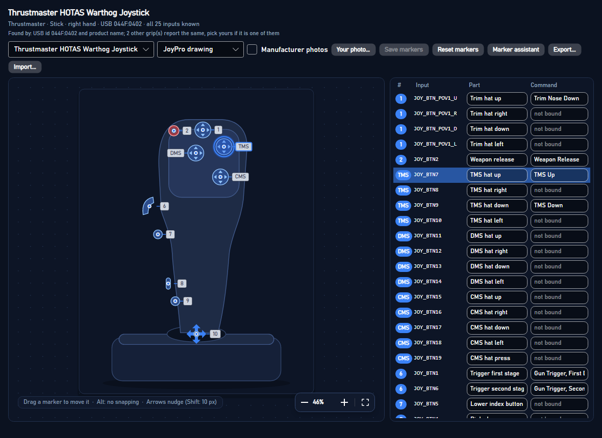
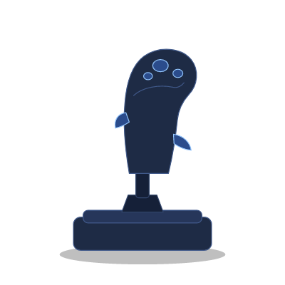
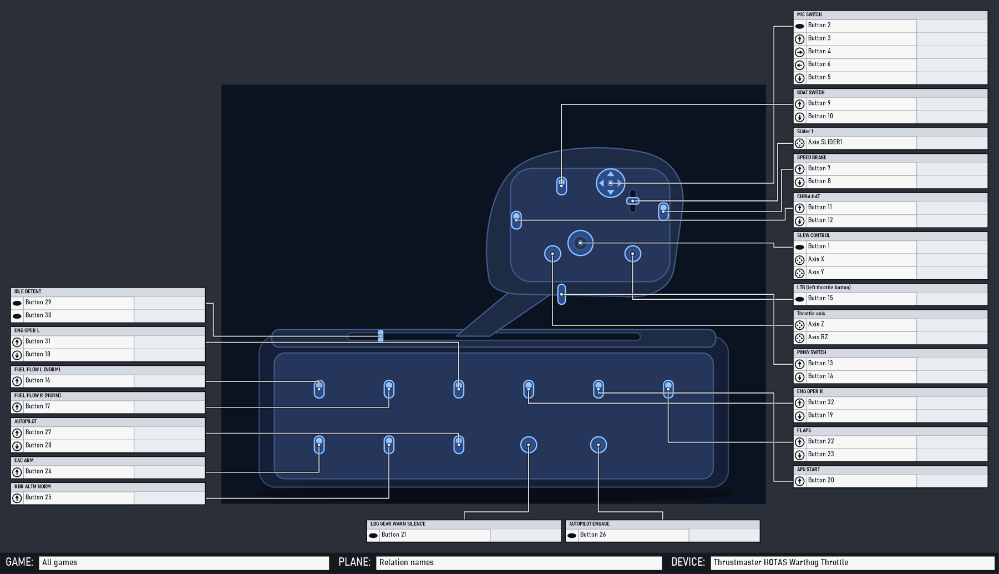

# Device reference pictures

When a device is picked or connected, the Layout page, Bind Studio's "Bind on the picture" and the device cards show
what it looks like, where its buttons, hats and axes are, and what each one does in the profile.



The system has to work for every device on the market and for devices JoyPro never saw. It rests on four rules:

1. **Identify every device**, and ask once when the device itself does not tell.
2. **Show the best picture there is**, and never an empty box.
3. **Put a marker only where the position is known.** A guessed marker is worse than none.
4. **Let coverage grow by sharing positions**, without shipping anyone's photo.

## 1. Identification

`DeviceIdentifier` (shared by the engine and the GUI) looks at the USB VID:PID, the HID product name and the inputs
the device reports. It checks them against the catalog (`DB/Devices`, 340 models).

1. It tries VID:PID first, then the exact product name, then part of the name.
2. **Bases with exchangeable grips** (Virpil WarBRD, WarBRD-D and MongoosT bases, VKB Gunfighter and Gladiator, the
   VPforce Rhino, Thrustmaster's Warthog base). Each grip entry records:
   - its base (`base`) and the other bases it fits (`fitsBases`): the VPC grip connector, the Rhino adapters;
   - its own axes, buttons and hats.
3. `DeviceChoices.Rank` ranks the candidate grips (or models) by likelihood from what the device reports. The ranking
   is tolerant on purpose:
   - Driver software (VPC Configurator, VKBDevCfg, the Rhino configurator) adds buttons through shift layers and
     remaps them. A higher button count still fits, and a multiple of the grip's count fits best.
   - Hats reported as buttons still fit.
   - A missing axis counts against a grip but does not rule it out.
   - The hand in the name ("L-VPC ...") counts strongly against grips for the other hand.
   - The USB id a grip is known to report counts for it. Another USB id counts against it.
4. `DeviceChoices.Question` decides what to ask:
   - **grip**: the base does not say which grip is on it. Virpil names the base ("L-VPC Stick WarBRD"); VKB names the
     grip ("... Modern Combat Pro Twist") and is not asked. The question is "Which grip is on your Virpil VPC WarBRD
     Base?".
   - **model**: one USB id for several products, and nothing else tells them apart.
   - **unknown**: the device is not in the catalog. "Which device is this?" offers a catalog search. If the device is
     not in the catalog, the user picks the kind of device. The kind is guessed from the name and the inputs.
5. **"Which one is it?"** is shown over the picture (the Layout page):
   - the candidates as tiles with their reference photo (or JoyPro's drawing), most likely first, "Most likely" and a
     percentage on each;
   - "Keep the most likely", "Not listed: search the catalog", "Not now".

   The answer is kept per device in `<data>\DeviceReference\grips.json`. It is either a model id or
   `class:<class>`. The device cards, the HUD and the engine (`hud devices --grip`) use it from then on.

The kinds of device (`DeviceClasses`) are: stick, throttle, HOTAS, pedals, panel, button box, keyboard, gamepad, wheel,
yoke, collective, quadrant, MFD, base and virtual.

## 2. Picture sources

Pictures are shown best first. The picture strip over the canvas has one button per picture:

1. **Your layout.**
   - The user's own layout file: a JoyPro 1 `.layout`, a picture he chose, or a layout saved in JoyPro.
   - For JoyPro 1 layouts, the bound commands are drawn as plain text at the user's positions, in the layout's own
     font, size and color, like JoyPro 1's cheat sheets. The boxes and lines are part of his picture.
2. **Your photo.** Pick it with *Your photo...* or drop it on the picture. It is copied to
   `<data>\DeviceReference\Photos`.
3. **JoyPro's own drawing of the model** (`DB/DeviceDrawings`, see [JoyPro's drawings](#joypros-drawings)). It ships
   with JoyPro, so nothing is downloaded and no consent is needed. JoyPro's curated positions and the shipped callout
   sheet of the model apply to it directly. It is painted in the user's drawing style: lines, or cel-shaded (flat
   colours under bold outlines), in JoyPro's colours or the user's own.
4. **The maker's reference photos.**
   - There is one per view: main, front, side, back, top, base, three-quarter, and *button map* (the maker's sheet).
   - They are fetched at run time on the user's PC from an address on the maker's own hosts, and cached in
     `%LOCALAPPDATA%\JoyPro2\DeviceImages`.
   - Only with the user's consent for that device (`DevicePhotoConsent`, docs/privacy.md "Device photos"): JoyPro asks
     once per device model ("JoyPro found the product photo of your ... Download it and show it here?" Yes / No / Always
     for all my devices / Never) on this page and on the Start page's device card. Without a yes nothing is downloaded
     and JoyPro's drawing or the class outline is shown. The switch "Maker's photo of this device" changes the answer
     of the shown device; Settings > Privacy sets Ask / Always / Never for all devices (the old "Manufacturer photos"
     switch, off = Never). `DeviceImageCache` checks the consent before every download and before a cached photo is
     shown, also for the HUD and the Auto Assign pictures. A device card that shows JoyPro's own drawing does not ask;
     the Layout page still offers the photo.
5. **JoyPro's schematic drawing of the model**, but only when it is recognizable. That is the case for devices whose
   parts sit in rows anyway (pedals, panels, MFDs, quadrants, yokes, collectives) and for sticks, bases and throttles
   with up to 14 parts. A grip with 30 parts drawn in rows is not recognizable.
6. **JoyPro's outline of the device class** (`DeviceClasses.Drawing`): a clean drawing of a stick, throttle, HOTAS,
   pedals, panel, button box, keyboard, gamepad, wheel, yoke, collective, quadrant, MFD frame or base, and a ghost
   outline for virtual devices (vJoy). The outline has no markers; the legend lists every input. A model or class
   always has one of these, so the picture is never empty.

The Layout page shows the first of these that it can, and the picture strip offers the others in this order; the
Start page's device cards use the same order.



More: `docs/device-reference/class-*.png`. JoyPro's schematic drawings and class outlines are drawn from the catalog's
data.

## JoyPro's drawings

JoyPro ships its own drawings of the devices in `EngineOnly_Runtime/DB/DeviceDrawings`: one file per model and view,
format `joypro-device-drawing`. A drawing shows the device's outline and the contours of its buttons, hats, switches and
panels as vector paths, plus (optionally) flat colour regions for the cel-shaded style. It contains no picture.

```json
{ "format": "joypro-device-drawing", "version": 1, "model": "vkb-gnx-sem", "view": "top", "key": "3f0c1d2e4a5b6c7d",
  "class": "panel", "title": "JoyPro drawing", "width": 1200, "height": 900, "outlineWidth": 3.6, "detailWidth": 2.5,
  "paths": [ { "role": "outline", "d": "M120,80Q140,60 ...Z" }, { "role": "detail", "d": "M..." } ],
  "fills": [ { "color": "#444444", "rule": "evenodd", "d": "M...Z" } ] }
```

- `paths`: absolute `M L Q C Z` only. Three stroke weights: `outline` is the silhouette (bolder), `detail` a control
  or panel contour, `minor` a fine line (seams, screw heads; drawn at 0.65 of the detail width).
- `fills` (optional): the cel-shaded style's flat colours from a small fixed palette, drawn under the paths.
- `key`: names the curated position set (`DB/DeviceLayouts`) the drawing belongs to: `DeviceLineArt.OpaqueKey` of that
  set's photo hash. The drawing has the same width and height as that set's picture, so the set's positions (0..1) and
  its shipped callout sheet apply 1:1.
- Cockpit grips: `DB/Cockpits/line-drawings`, with `aircraft` and `device` instead of `model` and an optional `parts`
  object (part id → [x, y], 0..1) for the Cockpits page's tables.

### How the drawings are made

Nothing is traced from a photo any more where a better source exists. Three ways, best first:

1. **The game's own grip** for devices that replicate a real aircraft's grip (Thrustmaster Warthog = A-10C, the F-16C
   and F/A-18C grips): `engine devices reference mesh-render --aircraft <plane> --grip stick|throttle --view <yaw>,<pitch>
   --folder <dir> [--skip <regex>]` renders the grip of the game's cockpit model (DCS World, read like the cockpit
   pictures: plain files only, nothing written) without textures, with the part of every pixel and the model's named
   parts (`STICK-BTN-TMS` ...). `python tools/device_drawings.py mesh <dir> <part name> [--crop ...] [--components n]`
   makes a drawing part of it: the silhouette, the outline of every separate piece, flat colour regions, and the named
   parts (or, for a model without names, every separate piece as `c01`, `c02` ... with a labeled preview) as keys. The
   device's spec maps the keys to its parts by the maker's button map and adds what the device has and the aircraft
   has not (its base, a paddle, extra buttons). The source line credits the game.
2. **A vector spec** (`tools/device_drawings/<model>.<view>.json`, `python tools/device_drawings.py build <model>`):
   the silhouette and body parts as smooth paths, every control as a glyph of the shared library (button, hat 4/8-way
   with its direction arrows and press, mini-stick, toggle, rocker, wheel, encoder, knob, slider, lever, gimbal, twist,
   pedal: `device_drawings.py glyphs` shows them) at its spot, positions from the maker's button map. Shared parts
   (`tools/device_drawings/parts`, e.g. the Virpil MT-50 handle) are included and mapped per model. A drawing in its own
   frame gets a position set `DB/DeviceLayouts/<model>.drawing-<view>.json` with photo kind `lineart` and the drawing's
   key; the engine arranges its callout sheet. A group can also carry `photoSet`: its parts are then written into that
   maker's photo set too.
3. **A template drawing** for the rest (`python tools/device_drawings.py auto <model> ...`): the traced drawing's
   silhouette smoothed into one clean outline, the big inner contours kept, every curated part drawn as the glyph of its
   type at its curated spot (no traced inner lines, screw heads or texture). It keeps the traced drawing's frame and key.

4. **Composed views** (`python tools/device_drawings.py compose <model> [--views main,side,main~] [--grid <folder>]`):
   several curated photo views of the model side by side, each as its template drawing (`parts/<model>-<view>.json`),
   `<view>~` a mirrored copy of a view's outline for the far side, and the controls no photo shows placed by hand
   from the maker's button map. The recipe is the spec's `compose` block (`views`, `place`: part, view, `uv` 0..1 of
   that view, optional glyph and size; `notPhysical`, `unplaced`, `mappingSource`); `--grid` writes a preview with a
   0..1 grid per view for placing by eye. The result is the model's drawing `main` with its own position set, like a
   vector spec.

A spec's own control can be placed in 3D too: `"anchor3d": <index of the game-model include>` places it through that
include's view (a button the replica adds to the aircraft's grip).

A single-photo-to-3D model (TripoSR, tested on the VKB MCG Pro) melts the controls into blobs: not used.

### 3D view

Devices with a 3D model (a game's grip model, or a downloadable CAD / 3D file of the device) get a rotatable view:
**3D view** on the Layout page's toolbar and on the Bind page's picture (shown only for such devices). Drag turns it
(sideways around the vertical, up and down between the pitches), the wheel zooms, a double click (or Home) resets it,
the arrow keys step. Every part of the device sits at its spot on every frame (a part facing away is a hollow dashed
ring), the picked part is ringed and its bound command shown, held inputs light up, a click picks the part (the same
selection as the flat picture), a relation dropped on a part is bound there. The 3D view is the default where a device
has one; the toggle switches to the flat drawing, which is what the cheat sheets print and what Edit mode works on.

**Not shipped, downloaded per device.** The 3D views are release assets, not part of JoyPro's package:

- Release `device-3d-v1` (published with `--latest=false`): one zip per device model (`<model>.zip`: `turntable.json`,
  `frames/*.png`, `CREDITS.txt` with the model's source and licence) and `manifest.json` (`joypro-device-3d-packs`,
  `packVersion` 1; per pack `model`, `asset`, `size`, `sha256`, `version`, `built`, `source`).
- When the device cards find a connected device whose model has a pack, JoyPro follows Settings > Privacy *Pictures
  from JoyPro's releases (cockpits, 3D device views)* (the setting of the cockpit picture packs): **Ask** shows "A 3D
  view of ... is available (x MB). Download it?" on the Layout page and the Start page (*Download*, *Not now* for this
  session, *Always download*, *Never*); **Always** downloads it at once; **Never** does not look.
- The zip is checked against the manifest's SHA-256 and holds only `turntable.json`, `CREDITS.txt` and PNGs in
  `frames/`; it is unpacked to a temporary folder and moved to `<data>\DeviceReference\Turntables\<model>` (`pack.json`
  keeps the version; a newer version in the manifest replaces it).
- Offline, without a pack or with *Never*: the flat drawing (nothing else changes).
- Code: `Services/DeviceTurntablePacks.cs`, `MainWindowViewModel.Device3D.cs`; `JOYPRO_DEVICE_3D_FEED` points JoyPro at
  another feed (a folder or address; tests, checking packs before they are published).
- Build: `powershell -File tools\build_device_3d_packs.ps1 [-Source <turntables>] [-Out <folder>] [-Model <id>,...]`
  (defaults: `JOYPRO_DEVICE_3D_DIR`, `<JOYPRO_RELEASE_DIR>\device-3d`; both outside the repository). An unchanged model
  keeps its zip and version, a changed one gets the next version. The script uploads nothing.

- Made by `python tools/device_drawings.py turntable <model> [--steps 24] [--pitches 5,25,45] [--size 420] [--out
  <folder>]` (default folder `JOYPRO_DEVICE_3D_DIR`, outside the repository): it calls
  `engine devices reference mesh-render ... --turntable <steps> --pitches ... --keep-top <f> --anchors <files>`, which
  renders the grip without textures in a cel style (flat colours in two tones, light outlines between the model's
  parts, transparent background) from every direction, places the drawing's points in 3D through the depth of the view
  they were picked on, and records where each lands per frame and whether it faces the camera. The spec's
  `turntableKeepTop` frames the upper part of a long stick.
- From a 3D model file instead (.glb / .gltf / .stl / .obj, e.g. a maker's AR model or a community scan): a recipe
  `tools/device_drawings/mesh/<model>.json` (the file name and where it came from, which meshes belong to the device,
  the front view's yaw, `source` and `licence` for the pack's CREDITS.txt, and the parts picked on a few views) and the
  file itself in `<JOYPRO_DEVICE_3D_DIR>\.models\` (never in the repository). `turntable <recipe> --views <folder>`
  draws the pick views with a pixel grid; `turntable <recipe>` renders the same cel-shaded frames in Python
  (`tools/device_mesh_turntable.py`, needs numpy and trimesh).
- `<model>/turntable.json` (`frames`: pitch, yaw, file, `points` part -> [x, y, seen]; `source`, optional `licence`)
  and `frames/*.png` (24 x 3 frames, about 1.5 MB per device), credited on the view ("Rendered from DCS World's A-10C
  cockpit model").
- Code: `Services/DeviceTurntable.cs`, `Views/Controls/TurntableView.cs`, `MainWindowViewModel.WorkspaceTurntable`.
- Devices with a 3D view (2026-10-18, 14 packs): Thrustmaster Warthog stick and MKII stick, Warthog throttle (the
  grips), the F-16C Viper and F/A-18C Hornet grips (Warthog/AVA bases and the VPforce Rhino), the WinWing NavyAce and
  CarrierAce F/A-18 grips, the VKB Gunfighter F-14 grip and the Warthog grip on the Gunfighter, the Logitech X56 stick
  (Logitech's own 3D model).

### Complete devices

`engine devices reference completeness [query] [--missing] [--list <file>]`: per model whether the best shipped
picture (JoyPro's drawing first) places every part with an input: every button, each hat with its directions and press,
every axis, mini-stick, slider, encoder, toe brake. A part a set lists as `not physical: ...` (VKB / Virpil logical
buttons, a lever position such as the Warthog's idle detent) counts as done. `DeviceCompletenessTests` keeps the drawn
devices complete input by input. Numbers on 2026-10-18: 132 of 310 models with inputs complete (120 after the first batch) (107 before the first
batch of composed views).

### Correcting JoyPro

When JoyPro forgot an input or put it on the wrong spot, the user fixes it on the Layout page and can send the fix:

- A card over the picture says how many inputs have no place ("3 inputs have no place on the picture: press them on
  your device to place them") with **Place them** (the marker assistant, waiting for the first press).
- The marker assistant has **Add control**: the kind (button, 2/3-way switch, hat 4-way, hat 4-way + press, hat 8-way,
  mini-stick + press, encoder, axis / slider, wheel) and an optional name; it asks for each input in turn (each hat
  direction, then the press; a mini-stick's axes by moving them), then for the spot. **Remove from picture** takes a
  wrongly placed part off. Moving (drag), renaming (the legend) work as before.
- Everything is kept locally as the user's layer over JoyPro's data: positions per picture
  (`<data>\DeviceReference\Layouts`, parts taken off as `removed by the user`), new or changed controls as the user's
  definition of the model (`<data>\Devices`), used by the Layout page, Visual Assign, the cheat sheets and the HUD.
- **Send correction to JoyPro...** writes `<data>\DeviceReference\Corrections\<model>-<time>.json`
  (`joypro-device-correction`: model, VID:PID, the picture's kind and key, the changed positions, removed parts, added or
  changed controls; nothing personal) and opens the prefilled GitHub issue form "Device layout correction"
  (`.github/ISSUE_TEMPLATE/device-layout-correction.yml`) in the browser; the user decides there. A correction too long
  for the address is attached by hand.
- The maintainer: `python tools/device_corrections.py show|merge <file> [--controls]` (into the drawing's spec
  `positions` / `unplaced`, or the photo's curated set; controls into the catalog with `--controls`).

### Drawing style

How the drawings are painted is the user's choice, the same in every renderer (the Layout page, the callout sheets, the
device cards, the Cockpits page, the engine's cheat sheets and exports): `DrawingStyle` (`engine/DeviceReference`).

| | |
|---|---|
| Style | **Lines** (the outline and the contours) or **Cel-shaded** (flat colours under bold outlines; default on screen) |
| Colours | **JoyPro** (the theme's: light lines on JoyPro's dark surface with the accent blue for leaders, dark lines on the light surface), **Manual** (white lines on near-black, light grey leaders), **Blueprint** (light lines on blue), **Print** (black on white), **Custom** |
| Own colours | line colour, page colour, leader/label colour (`#RRGGBB`; empty = the preset's) |

- Settings > Drawings has two editors: the screen (Layout page, device cards) and *Cheat sheets and exports* (empty =
  the screen's). The Layout page has *Lines | Cel-shaded* next to the picture; the cheat sheet export options have the
  export editor.
- Kept in `<data>\DeviceReference\settings.json` (`DrawingStyle`, `ExportDrawingStyle`, a spec like
  `mode=cel;preset=manual;ink=#F2F2F2`). The engine reads them there and takes `--drawing-style lines|cel|<spec>`,
  `--drawing-preset joypro|manual|blueprint|print|custom`, `--drawing-ink`, `--drawing-paper`, `--drawing-accent`
  (`layout render`, `layout callouts`, `setup render`, `devices reference drawings`); the GUI passes its export style.
- On JoyPro's drawings the leader lines of the tables take the style's leader colour.
- A drawing without colour regions is painted in the line style also when cel-shaded is chosen.

### Callout sheets and exports

`engine layout callouts --model <id>` uses JoyPro's drawing of the model with its curated positions and shipped sheet
when there is one (`--schematic`: the schematic drawing). The cheat sheets and the setup wizard's sheets do the same. A
sheet saved on the Layout page on JoyPro's drawing keeps `"photo": { "kind": "lineart", ... }`; the engine draws the
drawing itself (no local picture copy).

### CLI

- `engine devices reference drawings [query]`: the drawings with their positions (`positions 12/12` = all curated
  positions on the drawing's silhouette).
- `engine devices reference drawings --check`: every drawing names a catalog model, has plain path data and no
  address or picture, and the curated positions lie on its silhouette.
- `engine devices reference drawings --model <id> [--view <view>] --svg <file> | --png <file> [--light]
  [--drawing-style ...]`: one drawing in a style.

## 3. Markers only at known positions

A marker is drawn where its position is known by construction:

- **JoyPro's drawing**: the drawing draws each part at its marker.
- **A curated position set** for exactly one photo: `DB/DeviceLayouts/*.json`, keyed by the photo's SHA-256.
  - If the maker changes the photo, the content hash no longer matches. The positions are not used, and the status
    bar says "The maker changed this photo".
- **The user's positions**: placed with the marker assistant or by dragging, kept per photo content in
  `<data>\DeviceReference\Layouts\<model>.<hash>.json`.

A photo without positions shows no marker. The legend lists every input and says where each part is shown ("On:
Front, drawing", or "not placed yet"). A card over the picture offers the **marker assistant**:

1. Press a button or hat direction on the device (presses on other devices are ignored), or move an axis.
2. Click the part's spot on the picture.
3. *Skip*, *Undo* and *Stop* work at any step. *Finish* saves the positions.

With the assistant, an unknown device also gets a device definition (`<data>\Devices\<id>.json`, see below).

### The look of the markers

The markers look like JoyPro 1's pictures:

- a small dot on the part;
- next to it a compact label with the bound command, joined by a thin leader line.

Labels are placed so that none covers another label or another part: right of the part, else left, above, below, then
further out. Where no label fits, only the part's number is drawn; the legend and the tooltip have the text. Unbound
parts get a small tag with their short name.

## Tables and lines (callout sheets)

A reference picture with known positions is shown like JoyPro 1's cheat sheets: a table per control group around the
picture, thin orthogonal lines from each part's spot to its table, the bound command in each row and the modifier bind
in a second column. The same sheet is what the cheat sheets print.



More: `device-reference/callouts-warthog-stick-dark.png`, `callouts-takeoff-panel-light.png` (JoyPro's drawings,
`engine layout callouts --sample`), and the Layout page in `ui/layout-tables-*.png`.

### What is automatic

`CalloutLayouter` (`engine/DeviceReference/CalloutLayout.cs`, shared by the engine and the GUI, no LLM) does:

1. **Groups.** One table per part of JoyPro's model:
   - a hat or 4-way: press, up, right, left, down (JoyPro 1's order), then the diagonals, with arrow icons;
   - a switch: its positions; an encoder: its turns and press; an axis: a row with the axis icon;
   - a button: one row;
   - **key grids** (`engine/DeviceReference/CalloutGrids.cs`): keys, buttons, switches or encoders of one kind that sit
     together like a keypad get ONE table laid out like the keys (grid rows and columns as on the device; a switch's up
     and down are two lines of its cell) and ONE line to the cluster's centre. Names do not matter (A, CLR, DEP ARR as
     well as B1-B8). Found by:
     - parts on (nearly) one spot, within 1.5 % of the picture's diagonal, count as one site (a toggle's positions
       placed as buttons of their own);
     - single linkage at 1.55 times the kind's typical site spacing (the median distance to the nearest site); no
       grids when that spacing is above 7 % of the diagonal (a grip's buttons around it);
     - a cluster of four or more: the two main directions of the neighbour links (a keypad photographed at an angle is
       a slanted grid), rows and columns where the keys' coordinates along them jump by half a pitch. Two keys in one
       cell, or a sparse grid of eight keys or more: columns by the order within each row. A sparse small cluster is no
       keypad. Gaps of two pitches split a cluster into blocks, then the widest gaps until each block has at most 6
       columns and 8 rows (an MCDU's line select keys, function keys and letters become a few tables);
   - **parts on one spot** (a knob's push, pull, turn and axis; at most four within 1.5 % of the diagonal) share one
     table and one line;
   - **Split into single tables** (Edit mode) turns a grid or a shared table back into one table per part; the sheet
     keeps that (`"ungrouped"`) until **Group again** or **Reset**.
2. **Sides.** Each table with a known spot goes to the nearest margin. Left and right are preferred: a column reads
   better and its lines do not cross. Then the sides are balanced:
   - a column takes about the picture's height, a band (top or bottom) the picture's width in one row;
   - an overfull side hands over the table that costs least to move (a band always gives way, a column only while the
     other column stays shorter);
   - a column grows when every side is full (the canvas grows with it).
3. **Stacking.** A side's tables are sorted by their spot along the side and packed without overlap so that each
   table's first row is as close as possible to its spot's height: overlapping neighbours merge into a cluster placed at
   the mean of their wishes (least squared displacement, order kept). Pinned tables of the column stay where they
   are; a table that would overlap one goes below it.
4. **Lines.**
   - Spot → lane → along the lane → table edge. The lanes lie in the gutter between the picture and the tables. Lines
     whose table lies above the spot get their lanes from the top spot on, the others from the bottom spot on; a line
     gets the lane after the highest lane of the earlier lines whose run overlaps its own. With the order kept by the
     stacking, the lines of one side never cross each other or a table.
   - Spots in one row (the same height within half a row) would share a track: they get L-shaped lines straight to
     their table's row instead, nested so that they do not cross. Where such a line would run through another part, or
     the table row is beside the picture's top or bottom band, the line takes a lane and steps off the row's track
     (farther spots farther).
5. **Canvas.** The gutters are sized from the lanes, the columns from the widest table; the picture sits in the
   middle; the canvas grows to hold everything. Tables of parts without a known position go into **Other controls**
   below, without a line.

Look: the row height follows the picture (2.4 % of its longest side, 20 to 56 px), the main text column 8.5 rows wide,
the modifier column 5.5.

Numbers on JoyPro's drawings of the whole catalog (`engine layout callouts --check-all`, 296 models with inputs, 2875
tables): no overlap, no slanted line, nothing outside, every positioned part linked; 761 crossings in all, 7 shared
tracks. Before key grids and shared tables (247 models): 3646 tables, 1656 crossings.

### What you can edit (Layout page, Edit mode)

- Drag a table: it is **pinned** there (Auto arrange keeps it, moved with the picture). Its right edge resizes it.
- **Row + / Row −**: zone rows on an axis (0-20 %, 20-40 % ...), or hide and show rows of other tables.
- **Modifier column** on or off per table (all its modifier columns); **Modifier columns show** and **Columns per table
  at most**: see Modifier combinations below.
- Drag a line's segment sideways to bend it (it stays orthogonal), **Re-route line**, **Remove line** (Del), and drag
  the round handle of a table to a spot on the picture to add its line. A part without a position gets that spot (as
  with the marker assistant), and its table leaves Other controls. Dragging a spot moves the part.
- Snap to the grid (10 px; the grid button shows it), **Undo / Redo** (Ctrl+Z / Ctrl+Y), **Auto arrange** (keeps pinned
  tables), **Reset** (JoyPro's arrangement again).
- **Save** keeps the sheet. Without edits the arranged sheet is kept at once, so the cheat sheets have it.

### Binding on the rows

- Drop a relation from **Drag a relation onto a row** (side panel) on a cell: it is bound to that input of the device
  with exactly the modifiers of the cell's column (`binds set --clear-modifiers --modifier A --modifier B`).
- Right-click a row: **Change...** (Bind mode on that input) or **Clear**.
- The preview box on the toolbar: **Relation names**, or one game and aircraft: the rows show that game's own menu
  titles for the aircraft (`engine layout titles`), with a GAME / PLANE band.

### Modifier combinations

JoyPro's modifiers ("reformers") multiply what an input can do: with n modifiers an input has 2^n meanings (none, mod
1, mod 2, mod 1 + 2 ...). A list table therefore has the main column (no modifier) and one column per modifier
combination, headed with the combination ("Shift A", "Shift A + Shift B"); each cell shows the relation bound to the
input under exactly those modifiers (a bind with Shift A + Shift B is not shown under Shift A).

- **Modifier columns show**: *(combinations in use)* (default: the combinations the device's binds use; the most used
  first when they do not all fit), *(all combinations)* (every combination of the profile's modifiers: 1, 2, 3
  modifiers = 2, 4, 8 columns), or one picked combination alone (the old "Modifier column shows").
- **Columns per table at most** (unmodified column included, default 8 = 3 modifiers).
- With several columns each one is narrower (0.85 / 0.72 / 0.62 of the modifier width for 2 / 3-4 / 5+); a changed set
  of combinations widens the tables and arranges the sheet again (pinned tables stay).
- A profile without modifier binds keeps the single modifier column of before. Key grids show the unmodified binds.
- Code: `CalloutCombos` (engine/DeviceReference/CalloutLayout.cs: Split / Key / Label / AllOf / Choose),
  `CalloutSheet.Combos`, `ComboMode`, `MaxColumns` (saved as `combos`, `comboMode`, `maxColumns`), `ComboOfColumn`.
  The cheat sheets (`engine layout render`, `layout callouts`) render the saved columns with the same text per column.

### Storage and sharing

- `<data>\DeviceReference\Callouts\<model>.<picture>.json`: a `joypro-device-layout` with the positions and a
  `"callouts"` object, plus `photo.local`, a PNG copy of the photo the engine can read (only in this file).
  `devices.json` there maps each device to the sheet of the picture last shown for it.
- **Share layout...** writes the positions and the tables and lines (never `photo.local`, never a maker's photo);
  **Import layout...** takes both over.

```json
"callouts": { "version": 1, "width": 2056, "height": 1656, "picture": [514, 203, 1000, 1300],
  "rowHeight": 31, "mainWidth": 264, "modWidth": 171, "modifier": "", "otherY": -1,
  "tables": [ { "id": "stick.hat.cms", "title": "CMS hat", "parts": ["stick.hat.cms"], "side": "right",
                "x": 1524, "y": 545, "width": 465, "modifier": true, "spot": [0.585, 0.282],
                "rows": [ { "input": "JOY_BTN19", "label": "Press", "icon": "button" } ] } ],
  "lines": [ { "table": "stick.hat.cms", "points": [[1099, 568], [1505, 568], [1505, 580], [1524, 580]] } ] }
```

Table fields beyond these: `grid` and `columns` (a key grid; its rows carry `"cell": [row, column, line]`), `zones`,
`pinned`, `resized`, `noLine`, `hidden` (rows by input). Sheet field `ungrouped`: parts split out of their grid.
Line field: `manual` (bent by the user).

### JoyPro 1 layouts

Their positions are text spots in the user's own drawn tables: they are shown and printed as they are (the tables are
part of the picture). Generated tables are the default for every other picture with known positions; **Tables** on
the toolbar switches to the markers with labels.

### Cheat sheets and the CLI

- The cheat sheets use, per device: the user's own layout (JoyPro 1, his picture), else the device's callout sheet,
  else what the engine makes. The sheet on screen is saved before the export.
- `engine layout render --layout-map <device>=<callouts .json>` draws the sheet like JoyPro 1: the picture, the tables
  with the game's menu titles (per aircraft) or the relation names (overview), the modifier column, the GAME / PLANE /
  DEVICE band. `--style dark|light` (JoyPro 1's grey page or a white one), `--print-width <px>` (3508 = A4 landscape at
  300 dpi, the default; 0 = the sheet's size), `--combine true` (one page with all devices per aircraft,
  `All devices.png`).
- `engine layout callouts --model <id> | --layout <file>` arranges (or reads) a sheet, checks it and prints the tables;
  `--png` draws it (the same picture as `layout render`), `--save` writes the shareable file, `--sample` fills the rows
  with the input names, `--check-all [query]` checks every catalog model.
- `engine layout titles --device <name>`: the menu titles of the device's binds per game and aircraft.

## 4. Sharing, the photo database and the tools

### The layout format

A `joypro-device-layout` file holds the marker positions of one picture of one model:

```json
{ "format": "joypro-device-layout", "version": 1, "model": "winwing-f18-takeoff-panel",
  "photo": { "kind": "vendor", "url": "https://eu.winctrl.com/static/ipfs/...", "sha256": "0e6b61...", "view": "main" },
  "markers": { "panel.toggle.3": [0.353, 0.358], "panel.button.1": [0.478, 0.431] },
  "source": "...", "confidence": "medium", "note": "..." }
```

- `kind`: `vendor` (a maker's photo), `user` (the user's own photo), or `drawing` (JoyPro's drawing).
- JoyPro's curated sets add more (all optional, see [Curating positions](#curating-positions)):
  - `parts`: every part of the model with its `type`, its `inputs` (the catalog's group: a hat with its directions, a
    switch with its positions, an axis), `mapping` (how certain the input numbers are) and, when placed, `confidence`
    (how certain the position is);
  - `unplaced`: the parts not placed on this photo, each with the reason;
  - `candidates`: likely positions that are not certain enough to be shown;
  - `mappingSource`: where the input numbers come from.
- A maker's photo is shared by its address only.
- `photo.file` (base64) is written only for the user's own photo.
- **Share layout...** writes the shown picture's positions in this format. **Import layout...** reads one.
- The same files in `DB/DeviceLayouts` are JoyPro's curated sets. A community repository can collect such files the
  same way.

### Photo references

`DB/DevicePhotos/<vendor>.json` holds the reference photos of each model, next to the catalog's own `image`:

```json
{ "photos": [ { "model": "vkb-gunfighter-mcg-pro", "url": "https://vkbsimcontrollers.com/cdn/shop/files/...webp",
                "view": "left", "page": "https://vkbsimcontrollers.com/products/...", "sha256": "",
                "confidence": "high", "shows": ["stick.trigger"] } ] }
```

- `view`: `main`, `front`, `side`, `left`, `right`, `back`, `top`, `base`, `three-quarter` or `sheet`. Shop galleries
  whose views nobody tagged yet are `gallery-<n>`.
- `sha256`: the content hash after the first fetch. It is needed for curated positions.
- `shows`: the parts the view shows (optional).
- `confidence`: `high`, `medium` or `low`.
- Only addresses on the vendor's `officialHosts` are used. A grip on the Rhino may use its maker's hosts (listed in
  `vpforce.json`).

### Tools

- `tools\add_device_photos.ps1 -Model <id> -Url <photo> -View <view>`: adds one photo reference.
  - With `-ProductUrl <shop page>` instead, it adds every photo of a Shopify product gallery.
  - It calls `engine devices reference photo-add`, which refuses addresses that are not on an official host.
- `tools\backup_device_photos.ps1 -Target <private folder>`: the maintainer's private backup of every referenced photo.
  - It writes a manifest with model, view, address, source page, date, SHA-256 and size.
  - The folder must be outside the repository. Neither the build nor the release reads it.
- `engine devices reference photos [query] [--coverage]`: the photo references and the coverage numbers.
- `engine devices reference layout-check`: checks the curated sets. Each set must name a catalog model, one of its
  photos, the photo's hash, and only parts the model has.
- The marker assistant places positions on a new photo; *Share layout...* turns them into a file for
  `DB/DeviceLayouts`.
- `tools\device_positions.py`: curating positions on the makers' photos, see below.

### Curating positions

There are only a few hundred devices on the market. JoyPro places their controls on the makers' photos once and ships
the positions (`DB/DeviceLayouts`). The auto function and the marker assistant stay for everything else.

The tool is `tools\device_positions.py` (Python 3 with Pillow). It reads the photos from the private backup
(`tools\backup_device_photos.ps1`, found next to the repository or with `--photos` / `JOYPRO_PHOTO_BACKUP`). Its
pictures go to an output folder outside the repository (`--out` or `JOYPRO_CURATE_OUT`). Only positions go into the
repository, never a photo.

| Command | |
|---|---|
| `info <model>` | the model's parts (id, type, inputs) and its photos (view, size, hash, curated or not) |
| `grid <model> <view> [--crop x0 y0 x1 y1]` | the photo with a labeled 0..1 grid; a crop zooms in with a finer grid |
| `draft <model> <view>` | a draft file listing every part; for a curated photo, the set as a draft |
| `render <draft.txt>` or `render <model> <view>` | the photo with the numbered markers and a legend |
| `build <draft.txt> ...` | writes `DB/DeviceLayouts/<model>.<view>.json` and records the photo hash in `DB/DevicePhotos` |
| `check` | every set: photo referenced with the same hash, in the backup, parts and inputs of the catalog |
| `status [query]` | per model: photos and how many parts are placed |
| `sheet [query] [--no-png]` | arranges each set's callout sheet (tables and lines) with the engine, stores it in the set, rates it good / fair / poor and renders it for a look |
| `pin <model> <view> <table> <x> <y>` | keeps a table of a set's sheet where it is put by hand; `sheet` arranges the rest around it |

The draft has one line per part:

```text
# model: thrustmaster-t16000m
# view: main
# source: JoyPro curated on the maker's photo (2026-10-11), seen from the left
# mapping: Thrustmaster T.16000M user manual fig. 3 (right-handed mode)
# mapping-confidence: high
stick.hat.tms 0.465 0.060 high                          placed, position confidence high or medium
stick.base.button.1 0.275 0.790 medium map=low | ...    spot known, number not: a hidden candidate
stick.trigger 0.300 0.410 low | ...                     spot not certain: a hidden candidate
stick.button.thumb.3 - | on the right flank, hidden     not on this photo, with the reason
```

The procedure per photo (batches of devices work the same way; the batch brief for helpers is the same text):

1. `info`: pick the photo that shows the most controls. Add a second view when it shows many controls the first hides.
   A shop photo tagged `gallery-<n>` gets its real view with `# retag:`.
2. `grid`, then `grid --crop` on the head, the base and every small control.
3. Map each control to its part. The vendor's documentation decides: the manual's numbered figure, the support
   article's button map, the printed labels. Cite it in `# mapping:`. Where the vendor contradicts the catalog, fix the
   catalog separately; the draft never guesses.
4. Confidence:
   - position *high*: unmistakable on the photo; *medium*: clearly that control, but small or partly hidden, or the
     spot of an axis (the gimbal at the boot, the twist on the handle, a lever on its handle); *low*: not certain;
   - mapping *high*: the vendor documents it; *medium*: a consistent community map or a configuration read from a real
     device; *low*: guessed.
   - Only parts with position and mapping at least *medium* are shown. The rest stay hidden as candidates, so a later
     check (the marker assistant, a real device) can confirm them.
5. `render` the draft and look at it: every numbered marker on its control, the legend right. Fix and render again.
6. `build` (a draft that places nothing writes no set), `sheet`, `check`, and
   `dotnet test gui/JoyPro.Gui.Tests --filter CuratedDeviceLayoutsTests`.

`CuratedDeviceLayoutsTests` and `engine devices reference layout-check` check every set: a referenced photo with its
hash on record, only parts of the model, the catalog's inputs per part, nothing shown that is uncertain, a clean sheet.

**The shipped sheets.** Every curated photo carries JoyPro's callout sheet in its set (`"callouts"`). It is
`CalloutLayouter`'s arrangement for that photo's size, plus tables pinned by hand where the automatic one is poor. The
user edits it as his own copy (`<data>\DeviceReference\Callouts`). The rating of `sheet`: *good* = no overlap, every
part linked, at most 4 crossings; *fair* = up to 12 crossings or a shared track; *poor* = more. Since key grids, dense
keypads (MCDU, PFP, ICP, PDC, PAP) are a few grid tables, and none is poor. The Layout page shows a shipped sheet made on
the full-size photo scaled to the photo as it is shown (same aspect), with its pins.

### Growing the catalog

`tools\device_catalog.py` takes drafts from research batches (one per vendor) into the catalog:

| Command | |
|---|---|
| `ids [query]` | the catalog's models (id, file, kind, name, USB ids, photo yes/no) |
| `check <draft.json> ...` | ids, vocabulary, inputs, official hosts, base references; a trial catalog through the engine (drawing and callout sheet of every new model) |
| `merge <draft.json> ...` | appends the devices to `DB/Devices/<file>` without reformatting it |
| `photos <photos.json> ...` | adds photo references (`engine devices reference photo-add`: official hosts only; a photo whose hash is on record keeps its entry) |
| `fix <fixes.json> ...` | changes names and labels of existing entries, each with a source |

A catalog draft is the vendor-file format with `"file"` (the vendor file it goes into) and only the new devices. The
research rules (sources, confidence, no guessed numbers, one entry per USB device, photos only from the maker's own
hosts) are in the batch brief, the same as for positions. After new photo references, `tools\backup_device_photos.ps1`
fetches them into the private backup; then their positions can be curated.

### Coverage (2026-10-12)

| | |
|---|---|
| Models in the catalog | 476 (95 grips; 232 with a USB id), from 26 vendor files incl. discontinued lines (Saitek, CH, Thrustmaster Top Gun, VKB Gladiator/Mamba, Virpil MongoosT-50, Logitech WingMan) |
| Photo references | 1694 addresses on the makers' own hosts, with views |
| Models with a reference photo | 383 (311 with several views) |
| Models with a photo hash on record | 368 |
| Models with curated positions | 290 (325 position sets, 3651 positions; 28 sets moved onto cleaner photos of the same model) |
| Callout sheets shipped | 325: 320 good, 5 fair, 0 poor (with key grids and shared tables; before: 256 / 26 / 15). Fair: Thrustmaster Cougar MFD (7 crossings), VKB STECS STG Max (5), three grips with one shared track |
| JoyPro drawing shown | 364 models show JoyPro's own drawing; of the rest, the recognizable schematic or the class outline when there is no photo |
| JoyPro's own drawings (`DB/DeviceDrawings`) | 467 drawings of 364 models; 279 carry the curated positions and shipped sheet of their photo (of 325 sets), the others are further views; 360 with the cel-shaded colours (the others are painted in the line style). Real aircraft grips (`DB/Cockpits/line-drawings`): 13 |

Models with a photo but no curated set: their catalog entry has no parts yet (WinWing MIPs, MOZA AMPCD/MGX1000,
placeholder lists), or every part is still uncertain (kept as candidates in the drafts). Models without a photo are
mostly discontinued products whose maker no longer shows them.

## Your old JoyPro layouts

**Use my old JoyPro layouts...** on the Layout page takes the user's JoyPro 1 layouts over:

1. When the page opens, JoyPro looks for JoyPro 1 folders, without a fixed path:
   - next to its own folder, walking up from it;
   - in Documents, Desktop, Downloads, the program folders and the drive roots;
   - in folders named `JoyPro*` or `JoystickProfiler*` that have a `LayoutImages` folder with `.layout` files.
2. It copies the layouts once into `<data>\Layouts\JoyPro1`. The old folder is only read.
3. The button picks another folder.
4. The engine finds the layouts there (`layout suggest`, `hud devices`).
5. A layout matches a device by the device name stored in it. The GUID is dropped (it differs on another PC).
   - `LEFT VPC ...` and `L-VPC ...` count as the same name; another hand does not.
   - The newest of several layouts of a device wins.
6. Binds of a profile made on another PC match by device name too.

These layouts are the user's own files and are never shipped.

## Device cards (Start page, Settings > Devices)

The cards use the same result as the Layout page:

- the same identification: the user's answer first;
- a base without a known grip shows the base with "Which grip?";
- the same picture order: your layout, your photo, JoyPro's own drawing of the model (in the drawing style of Settings >
  Drawings), the maker's photo (after your yes), JoyPro's schematic drawing when it is recognizable, else the class
  outline;
- vJoy gets the virtual outline;
- a keyboard with a gamepad mode (Wooting) gets a card for its gamepad interface, with its photo. Its other interfaces
  are one line "Also connected".

The Layout page's device list also shows one entry per physical device.

### Device icon

The Layout page's picture label has an "Icon: ..." button: it offers every picture of the shown device as its icon
(your photo, the maker's photos, JoyPro's line drawing as line art, cel-shaded and two-colour, JoyPro's drawing, the
layout's picture) plus "Your own picture..." (any picture file) and "Automatic". The chosen picture is cut out of its
plain background, cropped square around the device (256 px PNG in `<data>\DeviceReference\Icons`, the choice in
`icons.json`, by device name without its GUID). The device cards (Start page, Settings > Devices, the Binds page's
detail), the bind list's device chips and the HUD designer's widget list show it; without a choice they show what the
order above picks. Code: `Services/DeviceIconService.cs`, `MainWindowViewModel.DeviceIcons.cs`.

## How the system covers devices JoyPro never saw

- **A new grip for a known base:**
  1. The base is identified by its USB id.
  2. The grips that fit it are ranked by what the device reports (tolerant of shift layers and remapping).
  3. The user picks one in one or two clicks.
  4. A grip that is not in the catalog is found with the catalog search, or the device is shown as its base with all
     reported inputs in the legend.
- **A device not in the catalog:**
  - JoyPro guesses its class from the name and the inputs, and the user confirms it or finds the device in the catalog.
  - The class outline and the legend of every reported input are shown at once. No marker is guessed.
  - The marker assistant places the parts on the user's photo or the outline in a minute. *Finish* saves a device
    definition (catalog format) that the engine, Auto Assign and the HUD use. *Export...* shares it.
- **A known model without a photo:** JoyPro's own drawing of the model when it has one, else JoyPro's schematic
  drawing if it is recognizable, else the class outline with the legend.
- **A known photo without positions:** the photo, the legend and the marker assistant.
  - *Share layout...* exports the positions; anyone can import them.
  - A curated file in `DB/DeviceLayouts` gives them to everyone with that exact photo.
- **A maker that changes a photo:** the hash no longer matches, so the old positions are not used and the user is
  told. The private backup keeps the old photo for the maintainer.

## Catalog fields

These fields come in addition to [devices.md](devices.md):

```json
{
  "vendor": "VKB",
  "officialHosts": ["vkb-sim.pro", "vkbsimcontrollers.com"],
  "devices": [
    {
      "id": "...",
      "base": "virpil-warbrd-base",
      "fitsBases": ["virpil-warbrd-d-base", "virpil-mongoost-50cm3-base"],
      "image": "https://vkbsimcontrollers.com/cdn/shop/files/...webp",
      "photos": [ { "url": "https://...", "view": "side" } ],
      "productUrl": "https://...",
      "reference": { "shape": "grip.space", "markers": { "stick.hat.tms": [0.71, 0.24] } }
    }
  ]
}
```

- `officialHosts`: the manufacturer's own hosts. A subdomain of a listed host counts too. An entry may add hosts of
  its own (a grip on another maker's base).
- `fitsBases`: other bases the grip fits.
- `photos`: more reference photos (the same fields as `DB/DevicePhotos`).
- `reference.shape`: the drawing family. Without it, the family is chosen from the kind and the name.
- `reference.markers`: marker positions on JoyPro's drawing (0..1 of the drawing) by part id.

## Using the view on a page (API)

`JoyPro.Gui.Views.Controls.DeviceReferenceView` is a `UserControl` whose `DataContext` is a `DeviceReferenceViewModel`.
The Layout page and Bind Studio use the picture canvas `DeviceMarkerCanvas` directly (contract:
[docs/ui/layout-redesign.md](ui/layout-redesign.md)).

`DeviceReferenceViewModel` members:

| Member | |
|---|---|
| `ShowModelAsync(id, device)`, `ShowDeviceAsync(probe, device, knownModelId, pickedGrip)`, `ShowClassAsync(class, device, reason)`, `ShowAsync(...)` | show a model, a connected device (identified, asked), a class |
| `Model`, `BaseModel`, `Schematic` (the model's drawing: the parts), `ClassSchematic`, `DeviceClass`, `Title`, `Subtitle`, `Status` | what is shown |
| `Pictures` (`ReferencePictureOption`: `Kind` user/vendor/schematic/class, `View`, `Photo`, `Key` = photo hash), `SelectedPicture`, `PictureKind`, `Photo`, `PhotoCredit`, `VendorPhotosEnabled` | the pictures |
| `Markers` (`ReferenceMarker`: `IsShown` = position known on this picture, `IsPlaced` = placed by the user), `CanvasMarkers` (only the shown ones), `KnownMarkerCount`, `HasNoKnownPositions` | the markers |
| `Legend` (`ReferenceLegendRow`: `Input`, `Name`, `Command`, `ViewText`), `SetBindings(map)` | the legend |
| `MoveMarker`, `SaveMarkersCommand`, `ResetMarkersCommand`, `SavePlacedMarkersFor(id)` | positions (per photo hash) |
| `Question`, `QuestionCandidates` (`ChoiceCandidate`: model, score, why, picture), `FindText`, `FindResults`, `ClassChoices`, `ChooseCandidateCommand`, `ChooseClassCommand`, `KeepBestCandidateCommand`, `DismissQuestionCommand`, events `GripChosen` and `DeviceChosen` | "Which one is it?" |
| `CurrentLayoutSet()`, `ExportLayout(file)`, `ImportLayoutAsync(file)` | sharing positions |
| `CurrentDefinition()`, `SaveDefinitionCommand`, `ExportDefinition(file)`, `ImportDefinitionsAsync(file)` | device definitions |
| `CaptureService`, `OpenAssistantCommand`, `Assistant` (`MarkerAssistantViewModel`) | the marker assistant |

`DeviceReferenceService` holds the catalog, identification, the curated sets (`CuratedLayouts`), the known
positions per photo (`KnownPositions`), the user's files and the answers (`ChoiceOf` / `SetChoice`).
`OldJoyProLayouts` finds and takes over JoyPro 1 layouts.

## CLI

- `engine devices reference list [query]`: models with their family, known inputs, USB ids and origin.
- `engine devices reference identify --vidpid <VID:PID> --name <HID name> [--instance <name>] [--buttons <n>]
  [--hats <n>] [--axes X,Y,RZ]`: the model, how it was found, the base, the choices, and what JoyPro asks (`Ask`, the
  ranked `Candidates`).
- `engine devices reference show <id> [--base <id>] [--svg <file>] [--light] [--no-badges]`: the drawing with its
  markers.
- `engine devices reference check [query]`: builds every model's drawing and reports parts outside the picture,
  overlaps and inputs on two parts.
- `engine devices reference photos [query] [--coverage]`, `photo-add`, `layout-check`: see
  [Tools](#tools).
- `engine layout template-inspect --source <file>` also reports the layout's device name and JoyPro 1's text style
  (`Joystick`, `FontName`, `FontSize`, `TextColor`).

## Tests

`dotnet test gui/JoyPro.Gui.Tests --filter "DeviceReferenceTests|CuratedDeviceLayoutsTests|DeviceCardsTests|LayoutWorkspaceTests"` covers:

- **Every catalog model:** it resolves to JoyPro's drawing (a drawn part under every marker) or to its class outline
  (no marker at all), and it has a legend.
- **A sample of every class:** it renders with ink, every shown marker inside the picture, and every class outline
  with ink.
- **The photo database:** only official hosts; curated sets with the photo's hash and only existing parts; minimum
  coverage numbers.
- **JoyPro's curated sets** (`CuratedDeviceLayoutsTests`): every set names an official photo whose hash is on record,
  only parts of the model, each part with exactly the catalog's inputs, and nothing shown whose position or mapping is
  uncertain; the extra fields survive a round trip.
- **Photos:** no guessed marker; positions kept per photo content; a changed photo loses JoyPro's positions and says
  so.
- **The questions:** a Rhino (grip question, pick, remembered); a WarBRD (Alpha L first, right-hand grips later); a
  VKB grip named by its device (not asked); an unknown device (found in the catalog, or a class, remembered).
- **The device cards:** the same model and picture as the Layout page (base with "Which grip?", class outlines,
  Wooting keyboard card).

`--filter DeviceLineArtTests` covers JoyPro's own drawings: every shipped drawing names a catalog model and a photo hash
on record (by its key), has plain `M L Q C Z` path data and no address, hash field or embedded picture; the curated
positions of its photo lie on its silhouette (or within 3.5 % of the picture next to it, for parts on the edge) and its
aspect is the shipped sheet's; the drawing styles parse and resolve (presets, own colours, `--drawing-*` options); a
sample drawing renders in every style and colour preset with the preset's page and ink (pictures in
`JOYPRO_DEVICE_REFERENCE_PREVIEW`). The Layout page's tests check that a model with a drawing shows it first, with its
curated positions, and that the class outline still guesses no marker. The engine smoke part checks
`drawings --check`, draws one drawing in every style and preset (page colour, ink) and a callout sheet on it.

`--filter "CalloutLayoutTests|LayoutWorkspaceTests"` covers the tables and lines:

- JoyPro's drawings of every stick, throttle, panel, pedals, HOTAS, MFD, yoke and quadrant of the catalog and a
  generic button box: no overlapping tables, no table over the picture, only orthogonal lines, everything on the
  canvas, every positioned part linked; few crossings on the named samples (Warthog stick 0, throttle at most 8,
  WinWing takeoff panel at most 10, X52 Pro at most 12).
- The two curated photo sets: placed parts linked, the others in "Other controls" without a line.
- The groups (a hat's five rows in JoyPro 1's order), the shareable format round trip (`photo.local` never shared).
- Editing: a moved table is pinned and Auto arrange keeps it; bend, remove, re-route lines; rows, zones, modifier
  column, width; a line dragged to a spot places an unknown part; undo/redo; a saved sheet comes back.
- The Layout page: tables are the default, a dropped relation binds the row (`binds set ... --input`, `--modifier` on
  the second column), right-click Clear frees it, the preview shows the game's menu titles; edits undo and save.

The engine smoke part `engine\tests\smoke\callouts.ps1` checks every catalog model (`--check-all`), one sheet's tables,
the saved file, that `layout render` and `layout callouts` draw byte-identical pictures of the same sheet, the light
style, the print width, `--combine` and `layout titles`.

Pictures are written only on demand:

- `JOYPRO_DEVICE_REFERENCE_PREVIEW=<folder>` writes the preview pictures (`schematic-*.png`, `class-*.png`).
- `LayoutRealDevicesRenderTests` renders the Start page and the Layout page with the devices of the PC it runs on,
  through the real engine. It needs `JOYPRO_REAL_LAYOUT_OUT` and `JOYPRO_REAL_LAYOUT_ENGINE`; optional are
  `JOYPRO_REAL_LAYOUT_OLD`, `JOYPRO_REAL_LAYOUT_PROFILE` and `JOYPRO_REAL_LAYOUT_CHOICES`. It downloads makers' photos:
  keep its output out of the repository.

No other test downloads anything. The engine smoke part is `engine\tests\smoke\devicereference.ps1`.
