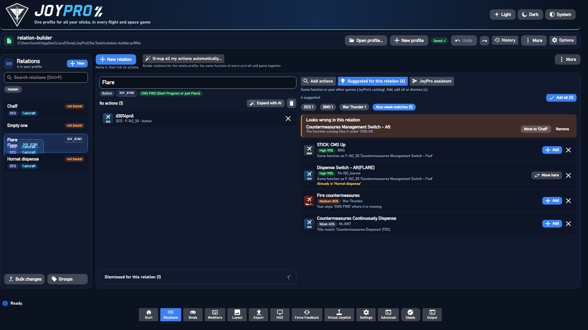
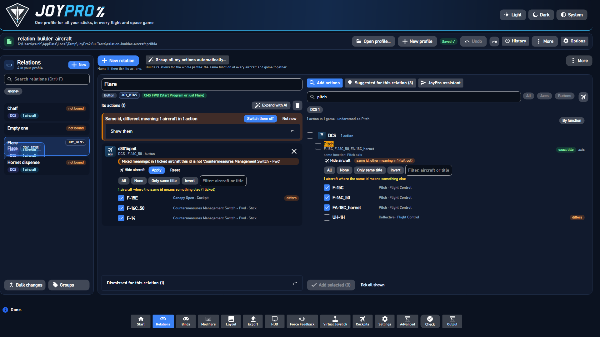
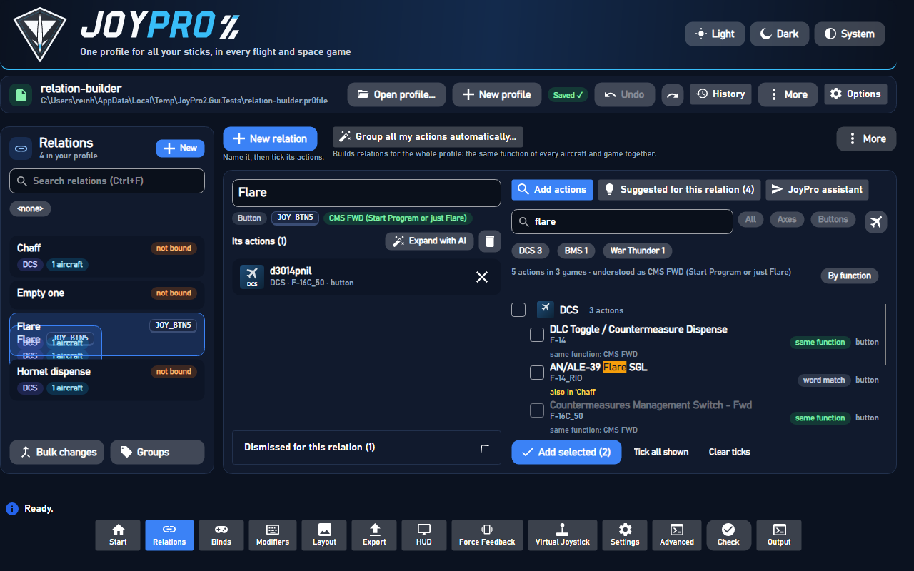
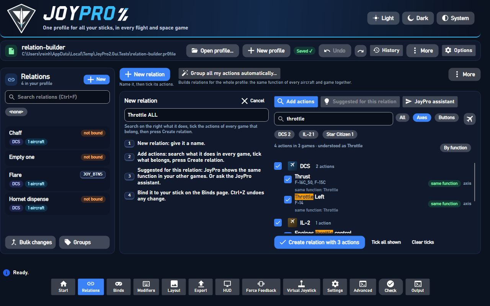
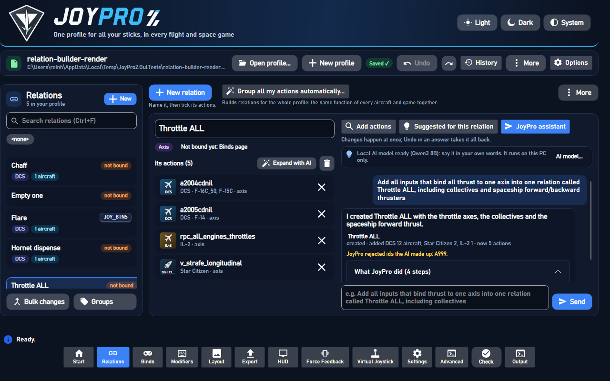
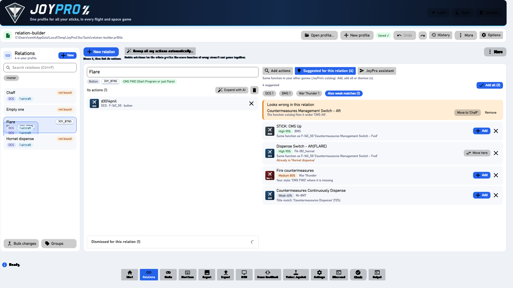

# Relations page: search, tick, add (and the JoyPro assistant)

A relation is one function, for example "Throttle ALL". It holds that function's action in every game and aircraft
(DCS F-16C "Thrust", IL-2 "Engines throttle control", Star Citizen "Strafe forward / backward" ...), all on one input
of the stick. The Relations page builds it the way JoyPro 1 did: name it, search what it does over every game, tick what
belongs, add. On top of that JoyPro suggests what else means the same, and the JoyPro assistant does it from a sentence.
Binding the relation to a button or axis happens on the Binds page.



## The page

- **Left:** the relations (search, the [filter bar](#filters-relations-and-binds-pages), Ctrl/Shift for several,
  `Bulk changes`, `Groups`). Each card shows its bind as device, input and modifiers: `WarBRD · BTN 8 · Shift A` (the
  tooltip has the full device name); `not bound` when it has none.
- **Top right:** `New relation` ("Name it, then tick its actions.") and `Auto-build relations from all my actions...`
  ("Builds relations for the whole profile: the same function of every aircraft and game together"), `More` (refresh,
  import/export, next relation with suggestions, save).
- **The open relation:** its name in a text box (edit in place: Enter or leaving the box renames, Esc cancels;
  `engine relations rename`), its kind (Axis / Button), its input (or `Not bound yet: Binds page`), the function JoyPro
  reads from it, `Suggest missing (n)`, `Expand with AI`, delete; below, **Its actions**: one row per game action with
  the game badge, the aircraft, the title and the kind, `x` removes it after "Remove this action?" (with `Do not ask
  again`; Settings > Confirmations asks again). A click on a DCS action opens its aircraft (below).
- **No relation open:** "Pick a relation or make one" and the four steps; they show only then (never over a relation's
  actions). A refresh of the relation list (after an edit, an undo, a save) keeps the open relation open; when it
  leaves the list (deleted, filtered out) its actions leave the editor with it.
- **Right, four panels:** `Add actions` (with `Open catalog` next to the search), `Suggested for this relation (n)`,
  `Catalog`, `JoyPro assistant`; `More` > `Suggest missing for every relation...` shows the review list there.

## Binds page: what the relation does

Under the selected row's header the Binds page shows a read-only peek at its relation (`MainWindowViewModel.BindPeek.cs`,
`relations show`): `What it does: n actions in m games`, the actions grouped by game, each with its title, its
aircraft count (a click shows the names) and axis / button, and `Open in Relations` (the relation editor with this
relation). `Hide` / `Show` folds it; the state is remembered (`list-preferences.json` `BindPeekOpen`), folded it
reads nothing.

## Filters (Relations and Binds pages)

Both pages have the same filter bar (`ListFilterViewModel`, `Views/Controls/ListFilterBar.axaml`), each with its own
ticks, remembered in `<settings>\list-preferences.json` (the typed search is not remembered):

- **Search** (Ctrl+F): every word somewhere in the name, games, aircraft, groups, device, input or modifiers.
- **Groups**: tick groups (several: any of them), `No group` for relations without one.
- **Games**: tick a game for every relation with a switched-on action of it; open it (`>`) to tick only some of its
  aircraft (`All` / `None` act on the aircraft shown, so typing `A-10` and `All` ticks every A-10 version). DCS ticked,
  `None`, then A-10A, A-10C and A-10C II: only relations with an action for those aircraft. Games with one list (IL-2,
  Star Citizen ...) have no aircraft.
- **Devices**: the devices of the binds (two of the same model keep a part of their id).
- **Bound / Not bound** and **Axes / Buttons**: switches (a second click switches back to all).
- **Sort** (the button right of the filters, `ListSortViewModel`, `Views/Controls/ListSortBar.axaml`): sort levels in
  order, each a key and a direction (`A to Z` / `Z to A`), with up / down / remove, `Add level` and `Name only`. Keys:
  name, device (as shown, alias-aware), input (natural: axes X, Y, Z, RX, RY, RZ, sliders, then `BTN 2` before
  `BTN 10`, then hats, then keys), axis / button, games, aircraft count, group, bound / not bound, modifiers (relations
  have no change date, so there is no "last changed"). Unbound rows go after the bound ones; equal rows go by name. No
  level = by name (the old order). Each list remembers its levels (`list-preferences.json` `Sorts`); it works on top of
  the filters and the search, Follow input and the selection stay.

The filters combine (all must fit). Every tick shows how many relations it would show with the other filters as they
are; ticks that would show nothing are dimmed. Under the bar the active filters are chips with x, `n of 524 shown` and
`Clear all`. Opening a relation the filters hide (a new relation, "Open" in a review, Next relation with suggestions)
clears them. The relations are filter subjects built once per list, so a filter change is set lookups: on the user's
profile with 524 relations and 3 300 actions a change takes a few milliseconds (the journey test checks < 300 ms).

## Browse the catalog

`Open catalog` (next to the search) or the `Catalog` tab: not what a search finds, but everything a game or an aircraft
has (`engine relations browse`). Pick the game (the profile's games first) and, for DCS, the aircraft (the profile's
first; the open relation's own aircraft is picked when it opens). The actions come in the game's own categories (DCS
`HOTAS`, `Landing gear panel` ...; an action in "Control Stick; HOTAS" is in both); games without categories of their
own are grouped by JoyPro's function categories ("Engine and power", "Weapons"). A category opens with a click, shows
how many of its actions your relations use, and ticks all of its rows with its box. Each action shows `in this
relation`, `in '<relation>'` and, when that relation is bound, `bound: WarBRD · BTN 8`. `Only free` hides what is used,
the filter box opens the categories with a match. Ticked actions go in with `Add selected (n)` (or `Create relation
with n actions`); a DCS action takes its ticked aircraft (the browsed one; its aircraft selector adds more with the same
meaning). The open relation's kind decides what is listed (an axis relation: only axes).

Every button has a tooltip. No list on the page scrolls sideways: long titles end in "...", aircraft lists show the
first ones and `+n`, chips wrap. Tested at 1280x800 and 1920x1080 (`RelationBuilderRenderTests`).

## Make a relation, step by step

1. `New relation` (Ctrl+N), type its name (`Throttle ALL`). Left empty, it is named after its first action.
2. `Add actions`: type what it does (`throttle`). The search runs while you type (300 ms after the last key) over every
   game and aircraft (`engine relations search "<words>" [--axis|--button] [--plane ...] --limit 400`). The engine knows
   synonyms: `throttle` also finds thrust and the helicopter collective, `flare` the countermeasure dispense switches.
3. The rows come grouped by game (`DCS · 48 actions`), each with a tick box, the title (the words you typed marked),
   the aircraft, the kind, why it was found ("same function: Throttle") and `also in '<relation>'` when another
   relation uses it. Each game's **main control** of the function comes first, marked `main control`; a title that
   does not name the function says it: `AXIS ELEVATOR SET — Pitch axis (elevator)`.
4. Filters: `All` / `Axes` / `Buttons` (a relation holds one kind; an open relation with actions shows only its own,
   an empty one every kind), the game chips of the result with how many actions each game has (none ticked = every
   game, the best 12 rows of each: `--limit 200 --per-game 12`; a ticked chip searches that game again for all its
   rows; the first eight as chips, `+n more games` for the rest), and the aircraft picker. `By function` groups the
   rows by the function they are (the engine's `FunctionGroups`) instead of by game. Each row shows how it was found
   (`exact title`, `same function`, `synonym`, `described`, `word match`), and a typo offers `Did you mean: throttle?`.
   The search needs no open profile (the profile only marks which relations use a row). Under a game, `Show n more`
   loads the rest of that game's hits for the same search (`--game <game> --limit 400`), `Show less` folds them;
   `Expand all` / `Collapse all` above the list do every game. The state stays while the query, kind and aircraft stay
   the same; ticks survive expanding and collapsing.
5. Tick what belongs: a row, or the box of a game for all or none of its rows; `Tick all shown`, `Clear ticks`. A DCS
   row adds only its ticked aircraft ([Same id, different meaning](#same-id-different-meaning)).
6. `Create relation with n actions` (`engine relations add <name> --axis --node game:id:planes ...`). Axes and
   buttons together are refused with a hint. The new relation opens.

For an open relation the same panel says `Add selected (n)` (`engine relations suggest apply <relation> --add
game:id:planes ...`). Rows whose aircraft are all in the relation are marked `already in this relation` and cannot be
ticked. Ticks survive a new search when the same action comes back. Every change can be undone with Ctrl+Z.

### How the search finds things

Like a search engine over every game and aircraft at once, built on the [function map](#function-map); one row per
command and meaning, with every aircraft where the command means that and the relations that already use it.

- **Names and synonyms**: `throttle` finds every game's throttle, `thrust` (DCS FC3), the helicopters' `collective`,
  Star Citizen's `strafe longitudinal`, Elite's `Forward Thrust Axis` and X4's `Accelerate`.
- **What it does**: `make the plane go faster`, `drop countermeasures`, `talk to the tower`, `move sideways` (space),
  `lower the landing gear`, `look around`, `lock target`: the functions' plain-English descriptions (BM25 over names,
  synonyms, game terms and descriptions) and a lexicon of words that mean much the same (`drop` ~ `release` ~ `deploy`).
- **Directions**: `gear up`, `tms aft`, `zoom in`, `trim nose up`: rows in that direction first, toggles and rows
  without a direction after, the opposite direction never.
- **Typos**: one per word (two in long words); a misspelt word is corrected against every word JoyPro knows and the
  result says `Did you mean: throttle`.
- **Plain words** still work for everything the map does not know: whole words, word starts (`disp` finds
  "Dispense"), the readable id and the game's category; rare words weigh more than common ones.
- **Ranking**: the exact title first, then the function by its own words (`Throttle Left`), then by a synonym or game
  term (`Collective`), then by what the query describes, then plain word matches. Rows of the function's natural kind
  (a throttle axis, a gear button) rank before the others. The function's **primary axis** leads its game (see
  [Function map](#function-map)): `pitch` in MSFS is the elevator axis, then the helicopter cyclic, never the hot-air
  balloon's burner pitch above it; `throttle` in FSX is `Throttle axis (all engines)` before `Throttle 1 axis`.
- **Grouped**: `Groups` (per game) and `FunctionGroups` (per function, then game). Within `--limit` every game with a
  function hit keeps its best rows, so a search over all games shows every game's throttle; `--per-game N` caps the
  rows of one game.

## Same id, different meaning

A DCS command id is no function of its own. `a2001cdnil` is "Pitch" in the jets, "Flight Control Cyclic Pitch" in the
helicopters; a clickable cockpit id like `d3002pnilunilcd3vd1vpnilvunil` (device 3, command 3002) is "Hydraulic
Emergency Release Knob" in the P-51D, "Fuel Densitometer Selection Switch Cover - OPEN" in the F-86F and "Bomb control
handle - PASSIVE" in the La-7; `dnilp95u215...` is "Trim: Nose Up" in most jets and "Trim: Nose Down" on the F-16's
HOTAS. On the development PC's lists (122 DCS aircraft lists, 24 472 ids) 10 839 ids are shared by several aircraft and
3 289 of them mean something else in some aircraft (8 232 aircraft entries), 987 have near variants. The niche ones are
the worst: cockpit switches, electrics, radios, magnetos, voice chat (`d1731...`: 20 meanings). Every other game has one
list per game (one meaning per id); the same rules apply there and find nothing (`relations meanings`).

So a search hit, a suggestion and a relation action are (id, aircraft), each aircraft with its own title and category
(`engine\EngineIdMeanings.cs`):

| Compared to the row's meaning | When | Grouped |
|---|---|---|
| `same` | normalised title (the game's tags and prefixes off, lower case, plural s off) and normalised category equal | yes |
| `near` | same words in another order (`Pitch Trim Up` / `Trim pitch up`), the same title in another category, the same title with a note in brackets (`... (call radio menu)`), one plain word more or less, or up to two words more on one side (`Start dispensing` / `UV-26 Start Dispense`) | yes, flagged `near` for review |
| `differs` | anything else; always when the titles are opposite directions (`Nose Up` / `Nose Down`), name other numbers (`Station 1` / `Station 2`) or differ in a direction word | no: its own row, listed as "same id, different meaning in n aircraft (left out)" |

A row's head is its most common meaning; a relation action's meaning is the one whose title shares the most words with
the relation's name, else the most common one. Modules that list only input names (`Input.SpitfireLFMkIX.uc_1`) compare
as their twin list (`SpitfireLFMkIX_easy`: "Undercarriage DOWN").

Everything that builds relations keeps to it:

- **Search and resolve**: one row per id and meaning (`Variants`, `Near`, `SameIdDifferent`, `MeaningNote` in the JSON);
  an aircraft whose own title names another function is not read as the catalog's function for an id that means
  different things (`CatalogAgainstTitle`).
- **Suggestions**: the "same id" source proposes only aircraft where the id is `same` (90) or `near` (75) to the
  relation's own aircraft; no suggestion for an id the relation has with another meaning.
- **The assistant**: its tools return one line per meaning, a line says "same id means something else in n other
  aircraft (not in this line)", and the system prompt tells the model that ids are per aircraft.
- **Auto Group, Group by description, the setup wizard, `relations add --node DCS:<id>` without aircraft**: an
  aircraft whose meaning differs from the node's (and whose own title the function map does not read as the same
  function and direction) is left out: in the node switched off, listed (`MeaningExcluded`, `MeaningNotes`), one tick
  brings it back. A node spec without aircraft takes the id's most common meaning.
- **Export**: a node exports its bind only for its switched-on aircraft (`RelationItem.AIRCRAFT`, as in JoyPro 1).

**In the GUI** every DCS row of `Add actions` and every DCS action of the open relation has an aircraft selector:
`a-10a, A-10C +69 more` / `82 of 84 aircraft · 14 aircraft use this command for something else (show)` (and
`· n aircraft have another name for it` for another title of the same function); a click on the action itself, its chevron (v / ^) or that line opens it; closed, the card shows its one-line summary (game, aircraft). Every collapsible header of the app (Expanders, Settings sections) opens and closes from anywhere on its row, the chevron included (`Styles/DesignStyles.axaml`, `Styles/SettingsSection.axaml`).
It lists every aircraft with that id in groups by what the id means there: `Same meaning: 'Pitch' (60)`, `Nearly the
same (9)`, `Another name, does the same (14)` (a helicopter's `Flight Control Cyclic Pitch`: the function map reads it
as pitch, no mixed meaning), `Not in its list (2)`, `Does something else here (its own name shown)`, each aircraft with its own
title and category and a tick; `All`, `None`, `Only same meaning` (same and near), `Only same function` (also the
other titles of the function), `Only same title`, `Invert` (on the shown aircraft), a filter box; Space toggles, Shift+click ticks a range. A search row starts with its same and near aircraft
ticked and the other meanings unticked and adds only its ticked aircraft; an action's `Apply` saves its ticks in one
step (`relations aircraft set`, one undo step) and the list stays open. Actions whose ticked aircraft mix meanings are
flagged inside their card (`In 1 ticked aircraft this command is not '...' but something else`; only another function counts, not another title of the same function).
Other games' actions show their title in the game (`Pitch axis`, `AXIS ELEVATOR SET`), not their id. Opening a
relation puts its name into the `Add actions` search; a game's header counts like its chip (`12 of 44 actions`).
Games with one list per game have no selector.



**Repair**: `relations check-aircraft` finds actions with switched-on aircraft whose meaning differs from the action's;
those the function map reads as the same function (`Cyclic Pitch` in a `Pitch` action) are listed but kept. The
open relation shows a neutral question (blue, info icon; orange is kept for real problems) that counts only this
relation, with a real example: `In some aircraft this command does something else. The 'Rudder' command of the AH-64D
has another meaning in 35 aircraft (e.g. F-16C_50: 'Nosewheel steering'). Should this relation also apply there?`.
`Show what this command does in the other 35 aircraft` opens the list: per aircraft its name, what the command is
called there and a `use here` tick. `Only where it is 'Rudder'` switches the others off (`relations aircraft set
--off`, one undo step per action; they stay listed), `Keep for all` keeps them, `Ask me later` hides the question
until the next start. Kept aircraft (`Keep for all`, `use here`) are remembered in `list-preferences.json`
(`KeptAircraft`: relation|game|id|plane) and not asked about again. The profile-wide number is the small link
`Check all relations (n actions)` above the editor: it runs the check again and lists every flagged action (a click
opens its relation) with `Switch them all off` (`--apply`, one undo step; one run per action when the user keeps
aircraft). On the user's HoldiFeb23 profile (443 relations, 2 760 actions): 220 actions with differing
aircraft, 165 actions in 129 relations to repair, 360 aircraft to switch off, 398 kept as the same function.

## Suggested for this relation (no AI)

`engine relations suggest <relation> [--min high|medium|low] [--game g1|g2]`. Deterministic; the sources:

| Source | Score | Example reason |
|---|---|---|
| The function catalog (`DB/Functions`, checked against the manuals): every function the relation's actions are | 95 when the function counts fully, down to 60 when few of the actions agree (substitutes: 70 to 45) | "Same function as F-16C_50 'Countermeasures Management Switch - Fwd'" |
| Your style: what you put on this function in aircraft that lack it (Auto Group's learned habits, at least two separate decisions in your own relations) | 80 | "Your style: 'TMS Up' where 'CMS FWD' is missing" |
| The same DCS command id in more aircraft, only where it means the same there | 90 with the same title, 75 when near; never when it means something else | "Same command id as in F-16C_50, same title" |
| Similar titles in any game (never the opposite direction) | 70 / 55 / 40 | "Title match: 'Countermeasures Dispense' (87%)" |

Confidence: high from 85, medium from 55, else weak. Weak matches are hidden until `Also weak matches`.

- `Add` takes one row, `Add all (n)` every row shown that no other relation uses, `x` dismisses one for good
  (`suggest apply --never`: kept in the relation switched off, never suggested again; `Dismissed for this relation`
  on the left lists them, `Restore` (`--remove`) takes one out).
- **Already in another relation**: such a row says `Already in 'Flare'` and offers `Move here` (`--take`).
- **Looks wrong**: entries an old auto-fill put into the relation, with `Move to` / `Remove`
  ([Suggest additions](suggest-additions.md#what-looks-wrong)). Also a button in an axis relation (or an axis in a
  button relation: "'UFC 3 Key' is a button in A-10C II; 'Pitch' is an axis relation"), with `Move to` the button
  relation of its function.
- **Outliers seed nothing**: an action of the other kind, or one the catalog files under a function no other action of
  the relation shares (the relation has a function of its own), says nothing about what the relation is: no suggestion
  comes from it, it only shows under `Looks wrong`. `check-aircraft` ("Same id, different meaning") leaves actions of the
  other kind out of its count (`OtherKindNodes`).
- The relation's meaning is the union of its actions' functions, weighted (a function counts fully when the relation is
  named after it or when at least half of its actions are it). The header shows it.
- The panel belongs to the open relation only: opening another one clears the suggestions, `Looks wrong`, the
  dismissed list and the function chip at once (the engine run takes a while), and a row left over from the relation
  before never acts on the new one.

### Recommended action

Games often have two to four actions for one function (Elite "Pitch Axis" / "(Alternate)" / "(Landing)", MSFS "Elevator
Axis" / "Elevator Set" / "Aileron / Elevator", Arma 3 plane and helicopter pitch, IL-2 Korea "Pitch (Elevator)" / "Mc
pitch" / "Rb pitch"). Per game (DCS: per aircraft) one is **Recommended** (ranked first, ticked for `Add ticked`); the
others sit collapsed under it (`+2 other actions in this game`), never ticked, each with one line `Differs: ...`.
`EngineActionChoice` with the generic rules of `DB/Functions/action-variants.json` (nothing written per action):

- the recommended action: no variant rule fits, no word of its own the function does not explain, the function's
  canonical control (`PrimaryRank`), the higher score, the shorter title;
- variant rules (title or the game's category): trim, alternate set, landing mode, mouse, combined axis (`Aileron /
  Elevator`), gyroscope, another seat, view / camera, weapon aiming, propeller, reset, "free"; a rule whose words are the
  function's own (trim for `Pitch trim`) does not count;
- a word the game gives no meaning for: `variant ('Mc') - meaning not documented by the game` (never guessed); no
  rule and no such word: `the game does not say how it differs`;
- families: a helicopter (or ground vehicle) action next to a plane action of the same game is recommended too, `for
  helicopters` / `for planes` (space games: `for ships`);
- a game or aircraft the relation has an action for already gets no recommendation.

Every row shows the game's readable name (`EngineActionInfo.Readable`: MSFS / FSX / P3D events whose list has no menu
name get one from the event name, `KEY_AXIS_ELEVATOR_SET` -> `Elevator Axis`; an id shown as its title gets its words),
the function and the id small underneath, and what it does: the cockpit guide's "What does it do?" text of the control it
is (through the cockpit pictures' commands), else the sim's own description (MSFS `en-US.locPak` `..._DESC`), else the
general explanation of its function (`_templates.json`, by the function, `functionTemplates` in action-variants.json where
the name alone would pick a wrong one), else nothing. The index is kept in `<data>\Cache\action-info.tsv`. The same marks
and texts are in `relations search` (Add actions), `relations browse` (catalog) and the relation's nodes (tooltip).
`engine relations action-info --coverage [--game g]` counts per game: readable names, explanations by source, functions
with a recommended action that is no variant.
- `More` → `Next relation with suggestions` (`suggest --all --min medium`) opens the next relation that can grow.

### Suggest missing

`Suggest missing (n)` on the open relation opens the panel in sections (each suggestion knows what the relation lacks,
`Missing` / `NewGame` / `NewPlanes` of `relations suggest`):

1. **Games not in this relation yet**: the same function in a game the relation has no switched-on action of.
2. **Aircraft not in this relation yet**: DCS actions for aircraft it has none for (`new for F-16C_50, FA-18C_hornet`).
3. **Used in other relations**: they fit but another relation has them (`Already in 'Flare'`, `Move here`); never added
   by `Add all` or `Add ticked`.
4. **More for aircraft already in it**: other actions of the function for aircraft the relation covers.

High before medium before weak, then by score. Tick rows (or a section's box) and `Add ticked (n)`, or `Add` per row.
The button's count is the free suggestions of sections 1 and 2.

**For every relation**: `More` → `Suggest missing for every relation...` (`relations suggest --all --missing --min
medium --per-relation 25`; the fast sources only, about 18 s on 524 relations): per relation what it lacks that no other
relation uses ("5 new games · 12 more aircraft · 3 used elsewhere"), new games first, a tick per row and per relation,
`Add ticked (n)` (one `suggest apply` per relation, each one undo step), `Open` opens the relation with all its
suggestions.

## The JoyPro assistant

`engine relations assistant "<message>" [--relation <name>] [--llm auto|on|off] [--max-steps N] [--show-prompt]`.
One sentence; JoyPro changes the relations **at once** (the page shows them right away) and answers with what it did:

> "Throttle ALL": created · added DCS 48 aircraft, Star Citizen 2, IL-2 5 · now 160 actions

with the steps it took (`What JoyPro did`), ids it rejected, and **Undo this**: one answer is one engine command, so
one undo snapshot takes the whole answer back (Ctrl+Z works too). Relation names in the answer open the relation.
`Expand with AI` on the open relation sends `--relation <name>`: "this relation" and "it" mean that one.

### With the local AI model: a tool loop

The model (the optional [local AI model](natural-language-grouping.md#optional-local-ai-model): the catalog model the
user downloaded, or their own llama.cpp and GGUF) works only through JoyPro's tools. JoyPro starts the model once per
answer (`EngineLlm.Session`: start, load, many requests, kill; a job object kills it with the engine) and loops:

1. The model answers with exactly one JSON tool call. A GBNF grammar allows nothing else (one flat object per tool).
2. JoyPro runs the tool on the profile and answers with `RESULT` lines (or `ERROR ...`).
3. Until the model calls `done`, or 16 steps (`--max-steps`). Three answers that are no tool call in a row end the
   turn; the same call twice in a row is refused. Older results shrink to their first line when the conversation
   outgrows the context (16k for the user's own model, 12k for the large catalog model).

| Tool | What JoyPro does |
|---|---|
| `{"tool":"list_relations"}` | the relations with kind, action count and games |
| `{"tool":"show_relation","relation":"NAME"}` | the relation's actions as ids (`A<n>`) and a set id (`S<n>`) |
| `{"tool":"resolve","query":"WHAT IT DOES","kind":"axis\|button\|any"}` | the offline brain: `relations resolve` on the [function map](#function-map), every game's action of the functions the words name, with synonyms and game terms (`throttle` = thrust, collective, Star Citizen's strafe longitudinal); side actions left out ("throttle" never brings "Throttle friction"); the word search when the map knows none of the words |
| `{"tool":"search","query":"WORDS","kind":"...","games":["DCS"]}` | the word search over every game's titles (`relations search`) |
| `{"tool":"suggest","relation":"NAME"}` | the relation's suggestions with confidence and reason (`relations suggest`) |
| `{"tool":"create_relation","name":"NAME","kind":"axis\|button"}` | a new, empty relation (refused when the name exists) |
| `{"tool":"rename_relation","relation":"NAME","new_name":"NAME"}` | renames it (the bind stays) |
| `{"tool":"add_to_relation","relation":"NAME","ids":["A3","S2"]}` | adds the actions (`S<n>`: every action of that result) |
| `{"tool":"remove_from_relation","relation":"NAME","ids":["A4"]}` | takes them out |
| `{"tool":"done","reply":"..."}` | ends the turn with a sentence for the user |

Result lines look like `A12 DCS F-16C_50, F-15C +17 | Thrust | axis | in 'Throttle'`; a result shows at most 45 lines
plus the titles of the rest, and its set id covers all of them.

**Checks:** an id counts only when a `RESULT` of this turn showed it; anything else is rejected, listed in the answer
and sent back to the model as an error. An axis into a button relation (or the other way round) is skipped. Nothing
is deleted (there is no delete tool), a relation the turn created and left empty is dropped at the end, and an
unknown relation name gets "Did you mean ...".

**The system prompt** (`DB/Llm/models.json` → `relationAssistant.system`, with a built-in copy in
`EngineRelationAssistant.DefaultSystemPrompt`) explains relations, lists the tools in the JSON form above and sets the
rules: only ids from `RESULT` lines; only actions that do exactly what was asked, never buttons in an axis relation,
no side actions sharing a word (trim, friction, cutoff, mixture, propeller, brakes, zoom, lateral or vertical thrust,
mining, turret); add a whole set only when every line fits; throttle, thrust, power lever, helicopter collective and
spaceship forward/backward thrust are axes, a twin's left and right throttle both belong to an all-throttle relation;
create only what was asked, never touch other relations; be quick, then `done` in plain words; a DCS id belongs to its
aircraft: each RESULT line is one meaning with only the aircraft where the id means that, and the aircraft a line says
were left out ("same id means something else in n other aircraft") are never added through it.
`relationAssistant.example` is one worked conversation (a "Gear" relation) in the exact format of a real turn.
`--show-prompt` prints the conversation and the grammar without running anything.

### Without the model: the offline brain

The same box understands simple commands with `resolve`; anything else is answered with what needs the model (and
nothing changes):

| Command | Does |
|---|---|
| `Throttle ALL: all throttle axes` | creates "Throttle ALL" (axis, from the words) with every resolved action |
| `... into one relation called Throttle ALL including collectives and spaceship forward/backward thrusters` | the name ends at "including"; each part (thrust, collective, forward/backward thrust) is resolved and added |
| `create Gear with landing gear toggle` | same, for a button relation |
| `add the collectives [to Throttle]` | adds to the named or the open relation |
| `remove War Thunder [from Throttle]` | removes the relation's actions whose game, aircraft or title has the words |
| `rename [Throttle] to Throttle ALL` | renames the named or the open relation |

`--llm auto` (the GUI's default with the model switched on) uses the model when it is usable and falls back to the
offline brain when it is not or does not start (the answer says why); `--llm on` fails without a usable model; `--llm
off` never starts it.

## Auto-build relations from all my actions (whole profile)

The button's subtitle says what happens: a wizard opens in place of the open relation's view (it comes back with
`Close and back to my relation` at the wizard's top). Leaving the Relations page closes the wizard, the AI panels
and the new relation form, so the page always opens in its normal state.

`Auto-build relations from all my actions...` has [Auto Group](auto-group.md) (by function, with presets) and
[Group by description](natural-language-grouping.md) (several relations from one sentence). Auto Assign ("Put
relations on my buttons automatically") is on the Binds page.

## Function map

`DB/Functions/function-map.json` is JoyPro's own knowledge of what an action does (no AI, deterministic, shipped with
JoyPro like the function catalog). 188 functions in 13 categories (flight controls, engine, weapons, countermeasures,
HOTAS switches, sensors and displays, navigation and autopilot, communication, view, lights, systems, spaceship,
simulator), each with:

- `id`, `name`, `category`, `kind` (axis / button / both) and `only` (no other kind can be it);
- `synonyms` (English, matched as whole words in titles, plural `s` ignored) and `terms` per game or class
  (`"StarCitizen": ["strafe longitudinal"]`, `"class:heli": ["throttle"]`, `"class:space": ["boost"]`);
- `not`: words that rule the function out ("Throttle Cutoff" is no throttle axis, "CB ..." is a circuit breaker);
- `dirs`: the function's direction words (`noseup` = "nose up", "aft", "pull"), `sided` (per engine or wheel), `keyed`
  (PTT 1, OSB 12, UFC 7);
- `slots`: the function catalog's slots it stands for (`"cms_fwd_start_program_or_just_flare": "@0.85"` for flares);
- `related`: functions a search lists along with it; plus `describe` (plain-English phrases), `lexicon` and
  `queryFiller` for described queries.

Every action of every game list on the PC is mapped at run time: the function catalog where it knows the action (slot
-> function), the map's rules for everything else (a synonym or game term in the title or the game's readable id, the
`not` words, axis or button, the aircraft class: helicopter, spaceship), one function where clear, up to three with
weights where not. A catalog slot shared by several functions keeps a function only when the title has none of that
function's `not` words: the slot `atc_engage` (F/A-18 "ATC" = auto throttle control) is also linked to the ATC request
of Star Citizen, and MSFS "Arm Auto Throttle" read as "ATC / docking request" (2.2.6 report); "auto throttle" is one of
the ATC request's `not` words, and the autothrottle's `not` words now have "request", "docking", "air traffic"
(regression: `engine\tests\smoke\functionmap.ps1`, search "atc" in MSFS 2024). New games, aircraft and catalog refreshes are covered by the rules, not by a fixed table. The mapped
index is kept in `<data>\Cache\function-map.bin` and rebuilt when a game list, `DB\Functions` or the engine changes.

**Primary axes.** An axis function (pitch, roll, yaw, throttle, mixture, brakes ...) has a canonical axis per game: an
axis action whose title has nothing but the function's name, synonyms or game terms, axis words (`axis`, `set`,
`control`, `joystick`, `all engines`, MSFS `EX1`), the two ends of the axis (`Pedals: left / right pedal`) and, for a
function per engine or wheel, a side or engine number, and that mainly is this function (weight 0.9 or more). MSFS
`AXIS ELEVATOR SET` / `Elevator Axis`, FSX `Elevator (pitch) axis`, DCS `Pitch`, IL-2 `Plane control: pitch`, Star
Citizen `v pitch` are primary; a variant has a word of its own and is not: `AXIS BURNER PITCH SET` (balloon),
`GYROSCOPE PITCH AXIS`, `SET CYCLIC LONGITUDINAL AXIS`, `Pitch Axis (Alternate)`, `Copilot pitch`, `inpmc_pitch`. Among
primaries the name before later synonyms, the lever for all engines before one engine, and the function catalog's own
pick before an axis only the rules found (MSFS `KEY_AXIS_ELEVATOR_SET` before the older `KEY_ELEVATOR_SET`). Search
(`EngineFunctionMap.PrimaryRank`, `EngineRelationSearch`) puts the primary axis first in its game when the query is
about that one function by its main word (`pitch`, `throttle`, `rudder`) or describes it; asked by a variant's word
(`collective`, `elevator`) the rows with that word lead and the primary axis only leads the other synonym rows. A
query about two functions (`cut the throttle`), with a direction (`pitch up`) or a related function gets no primary
boost. `relations resolve` ranks the same way. The `not` words keep the look-alikes out of the flight axes altogether:
balloon burner, gyroscope axes, flight director and AP pitch reference, ADI / horizon / boresight adjustment, STAB
AUG, head tracker, turret, Star Citizen's character customizer and EVA, DCS vehicle pedals.

On the lists of the development PC (80 327 actions of 31 games) 73 % of all actions map to a function (95 % of the
FSX/P3D lists, 89 % of War Thunder, 84 % of Falcon BMS, 72 % of DCS; the rest are panel knobs, cameras and menus).
`tools\relations\check-function-map.ps1` measures coverage, search quality on `tools\relations\search-eval.tsv` (218
name, synonym, game-term, direction, described, held-out and typo queries; `pitch`, `roll`, `yaw`, `rudder` and
`throttle` also name the first row of every game: 107 of 107 right on the development PC, 85 before the primary axes)
and mapping precision on the hand-labelled `tools\relations\function-labels.tsv`.
## Engine API

The commands the GUI and the local-model layer call. All print JSON without `--text` (stdout, or the file of
`--out`); all are read-only. `--profile` is optional: it only fills `InRelations` and the relation of `suggest`.
A node spec for `relations add --node` / `suggest apply --add` is `Game:Id:Plane1|Plane2` (DCS: the aircraft; other
games: the game id once).

`relations search "<words>" [--game g1|g2] [--plane p1|p2] [--category <name>] [--axis|--button] [--limit N]
[--per-game N] [--batch <file>]` (exit 1 when there are neither words nor a category):

```json
{ "Query": "throtle", "Category": "", "DidYouMean": "throttle",
  "Functions": ["Throttle", "Helicopter engine throttle / power lever"], "FunctionIds": ["throttle", "engine_power_lever"],
  "Resolved": [ { "Id": "throttle", "Name": "Throttle", "Category": "engine", "Kind": "axis", "Dir": "", "Term": "Throttle",
                  "Related": false, "Described": false } ],
  "Results": [ { "Game": "DCS", "Id": "a2087cdnil", "Title": "Flight Control Collective", "Category": "", "IsAxis": true,
                 "Planes": ["CH-47F", "UH-1H"], "Score": 850, "Match": "synonym", "Why": "Function 'Throttle axis' ('collective')",
                 "Function": "throttle", "Dir": "", "Term": "collective", "Functions": ["throttle"], "Weight": 1.0,
                 "InRelations": [] } ],
  "Groups": [ { "Game": "DCS", "Count": 16, "Total": 760, "Best": 1330, "Functions": 16 } ],
  "FunctionGroups": [ { "Function": "throttle", "Name": "Throttle", "Count": 70, "Games": ["DCS", "WarThunder"] } ],
  "Total": 1272, "More": true, "ElapsedMilliseconds": 101, "LoadMilliseconds": 190, "Warnings": [], "Errors": [] }
```

- `Primary`: the function's main control in its game, asked for by the function's own words (MSFS `AXIS ELEVATOR SET`
  for `pitch`); it leads its game. `FunctionLabel`: what the row was found as (`Pitch axis (elevator)`, empty for word
  matches); `Display`: the title to show, with ` — <FunctionLabel>` when the title does not name the function.
- `Match`: `exact` (the title is the query), `function` (the query's function, by its own words), `synonym` (by a
  synonym or game term), `described` (the query describes the function), `words` (a plain word match), `category`.
  `Results` are ranked by `Score`; `Groups` / `FunctionGroups` give the order of the groups.
- `Functions` of a row: every function the action is (weight 0.5 or more), `id` or `id:dir`.
- DCS rows (also of `resolve` and `suggest`): `Planes` are the aircraft where the id has the row's meaning; `Variants`
  lists every meaning of the id: `{ "Title", "Category", "Match": "same|near|differs", "Note", "Included", "Planes" }`
  (`Included`: in the row); `Near` and `SameIdDifferent` count the near aircraft and those left out, `MeaningNote` says
  it in words ("same id, different meaning in 14 aircraft (left out)").

`relations browse [--game <game> [--plane p1|p2]] [--axis|--button]` (alias `relations catalog`): without a game every
game with its aircraft (`Games: [{ Game, Actions, InRelations, Planes: [{ Plane, Actions, InRelations }] }]`); with a
game (DCS: and its aircraft) every action as search rows (`Results`, the aircraft's own title and category, `Match`
"category", `InRelations`, `Variants`), `Categories: [{ Name, Count, InRelations }]` and `CategorySource` ("game", or
"joypro" for games without categories). The table header of a game list is no action.

`relations suggest --all --missing [--min ...] [--per-relation N]` (default 25, 0 = all): per relation (`Relations`)
`IsAxis`, `Suggestions` (free missing ones), `NewGames`, `UsedElsewhere` and `Items` (the suggestions, new games first).
Every suggestion of `relations suggest` also has `Missing` ("game", "aircraft" or ""), `NewGame` and `NewPlanes`.

`relations aircraft <relation> [--node game:id]`: every action with every aircraft that has its id:

```json
{ "Relation": "Pitch", "Changed": 0, "Nodes": [ { "Game": "DCS", "Id": "a2001cdnil", "Title": "Pitch", "Category": "Flight Control",
    "Active": 3, "Available": 4, "Differs": 0, "DiffersSameFunction": 0, "Near": 0, "Excluded": 1, "Mixed": false, "Badge": "3 of 4 aircraft",
    "Aircraft": [ { "Plane": "UH-1H", "Title": "Collective", "Category": "Flight Control", "State": "off", "Match": "differs", "Note": "",
                    "SameFunction": false } ] } ], "Errors": [] }
```

`State`: `on`, `off` (in the action, switched off), `absent` (has the id, not in the action); `Match` against the
action's meaning, `unknown` when the id is not in that aircraft's list. `relations aircraft set <relation> --node game:id
[--on p1|p2] [--off p3]` changes one action's aircraft in one step (one undo step; `--on` also adds aircraft).

`relations check-aircraft [--relation <name>] [--apply] [--include-same-function]`: `{ Relations, Nodes, AffectedNodes,
AffectedRelations, AircraftToDrop, AircraftSameFunction, Applied, Dropped, Found: [ { Relation, Game, Id, Title,
Category, Active, Available, Meanings: [variants], Drop: [planes], SameFunction: [planes] } ] }`. `--apply` switches the
`Drop` aircraft off.

`relations meanings [--game g] [--top N]`: per game the lists, ids, ids shared by several lists, ids with another
meaning in some (`Mixed`, `AircraftLeftOut`), ids with near variants, and the ids with the most meanings.
- `--batch <file>`: one query per line (or the second column of a tab-separated line); prints a JSON array of results.

`relations resolve "<query>" [--game g1|g2] [--plane p1|p2] [--axis|--button] [--per-game N]` (default 25 per game,
0 = all): the query as function ids and the matching actions, grouped by game, best game first. The local-model
layer's tool:

```json
{ "Query": "drop countermeasures", "DidYouMean": "", "Direction": "", "Extra": [],
  "Functions": [ { "Id": "cm_dispense", "Name": "Countermeasures dispense", "Category": "countermeasures", "Kind": "button",
                   "Dir": "", "Term": "countermeasure", "Score": 10, "Related": false, "Described": false, "Synonyms": ["..."] } ],
  "Games": [ { "Game": "WarThunder", "Count": 3, "Actions": [ { "Game": "WarThunder", "Id": "ID_FLARES", "Title": "Fire countermeasures",
      "Category": "Aircraft", "IsAxis": false, "Planes": ["WarThunder"], "Function": "cm_dispense", "Dir": "", "Weight": 0.8,
      "Source": "catalog", "Term": "countermeasure", "Why": "Same function: Countermeasures dispense (function catalog)" } ] } ],
  "Total": 208, "ElapsedMilliseconds": 12, "Warnings": [], "Errors": [] }
```

`relations functions [--category <id>] [--query "<words>"] [--coverage] [--dump <file.tsv>]`: the map itself:

```json
{ "Version": 1, "Source": "...\\DB\\Functions\\function-map.json",
  "Totals": { "Functions": 188, "Synonyms": 3625, "Terms": 151, "Actions": 80307, "Mapped": 58820 },
  "Categories": { "engine": "Engine and power" },
  "Functions": [ { "Id": "throttle", "Name": "Throttle", "Category": "engine", "CategoryName": "Engine and power", "Kind": "axis",
                   "Only": "", "Description": "...", "Synonyms": ["throttle", "thrust", "collective"], "Terms": { "StarCitizen": ["strafe longitudinal"] },
                   "Directions": ["increase", "decrease", "max", "min"], "Slots": ["throttleleft:left"], "Related": ["engine_power_lever"],
                   "Actions": 1305, "Games": { "DCS": 760, "WarThunder": 2 } } ],
  "Coverage": [ { "Game": "WarThunder", "Planes": 1, "Actions": 290, "Mapped": 259, "Catalog": 109, "Rules": 150, "Percent": 89.3,
                  "Functions": 79, "Unmapped": ["..."] } ],
  "LoadMilliseconds": 190, "ReadMilliseconds": 185, "FromCache": true, "ElapsedMilliseconds": 230, "Warnings": [] }
```

`relations suggest <relation>` (see [Suggested for this relation](#suggested-for-this-relation-no-ai)) adds `MapFunctions` (what the
relation is in the function map: `Id`, `Name`, `Dir`, `Weight`, `Reference`) and per suggestion `Function` (the map's
function id when the map proposed it); `Source` is `function map` for those rows, their `Why` reads
`Same function: Throttle axis`. `Dismissed`, `InOtherRelations` and `suggest apply` are unchanged.

## Tests

- Engine: `engine/tests/smoke/functionmap.ps1` (the function map on fixtures: a query table for search / resolve
  with names, synonyms, game terms, directions, descriptions and a typo, the primary axis first in its game on MSFS 2024
  and FSX fixtures, as the GUI asks (`--limit 200 --per-game 12`, with and without `--axis`; balloon burner, gyroscope,
  prop pitch, AP / flight director pitch and trim not read as pitch), the map cache, suggestions from the map, Auto
  Group's map rows); real game lists (not in the smoke test): `powershell -File tools\relations\check-function-map.ps1
  [-DataDir <copy>]` (coverage per game, search quality on `tools\relations\search-eval.tsv`, mapping precision on
  `tools\relations\function-labels.tsv`).
- Engine: `engine/tests/smoke/searchranking.ps1` (real game lists): `pitch`, `roll`, `yaw`, `throttle`, `brakes` with
  and without `--axis` as the GUI asks: the main control first and `Primary` in MSFS 2020 / 2024, X-Plane 11 / 12, DCS,
  FSX / P3D, IL-2, War Thunder and Falcon BMS; in every game the function's rows before the word matches; MSFS's
  `AXIS ELEVATOR SET — Pitch axis (elevator)`, the balloon's `BURNER PITCH INC` a plain word match.
- Engine: `engine/tests/smoke/peraircraft.ps1` (same id, different meaning, on fixtures in
  `engine\tests\fixtures\per-aircraft\DB` where `a2001cdnil` is "Pitch" in three jets and "Collective" in the UH-1H, a
  cockpit switch id is another switch per module, `dnilp95u215` is nose up / nose down, and `Pitch Trim Up` / `Trim
  pitch up` are near): the search splits and reports, resolve, suggest, the assistant, Auto Group and a node spec
  without aircraft leave the helicopter out, `relations aircraft [set]`, the DCS export writes only the selected
  aircraft, `relations check-aircraft` finds and repairs a mixed action.
- Engine: `engine/tests/smoke/relationbuilder.ps1` (suggestions, search, chat) and `relationassistant.ps1`: the
  offline commands (create and fill, rename, remove a game, a free sentence that needs the model, `--llm on` without a
  model, `--show-prompt`), and the tool loop through `engine llm fake-server` with a scripted conversation
  (`JOYPRO_LLM_FAKE_RESPONSE`, answers separated by a line `#next`): one model process for the whole turn, six
  requests, an invented id rejected, a button skipped in an axis relation, an invalid answer answered with an error,
  the step limit, a repeated call refused, an empty new relation dropped, the model process gone afterwards.
- GUI: `gui/JoyPro.Gui.Tests/RelationBuilderTests.cs` (search as you type over every game, game chips, ticks by row
  and by game, Add selected, a new relation from ticked axes, mixed kinds refused, rename in place, suggestions add /
  add all / dismiss / restore / move / misfits, the assistant applied at once with its summary, rejected ids and one
  Undo, Expand with AI, the offline path and "needs the model", Auto Assign on the Binds page) and
  `AircraftSelectorTests.cs` (the aircraft selector: All / None / Only same title / Invert / filter, Shift+click ranges,
  the badge, a row that adds only its ticked aircraft, ticks kept over a new search, `Show n more` / `Show less` /
  `Collapse all`, an action's `Apply` in one engine run, the profile check notice and its repair) and
  `RelationBuilderRenderTests.cs` (the page at 1280x800 and 1920x1080: no horizontal scroll bar, every button inside
  the window, a refresh of the list keeps the relation and the steps never show over its actions; with
  `JOYPRO_UI_DESIGN_OUT` the pictures below). `RelationStudioRealProfileRenderTests.cs` renders a real profile through
  the real engine (opt-in: `JOYPRO_REL_REAL_OUT`, `JOYPRO_REL_REAL_ENGINE`, `JOYPRO_REL_REAL_PROFILE`, a copy is used).

| | |
|---|---|
|  |  |
|  |  |
