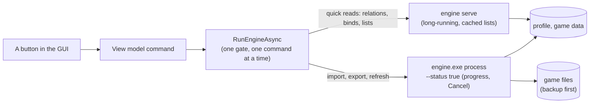

Everything JoyPro does happens in its **engine**, `engine.exe`. The window you click in (the GUI) runs the engine for
every action. You can run the same commands yourself in a console, in a script or from another tool.

:::video engine-cli "The engine on the command line"
:::

:::layer beginner
## Do I need this?

No. Everything here is also in the GUI. The command line is for people who like scripts, for automating things (for
example exporting every evening), and for understanding exactly what a button does: each GUI page on this site lists
the engine command behind every button.

To try it: open a console (Windows Terminal or PowerShell) in JoyPro's folder and type
`engine\engine.exe summary --text`.
:::

:::layer advanced
## How a command looks

```
engine <area> <command> [arguments] [--option value] [global options]
```

- `--profile <file.pr0file>` loads that profile and saves it after a command that changes it.
- `--text` prints readable text; without it most commands print JSON (for scripts).
- `--out <file>` writes the output to a file.

Examples:

```powershell
engine devices list --connected --text
engine dcs import "C:\Users\Pilot\Saved Games\DCS" --merge --include-defaults --profile "My Sticks.pr0file"
engine relations search "gear" --button --text
engine dcs export --mode clean --nuke-untouched-devices true --planes "F-16C_50|FA-18C_hornet" --profile "My Sticks.pr0file"
engine backups restore latest --game DCS
```

Exit codes: `0` success, `1` failure (the reason on stderr), `3` cancelled.
:::

:::layer technical
## How the GUI uses the engine



- Every GUI action goes through `MainWindowViewModel.RunEngineAsync`: it adds `--profile`, `--status`, the correction
  options and `--text` where needed, and serializes calls so two commands never write at once.
- Quick interactive commands run in one long-running `engine serve`, which keeps the game lists, the function map and
  indexes in memory and checks their files before every command; each command still behaves as in its own process.
  `JOYPRO_ENGINE_SERVER=off` runs every call in a process.
- Long commands report `[engine-progress] <current>/<total> <phase>: <item>` lines on stderr (`--progress true`), which
  feed the busy area; Cancel writes the file named by `JOYPRO_CANCEL_FILE` and the engine stops cooperatively (exit
  code 3).
- Before a command that changes game files the engine makes a backup set; after a command that changes the profile it
  saves it atomically as a new history version (`--history-note` names it).
- The command list below is read from the engine's own help (`engine --help`), so it always matches the program.
:::
