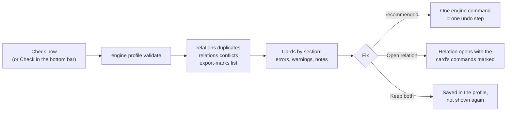

The Check looks at your profile the way the game will see it after an export, and lists what would go wrong there:
a button that does two things in the same aircraft, a command that ends up on two buttons, a bind the game did not
take. Every card says it in game words (the aircraft, "device · button", the command as the game calls it) and offers
a fix you can undo.

:::video the-check "The Check: read a card, fix it"
:::

:::layer beginner
## Run the Check

Press **Check** in the bottom bar (or **Check now** on the Export page). The results show on the Export page under
**Problems found by the check**: "To look at: 0 errors, 1 warning, 0 notes".

**Red cards are errors**: fix them before you export, or the game will do something you did not want. **Amber cards
are warnings**: worth a look, often fine. **Notes** are harmless.

### Read a card

1. **The title** says what is wrong: "One button does two things", "Same command on two buttons", "Not written to DCS
   World".
2. **The buttons**: "Throttle - HOTAS Warthog · BTN 22 ('Gear Up/Down')", the device, the button and, in brackets,
   your relation.
3. **One sentence** what happens in the game: "In F-16C, both buttons do 'Display Management Switch - Down'. Usually
   only one of them is wanted."
4. **The fixes**: the blue button with a tick is JoyPro's suggestion. The others are alternatives; **More** has the
   rest. **Open '<relation>'** shows the relation with exactly the card's commands marked; **Back** (Alt+Left) returns
   to the card.

Every fix can be undone with **Ctrl+Z**.
:::

:::layer advanced
## Sections and fixes

Errors come first, then warnings, then notes. The search finds cards by relation, aircraft, button and command; the
kind filter shows one kind; the order (By relation, By aircraft, By game, By confidence) also groups the cards.

| Section | Kind | What it means in the game | Fixes |
|---|---|---|---|
| One button does two things | error | An input is bound in two relations that both have a command of the same aircraft on: one press runs both. | Keep only 'X' on this button (the aircraft is switched off in the other relations), Keep both; More: Move 'X' to another button, Switch off all of them |
| One button runs two commands | error | One relation has two commands of the same aircraft (or game) on. | Keep only 'A', Keep both; More: Move one to another button, Switch all off |
| Other errors | error | For example a modifier button that is also a normal button. | as the card says |
| Same command on two buttons | warning | One command of an aircraft is on in two relations: the game gets it on two buttons. | Keep only on X (JoyPro's suggestion), Keep both; More: Switch it off on both |
| Copied relations | warning | An import made copies of a relation on the same button. | Merge into one; Merge all copied relations |
| Not written to the game | warning | "Only add" left a bind out because the game uses the button for something else, or the game has no free place (Elite: Primary and Secondary in use). | Export with 'Update' to replace it, Move to another button, Keep as is |
| Notes | note | Harmless, worth a look. | |

- **Keep both** is saved in the profile: the Check does not show it again while exactly these relations have it.
- **Caused by**: when the profile history knows which change brought a problem, the card says so ("Caused by: Manage
  with AI (366 relation changes) on 21.10.2026").
- **Unknown commands**: a command the aircraft's current list no longer has (an old module version, a mod that is not
  installed) is marked "unknown command"; More offers **Remove the unknown command** and **Find similar**.
- **Vehicle classes**: in games without aircraft lists (War Thunder, MSFS, Arma) a plane's throttle and a helicopter's
  collective on one axis are no error; only actions of the same vehicle class conflict.
:::

:::ingame What each card means in the game
- **One button does two things**: in that aircraft, one press fires both commands (for example "Gear" and "Weapon
  release"). After the fix, the button does one thing there; other aircraft are unchanged.
- **Same command on two buttons**: both buttons do the same in that aircraft. Harmless unless you wanted the second
  button for something else.
- **Not written to the game**: the game still does its own function on that button. "Export with 'Update'" replaces
  it at the next export; "Keep as is" leaves the game's function and hides the card.
- **Unknown command**: the game would ignore that line; removing it changes nothing in the game.
:::

:::layer technical
## How it works inside

- **GUI**: `ValidateProfileCommand` (bottom bar **Check**, Export page **Check now**) runs
  `engine profile validate --fail-on-warnings false`, then the duplicate and conflict reports, and builds the cards
  (`MainWindowViewModel.CheckCards.cs`, `MainWindowViewModel.Duplicates.cs`, `Models/CheckIssueModels.cs`,
  `Views/Controls/CheckProblemsPanel.axaml`). Cards are paged (5 rich, 25 light per section, **Show more**), and
  "More" and the details are built only when opened, so 3000 errors stay responsive (`CheckResponsivenessTests`: every
  step under 400 ms).
- **Engine**: `relations conflicts` (`engine\EngineCheckConflicts.cs`) gives validate's two errors in detail:
  `InputConflicts` (key `game:plane§device§input[§modifier]`) and `ActionConflicts` (key `game|plane|relation`). Fixes:
  `--keep <relation>`, `--keep-action <id>`, `--off`, `--keep-both` (saved in `Pr0file.KeptDuplicates`),
  `--remove-actions`. `relations duplicates` finds the same command on two buttons and copies; `export-marks list`
  the binds an export left out. Each fix is one profile version (one undo step).
- **Text gate**: `CheckTextGate` fails a test when a card text shows an id, "node" or another internal word.

Engine commands: [[cli:profile validate]], [[cli:relations conflicts]], [[cli:relations duplicates]],
[[cli:export-marks list]], [[cli:export-marks dismiss]]. Reference: [[doc:ui/check|The Check (reference)]].
:::

## Related

- [[gui:check|The Check page]], every control on it
- [[page:flows/export.html|Export]], where the Check is step 1
- [[page:flows/relations.html|Build relations]]
