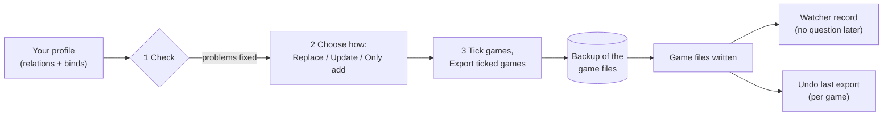
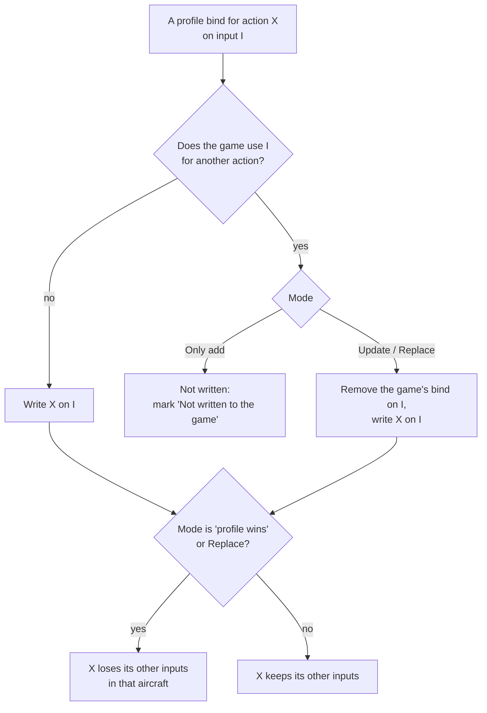
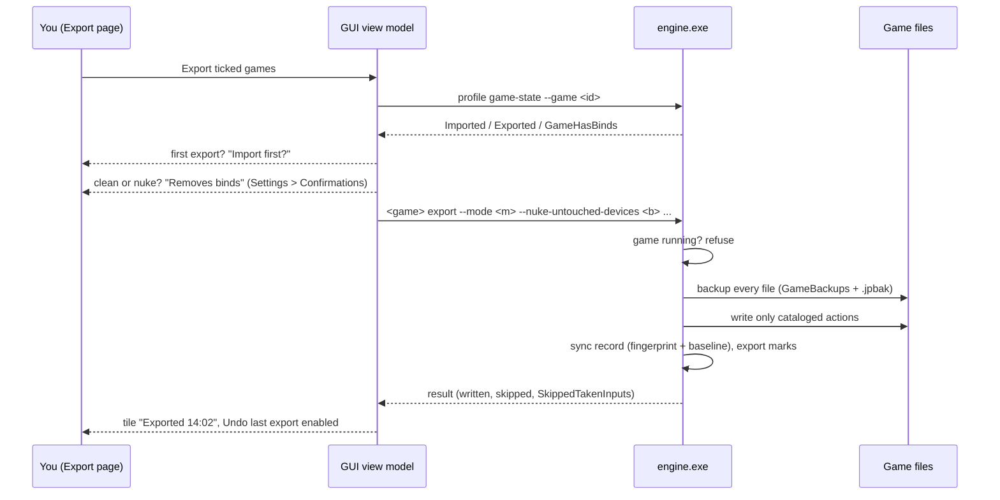

Export is the step that makes your sticks work in the game. JoyPro writes your relations and binds into the control
settings files of each game, the same files the game's own Controls menu saves. Nothing runs in the background while
you fly: once exported, the game reads its own files as always.

:::video export-modes "Export: the four modes and Undo export"
:::

:::layer beginner
## Export in three steps

Open **Export** in the bar at the bottom. The page is three numbered cards from top to bottom:

1. **Check your profile.** Press **Check now**. JoyPro looks for things that would go wrong in the game, for example
   one button that does two things in the same aircraft. Fix what it finds (one click per problem) or leave it; the
   check never blocks the export. See [[page:flows/check.html|the Check]].
2. **How JoyPro writes into the games.** Pick one of four choices. If you are not sure, keep the first one:
   **Replace on my devices** with **Also clear my other devices** ticked. Your sticks then do exactly what your
   profile says, and nothing else.
3. **Export to games.** Every game your profile has binds for gets a tile with its picture. Tick the games and press
   **Export ticked games**, or press **Export now** on one tile.

**Close the game first.** Games write their control files when they quit, so JoyPro refuses to export into a game
that is running and tells you so.

### Which choice is right for me?

| Choice | Pick it when | What happens to the game's own binds |
|---|---|---|
| **Replace on my devices** | JoyPro is the place where you set up your sticks | On the devices in your profile, only your binds stay (for the aircraft you export). |
| **Update, keep the game's binds** | You also bind things inside the game and want to keep them | Your binds go in; a game bind is removed only where it sits on a button you use for something else. |
| **Update, my profile wins** | Like the one above, but you moved actions to other buttons in JoyPro | As above, and every action you bind loses its other buttons in the game, so a move really moves. |
| **Only add** | You are trying JoyPro for the first time | Nothing is removed. If the game already uses a button for something else, your bind is left out and the Check tells you. |

**Also clear my other devices** (a tick under the choices): connected devices that have no binds in your profile lose
their binds in the exported aircraft. Leave it ticked if you want a clean start, untick it if you use a second device
only inside the game.

### Safe by design

- Before JoyPro changes a game file it **copies it into a backup**. Each tile has **Undo last export**: it puts the
  files back exactly as they were, byte for byte.
- The **first export** into a game that already has its own binds asks once: "Import first?". Choose **Import first**
  if you want to keep what you made in the game, **Export anyway** to replace it.
- Devices that are **not plugged in** keep their binds. Your **mouse** and **gamepad** binds are never touched.

### What you notice in the game

Start the game and open its controls menu: your binds are there, in each device's column, under the names the game
uses. In DCS they show per aircraft; in Star Citizen per ship action; in IL-2 in Key mapping. The section
[In the game](#in-the-game) below lists every kind of game.
:::

:::layer advanced
## The modes in detail

"Same input" means the same device, the same button or axis and the same modifiers, in the same aircraft (or ship,
vehicle) when the game keeps binds per aircraft. Every mode works only in the aircraft of the export.

| | Only add (`add`) | Update, keep (`merge`) | Update, profile wins (`merge-overwrite`) | Replace (`clean`) |
|---|---|---|---|---|
| Your binds | written where the input is free | written | written | written |
| A game bind on an input you use for another action | kept; your bind is **not written** and marked | removed | removed | removed |
| A game bind of the same action on another input (after a Move) | kept | kept (the action is on both inputs) | removed | removed on the written devices |
| Other game binds on your devices | kept | kept | kept | **removed** |
| Game defaults on your devices | kept | kept | kept unless they hold one of your actions | **removed** |
| Connected devices without binds in the profile | kept | kept | your actions removed from them | kept, unless **Also clear my other devices** |
| Devices that are not connected, mouse, gamepad | never touched | never touched | never touched | never touched |
| Keyboard | only with the keyboard option | only with the keyboard option | only with the keyboard option | only with the keyboard option |
| Aircraft not in the export | never touched | never touched | never touched | never touched (DCS: unless "clean all aircraft") |

**Also clear my other devices** (`--nuke-untouched-devices true`) is not used with Only add. With the other modes it
empties the connected devices the profile does not use, in the exported aircraft (DCS: their DCS defaults too). The
devices the import ignores and the vJoy device JoyPro tunnels into are never cleared.

Since 2.5.0 the GUI's default is **Replace on my devices** + **Also clear my other devices** (as in JoyPro 1). A mode
you picked yourself is remembered (`export-settings.json`, `ModeChosenByUser`). The engine's default when a command
line leaves out `--mode` is `merge-overwrite`.

### Options per game

Under **Options and paths (for experts)**:

- **DCS**: the **Aircraft...** list on the DCS tile (only ticked aircraft are written); *keep keyboard defaults*
  (`--keep-keyboard-defaults`, on); *my devices lose the DCS default binds in every other aircraft too*
  (`--clean-all-aircraft`, off).
- **Star Citizen**: *keep keyboard defaults*, *prefer the local order* (`--prefer-local-order`).
- **The other games**: a **Dry run** box (`--dry-run`) that shows what would change without writing.
- **Paths**: a different Saved Games or config folder per game; *Own paths and ignored devices for this profile*
  gives the open profile its own instead of the PC's.

### Marks: "Not written to the game"

Only add (and any mode where a game has no free place for another input, for example Elite Dangerous with two inputs
per action) leaves some binds out. The profile remembers each one with the game's action that holds the input and the
date; the Check shows a card per mark with **Export with 'Update' to replace it**, **Move to another button** and
**Keep as is**. Each export replaces the marks of its game and aircraft, so a mark disappears when a later export
writes the bind. Engine: [[cli:export-marks list]], [[cli:export-marks dismiss]].

### Remembered settings

The mode, the nuke tick, the per-game options and the paths are kept in `export-settings.json` in JoyPro's settings
folder; the games and DCS aircraft you ticked yourself are kept per profile. Clean and nuke ask before every export
(Settings > Confirmations can switch the question off).

### After the export

- **Undo last export** on the tile restores the newest backup of that game ([[cli:backups restore]]
  `latest --game <id>`). The full list is under **Game config backups** at the bottom of the Export page.
- The export records the game's files for the **game watcher**: JoyPro's own export never asks "take the changes?"
  later; a change you make in the game afterwards does ([[doc:sync-watcher|the watcher]]).
- JoyPro keeps its own data next to the game file (DCS `.jp`, IL-2 `jp.actions`, `.joypro-meta.json`), so a later
  import brings back relation names, groups, modifiers and curves ([[doc:reimport|re-import]]).
:::

## In the game

What the player sees after an export depends on the kind of game. Every game below follows the same rules: JoyPro
writes only the actions of its command list, refuses to write while the game runs, backs the files up first and never
guesses a device or an action it cannot match (it skips it with a warning).

:::ingame Flight simulators: DCS, IL-2 (Great Battles, Korea, 1946, Cliffs of Dover), Falcon BMS, X-Plane, MSFS, FSX, Prepar3D
JoyPro takes over the devices it writes. With **Replace** every other bind of those devices disappears in the exported
aircraft, with **Also clear** the other connected devices are emptied too (DCS: their DCS defaults as well).

- **DCS World**: per aircraft and device a `Saved Games\DCS\Config\Input\<aircraft>\joystick\<device>.diff.lua`,
  a `.jp` beside it and the aircraft's `modifiers.lua`. In Options > Controls, pick the aircraft: your binds are in the
  device's column, removed defaults show as empty cells, your modifiers are in the modifier list. The file holds only
  the differences from DCS's defaults, as DCS itself writes them. Only the ticked aircraft change.
- **IL-2 Great Battles**: `data\input\global.actions` (new lines at the end, the order kept) and the axis responses;
  Settings > Key mapping shows them. Mouse lines and unknown lines stay.
- **IL-2 Korea**: `data\input\general.actions` (the key mapping profile "General").
- **Falcon BMS**: the launcher's `User\Config\Setup.v100.* {GUID}.xml` per device; the launcher builds the key file
  and the axis mapping from them at its next Launch, so start BMS through the launcher.
- **MSFS 2024 / 2020**: input profiles the sim reads (2024: JoyPro's preset package `joypro-input-profiles` in the
  Community folder and the Steam profiles); in Controls the device shows JoyPro's preset.
- **X-Plane 11 / 12**: the joystick preferences in `Output\preferences`; Settings > Joystick shows the assignments.
:::

:::ingame Games with infantry, vehicles or menus: Star Citizen, War Thunder, Arma 3 / 2, Arma Reforger, WARDOGS, Nuclear Option, Hell Let Loose, Battlefield
JoyPro touches **only the flight actions** (aircraft, helicopter, spaceship). Your on-foot, vehicle and menu binds
stay byte for byte. Clean and nuke release only cataloged flight actions.

- **Star Citizen**: `LIVE\user\client\0\Profiles\default\actionmaps.xml` with JoyPro's `actionmaps.jp` beside it.
  Options > Keybindings shows the ship actions on your joysticks (js1, js2, ...). With clean or nuke the game's own
  joystick defaults on js1 are switched off when js1 is written or unused.
- **War Thunder**: `Documents\My Games\WarThunder\Saves\<id>\production\machine.blk`. Controls show the aircraft binds;
  tank and ship controls are unchanged.
- **Arma 3 / Arma 2**: the profile's key settings; only aircraft and helicopter actions change.
:::

:::ingame Space games: Elite Dangerous, X4: Foundations
- **Elite Dangerous** keeps two inputs per action (Primary and Secondary). A bind with no free place gets a mark
  "Not written" with "Move to another button" or "Keep as is". On-foot and SRV binds stay.
- **X4**: the game's input settings; only the cataloged ship actions change.
:::

:::ingame Games that read one device or only an Xbox pad
These games get your sticks through the [[gui:vjoy|Virtual Joystick]] mode: the export writes the binds onto the vJoy
device (or the virtual Xbox pad), JoyPro's forwarder feeds it while you play, and HidHide hides the physical devices
from that game only. The game sees one device with everything on it.
:::

:::layer technical
## How it works inside

1. **GUI.** `ExportSelectedGamesAsync` / `ExportGameNowAsync` (`MainWindowViewModel.ExportGames.cs`) ask
   `AskAboutFirstExportAsync` ([[cli:profile game-state]]) and `ConfirmRiskyExportAsync`, then `ExportGameAsync` picks
   the exporter of the tile: `dcs`, `il2`, `starcitizen` or a registry game. The command is built from the page's
   settings, e.g. `RunDcsExportAsync`:
   `engine dcs export --mode clean --keep-keyboard-defaults true --nuke-untouched-devices true --clean-all-aircraft false --ignore-device <d> --planes F-16C_50|FA-18C_hornet`.
   Every engine call goes through one place, `RunEngineAsync`, with `--profile` and `--status true` (the busy area's
   progress and Cancel), serialized so two commands never write at once.
2. **Engine.** `engine\Program.cs` routes `dcs` / `il2` / `starcitizen` to their exporters and every other game to
   `Games.GameRegistry` (one `GameIntegration` per game). DCS: `EngineDcsExport.Modes.cs` computes, per device file,
   the binds DCS has active (clean profile minus `removed`, plus `added` and `changed`), decides which shall be active
   and writes only real differences from the defaults.
3. **Safety.** `GameExportSafety.BackupBeforeOverwrite` copies each file to `<file>.jpbak` and into the versioned
   backup store (`%LOCALAPPDATA%\JoyPro2\GameBackups\<date-time>_<game>\` with `manifest.json`; the newest 30 sets per
   game are kept). Registry games (Nuclear Option) get a snapshot of the values they may change. A file the export
   creates is recorded as "did not exist", so a restore removes it again.
4. **Afterwards.** The sync record (`<data>\Sync\<game>.json`: size, time and SHA-256 per file and a hash of every
   bind) makes the watcher quiet for JoyPro's own change. `ExportSkippedBinds.cs` fills `SkippedTakenInputs`; the
   export command turns them into the profile's marks. The profile history keeps a checkpoint before every export.

### Every mode on the command line

| GUI choice | Engine options |
|---|---|
| Replace on my devices + Also clear my other devices (default) | `--mode clean --nuke-untouched-devices true` |
| Replace on my devices | `--mode clean --nuke-untouched-devices false` |
| Update, my profile wins (+ Also clear) | `--mode merge-overwrite --nuke-untouched-devices true\|false` |
| Update, keep the game's binds (+ Also clear) | `--mode merge --nuke-untouched-devices true\|false` |
| Only add | `--mode add` (nuke is not used) |

Per game: [[cli:dcs export]], [[cli:il2 export]], [[cli:starcitizen export]], and `engine <game> export` for every
registry game (for example [[cli:warthunder export]], [[cli:msfs2024 export]], [[cli:xplane12 export]]; each takes
`--mode`, `--dry-run`, `--include-keyboard` and `--nuke-untouched-devices`). Undo: [[cli:backups restore]].
Tests: `engine\tests\smoke\dcsexportmodes.ps1` (every mode, round trip, undo byte for byte) and
`engine\tests\smoke\roundtrip.ps1` (import, clean + nuke, import again leaves the game as it was).
:::

## Related

- [[gui:export|The Export page]], every control on it
- [[page:flows/check.html|The Check]] before an export
- [[doc:export|Export reference]] and [[doc:backups|Game config backups]]
- [[game:support|Game support]]: what JoyPro does for each game
