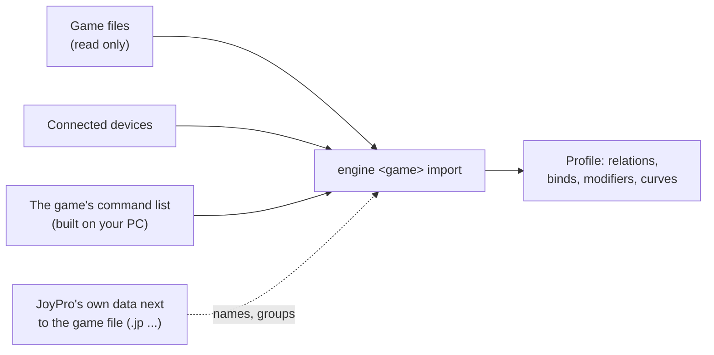

Import reads the control settings a game has saved and turns them into a JoyPro profile: one relation per function
with its button or axis. It is the quickest start: everything you already set up in your games comes in, and from
then on JoyPro keeps it in one place.

:::video import-a-game "Import your first game"
:::

:::layer beginner
## Import in three clicks

1. Open **Start** (the first button in the bottom bar). Under **Your games** every game JoyPro found on your PC has a
   card with its picture. Press **Import** on the game you play most.
2. JoyPro asks **how**:
   - **Add to my profile (recommended)** keeps what you have and adds the game's binds.
   - **Start over from this game** replaces your relations with what the game has (JoyPro keeps a copy of your
     profile first).
   - **Also take the keyboard keys** brings flight commands on the keyboard too. Device binds are always taken.
   - For DCS: **All my DCS aircraft**, or untick it and choose aircraft.
3. Press **Import now**. A moment later the card says "Done: your profile now has 214 relations (180 bound)" and
   **See my relations** opens them. **Look first** instead shows what the game has, without changing anything.

No profile open? JoyPro makes one for you and saves it automatically from then on (there is no Save button: every
change is saved and can be undone, also after a restart).

### What changes in the game?

**Nothing.** Import only reads the game's files. The game keeps its binds exactly as they are, whether you export
later or not.

### Before your first import: the command list

JoyPro needs to know the commands of each game (their names and ids). It builds this list once from your own
installation. When a list is missing, the Start page shows **Build List** (or **Build All Missing Lists**); a game
card offers **Update** after a game update. This takes from a few seconds to a few minutes (DCS reads every module).
:::

:::layer advanced
## Options and what they do

| Option | Default | Effect |
|---|---|---|
| Add to my profile / Start over | Add | Add merges into the open profile (`--merge`); Start over replaces its relations after a confirmation and a copy of the profile. |
| Also take the keyboard keys | your last choice | Flight commands bound to keys come in too (`--include-keyboard true`). |
| Also import devices that are not connected | on | Devices that are not plugged in now are imported too (useful for a stick you connect later). Off: they are skipped and counted (DCS: `--only-connected true`). |
| Treat devices with the same name as one device | on | Windows gives a device a new ID now and then; its old and new files are read as one device on the connected ID (`--merge-same-name true`). Two identical devices plugged in at once stay apart. |
| Include defaults (DCS, expert form) | on | Every default bind DCS has active for an imported device comes in, so that import followed by a Replace + Also clear export leaves DCS as it was. Your own binds win over a default on the same input. |
| Import inverted / slider / curvature / deadzone / saturation (expert form) | off | Takes values set **in the game** for binds JoyPro did not export itself. A bind JoyPro exported gets its tuning back without these. |
| DCS: ignore *_easy aircraft | off | The easy-mode copies of aircraft are left out (`--ignore-easy-planes true`). |

The **expert import** (Start page, below the cards, and the Advanced page) offers every engine option per game with
**Scan** (preview), **Import** and **Export**. Every choice is remembered for the next import.

### Names, groups and modifiers come back

A game file only holds device, input and maybe a curve. JoyPro's export keeps its own data next to it, and an import
reads it back:

| Game | JoyPro's data | Restored |
|---|---|---|
| DCS | `<aircraft>\joystick\<device>.jp`, `modifiers.lua` | relation name, groups (in order), modifiers with names, invert, slider, dead zone, saturation, curve |
| IL-2 Great Battles | `data\input\jp.actions` | name, groups, alias, modifiers, the exact tuning |
| Registry games (X-Plane, Elite, X4, Arma, MSFS, War Thunder, BMS ...) | `<config>.joypro-meta.json` | name, groups, alias, modifiers, tuning |
| Star Citizen | `actionmaps.jp` | names |

The game's current state wins: a curve you changed in DCS after the export is kept. Binds JoyPro never exported get
a name built from the game's action and the groups `DCS`, `IL2` or `GENERATED` + game.

### Two guards

- **Changes not exported yet.** If you changed binds in JoyPro and have not exported them to this game, an import
  would bring the old binds back. JoyPro asks first ([[cli:sync pending]]).
- **Already imported?** When the profile has the game, changes you make in the game later come in through the
  **game watcher** (it asks after the game closes); importing again stays one click.
:::

:::ingame What the import reads, per kind of game
Import never writes into a game folder. What it reads:

- **DCS**: `Saved Games\DCS\Config\Input\<aircraft>\{joystick,keyboard}\*.diff.lua` and `modifiers.lua`, plus the
  defaults of each device from the clean profiles JoyPro built from your DCS install (for "Include defaults").
- **IL-2 Great Battles / Korea**: `data\input\*.actions` and the axis responses.
- **Star Citizen**: `actionmaps.xml` of the branch (LIVE, PTU ...), with the game's joystick defaults on js1.
- **Games with infantry or vehicles** (War Thunder, Arma, Reforger, WARDOGS ...): only the flight actions of the
  file; everything else is ignored, not deleted.
- **MSFS**: the input profiles of the sim (Steam remote folder or the Microsoft Store save) and, on request, the sim's
  default presets.

Devices the game cannot tell apart (two devices of one model in some games) and half-axis binds (Elite) are skipped
and named in the result.
:::

:::layer technical
## How it works inside

1. **GUI.** `StartImportWizard` → `RunImportWizardAsync` (`MainWindowViewModel.GameHub.cs`). It asks
   `AskAboutUnexportedChangesAsync` (engine `sync pending`), confirms Start over and keeps a copy of the profile
   (`BackupProfileBeforeChange("before-import")`), then calls the game's import: `ImportDcsAsync`, `ImportIl2Async`,
   `ImportStarCitizenAsync` or `ImportRegistryGameAsync`. **Look first** runs the same with `scan`
   (`PreviewImportWizardAsync`) and opens the Output panel.
2. **Engine.** For DCS: `engine dcs import [--path <Saved Games\DCS>] --merge --include-defaults [--plane <a> --plane <b>]
   --include-keyboard true|false --ignore-easy-planes false --only-connected false --merge-same-name true`. The importer reads each device file, maps the
   device by its DirectInput instance GUID and name, maps every command id to the game's command list (`DB\<game>`
   in `%LOCALAPPDATA%\JoyPro2\GameData`), and builds one relation per function and input. Load-time corrections
   (`--load-corrections`, `--correction-mode`) remap renamed command ids with a confidence score.
3. **Profile.** The relations are merged by name and by the same input; modifiers are created from `modifiers.lua`
   (DCS) or the game's shift settings. The profile is saved atomically and every save is a version in
   `<data>\ProfileHistory` (Undo works across restarts).
4. **Watcher.** An import of a game without a sync record records the game's files, so changes you make in the game
   later are noticed (`<data>\Sync\<game>.json`).

Engine commands: [[cli:dcs import]], [[cli:dcs scan]], [[cli:il2 import]], [[cli:starcitizen import]] and
`engine <game> import` for every registry game (for example [[cli:warthunder import]], [[cli:msfs2024 import]]).
Re-import rules: [[doc:reimport|re-import]]. Tests: `engine\tests\smoke\dcsincludedefaults.ps1`,
`engine\tests\smoke\roundtrip.ps1`, `gui\JoyPro.Gui.Tests\ImportSettingsPersistTests.cs`.
:::

## Related

- [[gui:start|The Start page]], every control on it
- [[page:getting-started/first-start.html|First start]]: which games JoyPro finds
- [[page:flows/relations.html|Build relations]]: what to do after the import
- [[doc:sync-watcher|The game watcher]]
