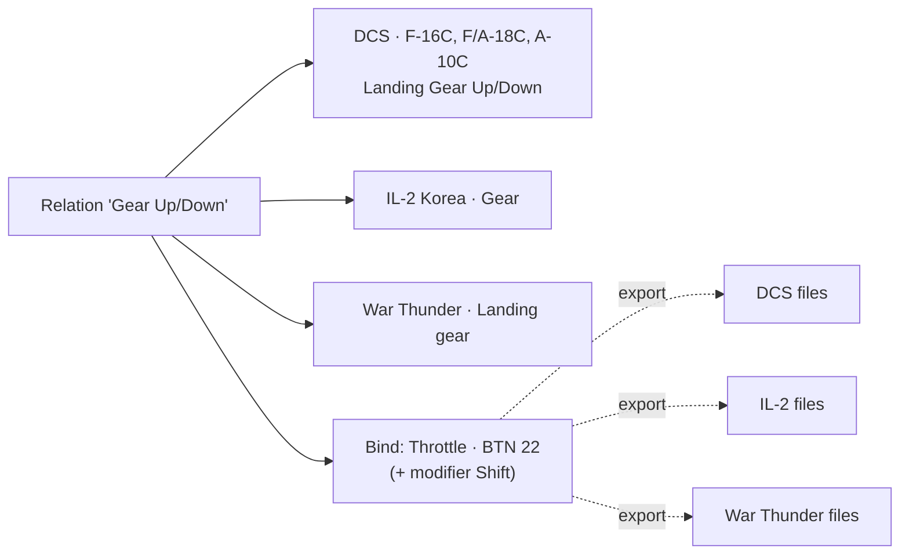
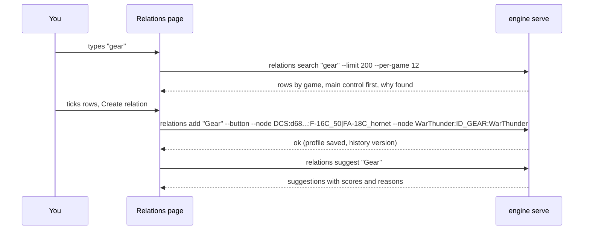

A **relation** is one function, for example "Gear Up/Down" or "Throttle". It holds that function's action in every
game and aircraft you fly: DCS F-16C "Landing Gear Up/Down", IL-2 "Gear", War Thunder "Landing gear", Star Citizen
"Toggle landing gear". You give the relation **one** button or axis on the [[gui:binds|Binds]] page, and that button
then does the same function everywhere.

:::video build-relations "Build relations: search, tick, add"
:::

:::layer beginner
## Relations in plain words

Think of a relation as a **label for a job**: "put the gear down". Each game calls that job something else and stores
it under its own code. The relation collects them all, so you decide once which button does the job.

- **Relations page**: the list of your relations on the left, the open relation in the middle, tools on the right.
- **Binds page**: which button or axis each relation is on.
- **Export**: writes it into every game.

### Make one, step by step

1. Press **New relation** (or Ctrl+N) and type a name, for example `Gear`.
2. Under **Add actions**, type what it does: `gear`. JoyPro searches every game and aircraft while you type and knows
   other words for the same thing (`throttle` also finds thrust and the helicopter collective, `flare` the
   countermeasure dispense switch).
3. The results come grouped by game. Each game's main control of the function comes first. Tick what belongs.
4. Press **Create relation with n actions**. Done: open the Binds page and press the button you want for it.

### Let JoyPro do it

- **Suggested for this relation** lists what else means the same in other games and aircraft. **Add** one or
  **Add all**.
- **Auto-build relations from all my actions...** builds relations for the whole profile: the same function of every
  aircraft and game together (**By function**, called Auto Group). You see a preview first.
- **JoyPro assistant**: type a sentence like "make a throttle relation for every game" and it does it. **Undo this**
  takes the whole answer back.

Every change can be undone with **Ctrl+Z**, also after a restart.
:::

:::layer advanced
## Working with many relations

- **Filters** above the list: groups, games and their aircraft, devices, bound or not, axis or button. The search can
  look at names only, names and actions, or everything (remembered). Ctrl/Shift+click ticks several relations for
  **Bulk changes** (groups, duplicate, delete).
- **The open relation**: rename in place (Enter), its kind (Axis or Button), its input, the **function chip** (what
  JoyPro thinks the relation is, from its function catalog), **Suggest missing (n)**, **Duplicate** (with or without
  the bind), delete. Below, **Its actions**: one card per game action with the game badge, the aircraft, the title.
  Drag a card by its grip to change the order (or Alt+Up / Alt+Down).
- **Aircraft of an action** (DCS): a click on an action opens its aircraft, "82 of 84 aircraft", each with a tick.
  The same DCS command id can mean something else in another aircraft (`a2001cdnil` is "Pitch" in jets and
  "Cyclic Pitch" in helicopters; a cockpit switch id is three different switches in three warbirds): JoyPro adds only
  aircraft where the id means the same and flags the others.
- **Suggestions** come from four sources, without any AI: the function catalog (checked against the manuals), your
  own style (what you put on this function in other aircraft), the same DCS id where it means the same, and similar
  titles in any game (never the opposite direction). High from 85 points, medium from 55; weak ones only on request.
  **x** dismisses a suggestion for good (kept in the relation switched off, so it never comes back).
- **Already in another relation**: a row says "Already in 'Flare'" and offers **Move here**.
- **Catalog**: every action of a game or aircraft by its categories, for browsing instead of searching.
- **Auto Group** works for DCS, Falcon BMS, IL-2 Great Battles and Korea, Star Citizen, X4, Elite Dangerous, MSFS 2020
  and 2024, X-Plane 11 and 12, War Thunder, Arma 3, Arma Reforger and WARDOGS. **Group by description** groups only
  what a sentence names ("all radio and comms functions of the F-16 and the A-10").

### What the Check looks at

Two relations with the same input that both have an action of the same aircraft switched on mean one button does two
things there; one action on in two relations means the game gets it on two buttons. The [[page:flows/check.html|Check]]
lists both with one-click fixes.
:::

:::ingame What a relation means in the game
A relation itself changes nothing in a game. At the next [[page:flows/export.html|export]] every action of the relation
gets the relation's bind, in each game and aircraft where the action is switched on:

- **DCS**: in every ticked aircraft the command gets the button (with the modifier when the bind has one). An aircraft
  switched off in the action keeps whatever it had (or nothing, with Replace).
- **IL-2, BMS, X-Plane, MSFS, War Thunder ...**: one action per game; it gets the button.
- **Star Citizen and games with infantry**: only the ship or aircraft action gets the button; on-foot binds stay.
- **Axis relations** carry the curve, dead zone, saturation, invert and slider of the bind, written in each game's own
  response model (DCS curvature, IL-2 response, MSFS sensitivity, X-Plane response curve ...).

So after one export, "Throttle · BTN 22" lowers the gear in the F-16, the F/A-18, the A-10C, IL-2 Korea and War
Thunder, and the player finds the same switch for the same job in every cockpit.
:::

:::layer technical
## How it works inside

- **Data model** (`engine\CoreRelation.cs`, `CoreProfile.cs`): a `.pr0file` holds `Relation` objects; each has a name,
  groups, `IsAxis`, a list of `RelationItem` (game, id, aircraft with on/off state, order) and a `Bind` (device, input,
  modifiers, axis tuning per scope). Modifiers are separate objects referenced by name. The profile is saved atomically
  and versioned (`ProfileHistory.cs`).
- **Search** (`engine relations search`): one index over every game's command list (`DB\<game>` in the game-data
  folder), the function catalog `DB\Functions` (functions, synonyms, game terms, checked against manuals) and per-id
  meanings (`EngineIdMeanings.cs`: same / near / differs per DCS aircraft). The GUI runs it 300 ms after the last key;
  quick commands go to one long-running `engine serve` (the engine server) instead of a new process each.
- **Changes**: `relations add <name> --axis|--button --node Game:Id:Plane1|Plane2`, `relations suggest apply <relation>
  --add ... | --take | --never | --remove`, `relations rename`, `relations item move`, `relations aircraft set`. Each is
  one engine command, so one undo step.
- **Suggestions**: `relations suggest <relation> [--min high|medium|low]` (scores as above); `relations suggest --all
  --missing` for every relation at once.
- **Auto Group**: deterministic rules plus the learned style (at least two separate decisions in your own relations);
  preview, then apply. The optional local AI model only calls the same tools; without it the offline rules answer.

Engine commands: [[cli:relations search]], [[cli:relations add]], [[cli:relations suggest]],
[[cli:relations browse]], [[cli:relations assistant]], [[cli:relations auto-group]], [[cli:relations from-text]].
Docs: [[doc:relation-builder|Relations page reference]], [[doc:auto-group|Auto Group]],
[[doc:natural-language-grouping|Group by description]], [[doc:suggest-additions|Suggest additions]].
:::

## Related

- [[gui:relations|The Relations page]], every control on it
- [[gui:binds|The Binds page]]: give the relation its button
- [[gui:modifiers|Modifiers]]: one button changes what others do
