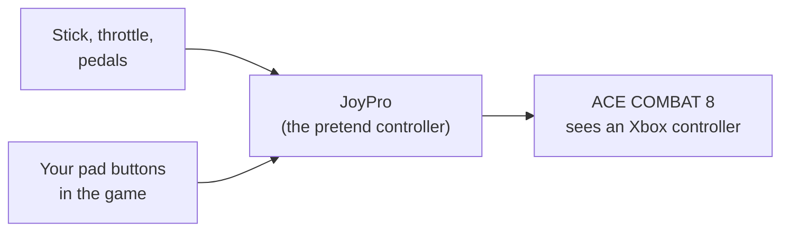

ACE COMBAT is an arcade air combat series, and its two current PC games could not be more different for a HOTAS.
**ACE COMBAT 8** reads no flight stick, only an Xbox controller. JoyPro turns your stick, throttle and pedals into a
pretend controller (a virtual Xbox pad) and writes nothing into the game. **ACE COMBAT 7** reads your sticks itself and
keeps their binds in a text file, `Input.ini`: JoyPro reads and writes it like any other game. ACE COMBAT Zero and
Assault Horizon are documented only.

:::video game-ace-combat "ACE COMBAT: import, relations, export"
:::

{{game-card}}

:::layer beginner
## Get it working in 3 steps

### ACE COMBAT 8

:::steps
1. **Set it all up for me** then **Use these buttons**
2. **Set up the pretend controller** then **Test**
3. **Start the game** at its title screen: Alt+Tab, **Start**
:::

### ACE COMBAT 7

:::steps
1. **Start the game once** then close it
2. **Set it all up for me** then **Use these buttons**
3. **Write to my game** keep the game closed
:::

## ACE COMBAT 8: set it up once

1. On the Start page, press **Set it all up for me**. Or pick the welcome's answer **Play ACE COMBAT with my flight
   stick**: a short tour then shows you every step.
2. Look at the list of what goes where. Press **Use these buttons**.
3. Press **Set up the pretend controller**. The setup window closes. The Virtual Joystick page opens.
4. The pretend controller needs a free helper called ViGEmBus. Tick the box below its license. Then press **Install
   ViGEmBus**. Windows asks for permission: click **Yes**. You do this only once.
5. Press **Test**. Move your stick. The controller picture moves with it. Press a button: it lights up.

You do not need to switch anything. ACE COMBAT 8 uses the pretend controller by itself. The page says "On the Xbox
pad by itself: the game reads only Xbox controllers". You need no HidHide for this game: it never sees your real
sticks anyway.

## ACE COMBAT 8: every time you play

1. Start ACE COMBAT 8. Wait until it shows its title screen.
2. Hold Alt and press Tab. You are back in JoyPro.
3. Press **Start**.
4. Press Alt+Tab again. You are back in the game. Fly!
5. When you are done, press **Stop**.

:::warn Start comes after the game
Press **Start** only when the game shows its title screen. Too early? JoyPro says "Too early". Press **Stop**, then
**Start**. Do this every time you play.
:::

## What goes where in ACE COMBAT 8

| On your HOTAS | On the pretend controller | In the game |
|---|---|---|
| Stick forward, back, left, right | Left stick | Pitch and roll |
| Throttle lever | Forward: RT. Back: LT. | Speed up and slow down |
| Stick twist (or the pedals) | LB and RB, from about 30 % | Yaw left and right |
| A free hat on your stick | Right stick | Look around |
| Your flare button | L3 and R3 together | Flares (not confirmed in game) |
| Your comm switch or AI-menu hat | D-pad | Wingman orders |
| A button relation named "High-G" | Both triggers fully | High-G turn |

The **Live test** tab of the Virtual Joystick page says what each button does, for example "A: Fire machine gun".

:::note Flares are not confirmed in game
JoyPro presses L3 and R3 together for flares. Nobody has confirmed this in the game yet. JoyPro says so too.
:::

## Look around on a hat

The game looks around with the right stick of the pretend controller. JoyPro puts it on a free hat of your stick.
Hold a hat direction, and the view turns that way. Often this is the top hat of your stick. The hat keeps its job in
your other games, for example trim in DCS. See
[[page:how-do-i/head-tracking.html|Head tracking and looking around]].

## ACE COMBAT 7: the quick way

1. **Start ACE COMBAT 7 once** with all your devices connected, then quit. The game writes `Input.ini` when it closes.
2. On the Start page, press **Set it all up for me**. Look at the list. Press **Use these buttons**.
3. **Close the game.** Press **Write to my game**. JoyPro keeps a copy of the old file.

Did you bind buttons in ACE COMBAT 7 before? Then the Start page offers **Import, then fill the gaps**. Your binds
stay, and only free buttons get new jobs.

## ACE COMBAT 7: import your own binds

1. **Start ACE COMBAT 7 once** with all your devices connected, then quit.
2. Open **Start**. Before that file exists, JoyPro uses its own list of the 20 flight actions. **Update** on the card
   builds the list from your file.
3. Press **Import** on the ACE COMBAT 7 card, keep **Add to my profile (recommended)**, press **Import now**.

## Build and check relations

One relation can hold the ACE COMBAT 7 action and the ACE COMBAT 8 action of the same function. Then both games get it
from one button ([[page:flows/relations.html|relations flow]]). The Check finds one button that does two things in
ACE COMBAT 7. Press **Check** in the bottom bar, or **Check now** on the Export page
([[page:flows/check.html|the Check]]).

## Export

- **ACE COMBAT 7**: **close the game**, open **Export**, keep **Replace on my devices** with **Also clear my other
  devices**, press **Export now** on its card.
- **ACE COMBAT 8**: an export writes nothing and says so. Your binds reach the game through the pretend controller
  while **Start** is on.

:::ingame What you see in ACE COMBAT
**ACE COMBAT 8** sees one Xbox controller: the menus show pad buttons, and **SYSTEM > CONTROLS > CONTROLLER > BUTTON
MAPPING** lists the nine remappable actions (yaw left and right, accelerate, decelerate, fire machine gun, fire
missile, change weapon, change target, radar map) with their pad buttons. Your stick moves the menu focus like the
pad's left stick.

**ACE COMBAT 7** has no menu to remap flight-stick binds: it reads them from `Input.ini`. Whether its controls menu
shows them is not confirmed yet. JoyPro's in-game test confirmed that the game keeps every value JoyPro wrote when it
rewrites the file on exit.
:::

:::picture ingame-ace-combat-controls "ACE COMBAT: the controls menu with the exported binds"
:::

## What you do yourself

- **ACE COMBAT 8**: press **Start** at the title screen, every time you play (see above).
- **ACE COMBAT 8**: after you change a pad button in **BUTTON MAPPING**, press **Update** on the game's card. Then press
  **Update mapping** on the Virtual Joystick page. JoyPro then follows your new buttons.
- **ACE COMBAT 7**: start the game once with each device connected. A device without a section in the file is skipped
  with "start the game once with this device connected". Switch **Steam Input** off for the game.

## Common pitfalls

- **ACE COMBAT 8 does not react**: was **Start** pressed too early? Press **Stop**, then **Start** at the title screen.
- **ACE COMBAT 8: the nose goes the wrong way**: did you set "Pitch Controls: Inverted" in the game? See Advanced.
- **ACE COMBAT 8: no ViGEmBus**: without it, the game cannot see your stick. Install it on the Virtual Joystick page.
- **ACE COMBAT 7: an axis sits at half**: the game averages one action over all devices. A throttle at 100 % and the
  same action on a slider at -100 % give 50 %. Bind each axis action on one device only (**Update, my profile wins**
  clears it on the others).
- **ACE COMBAT 7: two sticks of the same model** share one section; the game cannot tell them apart.

More: [[page:how-do-i/xbox-only-games.html|Play an Xbox-only game with a HOTAS]].
:::

:::layer advanced
## How the pretend controller works

- **No HidHide.** ACE COMBAT 8 reads only Xbox controllers, so it never sees your real sticks. Nothing has to be
  hidden, and Windows asks for no administrator rights. HidHide is only for games set to vJoy.
- **The mode switches itself.** While you have not picked a mode, the game uses the Xbox pad. Pick another mode on the
  Virtual Joystick page, and JoyPro keeps your choice.
- **The game's layout first**: each relation on an ACE COMBAT 8 action is pinned to the pad control the game uses for
  it (read from the game's save). Pitch and roll go to the left stick, looking around to the right stick.
- **Throttle**: the throttle lever drives both triggers. Forward is RT, back is LT, the centre is neutral. This also
  works when "decelerate" sits in another relation, such as a toe brake.
- **Yaw**: the stick twist (else the rudder pedals) presses LB and RB at about 30 % deflection.
- **Look around**: with no axis on the look actions, a free hat drives the right stick ("Hat to axes"). Each direction
  holds the stick fully out while you hold it, a diagonal moves both. JoyPro takes a hat your look or view relation
  of another game uses, else the top hat of your stick. A free ministick on the look actions always wins.
- **Flares**: L3 and R3 pressed together for 120 ms, from your flare or countermeasures relation. Not confirmed in game.
- **Wingman orders** go on the D-pad, from your comm switch or AI-menu hat.
- **High-G turn**: a button relation named "High-G" holds both triggers. So does the relation with DCS's ASC Direct
  Control (the "Cobra button" of the Su-27, Su-33 and J-11A). The throttle on the triggers keeps working.
- **One input, one job**: an input that drives one of these functions leaves the table, so it never presses two
  controls.
- **Your curve reaches the pad.** The dead zone, saturation, curve and invert of **Axis response** (Binds page) are
  applied to the pad stick or trigger. Tick only ACE COMBAT 8 under **Applies to** for a curve of its own. Else the
  **Default curve** counts.
- **Pitch**: DCS's invert never reaches the pad. By default a stick pushed forward gives nose down. With "Pitch
  Controls: Inverted" in the game, untick Invert for ACE COMBAT 8 alone (Axis response, Applies to: ACE COMBAT 8).
- **Roll the wrong way**: JoyPro passes roll straight through. Tick Invert on the roll relation for ACE COMBAT 8 alone.
- **What does not fit** a pad (two sticks, two triggers, 14 buttons, the D-pad) is listed on the Virtual Joystick page.
- **Several games on the pad**: ACE COMBAT 7 and 8 can both use it, each with its own table. With auto start the
  running game's table goes live. Else pick it under **Xbox pad table for Start and Test**.
- **Auto start** makes the pad within about 3 seconds of the game's start, before its title screen. That can be too
  early for this game: then press **Stop** and **Start** at the title screen.
- **Experts**: vJoy, HidHide, the forwarding rate and the modes are under **Show details for experts (vJoy, HidHide,
  modes)**.
- **ACE COMBAT Zero** ships inside the ACE COMBAT 8 folder (`ACZero\acz.exe`). It is not researched: to try it, press
  **Start** for ACE COMBAT 8 by hand and launch Zero. Not tested.

## Files JoyPro reads and writes

| File | What it is |
|---|---|
| `%LOCALAPPDATA%\BANDAI NAMCO Entertainment\ACE COMBAT 7\Config\Input.ini` | ACE COMBAT 7: `[JoystickSetting]` and one `[Joystick-<product GUID>]` section per device model with `ProductName=` and every `Flight_*` and `UI_*` key |
| `...\ACE COMBAT 7\Config\Input.ini.joypro-meta.json` | JoyPro's data of the exported binds (names, groups) for the next import |
| `%LOCALAPPDATA%\BANDAI NAMCO Entertainment\ACE COMBAT 8\Saved\SaveGames\System.sav` | ACE COMBAT 8: the pad keys you set in the game; **read only** |

## The export modes in ACE COMBAT 7

One input per action and device. Menu keys (`UI_*`) and combinations JoyPro does not read are never changed.

| Mode | What happens |
|---|---|
| **Only add** | An action that already has a value on that device keeps it; a bind on an input the game uses for another action is not written and gets the mark "Not written to the game". |
| **Update, keep the game's binds** | The profile's value is written; another action on the same input is released; the action's values on other devices stay (an axis the game averages is reported). |
| **Update, my profile wins** | As above, and every action the profile binds is cleared on the other connected devices. |
| **Replace on my devices** | The sections JoyPro writes keep only your readable values; a written axis is still cleared on the other connected devices. |
| **+ Also clear my other devices** | The readable values of the other connected devices are cleared. |

Comments, order, encoding and line ends of `Input.ini` stay. ACE COMBAT 8 has no export modes: nothing is written.

## What is never touched

- ACE COMBAT 7: the keyboard, menu keys, combinations, the section of a device that is not connected, the import's
  ignored devices and the vJoy device JoyPro tunnels into.
- ACE COMBAT 8: every file of the game, and HidHide.

## Axes, watcher, HUD

- **ACE COMBAT 7**: global binds (no aircraft profiles); invert only (`:R`), no curves or dead zones; the game reads up
  to 32 buttons, 8 axes and 4 hats with four directions per device; no modifiers.
- **Watcher**: ACE COMBAT 7's `Input.ini` is watched after the game closes ([[doc:sync-watcher|the watcher]]);
  ACE COMBAT 8 has nothing JoyPro writes, so nothing to watch.
- **HUD**: while the game runs, the [[gui:hud|HUD]] names the action of each pressed button.
- No force feedback and no telemetry in either game.
:::

:::layer technical
## Inside the ACE COMBAT integrations

Code: `engine\Games\AceCombat7Integration.cs`, `engine\Games\AceCombat8Integration.cs`; the pad planner and forwarder
of [[doc:virtual-joystick]], the pad's own functions in `engine\VJoy\XboxPadAutoSetup.cs`.

- **ACE COMBAT 7 sections**: `Joystick-` + the DirectInput product GUID (PID high word + VID, then `504944564944`,
  "PIDVID"). Objects `X Y Z Rx Ry Rz Slider1 Slider2`, `Button1`-`Button32`, `POV_U/D/L/R1`-`4`; options `:P` / `:N`
  (half), `:R` (reversed), `:C` (-1..1 as 0..1); combinations `&`, `!`, `+`, `>`, `<`; an empty value is unbound.
  JoyPro writes an axis as `X` or `Y:R`, a button as `ButtonN`, a hat direction as `POV_<U|D|L|R><n>`. Combinations
  and half axes are reported on import, not read.
- **ACE COMBAT 7 actions**: axes `Flight_Pitch/Roll/Yaw/Throttle/CameraPitch/CameraYaw`; buttons
  `Flight_Gun/Missile/Target/Weapon/Radar/Flare/View/AccelerationDeceleration/AutoPilot/Pause` and
  `Flight_HatSwitchUp/Down/Left/Right`. [[cli:ac7 refresh-db]] takes the `Flight_*` keys from your file.
- **ACE COMBAT 8**: `System.sav` is Unreal GVAS with a `Checksum`; it holds nine gamepad keys as Unreal key names
  (`YawLeftKey_Controller` = `Gamepad_LeftShoulder` ...). [[cli:ac8 refresh-db]] reads them into one `Pad_*` action
  per control with the key in the 5th column of the list; the sticks come from JoyPro's own table.
- **Pad mode**: the game declares `MaxJoysticks` 0 and the suggested mode xbox, so without a stored choice its mode is
  xbox (`VJoySettings.ModeOf`). [[cli:vjoy mode]] `AceCombat8 xbox` stores a choice. [[cli:vjoy map]],
  [[cli:vjoy forwarder-config]] `--xbox-game AceCombat8`. No HidHide step: with only such games in a virtual mode,
  [[cli:vjoy apply-hidhide]] says "HidHide is not needed" and starts nothing elevated.
- **Pad functions**: the throttle split (`XB_TRIGGERS`), yaw ("Axis ends to buttons", end zone 0.35), the flare chord
  (`IGamePadChords.PadChords`, `Confirmed = false`), the D-pad, the High-G hold (`PadHolds`) and the look hat
  (`hat-axes`, `IGamePadConventions.PadLookActions` = `Pad_CameraYaw` / `Pad_CameraPitch`) are made again at every plan.
  `Pad_Pitch` is reversed by default (`PadInvertDefault`).
- **Check**: [[cli:vjoy pad-check]] reports what the profile reaches on the pad (pitch, roll, gun, missile, target,
  throttle split, yaw, chords, hold, D-pad, look), with a score.
- **Commands**: [[cli:ac7 paths]], [[cli:ac7 scan]], [[cli:ac7 import]], [[cli:ac7 export]]; [[cli:ac8 scan]],
  [[cli:ac8 import]], [[cli:ac8 export]] (writes nothing).

### Known limits

- ACE COMBAT 7: whether the controls menu shows stick binds, and a flight with `:R` on pitch and `:C` on a throttle,
  are not confirmed yet.
- ACE COMBAT 8: the flare chord (L3 + R3) and the view button are not confirmed in game yet.
- ACE COMBAT 8: only the few sticks the game supports itself (a Thrustmaster and a HORI model) work without the pad;
  JoyPro does not write their settings.
- Tests: `engine\tests\smoke\acecombat7.ps1`, `acecombat8.ps1`; in the game `tools\e2e\games\AceCombat7Settings.ps1`
  (export, start, the rewritten file still holds every value, import) and `AceCombat8Xbox.ps1` (menus with the
  virtual pad, created once the title screen shows).
:::
