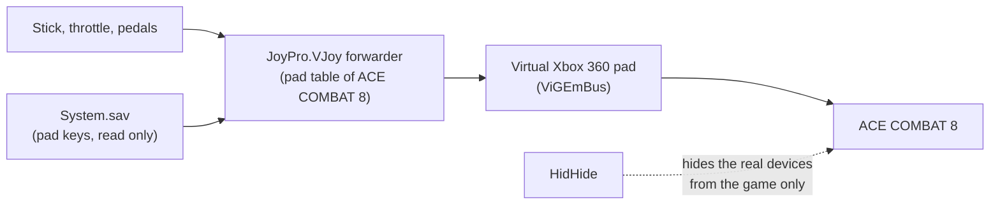

ACE COMBAT is an arcade air combat series, and its two current PC games could not be more different for a HOTAS.
**ACE COMBAT 7** reads any number of DirectInput sticks and keeps their binds in a text file, `Input.ini`: JoyPro
reads and writes it like any other game. **ACE COMBAT 8** reads no generic joystick, only Xbox pads: JoyPro turns your
HOTAS into a virtual Xbox pad and writes nothing into the game (its settings file carries a checksum). ACE COMBAT Zero
and Assault Horizon are documented only.

:::video game-ace-combat "ACE COMBAT: import, relations, export"
:::

{{game-card}}

:::layer beginner
## What JoyPro does for ACE COMBAT

| Game | How JoyPro reaches it |
|---|---|
| **ACE COMBAT 7: Skies Unknown** | Native: import and export of `Input.ini`, one section per device model. |
| **ACE COMBAT 8: Wings of Theve** | Virtual Xbox pad: JoyPro reads the pad keys you set in the game and puts each HOTAS input on the pad control the game uses. Nothing is written into the game. |
| **ACE COMBAT Zero** (comes with ACE COMBAT 8) | Not researched. You can try the virtual Xbox pad of ACE COMBAT 8 (see Advanced). |
| **ACE COMBAT Assault Horizon Enhanced Edition** | Reads only Xbox pads; no longer sold. The virtual Xbox pad is the route; JoyPro has no integration. |

## ACE COMBAT 7: import your binds

1. **Start ACE COMBAT 7 once** with all your devices connected, then quit. The game writes `Input.ini` when it
   closes, with one section per device model.
2. Open **Start**. Before that file exists, JoyPro uses its own list of the 20 flight actions; **Update** on the card
   builds the list from your file.
3. Press **Import** on the ACE COMBAT 7 card, keep **Add to my profile (recommended)**, press **Import now**.

## ACE COMBAT 8: set up the virtual Xbox pad

1. Open the [[gui:vjoy|Virtual Joystick]] page. Under **What this page needs**, install **ViGEmBus** (the virtual pad)
   and **HidHide** with one click each, if they are missing.
2. Under **Games**, switch ACE COMBAT 8 to **Xbox pad**. JoyPro already suggests it there with **Use it**.
3. Bind your relations to the ACE COMBAT 8 actions (**Relations** page): pitch and roll, camera, yaw left / right,
   accelerate and decelerate, the weapons. A throttle lever on both accelerate and decelerate becomes one axis on the
   two triggers: above the centre it accelerates, below it brakes.
4. Press **Start** on the Virtual Joystick page, then start the game. Press **Stop** when you are done.

## Build and check relations

One relation can hold the ACE COMBAT 7 action and the ACE COMBAT 8 action of the same function, so both games get it
from one button ([[page:flows/relations.html|relations flow]]). **Check** on the Export page finds one button that
does two things in ACE COMBAT 7.

## Export

- **ACE COMBAT 7**: **close the game**, open **Export**, keep **Replace on my devices** with **Also clear my other
  devices**, press **Export now** on its tile.
- **ACE COMBAT 8**: an export writes nothing and says so. Your binds reach the game through the virtual pad, which
  **Start** sets up from your relations.

:::ingame What you see in ACE COMBAT
**ACE COMBAT 7** has no menu to remap flight-stick binds: it reads them from `Input.ini`. Whether its controls menu
shows them is not confirmed yet. JoyPro's in-game test confirmed that the game keeps every value JoyPro wrote when it
rewrites the file on exit.

**ACE COMBAT 8** sees one Xbox controller: the menus show pad buttons, and **SYSTEM > CONTROLS > CONTROLLER > BUTTON
MAPPING** lists the nine remappable actions (yaw left and right, accelerate, decelerate, fire machine gun, fire
missile, change weapon, change target, radar map) with their pad buttons. Your stick moves the menu focus like the
pad's left stick.
:::

:::picture ingame-ace-combat-controls "ACE COMBAT: the controls menu with the exported binds"
:::

## What you do yourself

- **ACE COMBAT 7**: start the game once with each device connected (a device without a section is skipped with "start
  the game once with this device connected"), and switch **Steam Input** off for the game.
- **ACE COMBAT 8**: after you change a pad button in **BUTTON MAPPING**, press **Update** on the game's card and then
  **Update mapping** on the Virtual Joystick page, so the pad table follows.
- **ACE COMBAT 8**: flares, autopilot, view and the other buttons sit on fixed pad buttons that the save file does not
  name. The Virtual Joystick page lists the free pad buttons JoyPro gave them; check them in a mission.

## Common pitfalls

- **ACE COMBAT 8 does not react to the pad**: in JoyPro's tests a pad created before the game had started did not
  always reach it. Press **Stop** and **Start** once the title screen shows.
- **ACE COMBAT 7: an axis sits at half**: the game averages one action over all devices. A throttle at 100 % and the
  same action on a slider at -100 % give 50 %. Bind each axis action on one device only (**Update, my profile wins**
  clears it on the others).
- **ACE COMBAT 7: two sticks of the same model** share one section; the game cannot tell them apart.
:::

:::layer advanced
## Files JoyPro reads and writes

| File | What it is |
|---|---|
| `%LOCALAPPDATA%\BANDAI NAMCO Entertainment\ACE COMBAT 7\Config\Input.ini` | ACE COMBAT 7: `[JoystickSetting]` and one `[Joystick-<product GUID>]` section per device model with `ProductName=` and every `Flight_*` and `UI_*` key |
| `...\ACE COMBAT 7\Config\Input.ini.joypro-meta.json` | JoyPro's data of the exported binds (names, groups) for the next import |
| `%LOCALAPPDATA%\BANDAI NAMCO Entertainment\ACE COMBAT 8\Saved\SaveGames\System.sav` | ACE COMBAT 8: the pad keys you set in the game; **read only** |

## The export modes in ACE COMBAT 7

One input per action and device. Menu keys (`UI_*`) and combinations JoyPro does not read are never changed.

| Mode | What happens |
|---|---|
| **Only add** | An action that already has a value on that device keeps it; a bind on an input the game uses for another action is not written and gets the mark "Not written to the game". |
| **Update, keep the game's binds** | The profile's value is written; another action on the same input is released; the action's values on other devices stay (an axis the game averages is reported). |
| **Update, my profile wins** | As above, and every action the profile binds is cleared on the other connected devices. |
| **Replace on my devices** | The sections JoyPro writes keep only your readable values; a written axis is still cleared on the other connected devices. |
| **+ Also clear my other devices** | The readable values of the other connected devices are cleared. |

Comments, order, encoding and line ends of `Input.ini` stay. ACE COMBAT 8 has no export modes: nothing is written.

## What is never touched

- ACE COMBAT 7: the keyboard, menu keys, combinations, the section of a device that is not connected, the import's
  ignored devices and the vJoy device JoyPro tunnels into.
- ACE COMBAT 8: every file of the game.
- HidHide hides your real devices only from ACE COMBAT 8, only while the virtual pad runs; every other program keeps
  seeing them, and **Stop** gives HidHide back exactly its previous setup.

## The virtual Xbox pad of ACE COMBAT 8

- **The game's layout first**: each relation on an ACE COMBAT 8 action is pinned to the pad control the game uses for
  it (read from `System.sav`); pitch and roll go to the left stick, the camera to the right stick.
- **Throttle**: one axis on accelerate and decelerate becomes the centre-split trigger pair.
- **Invert**: *Invert* on a relation reverses the pad axis in JoyPro's forwarder; the game's own options apply after.
- **What does not fit** a pad (two sticks, two triggers, 14 buttons, the D-pad) is listed on the Virtual Joystick page.
- **Virtual functions** (toggles, axis bands, short / long press ...) work for ACE COMBAT 8 too, on the pad's controls.
- **ACE COMBAT Zero** ships inside the ACE COMBAT 8 folder (`ACZero\acz.exe`). It is not researched: to try it, start
  the virtual pad of ACE COMBAT 8 by hand and launch Zero. Not tested.

## Axes, watcher, HUD

- **ACE COMBAT 7**: global binds (no aircraft profiles); invert only (`:R`), no curves or dead zones; the game reads up
  to 32 buttons, 8 axes and 4 hats with four directions per device; no modifiers.
- **Watcher**: ACE COMBAT 7's `Input.ini` is watched after the game closes ([[doc:sync-watcher|the watcher]]);
  ACE COMBAT 8 has nothing JoyPro writes, so nothing to watch.
- **HUD**: while the game runs, the [[gui:hud|HUD]] names the action of each pressed button.
- No force feedback and no telemetry in either game.
:::

:::layer technical
## Inside the ACE COMBAT integrations

Code: `engine\Games\AceCombat7Integration.cs`, `engine\Games\AceCombat8Integration.cs`; the pad planner and forwarder
of [[doc:virtual-joystick]].

- **ACE COMBAT 7 sections**: `Joystick-` + the DirectInput product GUID (PID high word + VID, then `504944564944`,
  "PIDVID"). Objects `X Y Z Rx Ry Rz Slider1 Slider2`, `Button1`-`Button32`, `POV_U/D/L/R1`-`4`; options `:P` / `:N`
  (half), `:R` (reversed), `:C` (-1..1 as 0..1); combinations `&`, `!`, `+`, `>`, `<`; an empty value is unbound.
  JoyPro writes an axis as `X` or `Y:R`, a button as `ButtonN`, a hat direction as `POV_<U|D|L|R><n>`. Combinations
  and half axes are reported on import, not read.
- **ACE COMBAT 7 actions**: axes `Flight_Pitch/Roll/Yaw/Throttle/CameraPitch/CameraYaw`; buttons
  `Flight_Gun/Missile/Target/Weapon/Radar/Flare/View/AccelerationDeceleration/AutoPilot/Pause` and
  `Flight_HatSwitchUp/Down/Left/Right`. [[cli:ac7 refresh-db]] takes the `Flight_*` keys from your file.
- **ACE COMBAT 8**: `System.sav` is Unreal GVAS with a `Checksum`; it holds nine gamepad keys as Unreal key names
  (`YawLeftKey_Controller` = `Gamepad_LeftShoulder` ...). [[cli:ac8 refresh-db]] reads them into one `Pad_*` action
  per control with the key in the 5th column of the list; the sticks come from JoyPro's own table.
- **Virtual pad**: [[cli:vjoy mode]] `AceCombat8 xbox`, [[cli:vjoy map]], [[cli:vjoy forwarder-config]]
  `--xbox-game AceCombat8`; HidHide through [[cli:vjoy apply-hidhide]] / [[cli:vjoy restore-hidhide]].
- **Commands**: [[cli:ac7 paths]], [[cli:ac7 scan]], [[cli:ac7 import]], [[cli:ac7 export]]; [[cli:ac8 scan]],
  [[cli:ac8 import]], [[cli:ac8 export]] (writes nothing).

### Known limits

- ACE COMBAT 7: whether the controls menu shows stick binds, and a flight with `:R` on pitch and `:C` on a throttle,
  are not confirmed yet.
- ACE COMBAT 8: the pad buttons of flares and view, throttle on the triggers and yaw on LB / RB in flight are not
  confirmed yet.
- ACE COMBAT 8: only the few sticks the game supports itself (a Thrustmaster and a HORI model) work without the pad; JoyPro does not write their settings.
- Tests: `engine\tests\smoke\acecombat7.ps1`, `acecombat8.ps1`; in the game `tools\e2e\games\AceCombat7Settings.ps1`
  (export, start, the rewritten file still holds every value, import) and `AceCombat8Xbox.ps1` (menus with the
  virtual pad).
:::
