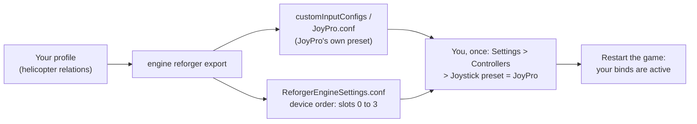

Arma Reforger takes joysticks through a joystick preset file that you pick in the game's settings. JoyPro writes its
own preset, `JoyPro.conf`, with your helicopter binds on your joysticks, and you select it once. The game's own
rebind file is never touched. Reforger uses at most four joysticks, so JoyPro also writes the game's device order
rules that say which device is joystick 0, 1, 2 or 3.

:::video game-arma-reforger "Arma Reforger: import, relations, export"
:::

{{game-card}}

:::layer beginner
## What JoyPro does for Arma Reforger

- **Import**: the helicopter binds of the joystick preset come into your profile, with their multiplier and invert.
- **Relations**: one relation is one function in every game. "Collective" can be the same lever in Reforger, Arma 3
  and DCS.
- **Export**: JoyPro writes `JoyPro.conf` with only the helicopter flight actions and your joysticks, and sorts your
  devices into the game's four joystick slots. Infantry and vehicle controls, keyboard, mouse and gamepad stay as the
  game has them.

## Import your Reforger binds

1. Open **Start**. If the Arma Reforger card asks for a command list, press **Build List**: JoyPro reads the helicopter
   actions and their names from the game's files (read only).
2. Press **Import** on the Arma Reforger card and keep **Add to my profile**.
3. Press **Import now**. **See my relations** opens what came in.

Keyboard binds and modifiers are not imported or exported in Reforger: JoyPro manages your joysticks only.

## Build and check relations

Join the same function of your games with the [[page:flows/relations.html|relations flow]], then press **Check** on
the Export page. The vanilla game has helicopters only (UH-1H, Mi-8); airplane actions come only with mods.

## Export to Arma Reforger

1. **Close Arma Reforger.** The game writes its settings when you change them, so JoyPro refuses to write while it
   runs.
2. Open **Export** and tick the Arma Reforger tile.
3. Keep **Replace on my devices** with **Also clear my other devices** if JoyPro is where you set up your sticks.
   Press **Export now** on the tile.

:::ingame What you see in Arma Reforger
Start the game and open **Settings > Controllers**. Under **Joystick preset** pick **JoyPro** (once), then restart the
game. The **Devices** list shows your joysticks in the slots JoyPro chose. The preset's binds do not show in
**Settings > Controls**: that page lists only the keyboard and gamepad columns.
:::

:::picture ingame-arma-reforger-controls "Arma Reforger: the controls menu with the exported binds"
:::

## What you do yourself in Arma Reforger

- **Select the preset once**: Settings > Controllers > Joystick preset > JoyPro, then restart. After later exports a
  restart is enough. Picking a gamepad **Controller preset** there replaces the joystick preset: only one of them can be
  active.
- **Start the game once and open Settings > Controllers** before the first export. JoyPro writes the device order only
  into the settings file the game already saved; without it, it numbers your devices the way the game would and warns.
- **Four joysticks at most.** The game takes the first four that send input after it starts; any further device
  replaces the fourth. With more devices, unplug or hide the others (for example with HidHide) while you play Reforger.
  The [[gui:vjoy|Virtual Joystick]] mode can merge your devices into one, but a vJoy device did not show up in the game
  in four starts.

## Common pitfalls

- **Nothing happens in flight**: the JoyPro preset is not selected, or the game was not restarted after the export.
- **A stick is missing**: more than four joysticks send input, or the device never sent input while the game window
  had focus. Move one of its axes or press a button with the game window in front.
- **Two identical devices**: the game tells devices apart by their name, so two of the same model get one slot rule;
  the second gets no slot.
- **Stable and experimental**: the two builds keep separate settings folders. JoyPro writes the device order into
  every settings folder it finds.
:::

:::layer advanced
## Files JoyPro reads and writes

| File | What it is |
|---|---|
| `%USERPROFILE%\Documents\My Games\ArmaReforger\profile\.save\settings\customInputConfigs\JoyPro.conf` | JoyPro's own joystick preset (Enfusion text): one `Action` block per helicopter action with its joystick sources and filters |
| `...\profile\.save\app<id>_user<steam id>\settings\ReforgerEngineSettings.conf` | the game's engine settings; JoyPro edits only the `JoystickOrderRule` entries under `DeviceOrderRules` |
| `...\app<id>_user<steam id>\settings\ReforgerGameSettings.conf` | the game settings; JoyPro edits only the HOTAS collective mode and the force feedback intensity when you set them |
| `JoyPro.conf.joypro-meta.json` | JoyPro's names, groups and tuning of the written binds, read back by the next import |
| `*.jpbak` | copies from before the first write, plus JoyPro's versioned backup store |

The game's own rebind file `InputUserSettings.conf` is never touched, and neither are your other presets in
`customInputConfigs`. Older builds name the two settings files `EngineUserSettings.conf` and `GameUserSettings.conf`
(same content).

## The device order rules

The game lists at most four joysticks (`joystick0` to `joystick3`) and gives a device a slot when a rule's name is part
of the device's name. On export JoyPro:

1. gives the devices you chose a slot for that slot (the `joystickSlot` setting, 0 to 3; -1 = automatic);
2. keeps the slot an existing rule gives a device (also the game's own rules with the long name);
3. gives the other devices the lowest slot no rule claims.

Each rule uses the device's HID product name (the game's name contains it). JoyPro changes a slot in place or adds a
rule, and writes slots 0 to 3 only. It warns when more than four devices are used, when no slot is left or when two
chosen slots are alike. The import maps `joystickN` back through the same rules.

## The export modes in Arma Reforger

Only the flight `Action` blocks of the preset change. Keyboard, mouse and gamepad sources and joysticks that are not
connected always stay.

| Mode | What happens in `JoyPro.conf` |
|---|---|
| **Only add** | Every source stays. A bind whose joystick input another flight action uses is not written and gets a mark "Not written to the game". |
| **Update, keep the game's binds** | Your sources go in; the source of another flight action on the same input is removed. The action's old sources stay. |
| **Update, my profile wins** | As above, and an action you bind loses its other joystick sources of connected devices. |
| **Replace on my devices** | The flight sources of the devices you write are dropped and replaced by yours. |
| **+ Also clear my other devices** | The same for connected devices without binds in your profile. |

A block left without sources is removed.

## What is never touched

- `InputUserSettings.conf`, your other presets and every infantry, vehicle and menu action.
- Keyboard, mouse and gamepad sources; joysticks that are not connected; the import's ignored devices and the vJoy
  device JoyPro tunnels into.
- Every line of the two settings files except the order rules and the two settings JoyPro holds. A missing settings
  block is not created (JoyPro warns: change the setting in the game once).
- Workshop mods are not read.

## Helicopters, curves, settings

- **Granularity**: one set of binds for every helicopter (the game's Helicopter context).
- **Axis settings**: per bind a multiplier and invert, written as the game's value filter on both halves of the axis.
  Reforger's dead zones and curves per device axis are not written (their format is not known yet).
- **Buttons act like the game's keys**: a button gets the same preset and filter the game's own default source of
  that action has (click, hold, repeat), so "Engine start" is held and "Sight range down" repeats.
- **Game settings**: HOTAS collective mode (Default, Manual, Sticky, Direct; the game's default for a HOTAS is Direct)
  and force feedback intensity (0 to 3); per device the `joystickSlot`. Set them in **Settings > Force feedback
  settings of the games** (pick Arma Reforger) or with [[cli:ffb set]]. An export without Reforger binds still writes
  them.
- **Watcher**: a change in the preset or in the game settings is noticed after the game closes; JoyPro asks whether to
  take it over.
- **HUD**: the HUD finds the game by its process and shows your Reforger binds.
:::

:::layer technical
## Inside the Reforger integration

Code: `engine\Games\ArmaReforgerIntegration.cs`, `engine\Games\ReforgerCatalogSource.cs`, `engine\Games\EnfusionPak.cs`,
the axis model `engine\AxisModels\ArmaReforger.cs` and the settings model `engine\FfbModels\ArmaReforger.cs`.

- **Format**: Enfusion text, one-space indentation, `Key Value`, objects `Class "{16 hex digits}" {`; every new object
  gets a unique random id. Inputs: `joystick0:button4` (0-based), `joystick0:axis6`, half axes `joystickN:axisA+` /
  `axisA-`, hats `joystickN:pov_up|pov_down|pov_left|pov_right`; axes 0 to 7 = X, Y, Z, Rx, Ry, Rz, Slider 0, Slider 1.
  A whole-axis action is written as `joystickN:axisA` (inverted by a negative `Multiplier`).
- **Devices**: the game detects a joystick from raw input (usage page 1, usage 4) when it first sends a report while
  the game window has focus; gamepads and multi-axis controllers are never joysticks here. Its table holds four
  entries; a fifth new device overwrites the fourth.
- **Command list**: [[cli:reforger refresh-db]] reads `Configs/System/chimeraInputCommon.conf`, the menu titles of
  `keyBindingMenu.conf` and `localization.en_us.conf` from the game's `.pak` archives (read only), plus the actions of
  your presets; only Helicopter / Airplane contexts count. [[cli:reforger catalog]] lists them, [[cli:reforger paths]]
  shows the files found.
- **Import / export**: [[cli:reforger import]], [[cli:reforger scan]]; [[cli:reforger export]] `--mode
  clean|add|merge|merge-overwrite --nuke-untouched-devices --ignore-device <d> --dry-run`.
- **Settings**: `engine ffb set --device * --game ArmaReforger --param hotasCollective=<0..3>` (also
  `forceFeedbackIntensity`); `--device "<device>" --param joystickSlot=<0..3>`; a slot above 3 is refused.

### Known limits

- The export is not checked in the running game yet; the settings menus were.
- Multiplier and invert only; no dead zone or curve.
- Four joysticks at most; a vJoy device did not appear in the game in four starts, so the virtual joystick is
  suggested only for more than four devices.
- Whether a preset replaces or adds to the game's default keyboard sources is not confirmed yet.
- Tests: `engine\tests\smoke\arma.ps1` (filter, order rules, game settings, refusals).
:::
