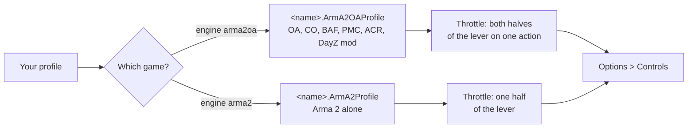

Arma 2 and Arma 2: Operation Arrowhead keep your binds in your player profile: one line per action with number codes,
and a list of the joysticks the game has seen. The two games share one folder but have separate files, so JoyPro treats
them as two games. It reads and writes the aircraft and helicopter binds only; infantry, vehicle and menu binds stay.
Operation Arrowhead also covers Combined Operations, BAF, PMC, ACR and the DayZ mod.

:::video game-arma2 "Arma 2: import, relations, export"
:::

{{game-card}}

:::layer beginner
## What JoyPro does for Arma 2

- **Import**: the aircraft and helicopter binds on your sticks, throttles and pedals come into your profile, with the
  sensitivity slider of each axis.
- **Relations**: one relation is one function in every game. Arma 2 and Operation Arrowhead are two games in it, so a
  relation can hold both.
- **Export**: JoyPro rewrites only the key lines of the flight actions. Keyboard and mouse binds stay, also on those
  actions.

## Import your Arma 2 binds

1. Open **Start**. If the Arma 2 or Operation Arrowhead card asks for a command list, press **Build List**: JoyPro
   reads the actions and their English names from the game's files (read only, no first start needed).
2. Press **Import** on the card of the game you play and keep **Add to my profile**.
3. Press **Import now**. **See my relations** opens what came in.

JoyPro manages your joysticks only: keyboard binds are not imported or exported, and Arma 2 knows no joystick buttons
with modifiers.

## Build and check relations

Join the same function of your games with the [[page:flows/relations.html|relations flow]], then press **Check** on
the Export page. The export counts helicopters and planes as different vehicles: the same button on both is no
conflict. Weapons and view actions count for both.

## Export to Arma 2

1. **Close the game.** Arma 2 saves the profile itself, so JoyPro refuses to write while it runs.
2. Open **Export** and tick the Arma 2 or Operation Arrowhead tile.
3. Keep **Replace on my devices** with **Also clear my other devices** if JoyPro is where you set up your sticks.
   Press **Export now** on the tile.

:::ingame What you see in Arma 2
Start the game and open **Options > Controls** in the main menu. Your binds are on the aircraft and helicopter
actions, next to your keyboard keys. Under **Controllers** your devices are listed and enabled, and **Customize** of a
device shows the sensitivity slider of each axis where JoyPro set it.
:::

:::picture ingame-arma2-controls "Arma 2: the controls menu with the exported binds"
:::

## What you do yourself in Arma 2

- **Start the game once with every device connected** and open **Options > Controls > Controllers**. The game adds a
  device to its list the first time it sees it; JoyPro cannot write a device the list does not have and tells you to
  start the game once with it.
- A device the game left as disabled is switched on by the export when it gets binds (the export says so).
- Start each of the two games once if you play both: each has its own profile file and its own device list.

## Common pitfalls

- **"The game is running"**: quit Arma 2 or Operation Arrowhead and export again.
- **Pedals or a throttle fire weapons or look around**: when the game first sees a device it adds every joystick
  default to it (bank on X, nose on Y, look on the hat, a few buttons), pedals and throttles included. **Replace on my
  devices** removes them.
- **Buttons above 32 or a second hat do nothing**: Arma 2 reads 32 buttons, 8 axes and the first hat. JoyPro skips
  binds beyond that.
- **A device was skipped after you changed USB ports**: the game sees a new ID as a new device. Start the game once
  with it connected.
- **Arma 2 alone: the throttle works on half the lever**: Arma 2 without Operation Arrowhead cannot join both halves
  of a lever on one action.
:::

:::layer advanced
## Files JoyPro reads and writes

| File | What it is |
|---|---|
| `%USERPROFILE%\Documents\ArmA 2\<name>.ArmA2OAProfile` | Operation Arrowhead (and Combined Operations, DayZ mod): `key<Action>[]={...};` lines, `class JoysticksList` and the other options |
| `%USERPROFILE%\Documents\ArmA 2\<name>.ArmA2Profile` | Arma 2 alone, the same format |
| `%USERPROFILE%\Documents\ArmA 2 Other Profiles\<name>\<name>.<ext>` | your other profiles (no dash, unlike Arma 3) |
| `<profile>.joypro-meta.json` | JoyPro's names, groups and tuning of the written binds, read back by the next import |
| `<profile>.jpbak` | the copy from before the first write, plus JoyPro's versioned backup store |

JoyPro never touches `<name>.vars.<ext>` or the video settings `ArmA2.cfg` / `ArmA2OA.cfg`, and stops when a profile is
a binary (rapified) file. Every other byte stays: line endings, the leading tab, the order of the lines. A cataloged
key line that is missing is added after the last key line (a missing line means "the game's default").

## The export modes in Arma 2

Only the lines of cataloged aircraft and helicopter actions change. Keyboard, mouse, TrackIR and Xbox pad codes and
keyboard combos always stay.

| Mode | What happens in the profile |
|---|---|
| **Only add** | Nothing is removed. A bind whose code another action of the same vehicle already has is not written and gets a mark "Not written to the game". |
| **Update, keep the game's binds** | Your codes go in; a code of another action of the same vehicle that you put elsewhere is dropped. The action's other codes stay. |
| **Update, my profile wins** | As above, and an action you bind loses its other joystick codes of connected joysticks. |
| **Replace on my devices** | The flight lines also lose every other code of the written devices, the game's automatic defaults included. |
| **+ Also clear my other devices** | The same for the codes of other connected joysticks. A joystick that is not connected keeps its codes. |

## What is never touched

- Infantry, vehicle, menu and every other line that is not a cataloged flight action.
- Keyboard, mouse, TrackIR and Xbox pad codes.
- Joysticks that are not connected, codes whose number range has no device in the list, the import's ignored devices
  and the vJoy device JoyPro tunnels into.
- The device list: JoyPro adds no entries and changes only `sensitivity[]` and the mode of existing ones;
  `joystickSensitivity[]`, controller schemes, mouse and TrackIR settings stay.

## Vehicles, curves, settings

- **Granularity**: one set of binds for every aircraft and helicopter; per game (Arma 2, Operation Arrowhead).
- **Axes as halves**: Arma 2 binds each half of an axis to an action. JoyPro's axis relations write both: pitch
  (nose down / nose up), roll (bank left / right), rudder (left / right pedal), the arcade turn, the thrust rate
  (increase / decrease thrust) and look and zoom.
- **Throttle**: "Thrust (Analogue)" is the plane throttle and the absolute helicopter collective; "Brake (Analogue)" is
  the airbrake. In Operation Arrowhead JoyPro puts both halves of the lever on the action, the negative half first
  (inverted: the positive half first), and the game joins them into one full axis. Arma 2 alone gets one half.
- **Sensitivity**: one slider per device and physical axis (the Customize dialog, -1 to 1), stored as 10 to the power
  of the slider value. It counts for every vehicle. JoyPro writes only values you set for Arma 2 / Operation Arrowhead
  (or for both, `family:arma2`) or that came from the import; when two relations on one axis disagree, the first by
  name wins with a warning.
- **Dead zone**: fixed 7 % on the main axes (none on the sliders); not adjustable in the game, not written.
- **Invert**: by the order of the halves (see Throttle) or the opposite half; there is no invert flag.
- **Settings**: per device on/off (mode Custom or Disable). Arma 2 has no game-wide options JoyPro writes, no force
  feedback and no telemetry.
- **Watcher**: a bind or slider you change in the game is noticed after it closes; JoyPro asks whether to take it over.
- **HUD**: the HUD finds the game by its process and shows your binds.
:::

:::layer technical
## Inside the Arma 2 integration

Code: `engine\Games\Arma2Integration.cs` on the Arma profile code shared with Arma 3 (`ArmaProfileIntegration.cs`,
`ArmaGameData.cs`) and the axis model `engine\AxisModels\Arma2.cs` (games Arma2 and Arma2OA).

- **Devices**: `class JoysticksList { class Joystick1 { guid="..."; name="..."; offset=256; isXInput=0; mode="Custom";
  }; }`. `guid` is the DirectInput **instance** GUID, upper case, no braces; `name` the product name. A new device gets
  the highest offset + 256; entries stay, so a device keeps its offset. The class names `Joystick1..N` are renumbered on
  each save, so JoyPro matches by `guid` only. `mode` is `"Custom"`, `"Scheme"` (Xbox pad scheme) or `"Disable"`.
  `sensitivity[]` (16 values) appears only after the game's Customize dialog was confirmed; JoyPro creates it after
  `isXInput` when a value differs from the default.
- **Codes**: button `0x20000 + offset + b` (b 0 to 31); axis half `0x30000 + offset + a` positive, `+ a + 8` negative
  (X, Y, Z, RotX, RotY, RotZ, Slider 1, Slider 2); first hat `0x40000 + offset + direction` (eight directions). The
  import also reads stored full-axis codes; the export never writes them.
- **Command list**: [[cli:arma2oa refresh-db]] reads `CfgDefaultKeysMapping` from `Expansion\dta\bin.pbo`, and
  [[cli:arma2 refresh-db]] from `Dta\bin.pbo`, with the English menu names of `languagecore.pbo`; a profile adds what
  mods define. Operation Arrowhead 68, Arma 2 66 actions. [[cli:arma2oa catalog]], [[cli:arma2oa paths]],
  [[cli:arma2 catalog]], [[cli:arma2 paths]].
- **Import / export**: [[cli:arma2oa import]], [[cli:arma2oa scan]], [[cli:arma2oa export]]; [[cli:arma2 import]],
  [[cli:arma2 scan]], [[cli:arma2 export]] (`--mode clean|add|merge|merge-overwrite --nuke-untouched-devices
  --ignore-device <d> --dry-run`).
- **Device switch**: `engine ffb set --device "<name> {GUID}" --game Arma2|Arma2OA --param enabled=0|1`
  ([[cli:ffb set]]).

### Known limits

- Which slider direction the game calls "more sensitive" is not confirmed yet.
- Joystick combos (a button with a modifier) do not exist in Arma 2; JoyPro writes none.
- Arma 2 alone has no full axis on one action; how its helicopter collective feels on one half of the lever is not
  confirmed yet. The full-axis direction in Operation Arrowhead is also still to be confirmed after a real first start.
- Tests: `engine\tests\smoke\arma.ps1` (sensitivity, family scope, device switch); in the game
  `tools\e2e\games\Arma2Settings.ps1 -Game arma2oa|arma2` (test profiles `JoyProE2E_OA` / `JoyProE2E_A2`, main menu >
  Options > Controls only).
:::
