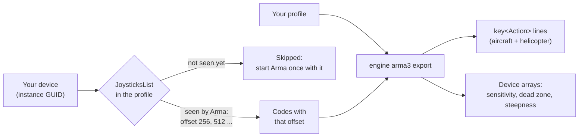

Arma 3 keeps your binds in your player profile, `<name>.Arma3Profile`: one line per action with number codes, and a
list of the joysticks the game has seen. JoyPro reads the aircraft and helicopter binds into your profile and writes
them back into those lines only. Infantry, vehicle and menu binds stay as they are. The response curves are per device
and physical axis in Arma, so one curve counts for every vehicle.

:::video game-arma3 "Arma 3: import, relations, export"
:::

{{game-card}}

:::layer beginner
## What JoyPro does for Arma 3

- **Import**: the aircraft and helicopter binds on your sticks, throttles and pedals come into your profile, with the
  sensitivity, dead zone and steepness of each axis.
- **Relations**: one relation is one function in every game. "Gear" can be the same switch in Arma 3, DCS and the
  other games.
- **Export**: JoyPro rewrites only the key lines of the flight actions. Your keyboard and mouse binds stay, also on
  those actions.

## Import your Arma 3 binds

1. Open **Start**. If the Arma 3 card asks for a command list, press **Build List**: JoyPro reads the actions and
   their English names from the game's config (read only, no first start needed).
2. Press **Import** on the Arma 3 card and keep **Add to my profile**.
3. Press **Import now**. **See my relations** opens what came in.

Keyboard binds are not imported or exported in Arma 3: JoyPro manages your joysticks only.

## Build and check relations

Join the same function of your games with the [[page:flows/relations.html|relations flow]], then press **Check** on
the Export page. The export counts helicopters and planes as different vehicles: the same button on a plane action
and on a helicopter action is no conflict; two plane actions on one button are.

## Export to Arma 3

1. **Close Arma 3.** The game saves the profile when it quits and when you change settings, so JoyPro refuses to write
   while it runs.
2. Open **Export** and tick the Arma 3 tile.
3. Keep **Replace on my devices** with **Also clear my other devices** if JoyPro is where you set up your sticks.
   Press **Export now** on the tile.

:::ingame What you see in Arma 3
Start the game and open **Options > Controls** in the main menu. Your binds are on the aircraft and helicopter
actions, next to the keyboard keys you had. Under **Controllers** your devices are listed and enabled; **Customize**
of a device shows the sensitivity, dead zone and steepness JoyPro wrote.
:::

:::picture ingame-arma3-controls "Arma 3: the controls menu with the exported binds"
:::

## What you do yourself in Arma 3

- **Start Arma once with every device connected.** The game adds a device to its list (and gives it its number range)
  the first time it sees it. JoyPro cannot write a device the list does not have: it skips it and tells you to start
  the game once with it connected.
- A device you disabled in the game's Controllers list is switched on by the export when it gets binds (the export
  says so), unless you set it off for Arma 3 in JoyPro (`enabled=0`, see Technical).

## Common pitfalls

- **"Arma 3 is running"**: quit the game and export again.
- **A device was skipped**: Arma has not seen it yet, or it got a new ID (another USB port gives a new entry with a
  new number range). Start the game once with it connected.
- **Two relations on one axis with other curves**: Arma has one curve per physical axis. The first relation by name
  wins; the export names both.
- **Throttle only works on half the lever**: the analog thrust needs both halves of the lever. JoyPro writes the plane
  throttle and airbrake as a full axis; check the relation is on an axis, not on a button.
:::

:::layer advanced
## Files JoyPro reads and writes

| File | What it is |
|---|---|
| `%USERPROFILE%\Documents\Arma 3\<name>.Arma3Profile` | the default profile: `key<Action>[]={...};` lines, `class JoysticksList` (devices with their arrays) and the game options |
| `%USERPROFILE%\Documents\Arma 3 - Other Profiles\<name>\<name>.Arma3Profile` | your other profiles (folder and file names are URL-encoded, `Mission%20Builder`) |
| `<profile>.joypro-meta.json` | JoyPro's names, groups and tuning of the written binds, read back by the next import |
| `<profile>.jpbak` | the copy from before the first write, plus JoyPro's versioned backup store |

JoyPro never touches `<name>.vars.Arma3Profile` or `.3den.Arma3Profile`, and stops when the profile is a binary
(rapified) file instead of text. A `-profiles=` folder or another Documents folder can be set on the Export page under
*Options and paths (for experts)*.

## The export modes in Arma 3

Only the lines of cataloged aircraft and helicopter actions change. Codes of keyboard, mouse, TrackIR and Xbox pads
always stay.

| Mode | What happens in the profile |
|---|---|
| **Only add** | Nothing is removed. A bind whose code another action of the same vehicle already has is not written and gets a mark "Not written to the game". |
| **Update, keep the game's binds** | Your codes go in; a code of another action of the same vehicle that you put elsewhere is dropped. The action's other codes stay. |
| **Update, my profile wins** | As above, and an action you bind loses its other joystick codes of connected joysticks. |
| **Replace on my devices** | The flight lines also lose every other code of the written devices. |
| **+ Also clear my other devices** | The same for the codes of other connected joysticks. A joystick that is not connected keeps its codes. |

## What is never touched

- Infantry, vehicle, view and menu actions; every line that is not a cataloged flight action.
- Keyboard, mouse, TrackIR and Xbox pad codes.
- Joysticks that are not connected, codes whose number range has no device in the list, the import's ignored devices
  and the vJoy device JoyPro tunnels into.
- The device list itself: JoyPro adds no entries, and changes only the arrays, the mode and the analog click values of
  existing ones.

## Vehicles, curves, game settings

- **Granularity**: one set of binds for every aircraft and helicopter. Some actions are shared (rudder, gear).
- **Axis curves**, per device and physical axis, as the Customize dialog keeps them: sensitivity for each half (-1 =
  cubic, 0 = linear, +1 = cube root), dead zone (0 to 0.1) and steepness (1.0, 1.2, 1.5, 1.9, 2.4 or 3.0; other values
  snap with a warning). Steepness multiplies and saturates, it is not an exponent. JoyPro writes only values you set
  for Arma 3 or that came from the import; your general JoyPro curve is not carried over.
- **Invert**: Arma has no invert flag. JoyPro inverts by binding the opposite half of the axis.
- **Full-axis throttle**: "Thrust (Analog)" and "Speedbrake (Analog)" get both halves of the lever, the negative half
  first (lever forward), inverted the positive half first.
- **Game settings**: the helicopter advanced flight model and its auto-trim, gauges, rough landing, wind and stress
  damage options, and gamepad vibration; per device on/off and the analog click thresholds. Set them in **Settings >
  Force feedback settings of the games** (pick Arma 3) or with [[cli:ffb set]]. An export without Arma 3 binds still
  writes them and touches no key line.
- **Force feedback**: Arma 3 has no joystick force feedback option.
- **Watcher**: a bind or curve you change in the game is noticed after it closes; JoyPro asks whether to take it over.
- **HUD**: the HUD finds the game by its process and shows your Arma 3 binds.
:::

:::layer technical
## Inside the Arma 3 integration

Code: `engine\Games\Arma3Integration.cs` on the Arma profile code shared with Arma 2 (`ArmaProfileIntegration.cs`,
`ArmaGameData.cs`), the axis model `engine\AxisModels\Arma3.cs` and the settings model `engine\FfbModels\Arma3.cs`.

- **Devices**: `class JoysticksList { class Joystick1 { guid="..."; name="..."; offset=256; isXInput=0;
  sensitivity[]={...}; deadZone[]={...}; steepness[]={...}; mode="Custom"; ... }; }`. `guid` is the DirectInput
  **instance** GUID, upper case, no braces. `offset` is 256 times N, given when the game first sees the device; entries
  stay after unplugging. `mode="Disabled"` switches a device off.
- **Codes** (signed 32-bit, `off` = the device's offset): button `0x20000 + off + button`; axis `0x30000 + off + a`,
  `a` 0 to 7 the positive half, `a + 8` the negative half (X, Y, Z, RotX, RotY, RotZ, Slider 1, Slider 2); hat
  `0x40000 + off + direction` (eight directions, one hat). Keyboard codes are DIK numbers.
- **Arrays**: `sensitivity[]` (16 values, positive halves then negative halves), `deadZone[]` (8) and `steepness[]`
  (8). A missing array is created after its predecessor in the game's save order, with the game's defaults for the
  other axes, only when a value differs from the default. Import + export is byte for byte.
- **Command list**: [[cli:arma3 refresh-db]] reads `CfgDefaultKeysPresets` from `bin.pbo` > `config.bin` and the English
  menu names from `languagecore_f.pbo`'s `stringtable.xml`; a profile adds actions of mods. 51 actions.
  [[cli:arma3 catalog]] lists them, [[cli:arma3 paths]] shows the profiles found.
- **Import / export**: [[cli:arma3 import]], [[cli:arma3 scan]]; [[cli:arma3 export]] `--mode
  clean|add|merge|merge-overwrite --nuke-untouched-devices --ignore-device <d> --dry-run`.
- **Settings**: `engine ffb set --device "<name> {GUID}" --game Arma3 --param enabled=0|1` (also `analogClickHigh`,
  `analogClickLow`); game-wide `--device *` with `RTDEnabled`, `RTDAutoTrim`, `RTDFullHUD`, `RTDRoughLanding`,
  `RTDWindDynamic`, `RTDStressDamage`, `vibrations`.

### Known limits

- Joystick buttons with modifiers are not confirmed yet; JoyPro writes no modifiers and no keyboard binds for Arma 3.
- Up to 256 buttons, 8 axes and one hat per device can be encoded (taken from the file format).
- Whether the Customize slider writes the same value to both halves, and the per-action curves some actions add on top,
  are not confirmed yet (the preview shows the device curve only).
- Tests: `engine\tests\smoke\arma.ps1` (arrays, settings, full-axis throttle, conflict warning, import round trip,
  settings-only export); in the game `tools\e2e\games\Arma3Settings.ps1` (test profile `JoyProE2E`, main menu >
  Options > Controls only).
:::
