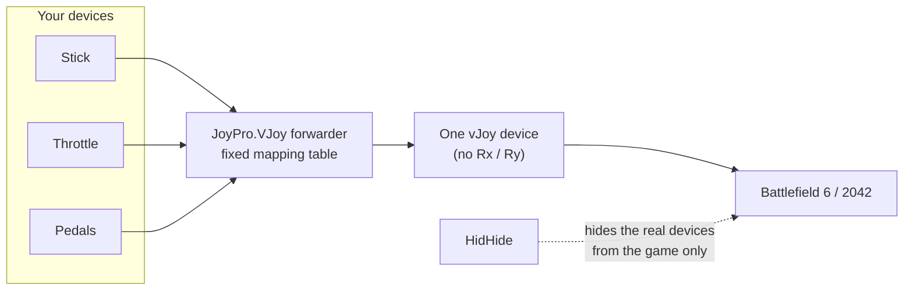

Battlefield 6 and Battlefield 2042 read **one** joystick, and their binds name no device. A HOTAS of several devices
therefore works only through JoyPro's **virtual joystick**: JoyPro puts every input your Battlefield relations use
onto one vJoy device and hides the real devices from the game with HidHide. The game's text profile holds the binds of
jets and helicopters; JoyPro writes their keyboard keys today and reads the joystick binds. Writing joystick binds
waits for one confirmed survey of the game's joystick numbering. The older Battlefields are documented only.

:::video game-battlefield "Battlefield: import, relations, export"
:::

{{game-card}}

:::layer beginner
## What JoyPro does for Battlefield

- **One device for the game**: in virtual mode your stick, throttle and pedals appear to Battlefield as one vJoy
  joystick whose inputs never move. Every other program keeps seeing your real devices.
- **Keyboard keys**: JoyPro reads and writes the keyboard keys of the jet and helicopter button actions, when you ask
  for the keyboard.
- **Joystick binds**: JoyPro reads them (with a warning) but does not write them yet. The game's numbering of joystick
  inputs is not confirmed; until it is, you bind the vJoy device on the game's joystick page yourself.

## Import

1. **Start the game once** so it writes its settings profile. Before that, JoyPro lists its own table of the jet and
   helicopter actions; the first import replaces it with the actions of your profile.
2. Open **Start**, press **Import** on the Battlefield 6 (or 2042) card, tick **Also take the keyboard keys** if you
   want them, press **Import now**.

## Set up the virtual joystick

1. Open the [[gui:vjoy|Virtual Joystick]] page. Under **What this page needs**, install **vJoy** and **HidHide** if they
   are missing.
2. Under **Games**, switch Battlefield 6 to **vJoy** (JoyPro suggests it there with **Use it**).
3. If the page offers **Set up vJoy for the table**, press it: JoyPro sets the vJoy device up without the Rx and Ry
   axes, because Battlefield takes a joystick with Rx / Ry for an Xbox pad. Windows must restart before vJoy takes the
   change.
4. Press **Start** before you start the game, and **Stop** when you are done.

## Build and check relations

Bind your HOTAS to the Battlefield jet and helicopter actions on the **Relations** page
([[page:flows/relations.html|relations flow]]): only inputs of relations that have a Battlefield action get a place on
the vJoy device. Jet and helicopter are different vehicles, so the same button may do something else in each.

## Export

1. **Close the game.**
2. Open **Export**, keep **Replace on my devices**, press **Export now** on the Battlefield tile. The keyboard keys are
   written when you ticked the keyboard at the import (the choice is kept per game). Joystick binds are listed as not
   written.
3. **Start the game once** afterwards and look at the binds: Steam Cloud and EA sync the settings folder, and a cloud
   copy can win.

:::ingame What you see in Battlefield
With the virtual joystick running, the game's one joystick is "vJoy Device". In Battlefield 6 the aircraft rows are
under the gear icon > **CONTROLLER** > **EDIT SETTINGS** > **JOYSTICK** > Aircraft **EDIT** ("AIRCRAFT PILOT CONTROL
MAPPING"): each row shows UNBOUND or the bind, for example "AXIS 1 X -". Keyboard keys JoyPro wrote show in the game's
keyboard bindings.
:::

:::picture ingame-battlefield-controls "Battlefield: the controls menu with the exported binds"
:::

## What you do yourself in Battlefield

- **Bind the vJoy device in the game** on the joystick page above: click a row's box, then move the input. The game
  binds the first input it sees, so only vJoy should be visible to it (virtual joystick running).
- **Switch Steam Input off** for the game.
- If the game still sees your real devices (some players report that Battlefield 6 sees devices HidHide hides),
  unplug them while you play; the vJoy device carries everything.

## Common pitfalls

- **The joystick page is missing in the game**: the joystick has Rx or Ry axes, and the game takes it for an Xbox pad.
  Set up vJoy without them (step 3 above) and restart Windows.
- **A row binds a jittering axis**: another device is still visible to the game. Start the virtual joystick before the
  game, or unplug the real devices.
- **Only one device was exported**: the game reads one joystick; JoyPro writes the device with the most binds and
  lists the others ("use the virtual joystick").
:::

:::layer advanced
## Files JoyPro reads and writes

| Game | File | What it is |
|---|---|---|
| Battlefield 6 | `%USERPROFILE%\Documents\Battlefield 6\settings\steam\PROFSAVEbf6mp_profile` and `PROFSAVE_profile` | multiplayer and campaign profile, text lines `GstKeyBinding.<category>.<Concept>.<slot>.axis <n>` (also `.button`, `.negate`, `.type`); the EA app version has no `steam` folder |
| Battlefield 2042 | `%USERPROFILE%\Documents\Battlefield 2042\settings\PROFSAVE_profile` | the same format |

An export writes every `*_profile` of the folder that holds binds, so campaign and multiplayer match. The binary
`PROFSAVE` files without `_profile` hold no binds and are never touched. Backups as for every export (`.jpbak` and
JoyPro's backup store), JoyPro's names and groups in `<profile>.joypro-meta.json`.

## The export modes in Battlefield

Only jet and helicopter slots change. Soldier and ground vehicle slots, mouse and pad slots, keys on axis actions and
joystick codes JoyPro's table does not read never change.

| Mode | What happens |
|---|---|
| **Only add** | A bind whose input another action of the same vehicle uses is skipped (marked "Not written to the game"); no slot is freed. |
| **Update, keep the game's binds** | The other action's slot on the profile's input is freed; the action's bound slots stay. A bind that finds no free slot stays out. |
| **Update, my profile wins** | As above, and the action's other slots (keys with the keyboard option) are freed; a bound slot takes the profile's input. |
| **Replace on my devices** | The flight slots of what the export writes are freed: the keyboard keys when keys are exported (the joystick once joystick binds are written). |
| **+ Also clear my other devices** | No other device to clear: the game reads one joystick. |

## What is never touched

- Infantry, ground vehicle, transport and gunner binds; mouse and pad slots.
- Keyboard keys on axis actions (the game manages those pairs) and keyboard keys without the keyboard option.
- Joystick slots, until the numbering is confirmed.
- HidHide hides your real devices only from the game's executable, only while the virtual joystick runs; **Stop**
  gives HidHide back exactly its previous setup.

## Axes and other settings

- **Per vehicle class**: jet and helicopter are separate categories in the game's profile; JoyPro writes both.
- **Invert** only: an axis is written as two halves, and *Invert* swaps them. No curves or dead zones, no modifiers.
- Hats: four directions only, diagonals are skipped. Players see about 18 buttons; above that is not confirmed.
- **Watcher**: the profile files are watched after the game closes ([[doc:sync-watcher|the watcher]]).
- **HUD**: while the game runs, the [[gui:hud|HUD]] names the action of each pressed button.
- **Virtual functions** (toggles, axis bands, short / long press ...) work on the vJoy device for Battlefield.

## The older Battlefields

| Game | What is known | JoyPro |
|---|---|---|
| **Battlefield V** | One DirectInput joystick; `Documents\Battlefield V\settings\PROFSAVE_profile_synced`, synced with EA's servers, its own numbering. | Documented only; once supported: one vJoy device. |
| **Battlefield 1** | One joystick; the same scheme as Battlefield V. | Documented only. |
| **Battlefield 4 / Hardline / 3** | One device; joystick and pad share one type in `Documents\Battlefield <n>\settings\PROFSAVE_profile`. | Documented only. |
| **Battlefield 2 / 2142** | One joystick by device index in `Documents\Battlefield 2\Profiles\000N\Controls.con`. | Documented only. |
:::

:::layer technical
## Inside the Battlefield integration

Code: `engine\Games\BattlefieldIntegration.cs` (one class for Battlefield 6 and 2042); the vJoy planner, forwarder and
HidHide session of [[doc:virtual-joystick]].

- **Bind lines**: `type` 0 mouse, 1 pad, 2 keyboard (`button` = DIK scan code, 255 = none), 3 joystick; "nothing bound"
  is axis 56 (Battlefield 6) or 27 (2042) and button 60. `negate 1` = the slot drives the action in the negative
  direction. The default profile has two empty joystick slots per axis action (negate 0 and 1); a button action gets
  slot n+1 with its four lines in their sorted place.
- **Devices**: the binds name no device; JoyPro writes one joystick. The game declares itself a one-device game
  (1 joystick, suggested mode `virtual`, vJoy axes Rx and Ry avoided), so the planner gives no input Rx / Ry and
  [[cli:vjoy configure-vjoy]] sets the device up without them.
- **Joystick numbering**: a provisional table taken from Battlefield 4's decoded scheme (X / Y as Axis1X / Axis1Y,
  Z / Rx / Ry / Rz as half-axis button codes 36-43, button n as code n-1, hat n as 44 + 4(n-1) + direction). The
  game's own default does not fit it, so without a confirmed table JoyPro reads joystick binds with a warning and
  writes none. The live survey `tools\e2e\games\BattlefieldJoystickSurvey.ps1` produces the confirmed table
  `<engine>\TOOLS\Conversions\Battlefield6JoystickMap.tsv` (`Battlefield2042JoystickMap.tsv`).
- **Commands**: [[cli:bf6 paths]], [[cli:bf6 catalog]], [[cli:bf6 scan]], [[cli:bf6 import]], [[cli:bf6 export]]
  `--include-keyboard --mode clean|add|merge|merge-overwrite --dry-run`, [[cli:bf6 refresh-db]]; the same under
  [[cli:bf2042 export]] and its siblings. Virtual mode: [[cli:vjoy mode]] `Battlefield6 virtual`, [[cli:vjoy map]],
  [[cli:vjoy apply-hidhide]].

### Known limits

- Joystick binds are not written until the survey confirms the numbering.
- Battlefield 2042 is implemented from the same format without an installed game.
- Buttons above about 18, and whether a half axis is stored as a whole axis, are not confirmed yet.
- Tests: `engine\tests\smoke\battlefield.ps1`; the survey scripts `tools\e2e\games\BattlefieldJoystickSurvey.ps1`,
  `BattlefieldSurveyAuto.ps1`, `BattlefieldAdminSession.ps1` (need a Windows restart window for the vJoy setup).
:::
