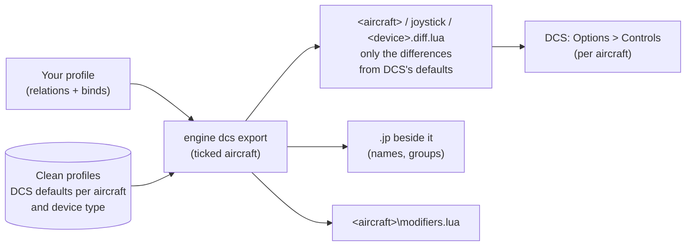
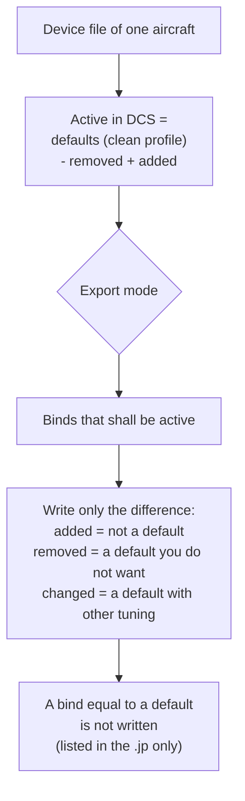

DCS keeps its controls per aircraft and per device: every module has its own binds on your stick, and DCS adds its
own default binds to every device. JoyPro reads these files into one profile, lets you build relations that cover all
your aircraft at once ("Gear" in the F-16C, the F/A-18C and the A-10C II) and writes them back into each aircraft's
files. Nothing runs while you fly: DCS reads its own files as always.

:::video game-dcs "DCS World: import, relations, export per aircraft"
:::

{{game-card}}

:::layer beginner
## What JoyPro does for DCS

- **Import**: every aircraft's binds on your sticks, throttles and pedals come into your profile, with your modifiers
  and axis settings. By default the DCS default binds that are active on your devices come in too, so nothing gets
  lost when you export again.
- **Relations**: one relation is one function in every aircraft. "Weapon release" can be the pickle button in the
  F-16C and in the A-10C II, with one button on your stick.
- **Export**: JoyPro writes each ticked aircraft's files. DCS then shows your binds in Options > Controls.

## Import your DCS binds

1. Open **Start**. The DCS card shows the game's picture. If the card asks for a command list, press **Build List**
   first: JoyPro reads every installed module with DCS's own Lua (DCS stays closed; a few seconds to a minute).
2. Press **Import** on the DCS card. Keep **All my DCS aircraft** ticked, or untick it and pick the aircraft you fly.
3. Press **Import now**. **See my relations** opens what came in.

## Build and check relations

On the **Relations** page a relation lists its action per aircraft. Use the aircraft filter to see one module, and
the [[page:flows/relations.html|relations flow]] to join actions of several aircraft into one relation. Then
**Check** on the Export page: it finds one button that does two things in the same aircraft before DCS does.

## Export to DCS

1. **Close DCS.** JoyPro refuses to write while DCS runs, because DCS writes its files when it quits.
2. Open **Export**. On the DCS tile, **Aircraft...** lists every aircraft of your profile: only ticked aircraft are
   written, the others keep their files exactly as they are.
3. Keep the first choice, **Replace on my devices** with **Also clear my other devices**, if JoyPro is where you set
   up your sticks. Press **Export now** on the DCS tile.

:::ingame What you see in DCS
Start DCS and open **Options > Controls**, then pick the aircraft at the top. Your binds are in your device's column
under DCS's own command names; DCS defaults that JoyPro removed show as empty cells; your modifiers are in DCS's
modifier list. Axis curves show in **Axis Tune** of the axis. Other aircraft you did not tick look as before.
:::

:::picture ingame-dcs-controls "DCS Options > Controls with the exported binds"
:::

## What you do yourself in DCS

- Nothing else is needed for the binds. If you use another Saved Games folder (for example `Saved Games\DCS.openbeta`),
  set it once in **Settings > Games** under *Controls saved in*.
- For the HUD's aircraft and for force feedback from telemetry, JoyPro installs a small script into DCS once (see
  Advanced); close DCS for that too.

## Common pitfalls

- **"DCS is running"**: close DCS (also the launcher's background process) and export again.
- **An aircraft kept its old binds**: it was not ticked under **Aircraft...** on the DCS tile, or the profile has no
  relation for it.
- **A stick has binds you never made**: these are DCS's default binds on a device JoyPro did not write. Tick **Also
  clear my other devices**, or see *Default binds* below.
- **Two identical devices**: DCS tells them apart by their instance ID; keep **Treat devices with the same name as one
  device** on, so a device that Windows gave a new ID is read as the same device.
:::

:::layer advanced
## Files JoyPro reads and writes

| File | What it is |
|---|---|
| `%USERPROFILE%\Saved Games\DCS\Config\Input\<aircraft>\joystick\<device>.diff.lua` | your binds on one device in one aircraft, as differences from DCS's defaults (`keyDiffs`, `axisDiffs` with `added` / `removed`, `ffDiffs`) |
| `...\<aircraft>\joystick\<device>.jp` | JoyPro's copy with relation names and groups, read back by the next import |
| `...\<aircraft>\keyboard\Keyboard.diff.lua` | the keyboard (only when you export keyboard binds) |
| `...\<aircraft>\modifiers.lua` | the aircraft's modifiers |

`<aircraft>` is the input profile name the module declares (for example `F-16C_50`, `FA-18C_hornet`). Another Saved
Games folder (`DCS.openbeta`) is set in Settings > Games. The files are written without a byte order mark, because
DCS's Lua cannot load one.

## The export modes in DCS

Every mode works on the binds a device file has **active** in DCS: the device's defaults, minus what the file removes,
plus what it adds. JoyPro then writes only real differences from the defaults, as DCS itself would.

| Mode | What happens in the exported aircraft |
|---|---|
| **Only add** | Nothing is removed. A bind whose button DCS already uses for another command (also a DCS default) is not written and gets a mark "Not written to the game". |
| **Update, keep the game's binds** | Your binds go in; DCS's defaults and your in-game binds stay, except a bind of another command on a button you use. |
| **Update, my profile wins** | As above, and every command you bind loses its other buttons in that aircraft (on every device file and on connected devices without a file; DCS defaults count). |
| **Replace on my devices** | The devices you write get exactly your binds in the exported aircraft, DCS defaults removed. |
| **+ Also clear my other devices** | Connected devices without a bind in the aircraft lose all binds there, DCS defaults included. |

Options on the Export page (under *Options and paths (for experts)*):

- **Keep keyboard defaults** (on): no keyboard file is written. Off: your keyboard binds are written, and only the DCS
  default keys they take are removed; every other default key stays.
- **My devices lose the DCS default binds in every other aircraft too** (off): with Replace, the written devices are
  also emptied in every installed aircraft you did not export. The input layers (UI layer, camera, general) are never
  touched.

## What is never touched

- Devices that are not connected keep their files byte for byte.
- The import's ignored devices and the vJoy device JoyPro tunnels into are never cleared.
- The keyboard is never cleared or taken over, in any mode; mouse binds are never written.
- Aircraft you did not tick, and the input layers (UI layer, camera, the general layer) keep their files.
- Force feedback settings (`ffDiffs`) of a device file that is emptied stay.

## Default binds

DCS gives each device type its own defaults per aircraft (a Warthog stick gets other defaults than a generic stick).
JoyPro knows them from **clean profiles** it builds from your DCS with the command list: one per aircraft and device
type. Replace and Also clear remove exactly these defaults from the devices they write.

For devices JoyPro does not write, **Settings > DCS: default binds** offers two changes to the DCS installation
itself, both off unless you switch them on: strip the defaults from every joystick file (each original kept as
`<file>.nocombo.bak`), or move DCS's device-specific default files into JoyPro's backup folder. Patched files fail the
integrity check of servers that enforce it; **Restore DCS files** puts every original back. After a DCS update JoyPro
applies a switched-on option again at its start.

## Aircraft, curves, force feedback

- **Per aircraft**: every relation keeps its action per aircraft; the export writes the ticked aircraft only.
- **Axis curves**: dead zone, saturation X and Y, curvature or an 11-point user curve, invert and slider, written per
  aircraft as DCS's own filter (what **Axis Tune** shows). A curve can be set for all games, for DCS or for one
  aircraft ([[page:gui/binds.html|Binds]] > Axis response).
- **In-game force feedback**: Settings > DCS force feedback sets swap axis, invert X and invert Y per device
  ([[cli:dcs ffb set]]). Telemetry force feedback: the [[gui:ffb|Force Feedback]] page installs JoyPro's hook
  `Saved Games\DCS\Scripts\Hooks\JoyProFfb.lua` (DCS must be closed; other scripts such as SRS or Tacview keep working).
- **HUD**: the HUD shows the binds of the aircraft you fly when the DCS hook is installed (HUD page > **Install DCS
  hook**: a small Lua file plus one guarded line in `Export.lua`, backed up first), or pick the aircraft by hand.
- **Watcher**: a bind you change in DCS's Options > Controls is noticed after DCS closes; JoyPro asks whether to take
  it over. Only the aircraft whose files changed are compared, against the device's defaults plus its diff.
:::

:::layer technical
## Inside the DCS integration

Code: `engine\EngineDcsImport.cs`, `engine\EngineDcsExport.cs`, `engine\EngineDcsExport.Modes.cs`,
`engine\EngineDcsRefresh.cs`, `engine\DcsDeviceNames.cs`, `engine\DcsCommandNames.cs`, `engine\EngineDcsDefaultsStrip.cs`.

- **Device names**: DCS names a joystick `<DirectInput instance name> {<instance GUID>}`, with the instance name
  exactly as DirectInput reports it, spaces at the ends included. JoyPro's own names trim those spaces;
  `DcsDeviceNames` converts both ways. The export names a file after the connected device's raw name, after an
  existing file for a device that is not connected, else after JoyPro's name. Files an older JoyPro wrote under the
  trimmed name are read when no DCS-named file exists and removed after the write (backed up).
- **Command list**: [[cli:dcs refresh id]] runs every module's input Lua in DCS's own `bin\luae.exe` (no game window),
  in several runs at once; English command names come from the install's `l10n\en\LC_MESSAGES\input.mo`, whatever
  language DCS uses. [[cli:dcs refresh clean]] builds the clean profiles: DCS's own `InputData.clearProfile` with a fake
  stick per device type, into a temporary Saved Games folder (your `Config\Input` is never changed). Files:
  `%LOCALAPPDATA%\JoyPro2\GameData\CleanProfile\DCS\<aircraft>.cf`, `...\<aircraft>\<device type>.cf`,
  `KeyboardCleanProfile\DCS\<aircraft>.cf`.
- **Import**: [[cli:dcs import]] (`--planes`, `--only-connected`, `--merge-same-name`, `--include-defaults`,
  `--include-keyboard`, the `--import-*` tuning switches); [[cli:dcs scan]] shows the same without changing the
  profile.
- **Export**: [[cli:dcs export]] `--mode clean|add|merge|merge-overwrite --nuke-untouched-devices true|false
  --keep-keyboard-defaults true|false --clean-all-aircraft true|false --planes <csv> --ignore-device <d>`;
  `--clear-keyboard-defaults true` (command line only) also removes every other DCS default key of the written
  aircraft. Backups: every file to `<file>.jpbak` and into `%LOCALAPPDATA%\JoyPro2\GameBackups` before the first write.
- **Checking**: [[cli:dcs verify-clean]] lets DCS's own Lua list every default bind still active on your joysticks
  (read only; `--include-disconnected` with fake sticks, `--dump-active` to compare before and after an export).
- **Default binds in the install**: [[cli:dcs strip-defaults]] (`apply|restore|status|auto`, marker line
  `-- [[DCS_STRIP_JOYSTICK_DEFAULTS v1]]`, originals as `.nocombo.bak`, every patched file loaded by DCS's loader before
  it counts) and [[cli:dcs device-luas]] (`list|remove|restore`; files move to `<data>\DcsDefaults\DeviceLuas` with a
  manifest). Both refuse while DCS or its updater runs.
- **Force feedback**: [[cli:dcs ffb list]], [[cli:dcs ffb set]], [[cli:dcs ffb clear]].
- **HUD hook**: [[cli:overlay dcs-hook status]] (`install` / `remove`): DCS sends the unit type to `127.0.0.1:1992`.

### Known limits

- Only installed modules get command lists and clean profiles.
- A device you ran DCS's axis wizard for keeps the wizard's assignment as its default (`wizard.lua`, per device
  instance); JoyPro does not change it.
- The input layers DCS shares between aircraft (General, UI layer, Combined Arms) are not written.
- Tests: `engine\tests\smoke\dcsexportmodes.ps1` (every mode, round trip, undo byte for byte),
  `smoke\dcskeyboard.ps1`, `smoke\dcsdefaults.ps1`; in the game `tools\e2e\games\DCS.ps1` and `DCSCurves.ps1`.
:::
