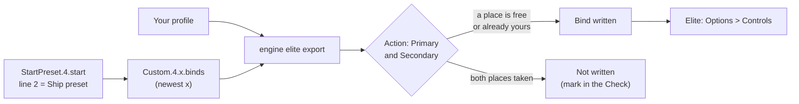

Elite Dangerous keeps its controls in presets, one `.binds` file each, and every action has two places for an input:
Primary and Secondary. JoyPro reads the flight binds of your Ship preset into your profile and writes them back into
the same file, in place. SRV, on-foot, camera and menu binds stay as they are. When both places of an action are
taken, JoyPro says so instead of overwriting one.

:::video game-elite-dangerous "Elite Dangerous: import, relations, export"
:::

{{game-card}}

:::layer beginner
## What JoyPro does for Elite Dangerous

- **Import**: the ship's flight binds on your sticks, throttles and panels come into your profile, with their invert
  and dead zone, and whether your throttle runs forward only or with reverse.
- **Relations**: one relation is one function in every game. "Landing gear" can be the same switch in Elite, Star
  Citizen and DCS.
- **Export**: JoyPro edits your Ship preset (`Custom.4.x.binds`) in place. Everything else in the file stays.

## Import your Elite binds

1. Open **Start**. If the Elite Dangerous card asks for a command list, press **Build List**: JoyPro collects the
   game's actions from its stock presets and the presets you saved (read only).
2. Press **Import** on the Elite Dangerous card. Keep **Add to my profile**. Tick **Also take the keyboard keys** if
   you want your flight keys in JoyPro too.
3. Press **Import now**. **See my relations** opens what came in.

A bind that uses half of an axis as a button or as a modifier cannot be held by a JoyPro profile: the import skips it
with a warning, and the export leaves it in the game.

## Build and check relations

Join the same function of your games with the [[page:flows/relations.html|relations flow]]. Then press **Check** on
the Export page. Besides one button that does two things, the Check lists under **Not written to the game** every bind
the last export had no place for, with **Move to another button** and **Keep as is**.

## Export to Elite

1. **Close Elite Dangerous.** JoyPro refuses to write while the game runs.
2. Open **Export** and tick the Elite Dangerous tile.
3. Keep **Replace on my devices** with **Also clear my other devices** if JoyPro is where you set up your sticks.
   Press **Export now** on the tile.
4. Read the result: binds that did not fit and half-axis binds JoyPro kept are named in plain words.

:::ingame What you see in Elite Dangerous
Start the game and open **Options > Controls**, then the ship controls. Your binds are in the Primary or Secondary
column of each action, next to the keyboard keys you kept. Inverted axes show **INVERTED**, the throttle shows
**Forward only** or **Full range** under its axis range, and the yaw-into-roll and head look rows show the values you
set in JoyPro.
:::

:::picture ingame-elite-dangerous-controls "Elite Dangerous: the controls menu with the exported binds"
:::

## What you do yourself in Elite

- **Save your controls once in the game.** JoyPro writes only into a preset you saved yourself. If your Ship controls
  still use a stock preset (Generic Joystick, a HOTAS preset of the game), change one control in **Options >
  Controls** (Ship), save, and close the game: Elite then creates `Custom.4.x.binds` and uses it.
- **Keep every device of the preset connected** when you start the game. Elite ignores a whole preset that names a
  device it cannot find. JoyPro warns when your preset names a device that is not connected.

## Common pitfalls

- **"Elite Dangerous is running"**: quit the game and export again.
- **"No free place in the game"**: Elite keeps two inputs per action. If a keyboard key holds one place and two of
  your relations put the action on two buttons, only the first button fits. Move the second one, or keep it as is.
- **Two identical sticks**: Elite tells devices apart by their USB id only. Two connected devices of the same model
  cannot be matched to the game's index, so JoyPro skips both.
- **The game loaded another preset**: a device of the preset was missing at start. Connect it, exchange it in JoyPro,
  or clear its binds in the game.
- **Hat diagonals** do not exist in Elite: four directions per hat.
:::

:::layer advanced
## Files JoyPro reads and writes

| File | What it is |
|---|---|
| `%LOCALAPPDATA%\Frontier Developments\Elite Dangerous\Options\Bindings\<preset>.4.<minor>.binds` | your preset (XML): every action with Primary and Secondary, axes with Binding, Inverted and Deadzone, and value settings such as ThrottleRange. JoyPro writes the newest minor version of the Ship preset. |
| `...\Bindings\StartPreset.4.start` | which preset each category uses (General, Ship, SRV, On Foot); read only |
| `...\Bindings\<preset>.4.<minor>.binds.joypro-meta.json` | JoyPro's names, groups, modifiers and tuning of the written binds, read back by the next import |
| `...\Bindings\<preset>.4.<minor>.binds.jpbak` | the copy from before the first write, plus JoyPro's versioned backup store |
| `<install>\Products\<product>\ControlSchemes\*.binds`, `DeviceMappings.xml` | the stock presets and the game's device names; read only |

The file is edited as text: line endings, tabs, the declaration, duplicate elements, value settings, your keyboard
layout and unknown elements stay byte for byte. JoyPro never writes to the install folder, never edits
`StartPreset.4.start`, and never touches the files of the old 3.x client.

Galaxy map actions belong to the General preset. JoyPro writes them only when General and Ship use the same file;
otherwise they are skipped with a warning.

## The export modes in Elite

Every mode works on flight actions only and on the slots of connected joysticks.

| Mode | What happens in the preset |
|---|---|
| **Only add** | A bind goes only into a free place. A bind whose input another flight action uses is not written and gets a mark "Not written to the game". |
| **Update, keep the game's binds** | The place of another flight action on an input you use is released. Your bind goes into a free place first, so an action you moved keeps its old input while a place is free. |
| **Update, my profile wins** | As above, and every action you bind loses its other places on your joysticks (the keyboard only with the keyboard option). |
| **Replace on my devices** | On the devices you write, every flight place that holds a bind of that device and is not in your profile is emptied (`{NoDevice}`; an axis also gets Inverted 0 and Deadzone 0). |
| **+ Also clear my other devices** | The same for the flight places of connected joysticks the export does not use. |

A place is never overwritten when it holds a keyboard key, a mouse or gamepad input, or a device JoyPro does not write.
If no place is left, the bind is not written and the profile keeps a mark ("Binds Not Written, No Free Place In The
Game"). The same holds for an axis action whose one place holds another axis of your profile.

## What is never touched

- SRV, on-foot, camera, colonisation, UI and mouse actions, even though they sit in the same file.
- Keyboard, mouse and gamepad places; the keyboard is written only with the keyboard option and never cleared.
- Places of a device that is not connected, the import's ignored devices and the vJoy device JoyPro tunnels into.
- Half-axis binds and half-axis modifiers: the export leaves them and names each one, for example "'Cycle Next Ship':
  kept the game's bind ... with ... RZ axis, positive half as modifier".
- `<Hold>` and `<ToggleOn>` of an action stay as they are.

## Ships, curves, game settings

- **Granularity**: one Ship preset for every ship and fighter. The SRV and on-foot presets are not written.
- **Modifiers**: up to three per place; keys, buttons of any device. JoyPro writes its modifiers as the game's
  `<Modifier>` entries.
- **Axis settings**: invert and dead zone (0 to 1) per axis action; there is no saturation and no curve in Elite.
  Invert keeps DCS's direction in your relation: Elite counts pitch, throttle and the vertical thrusters the other way
  round, so the file's Inverted is your invert turned over for those axes. The throttle relation's **Slider** sets
  **Throttle Axis Range**: Slider = forward only, no Slider = full range with reverse (warning when several throttle
  relations disagree).
- **Game settings**: yaw into roll (normal, flight assist off, landing), its sensitivity, the keyboard throttle
  increment, head look mode, increment, sensitivity, smoothing and reset on toggle. Set them in **Settings > Force
  feedback settings of the games** (pick Elite Dangerous) or with [[cli:ffb set]]. Only settings you set are written,
  in place; a setting missing from the file is reported, never added. Mouse, SRV and on-foot settings are not managed.
- **Force feedback**: Elite has none for joysticks.
- **Telemetry recording**: JoyPro can record `Status.json` and the journal (`Saved Games\Frontier
  Developments\Elite Dangerous`, read only) as a CSV session; the game gives no world position, so there is no
  Tacview track.
- **Watcher**: a bind you change in the game's controls menu is noticed after the game closes; JoyPro asks whether to
  take it over. The game writes the preset only when you save in its controls menu.
- **HUD**: the HUD finds the game by its process and shows your Elite binds.
:::

:::layer technical
## Inside the Elite integration

Code: `engine\Games\EliteDangerousIntegration.cs`, the axis model `engine\AxisModels\EliteDangerous.cs` and the
settings model `engine\FfbModels\EliteDangerous.cs`.

- **Device ids**: `%04X%04X`, the USB vendor id and product id in upper-case hex (`231D0125`). Devices listed in the
  install's `DeviceMappings.xml` are written by their symbolic name instead (`T16000M`, `ThrustMasterWarthogJoystick`,
  `VPCThrottle`, Alternatives included). JoyPro writes connected devices only. Identical devices would need the game's
  `DeviceIndex`, whose order is not documented: skipped.
- **Input names**: `Joy_1` ... `Joy_N` buttons, `Joy_POV<h>Up/Right/Down/Left` (hats 1 to 4), `Joy_XAxis` ...
  `Joy_RZAxis`, `Joy_UAxis` / `Joy_VAxis` for the sliders, `Key_*` keyboard. `Pos_Joy_*` / `Neg_Joy_*` (half axes)
  are never created.
- **Invert**: file `Inverted` = relation invert XOR the action's natural direction (1 for `PitchAxisRaw`,
  `ThrottleAxis`, `AheadThrust`, `VerticalThrustRaw`, their alternate and landing copies, `HeadLookPitchAxisRaw`,
  `CamTranslateYAxis`, `ExplorationFSSRadioTuningX_Raw`; 0 for every other axis). The import reads it back the same
  way. A device that reports an axis reversed needs invert in DCS too, and the XOR carries that over.
- **Command list**: [[cli:elite refresh-db]] reads the `.binds` the game wrote (they name every element it knows) and
  the stock presets, read only; only ship flight elements are added, known actions keep id and title.
  [[cli:elite catalog]] lists it, [[cli:elite paths]] shows the files JoyPro found.
- **Import / export**: [[cli:elite import]] and [[cli:elite scan]]; [[cli:elite export]] `--mode
  clean|add|merge|merge-overwrite --nuke-untouched-devices --include-keyboard --ignore-device <d> --dry-run`.
- **Game settings**: `engine ffb set --device * --game EliteDangerous --param <key>=<value>` (`yawToRollMode`,
  `yawToRollSensitivity`, `throttleIncrement`, `headlookAccumulate`, ...).

### Known limits

- Two identical devices are skipped; a missing device makes the game ignore the whole preset.
- The scale of the dead zone slider in the game's menu and how the game rescales outside the dead zone are not
  confirmed yet.
- Buttons: about 32 are reported by players; higher numbers have worked. Four hats, no diagonals.
- An action the file does not have is skipped with a warning (adding one is not confirmed yet).
- Tests: `engine\tests\smoke\elite.ps1`; in the game `tools\e2e\games\Elite.ps1` (binds and mode matrix) and
  `tools\e2e\games\EliteSettings.ps1` (invert direction, throttle range, game settings).
:::
