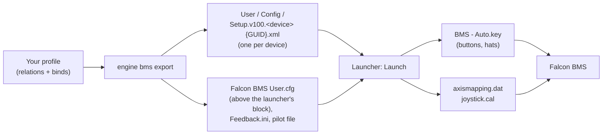

Falcon BMS 4.38 sets up your devices in its launcher: the launcher keeps one XML file per device and builds the key
file and the axis setup from them every time you press **Launch**. JoyPro writes exactly these launcher device files,
so the launcher stays in charge: it turns JoyPro's binds into the files BMS reads, as if you had made them in the
launcher yourself. Falcon 4.0 and Allied Force are not supported; use Falcon BMS.

:::video game-falcon-bms "Falcon BMS: import, relations, export"
:::

{{game-card}}

:::layer beginner
## What JoyPro does for Falcon BMS

- **Import**: the buttons, hats and axes of your devices come in from the launcher's device files, with the shift
  layer as a modifier and each axis's invert, dead zone and saturation steps.
- **Relations**: one relation is one function in all your games ("Gear" in BMS, DCS and IL-2 on the same button). The
  commands are BMS's callbacks from `BMS - Full.key`.
- **Export**: JoyPro writes the launcher's device files. On your next **Launch** the launcher builds the key file and
  the axis setup from them.

## Import your BMS binds

1. Open **Start**. The Falcon BMS card shows the game's picture. If it asks for a command list, press **Build List**:
   JoyPro reads the callbacks of the installed `BMS - Full.key`.
2. Press **Import** on the card and choose **Add to my profile** (keyboard keys stay in BMS's key file, so the keyboard
   box does not apply here).
3. Press **Import now**. **See my relations** opens what came in.

## Build and check relations

On the **Relations** page the BMS callback of a relation sits next to the same function in your other games. Use the
[[page:flows/relations.html|relations flow]] to join them, then press **Check now** on the Export page
([[page:flows/check.html|the Check]]).

## Export to Falcon BMS

1. **Close BMS and its launcher.** JoyPro refuses while `Falcon BMS.exe` or `FalconBMS_Alternative_Launcher.exe` runs.
2. Open **Export**. The Falcon BMS tile shows how many of its relations are bound.
3. Keep **Replace on my devices** with **Also clear my other devices** if JoyPro is where you set up your devices.
   Press **Export now** on the tile.

:::ingame What you see in Falcon BMS
Start the launcher and press **Launch**: the launcher builds the key file and the axis setup from JoyPro's device
files. In the sim, **Setup > Controllers > Advanced > Flight Control** shows each exported axis on your device with the
dead zone and saturation steps JoyPro set, and your buttons and hats do what your profile says.
:::

:::picture ingame-falcon-bms-controls "Falcon BMS: the controls menu with the exported binds"
:::

## What you do yourself in Falcon BMS

- **Press Launch in the launcher** after every export. Only then does the launcher write the key file,
  `axismapping.dat`, `joystick.cal` and `DeviceSorting.txt` that BMS reads.
- **Leave "Launch without any Setup override" unticked**, or the launcher does not write your setup.
- **Keyboard keys** stay in the key file BMS manages; set them in the launcher. JoyPro writes only joystick inputs.
- **Enable Force Feedback** is written into your pilot file (`<callsign>.pop`, the 468-byte file of BMS 4.36 and
  later). For a pilot file of another size JoyPro skips this one setting with a warning.

## Common pitfalls

- **"Falcon BMS is running"**: close the sim and the launcher and export again.
- **A modifier bind is missing**: BMS has one shift layer for all devices, held by the button that has
  `SimHotasPinkyShift`. JoyPro writes binds with that modifier into the shifted slot; any other modifier is skipped
  with a warning.
- **An axis stayed on another device in "Only add"**: BMS gives each function to one axis only, and Only add never moves
  it. Use an Update mode to move it.
- **Binds did not change in the sim**: the launcher was not started with Launch after the export.
:::

:::layer advanced
## Files JoyPro reads and writes

| File | What it is |
|---|---|
| `<BMS>\User\Config\Setup.v100.<device> {<GUID>}.xml` | the launcher's file per device: axes, hats, buttons, throttle detents |
| `<BMS>\User\Config\Falcon BMS User.cfg` | curve values and game settings, only above the launcher's marker line |
| `<BMS>\User\Config\Feedback.ini` | force feedback effect gains and the centring spring |
| `<BMS>\User\Config\<callsign>.pop` | the pilot file: only the Enable Force Feedback byte |
| `<BMS>\User\Config\JoyPro.joypro.json` | the inputs JoyPro wrote |

`<BMS>` is found through `HKLM\SOFTWARE\WOW6432Node\Benchmark Sims\...\baseDir` or a `Falcon BMS*` folder.
`axismapping.dat`, `joystick.cal`, `DeviceSorting.txt`, the key files and the launcher's block in User.cfg are rebuilt
by every Launch; JoyPro never writes them. A connected device without a device file gets one: from the launcher's stock
file of that model, else an empty file in the launcher's layout.

## The export modes in Falcon BMS

| Mode | What happens in BMS |
|---|---|
| **Only add** | Writes free slots only; a bind on a slot with another callback is not written and is listed. A function BMS has on another axis stays there (warning). |
| **Update, keep the game's binds** | Replaces the callback on your slot (the conflict) and keeps everything else; an axis function moves to your axis. |
| **Update, my profile wins** | Also releases the other press slots, hats and axes of connected devices that hold an action you bind. |
| **Replace on my devices** | Releases everything else of the connected devices you write (also cataloged callbacks in the release slots). |
| **+ Also clear my other devices** | The connected devices without binds in the export are cleared. |

## What is never touched

- Device files of devices that are not connected (an older axis claim there stays; the launcher takes the newest).
- The import's ignored devices and the vJoy device JoyPro tunnels into.
- Keyboard keys and the key file, the files the launcher generates, and the launcher's block in User.cfg.

## Curves, settings, force feedback

- **Granularity**: global, one setup for all aircraft.
- **Axes** (axis model `bms`): invert, the launcher's dead zone step (None, Small, Medium, Large) and saturation step,
  one-sided axes (throttle, toe brakes, brightness, volumes) without a dead zone; for pitch, roll, yaw and cursor X/Y
  also the exponential curve (0 to 100) and exponential saturation (0 to 99) in User.cfg. A curve set for all games
  sets the nearest launcher steps but no exponent.
- **Throttle detents**: the AB and IDLE detent positions per throttle device, in its device file.
- **Game settings** (Settings > **Force feedback settings of the games**): centring spring, runway rumble, anti-jitter
  deadband, analog idle cutoff, click at the AB detent, virtual rudder, Depr-Ret axis as brake.
- **Force feedback**: Enable Force Feedback, gun, bounce, centring spring, bomb drop and stall gains, the force feedback
  dead band. An export without BMS binds still writes settings and detents.
- **Telemetry recording**: read only from BMS's shared memory, with position (a Tacview track is possible). No
  telemetry force feedback.
- **Watcher**: changes in the device files, User.cfg, Feedback.ini or the pilot file are noticed after BMS closes
  ([[doc:sync-watcher|the watcher]]).
:::

:::layer technical
## Inside the BMS integration

Code: `engine\Games\FalconBmsIntegration.cs`, axis model `bms`, settings model `FalconBMS`; telemetry
`gui\JoyPro.Ffb.Core\Telemetry\Bms\BmsTelemetry.cs`.

- **Device files**: root `<JoyAssgn>` with `<detentPosition>`, 8 `<axis>` entries (X, Y, Z, Rx, Ry, Rz, Slider0,
  Slider1: `<AxisName>`, `<AssgnDate>`, `<Invert>`, `<Deadzone>`, `<Saturation>`), `<pov>` (4 hats × 8 directions,
  normal and shifted) and `<dx>` (128 buttons × 4 slots: press, press+shift, release, release+shift). The copy in
  `<profileDefaultF16>` is written alike. Declaration, whitespace, line ends and BOM are kept; only changed files are
  written.
- **Devices**: by the DirectInput instance GUID in the file name.
- **Buttons**: press slot 0; the shift layer is slot 1 and becomes the modifier `BMS Shift`. Release slots are never
  imported. A new callback gets `Invoke` = Default.
- **Axes**: a new claim gets `AssgnDate` = now; older claims of the same function are released (the launcher gives a
  function to the newest claim).
- **Command list**: [[cli:bms refresh-db]]: the visible callbacks of `BMS - Full.key` (cockpit and HOTAS sections) plus
  the launcher's axis functions (without FOV and camera distance).
- **Import / export**: [[cli:bms paths]], [[cli:bms import]], [[cli:bms scan]], [[cli:bms export]] (`--mode`,
  `--nuke-untouched-devices`, `--dry-run`). Backup to `.jpbak` and the backup store first; the read-only attribute is
  restored.
- **Settings and detents**: [[cli:ffb set]] `--device * --game FalconBMS --param flightControlsDeadband=0.05`, per
  throttle `--device "<throttle>" --param abDetent=80 --param idleDetent=5`; [[cli:binds tuning preview]] `--game
  FalconBMS`.

### Known limits

- Not written: the legacy key-file workflow, custom axis shaping (`axiscurves.cal`), dead zones other than the
  launcher's steps.
- The curve formula of the exponent and how BMS reads the saturation steps are not confirmed yet.
- Tests: `engine\tests\smoke\bms.ps1` (stock files); in the game `tools\e2e\games\BmsSettings.ps1` (Launch, the
  generated files, Setup > Controllers). The best in-game run passed 20 of 21 steps.
:::
