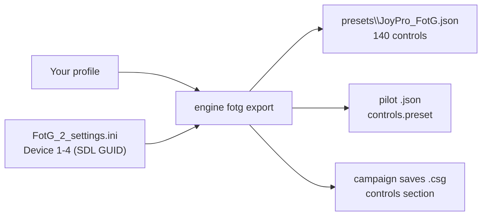

Fate of the Galaxy is a Star Wars space combat game built on FreeSpace Open and started with Knossos.NET. The game keeps
your controls in a **preset** file; your pilot only names the preset it uses. JoyPro reads the preset your pilot uses
into your profile and writes your binds as the preset **JoyPro_FotG**, then tells your pilot to use it. It finds
portable Knossos folders on any drive (a `kn_portable` folder next to `Knossos.NET.exe`) and the library of an installed
Knossos.NET.

**Experimental:** support for Fate of the Galaxy is new and built from the game's own file formats; if something looks wrong in the game, send JoyPro's support file. The game has no joystick modifiers, so JoyPro never puts its binds behind a JoyPro shift button, and each control takes up to two inputs.

{{game-card}}

:::layer beginner
## Get it working in 3 steps

:::steps
1. **Set it all up for me** on the Start page
2. **Use these buttons** look at the list first
3. **Write to my game** keep the game closed
:::

**Before**: start the game once and create your pilot. The game puts your connected devices into its four device slots
(Options: Device 1 to Device 4) the first time it starts.

**Then**: your binds are in the game's controls menu, preset **JoyPro_FotG**.

## What JoyPro does for Fate of the Galaxy

- **Import**: the controls of the preset your pilot uses come into your profile (sticks, throttles, pedals; keys with
  **Also take the keyboard keys**).
- **Relations**: one relation is one function in every game. "Fire lasers" can be the same trigger in Fate of the
  Galaxy, Elite Dangerous and X4.
- **Export**: JoyPro writes the preset `JoyPro_FotG` and selects it for your pilot and your campaign saves. Your keys and
  mouse binds stay.
- **Auto setup**: lasers, missiles, weapon banks, targeting, match speed, energy, shields and views go on your stick and
  throttle the way a space fighter pilot needs them.

## Export to Fate of the Galaxy

1. **Close the game.** It writes your pilot when it closes.
2. Open **Export** and tick the Fate of the Galaxy card.
3. Keep **Replace on my devices** with **Also clear my other devices** if JoyPro is where you set up your sticks. Press
   **Export now** on the card.

:::ingame What you see in the game
Start the game and open the controls menu: the preset is **JoyPro_FotG** and your binds are on Joy-0 to Joy-3, the four
devices of the options.
:::

## What you do yourself in the game

- **Create a pilot first.** Without one JoyPro writes the preset only; then pick **JoyPro_FotG** in the controls menu
  (or export again after creating the pilot).
- **Keep your devices in Device 1-4.** The game reads four devices. A device without a slot takes a free one; with all
  four taken, choose it in the game's options and export again.

## Common pitfalls

- **"The game is running"**: exit the game and export again.
- **A bind was skipped**: the game reads 128 buttons, the first hat in four directions (no diagonals) and eight axes
  per device, and two inputs per control; JoyPro names every bind it could not write.
- **Afterburner, countermeasures or sliding thrust are missing**: the mod switches them off; JoyPro shows only the
  controls the game's menu has.
- **You changed binds in the game**: the game saves them as a new preset you name. JoyPro's watcher notices it after the
  game closes and asks whether to take them over.
:::

:::layer advanced
## Files JoyPro reads and writes

| File | What it is |
|---|---|
| `kn_portable\HardLightProductions\FreeSpaceOpen\` (portable) or `%APPDATA%\HardLightProductions\FreeSpaceOpen\` | the game's user data |
| `...\data\players\presets\JoyPro_FotG.json` | the preset JoyPro writes: every control with a primary and a secondary input |
| `...\data\players\<pilot>.json` | your pilot; JoyPro changes only the name of its preset (and the dead zone / sensitivity you set) |
| `...\data\players\<pilot>.<campaign>.csg` | the campaign saves; they name the preset too |
| `...\data\FotG_2_settings.ini` | the four device slots (`[Input] Joystick` ... `Joystick3`), dead zone and sensitivity |
| `<Knossos library>\FotG_2\FotG_2-<version>\` | the mod: its control table and texts, read only for the command list |

Every file gets a `.jpbak` copy and a versioned backup before the first write.

## The export modes in Fate of the Galaxy

| Mode | What happens in the preset |
|---|---|
| **Only add** | Nothing is removed. A bind whose input another control has is not written and gets a mark. |
| **Update, keep the game's binds** | Your binds go into a free place of the control; only conflicts are removed. |
| **Update, my profile wins** | As above, and a control you bind loses its other joystick inputs (with the keyboard option also its keys). |
| **Replace on my devices** | The devices you export keep only your binds. Keys and mouse binds stay. |
| **+ Also clear my other devices** | The same for the other connected devices of Device 1-4. |

## Curves and game settings

- **Invert** per bind. A throttle lever pushed forward gives more thrust without an invert (the game reads the axis
  the same way as DCS); JoyPro writes the game's invert flag only when you invert the axis yourself.
- **JoyPro's notes** for a re-import sit next to your pilot as `<pilot>.json.joypro-meta`, a name the game ignores.
  JoyPro 2.7.3 used `<pilot>.json.joypro-meta.json`, which the game tried to load as a pilot and then stopped at start;
  the next export removes that old file (or delete it in `data\players` yourself).
- **Dead zone** (0-45) and **sensitivity** (0-9) are one setting for every axis: set them in **Settings > Force feedback
  settings of the games** (pick Fate of the Galaxy) or with [[cli:ffb set]]. The axis curve preview shows the game's
  response with them.
- **Watcher**: your pilot and the mod's settings are watched; JoyPro asks after the game closed.
:::

:::layer technical
## Inside the integration

Code: `engine\Games\FreeSpaceOpenIntegration.cs` and `engine\Games\FreeSpaceOpen\` (control list, files, Knossos
discovery), the axis model `engine\AxisModels\FreeSpaceOpen.cs` and the settings `engine\FfbModels\FreeSpaceOpen.cs`.
The formats follow FreeSpace Open 26.0.1's own source. Other FreeSpace Open mods could use the same backend later.

- **Inputs**: `CID_JOY0` .. `CID_JOY3` are Device 1-4; buttons `0` .. `127`, the first hat `128` back, `129` forward,
  `130` left, `131` right; axes `X_AXIS` .. `V_AXIS` count over the axes your device has.
- **Command list**: [[cli:fotg refresh-db]] reads the mod's `controlconfigdefaults.tbl` and its English texts, read
  only. [[cli:fotg catalog]] lists it.
- **Import / export**: [[cli:fotg import]], [[cli:fotg scan]]; [[cli:fotg export]] `--mode clean|add|merge|merge-overwrite
  --nuke-untouched-devices --include-keyboard --dry-run`.

### Known limits

- Not checked in the running game yet; the formats come from the game engine's source and real files of an installation.
- Two identical sticks are told apart by the device number the game saved.
- Tests: `engine\tests\smoke\fotg.ps1`.
:::
