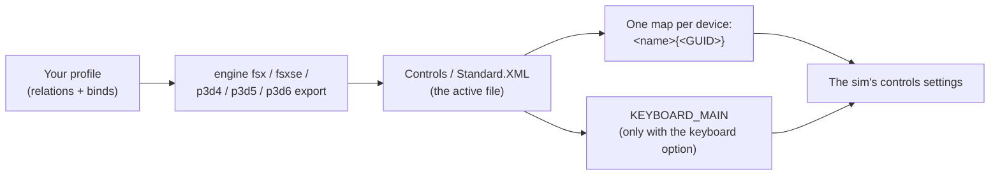

FSX, FSX: Steam Edition and Prepar3D v4, v5 and v6 keep your controls in one XML file in `%APPDATA%`: one map per
device with its axes, buttons and hat, plus the keyboard. JoyPro reads that file into your profile, joins it with your
other games in relations and writes it back block by block, leaving formatting, comments and other maps as they are.
Each sim is its own game in JoyPro because each has its own file.

This integration was written from public sources and is covered by a synthetic test file only: none of these sims has
been tested with JoyPro on a real install yet. After your first export, open the sim's controls and check the
assignments, and please report what differs.

:::video game-fsx-p3d "FSX and Prepar3D: import, relations, export"
:::

{{game-card}}

:::layer beginner
## What JoyPro does for FSX and Prepar3D

- **Import**: the axes, buttons and hats of your devices come into your profile, with each axis's sensitivity and
  null zone. Keyboard keys come in when you ask for them.
- **Relations**: one relation is one function in all your games ("Gear" in FSX, MSFS and X-Plane on the same button).
  The commands are the sims' public event names (`GEAR_TOGGLE`, `AXIS_AILERONS_SET` ...).
- **Export**: JoyPro writes the active controls file of the sim you export.

## Import your binds

1. Open **Start**. The card of your sim shows its picture. If it asks for a command list, press **Build List**:
   JoyPro combines its own event list with the events your control files (and the sim's own template files) name.
2. Press **Import** on the card. Choose **Add to my profile** and tick **Also take the keyboard keys** if you want your
   keys too.
3. Press **Import now**. **See my relations** opens what came in.

## Build and check relations

On the **Relations** page the sim's event of a relation sits next to the same function in your other games. Use the
[[page:flows/relations.html|relations flow]] to join them, then press **Check now** on the Export page
([[page:flows/check.html|the Check]]).

## Export

1. **Close the sim.** It rewrites the file when it quits; JoyPro refuses while `fsx.exe` or `Prepar3D.exe` runs.
2. Open **Export** and use the tile of your sim.
3. Keep **Replace on my devices** with **Also clear my other devices** if JoyPro is where you set up your devices.
   Press **Export now** on the tile.

:::ingame What you see in FSX and Prepar3D
Start the sim and open its controls settings: your devices' assignments show there, and the sensitivity and null zone
of each axis on its calibration page. The exact menu path and how the sims show JoyPro's file are not confirmed yet.
:::

:::picture ingame-fsx-p3d-controls "FSX and Prepar3D: the controls menu with the exported binds"
:::

## What you do yourself in FSX and Prepar3D

- **Start the sim once** with your devices connected, so it writes its controls file.
- **Check the result** after the first export (see above). It is the first real test of this integration on your PC.
- A hat is assigned as a whole and is normally the view pan (`PAN_VIEW`). Other events on single hat directions are not
  written; bind those in the sim.

## Common pitfalls

- **"The sim is running"**: close it and export again.
- **A device lost its binds after re-plugging**: Windows may give a device a new GUID. JoyPro then finds its map by the
  name when exactly one connected device has it (with a warning).
- **A joystick bind with a modifier is missing**: the format has no modifiers on joystick buttons. Keys can have Ctrl,
  Shift and Alt.
:::

:::layer advanced
## Files JoyPro reads and writes

| Sim | Control file |
|---|---|
| FSX (boxed) | `%APPDATA%\Microsoft\FSX\Controls\Standard.XML` (active file from `fsx.cfg` `[CONTROLS] Controls_Current`) |
| FSX: Steam Edition | `%APPDATA%\Microsoft\FSX-SE\Controls\` next to boxed FSX, `%APPDATA%\Microsoft\FSX\Controls\` when installed alone |
| Prepar3D v4 / v5 / v6 | `%APPDATA%\Lockheed Martin\Prepar3D v<N>\Controls\Standard.xml` (active file from `Prepar3D.cfg` `[CONTROLS]`) |
| all | `<file>.joypro.json` (the inputs JoyPro wrote), `<file>.joypro-meta.json` (names, groups and tuning for the next import) |

Prepar3D's `Standard.xmlx` (device presets) and FSX's template in the install folder are read for the command list
and never written.

## The export modes in FSX and Prepar3D

| Mode | What happens in the sim |
|---|---|
| **Only add** | Never removes or replaces a block. A bind on an input that has another event is not written and is listed. |
| **Update, keep the game's binds** | Replaces the event on your input (the conflict) and keeps everything else. |
| **Update, my profile wins** | Also removes the other inputs of the events you bind (connected devices; keyboard only with the keyboard option). |
| **Replace on my devices** | The main maps of the devices you write keep only your binds. |
| **+ Also clear my other devices** | The main maps of the other connected devices are emptied (the maps stay). |

## What is never touched

- Maps of devices that are not connected, the import's ignored devices and the vJoy device JoyPro tunnels into.
- The slew maps (`... SLEW {GUID}`), `Mouse Yoke`, `Mouse Look`, Prepar3D's per-SimObject maps, and the keyboard map
  unless you export keyboard binds.
- Key chords of two plain keys, comments, formatting and unknown elements.

## Curves and settings

- **Granularity**: global, one file for all aircraft.
- **Axis settings** (axis model `fsx`): sensitivity (0 to 127) and null zone (0 to 127) per device axis, as on the
  calibration page. A curve set for all games is fitted (dead zone to null zone, saturation to sensitivity); a curve
  shape has no equivalent. In Update mode values set in the sim stay when JoyPro's are the plain default.
- **Invert**: a negative sensitivity.
- No force feedback, game settings or telemetry. The watcher notices changes after the sim closes.
:::

:::layer technical
## Inside the FSX and Prepar3D integration

Code: `engine\Games\FsxIntegration.cs` (one class, one game per sim), `engine\Games\FsxControlsFile.cs` (text editing
of whole blocks), `engine\Games\FsxEvents.cs` (JoyPro's event list).

- **Format**: `<SimControls.Map>` with `<Name>`, `<Axis>` (`<Index>` 0 to 7 = X, Y, Z, Rx, Ry, Rz, Slider, second
  slider; `<AxEvent>`, `<AxScale>`, `<AxNull>`), `<Entry>` (0-based button `<Index>`, `<Down>` / `<Up>`, `<DownRpt>1`
  for repeating events) and `<POV>` (a whole hat). Header `encoding="Windows-1252"`.
- **Devices**: a map per DirectInput device named `<instance name>{<instance GUID>}`; matched by GUID, else by name when
  exactly one connected device has it. A device the file does not have gets a new map. 32 buttons and 8 axes per
  device are reported.
- **Mapping**: `JOY_X` .. `JOY_SLIDER2` to `<Index>` 0 to 7, `JOY_BTN<n>` to `<Index>` n-1, a hat on its up direction
  (`JOY_BTN_POV1_U`).
- **Command list**: [[cli:fsx refresh-db]] (and `fsxse`, `p3d4`, `p3d5`, `p3d6`): about 150 events with JoyPro's titles
  plus every event your control files and the sim's templates name; `AXIS_*` events are axes.
- **Import / export**: [[cli:fsx paths]] (the active file first), [[cli:fsx import]], [[cli:fsx scan]],
  [[cli:fsx export]], and the same for [[cli:fsxse export]], [[cli:p3d4 export]], [[cli:p3d5 export]],
  [[cli:p3d6 export]]. Backup before the first write.

### Known limits

- Everything needs a check on a real install: the Prepar3D v4+ header and whether `<Name>` still carries the GUID, the
  exact bytes the sims write, the axis name of the second slider, and whether a sim keeps a new map JoyPro adds for a
  device it has not seen yet.
- The FSX: Steam Edition config file name is inferred.
- Tests: `engine\tests\smoke\fsx.ps1` with a synthetic file built from the documented format.
:::
