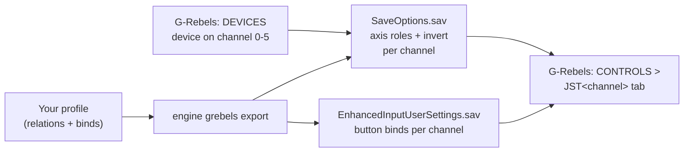

G-Rebels is a cyberpunk flight combat game on Unreal Engine 5: you fly a VTOL over megacities. The game puts each
joystick you switch on onto a **channel** (0 to 5) and keeps the role of every axis (pitch, roll, yaw, thrust, strafe,
up / down) and the button binds per channel in two save files. JoyPro reads those roles and binds into your profile
and writes them back; keyboard, gamepad and mouse stay as the game has them.

:::video game-g-rebels "G-Rebels: import, relations, export"
:::

{{game-card}}

:::layer beginner
## What JoyPro does for G-Rebels

- **Import**: the axis roles of every channel (which stick axis is pitch, roll, yaw, thrust, side strafe, up / down),
  with invert, and the button binds JoyPro knows, come into your profile on your real devices.
- **Relations**: "Pitch" in G-Rebels can be the same relation as pitch in your other games.
- **Export**: JoyPro sets the axis roles and button binds on the channels of your devices. It never adds a channel
  or a device: that part you do once in the game.

## Import your G-Rebels binds

1. Open **Start**. If the G-Rebels card asks for a command list, press **Build List**: JoyPro writes its own table of
   the game's axis roles and buttons.
2. Press **Import** on the G-Rebels card, keep **Add to my profile (recommended)** and press **Import now**.
3. **See my relations** opens what came in.

## Build and check relations

Bind your relations to the G-Rebels actions on the **Relations** page (see the
[[page:flows/relations.html|relations flow]]), then run **Check** on the Export page. G-Rebels allows one role per
axis and one button per action and channel; the Check shows where two relations want the same input.

## Export to G-Rebels

1. **Close G-Rebels.** JoyPro refuses to write while the game runs.
2. Open **Export** and tick the G-Rebels tile.
3. Keep **Replace on my devices** with **Also clear my other devices** if JoyPro is where you set up your sticks. Press
   **Export now** on the tile.

:::ingame What you see in G-Rebels
Open **OPTIONS > INPUT > CONTROLS** and the tab **JST&lt;channel&gt;** of your device (JST0 for channel 0). Under
AXIS each joystick axis (X, Y, Z, RX, RY, RZ, Slider, Dial) shows the role JoyPro set (YAW, THRUST, ROLL, PITCH, SIDE
STRAFE, UP / DOWN or NONE). Under BUTTONS the bound action shows your button, for example "Enhanced Raw Input
Controller 0 Button 5".
:::

:::picture ingame-g-rebels-controls "G-Rebels: the controls menu with the exported binds"
:::

## What you do yourself in G-Rebels

Do this once per device, before the first export:

1. **Switch the device on**: **OPTIONS > INPUT > DEVICES** lists every joystick with **DEACTIVATED**. Give each device
   you want a channel (**0 - CHANNEL** ... **5 - CHANNEL**). A device without a channel is skipped by the export with
   "switch it on in OPTIONS > INPUT > DEVICES".
2. **Change one axis role** on the device's **JST** tab. Only then does the game save the axis rows of that channel;
   JoyPro changes them in place and never adds them. Opening the tab alone saves nothing.
3. **Bind one button** in the game once. The button file appears with the first bind.

## Common pitfalls

- **An axis role is not written**: the channel has no saved axis rows yet. Change one axis role on its JST tab in the
  game, close the game, export again.
- **A button bind is missing**: only **Primary Fire** of the game's buttons is confirmed so far; other actions follow
  when their names are known.
- **Several raw-input devices share keys**: put the whole HOTAS on one device with the
  [[gui:vjoy|Virtual Joystick]]; it then needs only one channel.
:::

:::layer advanced
## Files JoyPro reads and writes

| File | What it is |
|---|---|
| `%LOCALAPPDATA%\G_Rebels\Saved\SaveGames\SaveOptions.sav` | the devices with their channels (by HID path) and one axis row per axis of every channel: role, invert, dead zone, multiplier |
| `%LOCALAPPDATA%\G_Rebels\Saved\SaveGames\EnhancedInputUserSettings.sav` | the button binds, one mapping per action and channel |
| `...\SaveOptions.sav.joypro-meta.json` | JoyPro's data of the exported binds (names, groups), read back by the next import |

Both save files are backed up before the first write (`.jpbak` beside them and JoyPro's backup store).

## The export modes in G-Rebels

One role per axis and one key per action and channel. The same rules hold for axis roles and buttons.

| Mode | What happens |
|---|---|
| **Only add** | A role goes only onto an axis without one; an axis with another role is skipped and marked "Not written to the game". |
| **Update, keep the game's binds** | The profile's role goes onto its axis (the role there goes); the role stays on its other axes. A button: another action's mapping on the key goes. |
| **Update, my profile wins** | As above, and the role's other axes on connected channels get **NONE**. |
| **Replace on my devices** | Every other role of a written channel becomes **NONE**. |
| **+ Also clear my other devices** | The same on the enabled, connected channels JoyPro does not write. |

## What is never touched

- Keyboard, gamepad, mouse and the game's other options.
- A channel whose device is not connected keeps its roles.
- The import's ignored devices and the vJoy device JoyPro tunnels into.
- The game's device list: JoyPro never switches a device on or off and never adds a channel.

## Axes and other settings

- **Global**: one set of binds per channel, no aircraft profiles.
- **Invert** is written with the role. Hats (the POV rows), dead zone and sensitivity are not written yet.
- No game-wide settings, no force feedback.
- **Watcher**: a role or bind you change in the game is noticed after it closes ([[doc:sync-watcher|the watcher]]).
- **HUD**: while G-Rebels runs, the [[gui:hud|HUD]] names the action of each pressed button.
- The game reads up to 96 buttons and 24 axes per device, no hats.
:::

:::layer technical
## Inside the G-Rebels integration

Code: `engine\Games\GRebelsIntegration.cs`, `engine\Games\GRebelsSaveOptions.cs`, `engine\Games\GvasKeyMappings.cs`.

- **SaveOptions.sav**: Unreal GVAS (UE 5.8, property tags with type trees). `Joysticks` holds
  `S_Controller_Save { DeviceID (HID path), Enabled, MultiID (channel) }`; `AxisOptions` holds
  `S_Input_Axis_Save { Key, Offset, Multiplier, Role, Inverted, DeadZone }` with keys such as
  `RawInput_Controller0_AxisY` and the role as an enum (0 Yaw, 1 Thrust, 2 Roll, 3 Pitch, 4 Side strafe, 5 Up/down,
  6 None). No checksum: JoyPro edits fixed-size values in place.
- **EnhancedInputUserSettings.sav**: Unreal Enhanced Input player-mapped keys. Mapping names are
  `<ACTION>JST<channel>` (`PRIMARYFIREJST0`), keys `RawInput_Controller<channel>_Button<n>` with n the DirectInput
  button number. The mapping list is rewritten; every other byte stays.
- **Devices**: matched by HID path to the channel the game gave them.
- **Command list**: JoyPro's own table (`DB\GRebels\actions.tsv`, axis roles and buttons; the game's files are not
  read). [[cli:grebels refresh-db]] writes it into the game-data folder; rows already there keep their entry.
- **Commands**: [[cli:grebels paths]], [[cli:grebels catalog]], [[cli:grebels scan]], [[cli:grebels import]],
  [[cli:grebels export]] `--mode clean|add|merge|merge-overwrite --nuke-untouched-devices --dry-run`.

### Known limits

- Hats, dead zone and sensitivity are not written.
- Of the buttons only **Primary Fire** is confirmed in the game.
- Entries are never added: channels, axis rows and the button file must exist from the game.
- Tests: `engine\tests\smoke\grebels.ps1`; in the game `tools\e2e\games\GRebelsSettings.ps1` (two starts: the first
  gives vJoy a channel and saves the axis rows, the second checks random roles and Primary Fire on JST0; the save
  folder is restored afterwards).
:::
