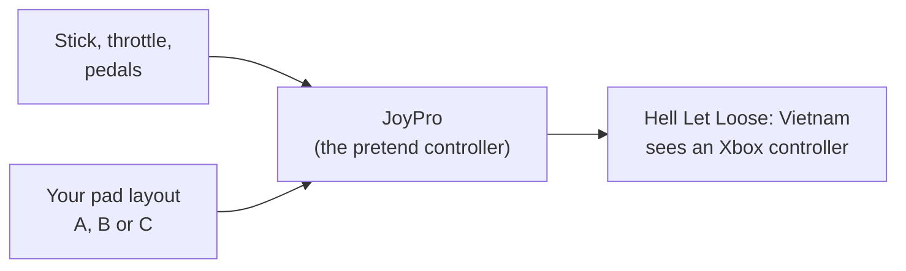

Hell Let Loose: Vietnam is an infantry shooter on Unreal Engine 5 with flyable helicopters, but it reads no joystick
at all: only keyboard, mouse and Xbox controllers. Its pad layouts are fixed (you pick A, B or C in the game). So
JoyPro flies it through a **pretend controller** (a virtual Xbox pad): your stick, throttle and pedals drive the pad
controls that your layout uses for each helicopter action. JoyPro writes nothing for the pad. It writes only the
keyboard pilot keys, when you ask for them.

:::video game-hll-vietnam "Hell Let Loose: Vietnam: import, relations, export"
:::

{{game-card}}

:::layer beginner
## Get it working in 3 steps

:::steps
1. **Bind the helicopter** on the Relations page
2. **Install ViGEmBus** then **Test**
3. **Start the game** at its title screen: Alt+Tab, **Start**
:::

## Set it up once

1. Open **Start**. If the Hell Let Loose: Vietnam card asks for a command list, press **Build List**. JoyPro writes its
   own table of the three pad layouts and the pilot keys.
2. Open **Relations**. Put your stick, throttle and pedals on the helicopter's pad actions: collective, cyclic, yaw.
   For the collective, put one throttle axis on both **Collective up** and **Collective down**. JoyPro splits it at the
   centre onto the two triggers.
3. Open the [[gui:vjoy|Virtual Joystick]] page. The pretend controller needs a free helper called ViGEmBus. Tick the
   box below its license. Then press **Install ViGEmBus**. Windows asks for permission: click **Yes**. You do this
   only once.
4. Press **Test**. Move your stick. The controller picture moves with it.

You do not need to switch anything. The game uses the pretend controller by itself. The page says "On the Xbox pad by
itself: the game reads only Xbox controllers". You need no HidHide for this game: it never sees your real sticks
anyway.

:::note The quick setup knows only the pilot keys
**Set it all up for me** knows only the game's keyboard pilot keys so far, not its pad actions. So bind the pad
actions yourself, as in step 2. The welcome's answer **Play ACE COMBAT with my flight stick** shows the same
pretend-controller steps as a tour.
:::

## Every time you play

1. Start Hell Let Loose: Vietnam. Wait until it shows its title screen.
2. Hold Alt and press Tab. You are back in JoyPro.
3. Press **Start**.
4. Press Alt+Tab again. You are back in the game. Fly!
5. When you are done, press **Stop**.

:::warn Start comes after the game
Press **Start** only when the game shows its title screen. Too early? JoyPro says "Too early". Press **Stop**, then
**Start**. Do this every time you play.
:::

## What JoyPro does for Hell Let Loose: Vietnam

- **Helicopter on the pretend controller**: JoyPro knows the helicopter actions of the three pad layouts (collective,
  cyclic, yaw, stability hold, auto-level, supply drop, recon flare, look, seat, medic). Bind your HOTAS to them, and
  the pretend controller moves the stick, trigger or button the game expects.
- **Keyboard pilot keys**: on request, JoyPro reads and writes the game's keyboard keys of the pilot actions.
- **Hell Let Loose** (the original) has nothing to fly, and **Squad** reads one merged device: both are documented
  only (see Advanced).

## Import your pilot keys

There are no joystick binds in the game to import. Only the keyboard pilot keys come in:

1. Press **Import** on the Hell Let Loose: Vietnam card.
2. Tick **Also take the keyboard keys**.
3. Press **Import now**.

## Build and check relations

The [[page:flows/relations.html|relations flow]] works as for every game. A relation can hold the helicopter action
of this game and the same function of your flight sims. Then "Collective" is one throttle lever everywhere.

## Export

The pretend controller needs no export: **Start** on the Virtual Joystick page builds its table from your relations.
An export writes only the keyboard pilot keys, and only when you ticked the keyboard at the import (the choice is kept
per game): **close the game**, open **Export**, press **Export now** on its card.

:::ingame What you see in Hell Let Loose: Vietnam
The game sees one Xbox controller: its menus show pad buttons (for example "B EXIT" in the main menu). Your stick,
throttle and pedals fly the helicopter as the pad of the layout you picked would. Keyboard pilot keys JoyPro wrote
show in the game's key settings.
:::

:::picture ingame-hll-vietnam-controls "Hell Let Loose: Vietnam: the controls menu with the exported binds"
:::

## What you do yourself in Hell Let Loose: Vietnam

- **Press Start at the title screen**, every time you play (see above).
- **Pick the pad layout** (A, B or C) in **Options > Controls**. After a change, press **Update mapping** on the Virtual
  Joystick page (or **Stop** and **Start**). JoyPro then follows the new layout.
- **The game's pad buttons cannot be rebound**, so the layout decides which pad control each action has. JoyPro
  follows it. There is nothing to set in the game for the pad.

## Common pitfalls

- **The game does not react**: was **Start** pressed too early? Press **Stop**, then **Start** at the title screen.
- **No ViGEmBus**: without it, the game cannot see your stick. Install it on the Virtual Joystick page.
- **Yaw and look move together** in layouts A and B: the game puts yaw and look left / right on the same stick axis
  and decides by context. JoyPro pins one physical axis there and warns about the second.
- **The collective goes the wrong way**: tick *Invert* on the collective relation. It swaps the two triggers.
- **A pilot key was not written**: keyboard keys are written only with the keyboard choice of the import.

More: [[page:how-do-i/xbox-only-games.html|Play an Xbox-only game with a HOTAS]].
:::

:::layer advanced
## How the pretend controller works

- **No HidHide.** The game reads only Xbox controllers, so it never sees your real sticks. Nothing has to be hidden,
  and Windows asks for no administrator rights. HidHide is only for games set to vJoy.
- **The mode switches itself.** While you have not picked a mode, the game uses the Xbox pad. Pick another mode on the
  Virtual Joystick page, and JoyPro keeps your choice.
- **Your curve reaches the pad.** The game gets no export, so JoyPro applies the dead zone, saturation, curve and
  invert of **Axis response** (Binds page) to the pad stick or trigger itself. Tick only this game under **Applies to**
  for a curve of its own. Else the **Default curve** counts.
- **Auto start** makes the pad within about 3 seconds of the game's start, before its title screen. In JoyPro's tests
  a pad made before the title screen never reached this game. Then press **Stop** and **Start** at the title screen.
- **Several games on the pad**: each game keeps its own table. With auto start the running game's table goes live.
  Else pick it under **Xbox pad table for Start and Test**.
- **Experts**: vJoy, HidHide, the forwarding rate and the modes are under **Show details for experts (vJoy, HidHide,
  modes)**.

## Files JoyPro reads and writes

| File | What it is |
|---|---|
| `%LOCALAPPDATA%\HLLVietnam\Saved\Config\Windows\GameUserSettings.ini` | read only: `SelectedGamepadLayout` (`LayoutA`, `LayoutB` or `LayoutC`) |
| `%LOCALAPPDATA%\HLLVietnam\Saved\SaveGames\EnhancedInputUserSettings.sav` | the keyboard keys you changed; JoyPro writes the pilot keys there (with the keyboard option) |
| `...\EnhancedInputUserSettings.sav.joypro-meta.json` | JoyPro's data of the exported keys for the next import |

## The helicopter pad layouts

| Action | A | B | C |
|---|---|---|---|
| Collective up / down | RT / LT | LT / RT | RT / LT |
| Cyclic pitch | left stick Y | right stick Y | left stick Y |
| Cyclic roll | left stick X | right stick X | left stick X |
| Yaw | right stick X | left stick X | LB / RB |
| Stability hold | B | B | B |
| Auto-level toggle | LS click | LS click | LS click |
| Supply drop | D-pad right | D-pad right | D-pad right |
| Recon flare | D-pad up | D-pad up | D-pad right |
| Look left / right, up / down | right stick | left stick | right stick |
| Free look (hold) | RB | LB | - |
| Next seat | Y | Y | Y |
| Medic / medic radial | A / RB | A / RB | A / RB |

## The export modes (keyboard pilot keys)

One key per pilot action. A mouse button on a pilot action always stays; infantry and common keys never change.

| Mode | What happens |
|---|---|
| **Only add** | The game's key stays; a key another pilot action has is skipped and marked "Not written to the game". |
| **Update, keep the game's binds** / **Update, my profile wins** | The profile's key is set; another pilot action on that key loses it (the game then uses its default there). |
| **Replace on my devices** | The other pilot keys you changed in the game go back to the game's defaults. |
| **+ Also clear my other devices** | Nothing to clear: the game stores no joystick binds. |

## What is never touched

- The game's pad layouts: they are fixed and JoyPro writes no pad binds.
- Infantry and vehicle keys, mouse buttons, every other byte of the save file.
- HidHide: the pretend controller needs none for this game.

## Pad, curves, other settings

- **Invert** on an axis relation reverses that pad axis in JoyPro's forwarder. JoyPro applies your axis curve to the
  pad too (see above); the game's own pad settings apply after it.
- An action without a pad key in the layout gets the next free pad control; what does not fit is listed on the
  Virtual Joystick page. [[doc:virtual-joystick|Virtual functions]] work on the pad too.
- **Settings > Games: Hell Let Loose: Vietnam: use the Oodle library of another installed game**: the game's files are
  compressed and it ships no library to read them. With your yes JoyPro uses one that another game on this PC has,
  where it is (never copied), to build the list from the game's own files. Off: JoyPro's own table, which is all the
  pad mode needs. **Ask again** forgets your answer.
- **Watcher**: the keyboard save file is watched after the game closes ([[doc:sync-watcher|the watcher]]).
- **HUD**: while the game runs, the [[gui:hud|HUD]] names the action of each pressed button.

## Hell Let Loose and Squad

| Game | What is known | JoyPro |
|---|---|---|
| **Hell Let Loose** (original) | Its `Input.ini` has only artillery and vehicle machine gun pitch / yaw; nothing flyable. | Not planned. |
| **Squad** | Reads one merged HID device; a beta version adds several HOTAS devices. Binds in `%LOCALAPPDATA%\SquadGame\Saved\Config\...\Input.ini`. | Waiting for the multi-device version; no integration. |
:::

:::layer technical
## Inside the Hell Let Loose: Vietnam integration

Code: `engine\Games\HllVietnamIntegration.cs`, `engine\Games\GvasKeyMappings.cs`; the pad planner and forwarder of
[[doc:virtual-joystick]].

- **Input**: the game's executable has no DirectInput, raw input or GameInput code, only keyboard, mouse and XInput.
  It declares itself a one-device game (0 joysticks, suggested mode `xbox`).
- **Command list**: `DB\HLLVietnam\actions.tsv`, two kinds of rows: `Pad_*` helicopter actions with the default key per
  layout in the 5th column (`A:Gamepad_LeftY|B:Gamepad_RightY|C:Gamepad_LeftY`), and `Driver_*` keyboard pilot keys.
  [[cli:hllv refresh-db]] writes JoyPro's own table, or reads the game's input assets when an Oodle library may be used
  (the game's own first, another game's only after your yes: `--oodle-dll <path>`, loaded where it is, only in the
  refresh process). [[cli:hllv oodle]] names the library it would use.
- **Pad plan**: the planner reads the layout from `GameUserSettings.ini`, pins each action to its key in that layout
  (`Gamepad_LeftY` to `XB_LY`, `Gamepad_FaceButton_Right` to `XB_B` ...); a relation on both collective actions becomes
  `XB_TRIGGERS`; *Invert* adds `~` (with a curve, the curve carries it). The game declares `MaxJoysticks` 0 and the
  suggested mode xbox, so without a stored choice its mode is xbox; [[cli:vjoy mode]] `HLLVietnam xbox` stores one.
  [[cli:vjoy map]]. No HidHide step: [[cli:vjoy apply-hidhide]] says "HidHide is not needed" for such games.
- **Setup tables**: `DB\Functions\HLLVietnam.tsv` lists only the `Driver_*` keyboard pilot actions so far, so the setup
  wizard and the quick setup do not place the `Pad_*` actions.
- **Keyboard file**: Unreal GVAS with the Enhanced Input tail (profiles, mappings with name, key, hardware class and
  slot). JoyPro rewrites only the `<Action>_Keyboard` mappings of the pilot actions; key names are turned into Unreal
  key names (`Space` to `SpaceBar`, `D1` to `One`).
- **Commands**: [[cli:hllv paths]], [[cli:hllv catalog]], [[cli:hllv scan]], [[cli:hllv import]], [[cli:hllv export]]
  `--include-keyboard --mode clean|add|merge|merge-overwrite --dry-run`.

### Known limits

- A flight with the virtual pad is not confirmed yet (collective on the triggers, cyclic, yaw, stability hold, supply
  drop); the menus were checked.
- Yaw and look share a stick axis in layouts A and B.
- Tests: `engine\tests\smoke\hllv.ps1` (no library loaded without your yes, the fallback table, the game's own library
  first); in the game `tools\e2e\games\HllVietnamXbox.ps1` (menus with the virtual pad; vJoy and HidHide unchanged
  afterwards).
:::
