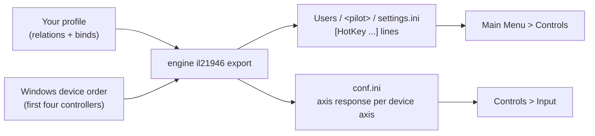

IL-2 Sturmovik: 1946 keeps the controls per pilot, in a plain ini file inside the game's folder, and the axis
response in `conf.ini`. It knows devices only by their position in Windows' device order. JoyPro reads the current
pilot's controls into your profile, lets you join them with your other games in relations and writes them back line
by line, leaving every other byte of the files as it was.

:::video game-il2-1946 "IL-2 1946: import, relations, export"
:::

{{game-card}}

:::layer beginner
## What JoyPro does for IL-2 1946

- **Import**: the current pilot's binds on your sticks, throttles and pedals come into your profile, with the dead
  band and curve of each axis. Keyboard keys come in when you ask for them.
- **Relations**: one relation is one function in all your games ("Gear" in 1946, Great Battles and DCS).
- **Export**: JoyPro writes the pilot's `settings.ini` and the axis lines of `conf.ini`. The game shows your binds on
  its Controls page.

## Import your IL-2 1946 binds

1. Open **Start**. The IL-2 Sturmovik: 1946 card shows the game's picture. If it asks for a command list, press
   **Build List**: JoyPro combines its own command list with the commands your files name.
2. Press **Import** on the card. Choose **Add to my profile** and tick **Also take the keyboard keys** if you want
   your flight keys too.
3. Press **Import now**. **See my relations** opens what came in.

## Build and check relations

On the **Relations** page the 1946 command of a relation sits next to the same function in your other games. Use the
[[page:flows/relations.html|relations flow]] to join them, then press **Check now** on the Export page
([[page:flows/check.html|the Check]]).

## Export to IL-2 1946

1. **Close the game.** JoyPro refuses to write while `il2fb.exe` runs; the game rewrites `settings.ini` on Apply and
   `conf.ini` when it quits.
2. Open **Export**. The IL-2 Sturmovik: 1946 tile shows how many of its relations are bound.
3. Keep **Replace on my devices** with **Also clear my other devices** if JoyPro is where you set up your sticks.
   Press **Export now** on the tile.

:::ingame What you see in IL-2 1946
Start the game and open **Main Menu > Controls**. Your binds show in the command rows, for example `JoyButton 7 ID4`
(button 7 of the fourth device), `Hat Switch -135 ID14` or `U Slider axis ID4` at the end of the list. **Controls >
Input** shows the dead band and the curve sliders JoyPro wrote for each bound axis.
:::

:::picture ingame-il2-1946-controls "IL-2 1946: the controls menu with the exported binds"
:::

## What you do yourself in IL-2 1946

- **Keep your devices in the same order.** The game stores "device 0, 1, 2, 3" in Windows' order, not names. If you
  plug devices in another order, export again.
- **Steam Cloud** syncs the `Users` folder when the game exits. A file JoyPro changed while the game is closed is
  uploaded at the next start.
- Fly the pilot you exported to. JoyPro takes the current pilot's file first (`Users\all.ini` says which one); for
  another pilot, set that pilot's `settings.ini` under **Options and paths (for experts)** on the Export page.

## Common pitfalls

- **A device is refused**: the game reads only the first four game controllers. A device at position five or later
  cannot be written.
- **A bind with a modifier is missing**: the game ignores a key held while a joystick button is pressed, so JoyPro
  skips joystick binds with modifiers (with a warning). Keys can have one modifier.
- **Binds on the wrong stick**: the device order changed. Export again.
:::

:::layer advanced
## Files JoyPro reads and writes

| File | What it is |
|---|---|
| `<install>\Users\<pilot>\settings.ini` | a pilot's binds, sections `[HotKey move]` (axes), `pilot`, `gunner`, `misc`, `aircraftView`, `orders` ... |
| `<install>\Users\all.ini` | the pilot list and the current pilot (read only) |
| `<install>\Users\default.ini` | the template for new pilots (read for the command list only) |
| `<install>\conf.ini` | the axis response, sections `[rts_joystick]` / `[rts_joystick<k>]` |
| `settings.ini.joypro.json` | the inputs JoyPro wrote |

`<install>` is `steamapps\common\IL 2 Sturmovik 1946` for Steam. JoyPro edits lines in place.

## The export modes in IL-2 1946

| Mode | What happens in the game |
|---|---|
| **Only add** | Nothing is removed. A bind on an input the game uses for another command is not written and is listed. |
| **Update, keep the game's binds** | Your binds go in; a game bind on an input you give another command is removed, the rest stays (the game keeps two inputs per command). |
| **Update, my profile wins** | As above, and every command you bind loses its other inputs (keyboard only with the keyboard option). |
| **Replace on my devices** | The devices you write lose all their other lines in the managed sections. |
| **+ Also clear my other devices** | The other connected devices lose their lines. |

## What is never touched

- Lines of a device that is not connected, lines the import cannot read, mouse lines (`MouseAXE_X`, `MouseLeft`) and
  keyboard lines (keyboard only with the keyboard option).
- The other pilots' files, unless you export to them, and every other line of `conf.ini`.

## Curves and settings

- **Granularity**: per pilot. All aircraft of a pilot share the binds; the axis response is per device axis.
- **Axis response** (axis model `il21946`): dead band (0 to 50), ten curve points at 10 % to 100 % stick (percent of
  the linear output), the filter and the one-sided flag. A curve set for all games is fitted: dead zone to dead band,
  the shape to the ten points (capped at linear, so a curve above linear cannot be expressed), a slider to one-sided.
  In Update mode a curve set in the game stays when JoyPro's is the plain default.
- **Invert**: a `-` before the command. Only one command per device axis gets a response line (a second one gets a
  warning).
- No force feedback or game settings. The watcher notices changes after the game closes.
:::

:::layer technical
## Inside the 1946 integration

Code: `engine\Games\Il21946Integration.cs`, `engine\Games\Il2LegacyIntegration.cs`, `engine\Games\Il2LegacyInput.cs`,
`engine\Games\LegacyIniFile.cs`.

- **Lines**: `<trigger>[ <trigger>]=<command>`. Axis `AXE_<X|Y|Z|RX|RY|RZ|U|V> JoystickDevice<d>`, button
  `Joystick<b> JoystickDevice<d>` (b 0-based), hat `Pov<angle> JoystickPov<d*4+h>`, key `[<modifier> ]<key>`. New
  lines are written input first, as the game does.
- **Devices**: by index only. `JoystickDevice<d>` is the d-th game controller in DirectInput order; JoyPro maps it to
  the connected device with that index. Up to 4 devices (`JoystickDevice0..3`), 8 axes and 4 hats each.
- **Axis lines**: `1<axis>[<device>]=` 13 integers: dead band, ten curve points, filter, one-sided (0 centred, 1
  one-sided, 2 one-sided reversed). `[rts] JoyProfile=k` selects the section.
- **Command list**: [[cli:il21946 refresh-db]]: JoyPro's own command list plus every command `Users\default.ini`,
  `conf.ini` and the pilots' `settings.ini` name. Ids are `<section>.<command>` (`pilot.Gear`, `move.power4`).
- **Import / export**: [[cli:il21946 paths]] (current pilot first), [[cli:il21946 import]], [[cli:il21946 scan]],
  [[cli:il21946 export]]. Backup of both files before the first write.

### Known limits

- Key names under a game language other than English are not confirmed yet.
- The button limit per device: the files allow 128, players report 32.
- Tests: `engine\tests\smoke\il21946.ps1`; in the game `tools\e2e\games\IL21946.ps1` (binds on the Controls page,
  responses on the Input page, the game's rewrite and its import; 29 of 33 steps, one fully green run pending).
:::
