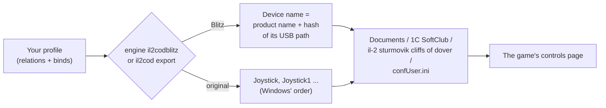

Cliffs of Dover and its Team Fusion edition Cliffs of Dover Blitz keep binds and axis settings in one ini file in your
Documents folder, `confUser.ini`, shared by both games. Blitz names each device after its product name and a number
taken from its USB port; the original names them `Joystick`, `Joystick1` ... in Windows' order. JoyPro reads the file
into your profile, joins it with your other games in relations and writes it back, keeping every line it does not
manage.

:::video game-il2-cliffs-of-dover "IL-2 Cliffs of Dover: import, relations, export"
:::

{{game-card}}

:::layer beginner
## What JoyPro does for Cliffs of Dover

- **Import**: your binds on sticks, throttles and pedals come into your profile, with chords (several inputs held
  together) as modifiers and the axis settings of each command. Keyboard keys come in when you ask for them.
- **Relations**: one relation is one function in all your games ("Gear" in Cliffs of Dover, IL-2 Great Battles and
  DCS on the same button).
- **Export**: JoyPro writes the flight sections of `confUser.ini`. Blitz and the original are two games in JoyPro
  (two cards and tiles) because they name devices differently; both write the same file.

## Import your binds

1. Open **Start**. Pick the card of the game you play: **IL-2 Sturmovik: Cliffs of Dover Blitz** or **IL-2
   Sturmovik: Cliffs of Dover**. If it asks for a command list, press **Build List**: JoyPro combines its own command
   list with the commands of your file and the install's default file.
2. Press **Import** on the card. Choose **Add to my profile** and tick **Also take the keyboard keys** if you want your
   flight keys too.
3. Press **Import now**. **See my relations** opens what came in.

## Build and check relations

On the **Relations** page the Cliffs of Dover command of a relation sits next to the same function in your other
games. Use the [[page:flows/relations.html|relations flow]] to join them, then press **Check now** on the Export page
([[page:flows/check.html|the Check]]).

## Export

1. **Close the game.** JoyPro refuses to write while Blitz (`Launcher64.exe`) or the original runs. The game writes
   `confUser.ini` when it closes.
2. Open **Export** and use the tile of the game you play (both tiles write the same file, each with its own device
   names).
3. Keep **Replace on my devices** with **Also clear my other devices** if JoyPro is where you set up your sticks.
   Press **Export now** on the tile.

:::ingame What you see in Cliffs of Dover
Start the game and open its controls page: your binds are in the rows of each command, on your devices. The exact menu
path and how the page shows JoyPro's binds are not confirmed yet: the live check in the game is still to come.
:::

:::picture ingame-il2-cliffs-of-dover-controls "IL-2 Cliffs of Dover: the controls menu with the exported binds"
:::

## What you do yourself in Cliffs of Dover

- **Start the game once.** Blitz creates the `Documents\1C SoftClub\il-2 sturmovik cliffs of dover` folder with a copy
  of the default `confUser.ini` on its first start.
- **Steam Cloud** keeps copies of the file and has been reported to bring old binds back. If an export does not stick,
  turn Steam Cloud off for the game.
- **Blitz and the USB port**: Blitz's device name changes when you plug a device into another port. JoyPro finds the
  device by name and writes the current name (an old line is renamed, with a warning).

## Common pitfalls

- **"The game is running"**: close it and export again. The original's process is called `Launcher`, a name other
  programs use too; JoyPro checks the game's own program.
- **Binds came back old**: Steam Cloud restored an older file (see above).
- **Two identical devices on Blitz**: they are told apart only by the id from their USB path. JoyPro matches a line by
  name alone only when one connected device has that name, so after moving one of them to another port, check the
  binds.
:::

:::layer advanced
## Files JoyPro reads and writes

| File | What it is |
|---|---|
| `%USERPROFILE%\Documents\1C SoftClub\il-2 sturmovik cliffs of dover\confUser.ini` | binds (`[HotKey ...]` sections) and axis settings (`[Config pilotMove]`) of both games |
| `%USERPROFILE%\Documents\1C SoftClub\il-2 sturmovik cliffs of dover - MOD\confUser.ini` | the pre-Blitz Team Fusion mod (listed for the original) |
| `<install>\confUser.ini` | the defaults, read for the command list only |
| `confUser.ini.joypro.json` | the inputs JoyPro wrote |

`conf.ini`, `user.ini`, `bldconf.ini` and "Save As" profiles in the same folder are not touched.

## The export modes in Cliffs of Dover

| Mode | What happens in the game |
|---|---|
| **Only add** | Nothing is removed. A bind on an input the game uses for another command is not written and is listed. |
| **Update, keep the game's binds** | Your binds go in; a game bind on an input you give another command is removed, the rest stays. |
| **Update, my profile wins** | As above, and every command you bind loses its other inputs (keyboard only with the keyboard option). |
| **Replace on my devices** | The devices you write keep only your binds in the managed sections. |
| **+ Also clear my other devices** | The other connected devices lose their lines in the managed sections. |

## What is never touched

- The `[HotKey vehicle]` section (ground vehicles), mouse and keyboard lines (keyboard only with the keyboard option).
- Devices that are not connected, lines the import cannot read, lines without a device (defaults the game could not
  resolve), the import's ignored devices and the vJoy device JoyPro tunnels into.
- Unknown sections, such as the mission builder's, byte for byte.

## Curves and settings

- **Granularity**: global. One file for all aircraft; axis settings are per command, not per device axis.
- **Axis settings** (axis model `il2cod`): aileron, elevator and rudder have sensitivity (0 linear to 1 most curved),
  centre dead zone and end dead zone; the other axes a dead zone at the low and the high end; the throttles keep their
  five values as imported. A curve set for all games is fitted (dead zone to the centre, saturation to the end, a
  positive curvature to sensitivity). The preview's formula is an assumption.
- **Invert**: the sign before the command (`=-1throttle`).
- In Update mode, values set in the game stay when JoyPro's are all zero. No force feedback or game settings.
- **Watcher**: changes in `confUser.ini` are noticed after the game closes ([[doc:sync-watcher|the watcher]]).
:::

:::layer technical
## Inside the Cliffs of Dover integration

Code: `engine\Games\Il2CodIntegration.cs` (one class, two games), `engine\Games\Il2LegacyIntegration.cs`,
`engine\Games\LegacyIniFile.cs`.

- **Lines**: `<trigger> [<trigger> ...]=<command>`; all triggers are held together and the last one fires, so the
  others become JoyPro modifiers (keys or joystick buttons). Button `<device>+Key<b>` (0-based, 128 buttons), axis
  `<device>+AXE_<X|Y|Z|RX|RY|RZ|U|V>=<1|-1><command>`, hat `Pov<angle> <device>+Pov` (the first hat).
- **Devices, Blitz**: `<product name>-<id>`, the DirectInput product name with blanks and `+` as `_`; the id is a
  31-bit hash of the device's interface path (`DIPROP_GUIDANDPATH`), printed in hex. JoyPro computes the same id from
  the path ([[cli:games devices]] shows it), matches by name and id, else by name when only one connected device has
  it. Up to 16 devices.
- **Devices, original**: `Joystick`, `Joystick1`, `Joystick2` ... in DirectInput order, up to 8 devices.
- **Command list**: [[cli:il2codblitz refresh-db]] / [[cli:il2cod refresh-db]]: JoyPro's own command list (ids such
  as `pilotMove.aileron`, `pilot.trigger0`) plus every command of your file and the install's default file.
- **Import / export**: [[cli:il2codblitz import]], [[cli:il2codblitz scan]], [[cli:il2codblitz export]] and the same
  for [[cli:il2cod export]]. Backup before the first write.

### Known limits

- Not yet checked in the game: binds made on Blitz's controls page, a second hat, the throttles' five values and
  whether Blitz still reads the old `Joystick<n>` names. The original game is checked against its default file only.
- Tests: `engine\tests\smoke\il2cod.ps1`; in the game `tools\e2e\games\IL2CoDBlitz.ps1` (written, not run yet).
:::
