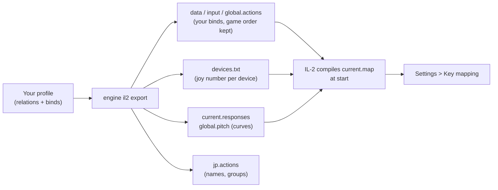

IL-2 Great Battles keeps one key mapping for all aircraft, in text files inside the game's installation
(`data\input`). JoyPro reads that key mapping into your profile, lets you join its actions with your other games in
relations ("Gear" in IL-2 and in DCS on the same button) and writes them back. The game compiles the files when it
starts, so nothing of JoyPro runs while you fly.

:::video game-il2-great-battles "IL-2 Great Battles: import, relations, export"
:::

{{game-card}}

:::layer beginner
## What JoyPro does for IL-2 Great Battles

- **Import**: every action of the key mapping that sits on a stick, throttle, pedals or panel comes into your profile,
  with modifiers, the axis invert and the axis response rows. Keyboard keys come in when you ask for them.
- **Relations**: one relation is one function in all your games. IL-2 has one key mapping for every aircraft, so a
  relation's IL-2 action works in every IL-2 aircraft.
- **Export**: JoyPro writes the key mapping files in the game's `data\input` folder. IL-2 shows your binds in
  **Settings > Key mapping**.

## Import your IL-2 binds

1. Open **Start**. The IL-2 Great Battles card shows the game's picture. If it asks for a command list, press
   **Build List**: JoyPro reads the key mapping files your IL-2 has written.
2. Press **Import** on the card. Choose **Add to my profile** (or **Start over from this game**) and tick **Also take
   the keyboard keys** if you want your flight keys too.
3. Press **Import now**. **See my relations** opens what came in.

## Build and check relations

On the **Relations** page every IL-2 action of a relation sits next to the same function in your other games. Use the
[[page:flows/relations.html|relations flow]] to join them, then press **Check now** on the Export page: it finds one
button that does two things in IL-2 before the game does ([[page:flows/check.html|the Check]]).

## Export to IL-2

1. **Close IL-2.** JoyPro refuses to write while `Il-2.exe` runs.
2. Open **Export**. The IL-2 tile shows how many of its relations are bound.
3. Keep **Replace on my devices** with **Also clear my other devices** if JoyPro is where you set up your sticks.
   Press **Export now** on the IL-2 tile.

:::ingame What you see in IL-2
Start IL-2 and open **Settings > Key mapping**. Your binds are in the action rows of each tab (for example **Plane
controls**), on your devices. The axis responses JoyPro wrote are the ones the game uses from this start on. The force
feedback and noise filter values JoyPro set show on **Settings > Input devices**.
:::

:::picture ingame-il2-great-battles-controls "IL-2 Great Battles: the controls menu with the exported binds"
:::

## What you do yourself in IL-2

- **Let IL-2 write its key mapping once.** If `data\input` has no `global.actions` yet, open **Settings > Key
  mapping** and press **ACCEPT**. Without that file there is nothing to import, and the command list holds only the
  actions the game has written.
- For force feedback and noise filter values: open **Settings > Input devices** once and press **ACCEPT**, so the game
  creates its `current.devices` file. JoyPro changes that file but does not create it.
- For JoyPro's own force feedback from the game's telemetry, the [[gui:ffb|Force Feedback]] page adds JoyPro's address
  to the game's `startup.cfg` (close IL-2 first). Then switch IL-2's own force feedback off for that stick.

## Common pitfalls

- **"IL-2 is running"**: close the game completely and export again.
- **Binds on the wrong device**: IL-2 tells devices apart by the number in `devices.txt`. A device JoyPro writes keeps
  its number; a new device gets the lowest free one. Do not renumber devices in the game between export and import.
- **A bind is missing after "Only add"**: the button was used for another action in IL-2. The Check lists it under
  "Not written to the game"; export with **Update** or move the bind.
- **The force feedback values did not change**: the game has no `current.devices` yet (see above).
:::

:::layer advanced
## Files JoyPro reads and writes

| File | What it is |
|---|---|
| `<install>\data\input\global.actions` | the key mapping: one line per action, `action, input, invert|` with the game's English text as a comment |
| `<install>\data\input\devices.txt` | the device list: number, DirectInput GUID and name of each joystick |
| `<install>\data\input\current.responses` | axis response rows per action (centred, one-sided), for all aircraft |
| `<install>\data\input\global.pitch` | the pitch row with a centre shift (only created when you set one) |
| `<install>\data\input\jp.actions` | JoyPro's copy with relation names, groups, modifiers and tuning, read back by the next import |
| `<install>\data\input\current.devices` | Settings > Input devices: force feedback and the joystick noise filter (changed in place) |
| `<install>\data\startup.cfg` | force feedback values and JoyPro's telemetry address |

`current.map` is compiled by IL-2 from these files at every start; JoyPro never writes it.

## The export modes in IL-2

| Mode | What happens in IL-2 |
|---|---|
| **Only add** | Nothing is removed. A bind whose input IL-2 already uses for another action is not written and gets a mark "Not written to the game". |
| **Update, keep the game's binds** | Your binds go in; IL-2's other binds stay, except a bind of another action on an input you use. |
| **Update, my profile wins** | As above, and every action you bind loses its other inputs (joysticks; keyboard only with the keyboard option). |
| **Replace on my devices** | The joysticks you write keep only your binds. |
| **+ Also clear my other devices** | Connected joysticks without a bind in your profile lose their binds. |

`global.actions` keeps the game's order; new lines go to the end.

## What is never touched

- Lines of a joystick that is not connected, the import's ignored devices and the vJoy device JoyPro tunnels into.
- Mouse lines (also mouse inputs with keyboard keys), TrackIR and lines with an input JoyPro cannot read.
- The keyboard, unless you export keyboard binds.
- `current.map` and the game's other files.

## Aircraft, curves, force feedback

- **Granularity**: global. One key mapping and one response row per action cover every aircraft.
- **Axis curves** (axis model `il2`): centre dead zone, edge dead zone and the curve ("sensitivity balance") for
  centred axes; low and high dead zones for one-sided axes such as the throttle; a centre shift for pitch. A curve
  set for all games is fitted to IL-2's model; you can also set one for IL-2 only, or for the IL-2 family (Great
  Battles and Korea read each other's values). Invert is written on the action's line.
- **Game settings** (Settings > **Force feedback settings of the games**): joystick noise filter, force feedback on,
  feedback power and shaking. An export without IL-2 binds still writes them.
- **Telemetry force feedback**: JoyPro's own effects from the game's telemetry output ([[gui:ffb|Force Feedback]]).
  The same output feeds the telemetry recording (CSV; the telemetry has no world position, so no Tacview track).
- **HUD**: shows the IL-2 binds of the pressed buttons while IL-2 runs ([[gui:hud|HUD]]).
- **Watcher**: a bind you change in Key mapping is noticed after IL-2 closes; JoyPro asks whether to take it over
  ([[doc:sync-watcher|the watcher]]).
:::

:::layer technical
## Inside the IL-2 integration

Code: `engine\EngineIl2.cs` (import, export, files), `engine\EngineIl2DbRefresh.cs` (command list),
`engine\AxisModels` (model `il2`), `engine\EngineFfbTelemetry.cs` (telemetry setup).

- **Inputs**: `joy<N>_b<button, 0-based>`, `joy<N>_axis_<x|y|z|...>`, `joy<N>_pov<hat>_<angle>`, keyboard keys by
  DirectInput name, axis pairs as `<input>/<input>`, modifiers as `<modifier>+<input>`. IL-2 numbers hats from 0,
  JoyPro from 1 (`JOY_BTN_POV1_*` is `pov0`).
- **Devices**: `devices.txt` lists `<number>,"<GUID>",<name>|`; IL-2 writes the last 8 bytes of the DirectInput instance
  GUID reversed as one group. Every mode keeps the numbers already listed.
- **Command list**: [[cli:db refresh-il2]] reads the `*.actions` files the game writes (not `jp.actions`); the game's
  tabs (Service, Camera controls, Plane controls, Weapons controls ...) are the categories. The game writes only
  actions that have an input, so a fresh install's list holds about 376 actions.
- **Import / export**: [[cli:il2 import]], [[cli:il2 scan]], [[cli:il2 export]] (`--mode clean|add|merge|merge-overwrite
  --nuke-untouched-devices true|false --ignore-device <d>`). Backups: every file to `<file>.jpbak` and into the
  backup store before the first write.
- **Settings and curves**: [[cli:ffb set]] `--device * --game IL2Game`, [[cli:binds tuning set]] `--scope game:IL2Game`
  or `family:il2`, [[cli:binds tuning preview]].
- **Telemetry**: [[cli:ffb telemetry setup]] `il2` adds one address line `127.0.0.1:41994` to the `telemetrydevice`
  section of `startup.cfg` and never changes other tools' addresses; `--remove` restores the file byte for byte.
- **Watcher**: [[cli:sync status]], [[cli:sync diff]] (watched: `global.actions`, `devices.txt`, `current.responses`,
  `current.devices`, `startup.cfg`).

### Known limits

- Actions without an input in the game's files are not in a freshly built command list.
- The game's own force feedback must be off for a stick that gets JoyPro's telemetry force feedback.
- Tests: `engine\tests\smoke\il2.ps1`; in the game `tools\e2e\games\IL2Game.ps1` (binds, 38 of 38 steps) and
  `IL2GameCurves.ps1` (responses compiled by the game against JoyPro's preview).
:::
