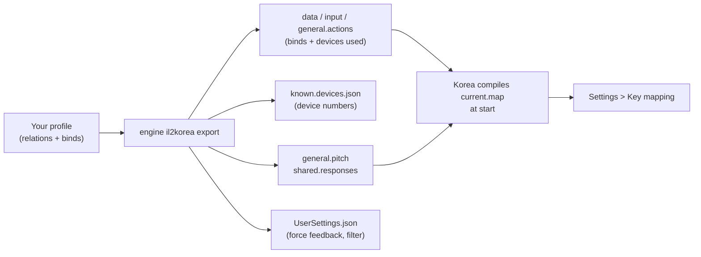

IL-2 Series: Korea comes from the same family as IL-2 Great Battles but keeps its key mapping in a new JSON format:
one profile ("General") for all aircraft, inside the game's installation. JoyPro reads it into your profile, joins
its actions with your other games in relations and writes them back, including the response curves of the game's
curve editor and its force feedback settings.

:::video game-il2-korea "IL-2 Series: Korea: import, relations, export"
:::

{{game-card}}

:::layer beginner
## What JoyPro does for IL-2 Korea

- **Import**: every action of the key mapping that sits on a stick, throttle, pedals or panel comes into your profile,
  with modifiers, the invert of each axis and the values of the curve editor. Keyboard keys come in when you ask.
- **Relations**: one relation is one function in all your games, for example "Gear" in Korea, IL-2 Great Battles
  and DCS on the same button. Korea has one key mapping for every aircraft.
- **Export**: JoyPro writes the key mapping and gives each of your devices a device number, as the game's own
  "assign device number" dialog does.

## Import your Korea binds

1. Open **Start**. The IL-2 Series: Korea card shows the game's picture. If it asks for a command list, press
   **Build List**: JoyPro reads the game's `general.actions` (every action gets JoyPro's own name and explanation).
2. Press **Import** on the card. Choose **Add to my profile** and tick **Also take the keyboard keys** if you want
   your flight keys too.
3. Press **Import now**. **See my relations** opens what came in.

## Build and check relations

On the **Relations** page the Korea action of a relation sits next to the same function in your other games. Use the
[[page:flows/relations.html|relations flow]] to join them, then press **Check now** on the Export page: it finds one
button that does two things in Korea ([[page:flows/check.html|the Check]]).

## Export to IL-2 Korea

1. **Close the game.** JoyPro refuses to write while `IL2Series.exe` runs.
2. Open **Export**. The IL-2 Series: Korea tile shows how many of its relations are bound.
3. Keep **Replace on my devices** with **Also clear my other devices** if JoyPro is where you set up your sticks.
   Press **Export now** on the tile.

:::ingame What you see in IL-2 Korea
Start the game and open **Settings > Key mapping**. Your binds are in the action rows (for example on the **Basic**
tab), with your device by name and its number ("joy 2"); the game does not ask for a device number. An axis row's
curve icon opens the response editor with the values JoyPro wrote. Force feedback and the axis noise filter show on
**Settings > Input devices**.
:::

:::picture ingame-il2-korea-controls "IL-2 Series: Korea: the controls menu with the exported binds"
:::

## What you do yourself in IL-2 Korea

- **Save a key mapping once.** The game writes `general.actions` when you press **ACCEPT** in Key mapping. A first
  start also shows the game's user agreement. Without `general.actions` there is nothing to export to.
- The standalone version installs under `Program Files` by default, and Windows may protect that folder. The export
  then says so instead of writing half the files.
- For JoyPro's own force feedback from the game's telemetry, the [[gui:ffb|Force Feedback]] page adds JoyPro's address
  to the game's `startup.cfg` (close the game first). Switch the game's own force feedback off for that stick.

## Common pitfalls

- **"IL-2 Korea is running"**: close the game and export again.
- **A device was skipped**: a device without a device number that is not connected cannot get one. Plug it in and
  export again.
- **A bind is missing after "Only add"**: the input was used for another action in the game. The Check lists it
  under "Not written to the game".
:::

:::layer advanced
## Files JoyPro reads and writes

| File | What it is |
|---|---|
| `<install>\data\input\general.actions` | the key mapping profile "General" (JSON): devices used, modifiers, every action with its inputs, Relative Control values |
| `<install>\data\input\known.devices.json` | every device the game has seen, with its device number |
| `<install>\data\input\general.pitch` | the pitch curve ("General (Common pitch curve)") |
| `<install>\data\input\shared.responses` | the curves of the other axes |
| `<install>\data\NSData\UserData\UserSettings.json` | Settings > Input devices: force feedback and the axis noise filter (section `input`) |
| `<install>\data\startup.cfg` | JoyPro's telemetry address (only when you set up telemetry force feedback) |
| `general.actions.joypro-meta.json` | JoyPro's names, groups, modifiers and tuning beside the file, read back by the next import |

`<install>` is `steamapps\common\IL2Series` for Steam, or the `game` folder below the standalone launcher.
`current.map` is compiled by the game; JoyPro never writes it.

## The export modes in IL-2 Korea

| Mode | What happens in the game |
|---|---|
| **Only add** | Nothing is removed. A bind whose input the game uses for another action is not written and is listed. |
| **Update, keep the game's binds** | Your binds go in; the game's other inputs stay, except a game bind on an input you give another action. |
| **Update, my profile wins** | As above, and every action you bind loses its other inputs (joysticks; keyboard only with the keyboard option). |
| **Replace on my devices** | Every joystick input of the devices you write is released; then your binds go in. |
| **+ Also clear my other devices** | Connected devices without a bind in your profile lose their joystick inputs. |

## What is never touched

- Keyboard keys, mouse inputs and key pairs on axes in Replace (the keyboard changes only with the keyboard option).
- Devices that are not connected, lines the import cannot read, the import's ignored devices and the vJoy device
  JoyPro tunnels into.
- `current.map`, the force feedback files per device and the game's other settings.

## Curves, Relative Control, force feedback

- **Granularity**: global. One key mapping for all aircraft; the pitch curve profile is assigned to every aircraft by
  default.
- **Axis curves** (axis model `il2korea`): exponent (-100 to 100), centre and edge dead zones, the centre offset for
  pitch; for pitch, roll and yaw also the built-in response curve and the control surface loading. One-sided axes
  (throttles, brakes) get exponent and low/high dead zones over the whole travel. Camera axes have no editor and get no
  curve. Values are in the file's units; the game shows dead zones four times larger.
- **Relative Control** (the ◆ button of an axis input): on/off, dead zone (0 to 80 %) and sensitivity (1 to 20), as
  the dialog shows them.
- **Game settings** (Settings > **Force feedback settings of the games**): force feedback on, shaking power, feedback
  power, low- and high-speed stick force, force-neutral rebalancing, terrain contact and the axis noise filter, in %
  as the game shows them.
- **Telemetry force feedback** and recording: from the game's telemetry output, as in Great Battles (CSV only, no
  Tacview track).
- **Watcher**: changes in `general.actions` are noticed after the game closes ([[doc:sync-watcher|the watcher]]).
:::

:::layer technical
## Inside the Korea integration

Code: `engine\Games\Il2KoreaIntegration.cs`, axis model `il2korea` in `engine\AxisModels`.

- **Inputs**: `dev<N>_b<button, 0-based>`, `dev<N>_axis_<x|y|z|w|s|t|p|q>` (X, Y, Z, RX, RY, RZ, slider 1, slider 2),
  `-` before the token = inverted, `*` = Relative Control, hats `dev<N>_pov<hat>_<angle>`, keys `key_<name>`,
  combinations with `+`.
- **Devices**: `known.devices.json` keys every device by its DirectInput instance GUID (in IL-2's byte order) and holds
  its `deviceId` (the number, `-1` = none) and `ident` (`vid_pid`). A device JoyPro writes keeps its number; a connected
  device without one gets the lowest free number from 1 up.
- **Command list**: [[cli:il2korea refresh-db]] adds the actions of a key mapping file. Actions without an input are
  not in `general.actions`, so a fresh list holds about 318 actions. JoyPro does not read the game's packed archives.
- **Import / export**: [[cli:il2korea import]], [[cli:il2korea scan]], [[cli:il2korea export]] (`--mode`,
  `--nuke-untouched-devices`, `--include-keyboard`, `--dry-run`); [[cli:il2korea paths]] shows the files.
- **Settings and curves**: [[cli:ffb set]] `--device * --game IL2Korea --param ffForce=80`, [[cli:binds tuning set]]
  `--scope game:IL2Korea` (or `family:il2`), [[cli:binds tuning preview]] (matches the game's compiled table to 1e-6,
  except the flat side of a centre offset).
- **Telemetry**: [[cli:ffb telemetry setup]] `il2korea`.

### Known limits

- The game's own action texts are in its packed archives, which JoyPro does not read; JoyPro uses its own names.
- About 60 actions of the Key mapping page have no input in a fresh `general.actions` and are not in a freshly built
  list.
- Tests: `engine\tests\smoke\il2korea.ps1`, `il2koreainstall.ps1`; in the game `tools\e2e\games\IL2Korea.ps1` (49 of
  49 steps), `IL2KoreaCurves.ps1`, `IL2KoreaSettings.ps1`.
:::
