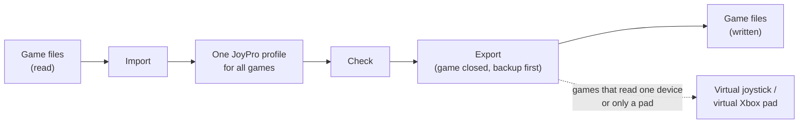

JoyPro handles {{stat:games.handled}} game titles and has notes on {{stat:games.documented}} more. Each page below
explains one game (or one family of games that share their files) in three levels, like the GUI pages: **Beginner**
(import, relations, export and what you then see in the game), **Advanced** (the files, what each export mode does in
that game, what is never touched, curves, force feedback, the watcher) and **Technical** (file formats, how devices
are identified, the engine commands). The **Show:** switch at the top of a game page picks the level.

:::video games-overview "JoyPro and your games: one profile, every game"
:::

Every game follows the same rules: JoyPro writes only the actions of the game's command list, refuses to write while
the game runs, backs the files up first (**Undo last export** on the Export page puts them back byte for byte) and
skips a device or action it cannot match instead of guessing. Devices that are not connected, your mouse, the
import's ignored devices and the vJoy device JoyPro tunnels into are never cleared.

{{game-index}}

## More

- [[page:games/support.html|Game support]]: the full matrix of every title, generated from the engine's code (import,
  export, keyboard, modifiers, curves, watcher, force feedback, vJoy, in-game test).
- [[page:flows/export.html|Export flow]]: the four export modes in general, and what changes in each kind of game.
- [[page:flows/import.html|Import flow]]: the import wizard and its options.
- [[gui:vjoy|Virtual Joystick]]: games that read too few joysticks or only an Xbox pad.
