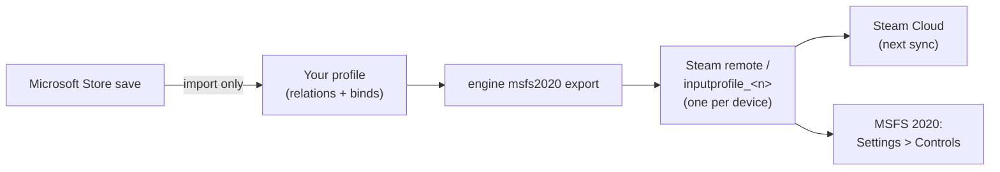

MSFS 2020 keeps one control profile per device, used for every aircraft. In the Steam version each profile is a small
XML file in Steam's `remote` folder of the sim; JoyPro reads these files into your profile and writes your binds back
into them, in place. The Microsoft Store version's profiles are imported, not written. Unlike
[[game:msfs2024|MSFS 2024]] there is no preset package, no import file and no profile per aircraft.

:::video game-msfs2020 "Microsoft Flight Simulator 2020: import, relations, export"
:::

{{game-card}}

:::layer beginner
## What JoyPro does for MSFS 2020

- **Import**: the profile of each connected device (Steam or Microsoft Store) comes into your profile: flight binds,
  General binds (cameras, views, pause) and the axis settings of the Sensitivity page.
- **Relations**: one relation is one function. A relation applies to every aircraft, because MSFS 2020 has one profile
  per device.
- **Export**: JoyPro edits the device profiles in the Steam version's `remote` folder. The sim reads them at its next
  start.

## Import your MSFS 2020 binds

1. Open **Start** and press **Import** on the Microsoft Flight Simulator 2020 card.
2. **Also import devices that are not connected** (off): MSFS keeps the profiles of every device it ever saw; off
   means only the devices connected now. **Also import default presets the sim may not use** (off) adds the preset
   the sim ships for a device without a profile of its own, also when it is not known whether the sim uses it.
3. Press **Import now**, or **Look first** to see what the sim has without changing your profile.

## Build and check relations

Build relations on the **Relations** page as for every game (see the [[page:flows/relations.html|relations flow]]),
then run the [[page:flows/check.html|Check]] on the Export page. The Check does not report a plane's throttle and a
helicopter's collective on one axis as an error here: MSFS 2020 has no separate aircraft lists.

## Export to MSFS 2020

1. **Close MSFS 2020.** JoyPro refuses to write while the sim runs.
2. Open **Export**, keep **Replace on my devices** with **Also clear my other devices** if JoyPro is where you set up
   your devices, and press **Export now** on the MSFS 2020 tile.
3. Start the sim. The `remote` folder is a Steam Cloud folder, so Steam syncs the changed files.

:::ingame What you see in MSFS 2020
Open **Settings > Controls** and pick your device: your binds are in the device's profile under the sim's action
names, and the device's **Sensitivity** page shows the axis curves JoyPro wrote. The same profile is used in every
aircraft.
:::

:::picture ingame-msfs2020-controls "Microsoft Flight Simulator 2020: the controls menu with the exported binds"
:::

## What you do yourself in MSFS 2020

- **Make a profile for each device once in the sim** (Settings > Controls). JoyPro edits existing profiles only; for
  a device without one the export says "create one in the sim first".
- **Microsoft Store version**: JoyPro imports your profiles but cannot write them. Use the Steam version for the
  export, or set the binds in the sim.
- **Relations limited to aircraft**: MSFS 2020 cannot keep them apart. In the *Other Games* form on the Start page,
  **Export Aircraft** exports the relations limited to one aircraft too, for every aircraft.

## Common pitfalls

- **"MSFS 2020 is running"**: close the sim and export again.
- **The sim shows your old binds**: Steam Cloud put an older copy back. Close the sim and export again.
- **A device has several profiles**: JoyPro uses the one picked with *Game Profile* in the *Other Games* form, or the
  only one; otherwise the device is skipped with a warning that lists the names.
- **A bind is missing**: an action keeps at most two input combinations (Primary and Secondary); a third is reported
  and left out.
:::

:::layer advanced
## Files JoyPro reads and writes

| File | What it is |
|---|---|
| `<Steam>\userdata\<id>\1250410\remote\inputprofile_<n>` | one device profile, XML without extension; written in place (backup `.jpbak` first) |
| `<Steam>\userdata\<id>\1250410\remote\profile_00` | the sim's binary index of the device profiles: **read only**, never written |
| `%LOCALAPPDATA%\Packages\Microsoft.FlightSimulator_8wekyb3d8bbwe\SystemAppData\wgs\<user>\` | the Microsoft Store save: read only (import and scan) |
| `<install>\Input\*.xml`, the `fs-base\en-US.locPak` | the presets the sim ships and its menu names: read only |
| `%LOCALAPPDATA%\JoyPro2\Ownership\MSFS`, `...\Backups\MSFS` | JoyPro's ownership data and backups, never in the Steam folder |

The Steam `remote` folder is a Steam Cloud folder. Only existing `inputprofile_*` files are edited: the sim's
`profile_00` names specific files, so a new file would not be picked up.

## The export modes in MSFS 2020

| Mode | What happens in the device profiles |
|---|---|
| **Only add** | A bind is written only where the profile has no other action on that input combination; otherwise it is listed under "Binds Not Written, Button Taken In The Game". Nothing is removed. |
| **Update, keep the game's binds** | The other action on your combination loses it; everything else stays, also an action's old combination. |
| **Update, my profile wins** | As above, and every action you bind loses its other combinations in the profiles of connected devices. |
| **Replace on my devices** | The profiles of the connected devices JoyPro binds keep only your binds. |
| **+ Also clear my other devices** | The profiles of connected devices without a bind in your profile are cleared. |

## What is never touched

- The menu, world map and developer contexts (`MENU`, `MENU_*`, `WORLDMAP_*`, `DEBUG`, `DEVMODE*`, `EDITOR_*`,
  `MISSION_FLOW_TOOLS`), in every mode.
- Keyboard, mouse and gamepad profiles (`GUID="{0}"`): keyboard binds are not written in MSFS.
- Profiles of devices that are not connected, `profile_00`, the Store save, the import's ignored devices and the vJoy
  device JoyPro tunnels into.

## Curves and the rest

- **Granularity**: one profile per device, for every aircraft.
- **Axis curves**: the device's Sensitivity page, one set per physical axis: Sensitivity + and -, Neutral, Dead zone,
  Extremity dead zone, Reactivity, the no-curve flag and invert. MSFS 2020 has no per-action override: a relation that
  asks for one gets the device page and a warning. The curve preview matches the sim (measured in MSFS 2020). The
  tuning scope `family:msfs` covers both sims; see [[doc:axis-curves]].
- **Force feedback**: MSFS has none of its own.
- **Telemetry recording**: through SimConnect, read only, with the `SimConnect.dll` in the sim's install folder (or the
  MSFS SDK's; JoyPro ships none).
- **HUD**: the [[gui:hud|HUD]] finds the sim by its process (`FlightSimulator`) and shows its binds.
- **Watcher**: JoyPro watches the `inputprofile_*` files and the Store save's `containers.index` and asks after the
  sim closed ([[doc:sync-watcher|the watcher]]).

## What differs from MSFS 2024

| | MSFS 2020 | MSFS 2024 |
|---|---|---|
| Export target | the Steam profiles in place | your own profiles (Steam and Store), JoyPro's preset package, import files |
| Microsoft Store version | imported only | imported and written |
| Profiles | one per device | per device and category, chosen per aircraft |
| Relations limited to aircraft | only with *Export Aircraft* (then for all aircraft) | written into the profiles of those aircraft |
| Action list in a profile | only bound actions | every action of its contexts |
| Per-action axis override | no | yes |
:::

:::layer technical
## Inside the MSFS 2020 integration

Code: `engine\Games\MsfsIntegration.cs` (one class for both sims, `sim == 2020`), `MsfsProfileFile.cs` (the
line-based editor), `MsfsUserProfiles.cs` (Steam and Store reading), `MsfsSimDefaults.cs`, `MsfsGameData.cs`,
`MsfsAircraft.cs`, `engine\AxisModels\Msfs.cs`.

- **Format**: an XML fragment (read with fragment conformance): `<Version>`, `<FriendlyName>`, `<Device DeviceName
  GUID ProductID>`, `<Axes>` with `<Axis AxisName AxisSensitivy AxisDeadZone ...>` (the misspelled attribute names are
  the sim's), `<Context ContextName>` / `<Action ActionName Flag>` / `<Primary>` / `<Secondary>` / `<KEY
  Information>code</KEY>`. A released action is removed; a new action goes into the context it has in the folder's
  other profiles, else its catalog context, else `PLANE` (with a warning).
- **Devices**: `GUID` is the DirectInput instance GUID, so reading needs no connected device; `ProductID` is the
  decimal USB product ID. Codes: button N = N-1, hat 256-259, axes 1026/1042/1058, 770/786/802, sliders 514/530; the
  last KEY of a combination is the main input, other buttons of the same device are modifiers.
- **Command list**: [[cli:msfs2020 refresh-db]] reads the sim's presets (`<install>\Input`, its official packages)
  and every flight event `en-US.locPak` names; it shares its start with MSFS 2024's list.
- **Commands**: [[cli:msfs2020 paths]], [[cli:msfs2020 catalog]], [[cli:msfs2020 scan]], [[cli:msfs2020 import]]
  (`--game-profile`, `--include-disconnected`, `--include-sim-defaults`), [[cli:msfs2020 export]] (`--mode`,
  `--nuke-untouched-devices`, `--dry-run`, `--aircraft <key>`); Undo with [[cli:backups restore]].
- **Old profiles**: profiles saved when JoyPro had one MSFS game (`MSFS:<action>`) get a node for each sim when they
  are loaded.

### Known limits

- The Microsoft Store version is read only; an export with its save folder as the path is refused.
- New `inputprofile_*` files are not created; a device needs a profile made in the sim.
- Steam Cloud can put an older profile back.
- Half axes, hat diagonals and a second hat are not read or written; at most two combinations per action.
- The shipped presets of MSFS 2020 were not checked on a real install, so a 2020 preset must also carry the device's
  name to be taken as a default.
- Tests: `engine\tests\smoke\msfs.ps1` (Sensitivity page, overrides, flags, conflicts, merge); in the sim
  `tools\e2e\games\MsfsCurves.ps1` (binds, the Sensitivity page, buttons and axis curves in a flight, read back through
  SimConnect).
:::
