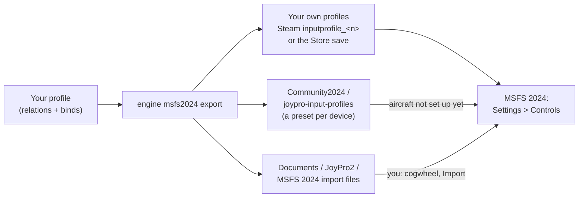

MSFS 2024 keeps your controls in profiles, one per device and category (Airplanes and General), and remembers for
every device and aircraft which profile it uses. JoyPro reads these profiles into one profile of its own and writes
your binds back into exactly the profiles the sim uses, in the Steam and the Microsoft Store version. For aircraft the
sim has not set up for a device yet, JoyPro adds its own presets as a small package in the sim's Community2024
folder, and where it cannot write a profile it leaves you a file to import in the sim's Controls menu.

:::video game-msfs2024 "Microsoft Flight Simulator 2024: import, relations, export"
:::

{{game-card}}

:::layer beginner
## What JoyPro does for MSFS 2024

- **Import**: the profiles you made in the sim's Controls menu (Steam or Microsoft Store) come into your profile,
  flight binds and General binds (cameras, views, active pause and so on), with the axis settings of the Sensitivity
  page. A device you never changed in the sim brings the preset the sim ships for it, when the sim's own records show
  that it uses that preset.
- **Relations**: one relation is one function. In MSFS 2024 a relation can be for all aircraft (the default) or only
  for the aircraft you tick, like in DCS.
- **Export**: JoyPro writes your binds into the profile the sim uses for each device and category, writes its preset
  package for aircraft the sim has not set up yet, and writes an import file where it could not update your profile.

## Import your MSFS 2024 binds

1. Open **Start** and press **Import** on the Microsoft Flight Simulator 2024 card.
2. Two options matter for MSFS, both off unless you tick them:
   - **Also import devices that are not connected**: MSFS keeps the binds of every device it ever saw. Off: only the
     devices connected now.
   - **Also import default presets the sim may not use**: for devices whose use of a shipped preset the sim's records
     do not show. This can add binds the sim does not have.
3. Press **Import now** (or **Look first** to see what the sim has without changing your profile).

Imported relations apply to all aircraft. When a bind exists only in the profiles of some aircraft, the
**Relations** page shows a note after the import with **Limit to these aircraft** per relation, **Limit all** and
**Keep for all aircraft**.

## Build and check relations

On the **Relations** page an MSFS 2024 action shows the aircraft of the sim with checkmarks: every aircraft ticked
means all aircraft. An action that exists only in some add-on aircraft says "only for:" with those aircraft, and adding
it ticks just them. See the [[page:flows/relations.html|relations flow]], then run the
[[page:flows/check.html|Check]] on the Export page: it finds one button with two functions before the sim does.

## Export to MSFS 2024

1. **Close MSFS 2024.** JoyPro refuses to write while the sim runs (in the Microsoft Store version also while its
   launch helper runs).
2. Open **Export**. Under *Export to games* two ticks are for MSFS 2024:
   - **MSFS 2024: write into my MSFS profiles** (on): the export updates the profile the sim uses for each device and
     category, backed up first.
   - **MSFS 2024: import files for every device** (off): an import file for every device and category, not only where
     JoyPro could not write your profile.
3. Keep **Replace on my devices** with **Also clear my other devices** if JoyPro is where you set up your devices, and
   press **Export now** on the MSFS 2024 tile.

After the export the box **Your MSFS 2024 profiles** lists every profile JoyPro wrote, with its aircraft and the
number of binds. When import files were written, a second box names them with **Open folder**.

:::ingame What you see in MSFS 2024
Start the sim and open **Settings > Controls**, then pick your device and the category (Airplanes or General). Your
binds are in your own profile, under the sim's action names; the device page (**Hardware Settings** on the device's
cogwheel) shows the axis curves JoyPro wrote. In an aircraft the sim has not set up for that device yet, the device
starts with JoyPro's preset.
:::

:::picture ingame-msfs2024-controls "Microsoft Flight Simulator 2024: the controls menu with the exported binds"
:::

## What you do yourself in MSFS 2024

- **Nothing**, for every profile listed as updated in **Your MSFS 2024 profiles**.
- **Import files**: when the export lists one, open **Settings > Controls**, pick the device and the category
  (Airplanes or General), click the cogwheel of the profile (not the one of the preset), choose **Import** and select
  the file JoyPro wrote for that device and category. The sim takes a file only for the same device and category.
  When the file carries the name of your profile, the sim asks whether to overwrite it: confirm, and your profile has
  JoyPro's binds. Import a file again only when the export says it is new or changed.
- **Connect every device once before the first export**: JoyPro needs the device's product ID for its preset.
- **One aircraft needs other binds than the others**: give it its own profile in the sim (Controls, with that aircraft
  loaded: duplicate the profile), then export again. The export names every relation it could not place.
- **Xbox cloud question**: if the sim or the Xbox app asks which save to keep, keep the one of this PC; the other one
  drops JoyPro's binds (export again then).

## Common pitfalls

- **"MSFS 2024 is running"**: close the sim; in the Microsoft Store version the sim's launch helper
  (`gamelaunchhelper.exe`) must be gone too.
- **Binds missing in one aircraft**: that aircraft uses another profile of yours. Check the list **Your MSFS 2024
  profiles**; a line with "import file" means you import that file in the sim.
- **A relation was not written**: it is limited to some aircraft, but the profile the sim uses there is shared with
  other aircraft. The warning names the profile and the aircraft.
- **A device has several profiles**: import takes the one the sim's records name, else the newest, and names the
  others. Pick another one with *Game Profile* in the *Other Games* form on the Start page.
- **"WRONG DEVICE" while binding in the sim**: a device that keeps sending values (some force feedback sticks) takes
  the sim's scan. This happens in the sim's own binding, not in JoyPro.
- **Reset to Defaults** in the sim resets the presets of every device and aircraft; JoyPro never does it for you.
:::

:::layer advanced
## Files JoyPro reads and writes

| File | What it is |
|---|---|
| `<Steam>\userdata\<id>\2537590\remote\inputprofile_<n>` | your own profile (Steam), plain XML without extension; written in place, Steam Cloud uploads it at the next sync |
| `%LOCALAPPDATA%\Packages\Microsoft.Limitless_8wekyb3d8bbwe\SystemAppData\wgs\<user>\` | the Microsoft Store save (`containers.index`, `container.<n>`, one blob per profile); JoyPro writes a new blob, a new container file and the index |
| `remote\profile_00` (Store: the container `profile_00`) | the sim's device records: which profile or preset each device uses per aircraft. **Read only**, never written |
| `<packages>\Community2024\joypro-input-profiles\InputProfiles\Categories\Airplane\JoyPro_<device>_<guid8>_2024_Planes.xml` | JoyPro's preset of a device (flight actions), with `layout.json` and `manifest.json` |
| `...\Categories\Transversal\JoyPro_<device>_<guid8>_2024_Transversal.xml` | JoyPro's preset of a device's General binds |
| `%USERPROFILE%\Documents\JoyPro2\MSFS 2024 import files\<device>_<guid8>_Airplanes.xml` / `_General.xml` | the import files, in the sim's own profile format |
| `<install>\Packages\fs-input-profiles`, `asobo-input-profiles-pc`, `fs-base\en-US.locPak` | the presets Asobo ships and the menu names: read only, for the command list and the default presets |
| `%LOCALAPPDATA%\JoyPro2\Ownership\MSFS`, `...\Backups\MSFS` | JoyPro's ownership data and backups, never in a synced folder |

`<packages>` is `InstalledPackagesPath` of `%APPDATA%\Microsoft Flight Simulator 2024\UserCfg.opt` (Store:
`%LOCALAPPDATA%\Packages\Microsoft.Limitless_8wekyb3d8bbwe\LocalCache\UserCfg.opt`). Before every write the whole
Store save folder or the Steam file goes into the backup set, so **Undo last export** puts the save back.

## The export modes in MSFS 2024

The modes work per profile (so per aircraft group) and only in the managed contexts.

| Mode | What happens in your MSFS 2024 profiles |
|---|---|
| **Only add** | A bind is written only where no other action of that profile uses the input combination; otherwise it is listed as not written. Nothing is removed. |
| **Update, keep the game's binds** | The other action on your input combination loses it; everything else stays, also an action's old combination (an action has two: Primary and Secondary). |
| **Update, my profile wins** | As above, and every action you bind loses its other combinations, also in the profiles of other connected devices (those profiles are written too). |
| **Replace on my devices** | The profiles of the connected devices JoyPro writes keep only your binds. |
| **+ Also clear my other devices** | Never clears one of your own MSFS 2024 profiles. |

A relation for all aircraft goes into every profile the sim's records name; a relation limited to aircraft goes only
into profiles whose aircraft are all ticked. Limited relations never go into the preset package or the import files,
because those apply to every aircraft.

## What is never touched

- The menu, world map and developer contexts (`MENU`, `MENU_*`, `WORLDMAP_*`, `DEBUG`, `DEVMODE*`, `EDITOR_*`,
  `MISSION_FLOW_TOOLS`), in every mode.
- Keyboard, mouse and gamepad profiles (`GUID="{0}"`): keyboard binds are not written in MSFS.
- `profile_00`, the presets Asobo ships, aircraft-specific preset slots, and every other container of the Store save
  (logbooks, other titles).
- Devices that are not connected, the import's ignored devices and the vJoy device JoyPro tunnels into.

## Aircraft, curves, the rest

- **Granularity**: per device and category (Airplanes, General) and per profile; the sim chooses the profile per device
  and aircraft, JoyPro follows that choice.
- **Axis curves**: the device's Sensitivity page, one set per physical axis: Sensitivity + and -, Neutral, Dead zone,
  Extremity dead zone, Reactivity, the no-curve flag and invert. A relation can give one action its own values (the
  per-action override of MSFS 2024). Relations on the same device axis share its page: the export writes the first
  relation's values and warns. See [[doc:axis-curves]].
- **Force feedback**: MSFS has none of its own.
- **Telemetry recording**: through SimConnect, read only, with your own `SimConnect.dll` (JoyPro ships none): the
  Steam version of MSFS 2024 has none, so install the MSFS 2024 SDK or have MSFS 2020 installed (its copy works too).
- **HUD**: the [[gui:hud|HUD]] finds the sim by its process and shows its binds.
- **Watcher**: JoyPro watches its package, the Steam profiles and the Store save's `containers.index`; after the sim
  closes (the Store save waits 10 s after its last write) it asks whether to take your in-game changes over
  ([[doc:sync-watcher|the watcher]]).
- **Re-import**: relation names, groups and tuning come back through JoyPro's metadata beside the files
  ([[doc:reimport|re-import]]).
- **Expert options** (*Other Games* on the Start page): **Game Profile** (pick one profile when a device has several),
  **Export Aircraft** (also export the relations limited to one aircraft, for every aircraft), **Write into my MSFS
  profiles**, **Also write MSFS import files for every device**, a dry run.
:::

:::layer technical
## Inside the MSFS 2024 integration

Code: `engine\Games\MsfsIntegration.cs` (one class for both sims), `MsfsIntegration.UserProfiles.cs` (the direct
write), `MsfsIntegration.ImportFiles.cs`, `MsfsCommunityPackage.cs`, `MsfsUserProfiles.cs` (Steam and Store reading),
`WgsContainers.cs` (the Store save), `MsfsSimProfile.cs` (the records in `profile_00`), `MsfsSimDefaults.cs`,
`MsfsProfileFile.cs` (the line-based editor), `MsfsGameData.cs`, `MsfsAircraft.cs`, `engine\AxisModels\Msfs.cs`.

- **Format**: an XML fragment (several top-level elements): `<Version>`, `<FriendlyName>`, `<Device DeviceName GUID
  ProductID CompositeID HWVer>` with `<Axes>` and `<Context ContextName>` / `<Action ActionName Flag>` /
  `<Primary>` / `<Secondary>` / `<KEY Information>code</KEY>`. A 2024 profile lists every action of its contexts,
  unbound ones as empty `<Action/>`. Codes: button N = N-1, hat 256-259, L-axis X/Y/Z 1026/1042/1058, R-axis
  770/786/802, sliders 514/530. Flags: 2 digital, 4 axis, 128 invert, 1024 no sensitivity curve, 4096 per-action axis
  override. Only changed `<Action>` elements are rendered again.
- **Devices**: a profile names its device by the DirectInput instance GUID (`GUID`), so no connected device is needed
  to read it. The sim matches a preset by the USB product ID (hex): JoyPro uses the one the sim noted in `profile_00`,
  else the USB PID (vJoy shows as product ID 0).
- **Which profile is active**: per device and aircraft the records in `profile_00` hold a General slot and a category
  slot; an own profile there is `inputprofile_<n>`, which is the Steam file name and the Store container name.
- **Store save**: written only when the index has the known layout (version 14, no conflict flag, the container
  listed once in a known state); then a new blob, `container.<n+1>`, the index last (temp file and replace), read back,
  and the old generation removed. Any failure puts everything back; anything unknown writes nothing and the import file
  carries the binds.
- **Command list**: [[cli:msfs2024 refresh-db]] reads Asobo's presets, every flight event `en-US.locPak` names, your
  General profiles and unpacked add-on packages (Community, Marketplace) with their aircraft; the aircraft list comes
  from the sim's content list. A fresh install builds the list at the first import.
- **Commands**: [[cli:msfs2024 paths]], [[cli:msfs2024 catalog]], [[cli:msfs2024 scan]], [[cli:msfs2024 import]]
  (`--game-profile`, `--include-disconnected`, `--include-sim-defaults`, `--limit-to-profile-aircraft`, `--replace`),
  [[cli:msfs2024 export]] (`--mode`, `--nuke-untouched-devices`, `--dry-run`, `--aircraft <key>`; `--user-profiles
  false` and `--import-files` as the two Export page ticks); per-aircraft relations with
  [[cli:relations aircraft set]]; Undo with [[cli:backups restore]]; the watcher with [[cli:sync status]] and
  [[cli:sync diff]]. The old CLI name `engine msfs ...` still means MSFS 2024.

### Known limits

- Aircraft-specific preset slots are not written (they come only with an aircraft's own package); JoyPro never writes
  `profile_00` (the file ends with a checksum).
- JoyPro's preset reaches only aircraft the sim has not set up for a device yet; elsewhere your own profile or an
  import file carries the binds.
- At most two input combinations per action; a third is reported. Half axes, hat diagonals and a second hat are not
  read or written. Modifiers: buttons of the same device only.
- Packed add-on packages (`.fsarchive`) are skipped; Store save paths over 260 characters are not read.
- A cloud copy (Steam Cloud, Xbox cloud) can win over JoyPro's write when another PC saved later.
- Tests: `engine\tests\smoke\msfs.ps1`, `smoke\msfsuserprofiles.ps1`, `gui\JoyPro.Gui.Tests\MsfsProfileImportTests.cs`
  (Steam and Store saves, per-aircraft profiles, rollback), `MsfsStoreWatcherEndToEndTests`; in the sim
  `tools\e2e\games\Msfs2024Settings.ps1` (presets, axes, buttons and the per-action curve in Controls).
:::
