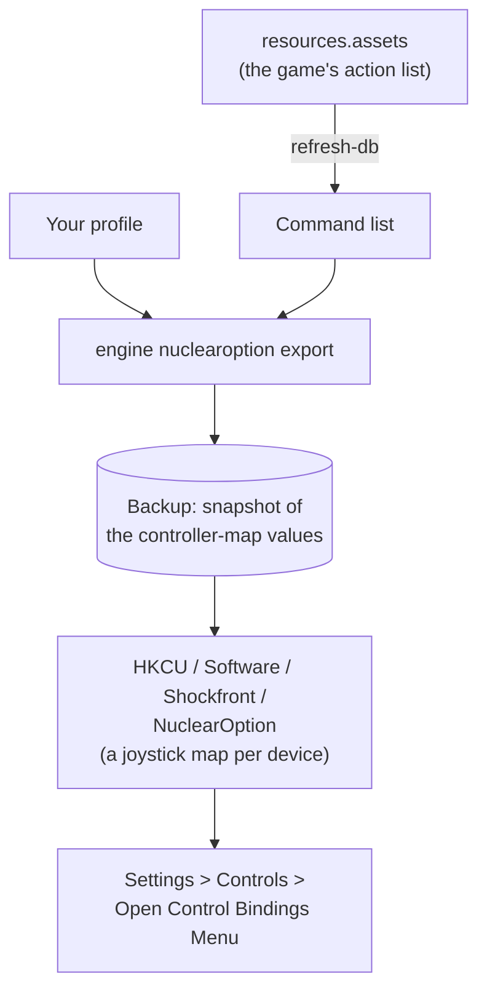

Nuclear Option is a combat flight game with jets, VTOLs and helicopters and one set of binds for every aircraft. It
keeps its controls not in a file but in the Windows registry: one Rewired joystick map per device, written by the
game's Control Mapper. JoyPro reads these maps into your profile and writes your **Flight Controls** binds back into
them; camera, gameplay and chat binds stay as they are.

:::video game-nuclear-option "Nuclear Option: import, relations, export"
:::

{{game-card}}

:::layer beginner
## What JoyPro does for Nuclear Option

- **Import**: the joystick maps of your connected devices come into your profile: axes with their invert, buttons,
  and buttons on an axis (for example "Increase Throttle").
- **Relations**: one relation is one function; Nuclear Option has no aircraft lists, so a relation is for every
  aircraft.
- **Export**: JoyPro edits the map of each device in place, only the Flight Controls actions it writes. A device the
  game has no saved map for gets a new map with your binds.

## Import your binds

1. Start Nuclear Option once (so its registry key exists) and close it.
2. Open **Start**, press **Import** on the Nuclear Option card, then **Import now**.

## Build and check relations

Build relations as for every game ([[page:flows/relations.html|relations flow]]); the setup wizard and Auto Assign
know the game's functions. Then run the [[page:flows/check.html|Check]] on the Export page.

## Export to Nuclear Option

1. **Close Nuclear Option.** JoyPro refuses to write while it runs: the game writes its maps when the bindings menu
   closes and when a device is unplugged.
2. Open **Export**, keep **Replace on my devices** with **Also clear my other devices**, and press **Export now** on
   the Nuclear Option tile.

:::ingame What you see in Nuclear Option
Open **Settings > Controls > Open Control Bindings Menu**. The Control Mapper has one tab per device: click your
device at the top to see your Flight Controls binds there (in the game's names, for example Pitch, Roll, Yaw,
Throttle). Camera, gameplay and chat binds are unchanged.
:::

:::picture ingame-nuclear-option-controls "Nuclear Option: the controls menu with the exported binds"
:::

## What you do yourself in Nuclear Option

- **Start the game once** before the first import or export, so it creates its registry key.
- **Use Throttle Axis Negative Region** in the game's controls: leave it on for a full throttle axis. JoyPro warns
  when it is off and your profile binds a throttle axis.
- **Hats**: bind hat directions in the game for now; JoyPro does not write them yet.

## Common pitfalls

- **"Nuclear Option is running"**: close the game and export again.
- **A device is skipped**: two connected devices of the same model (or a keyboard that also shows as a game controller)
  cannot be told apart in the game's maps; JoyPro leaves them out with a warning.
- **A device keeps the game's default binds**: a connected device the game has no saved map for uses the game's
  default map, which JoyPro cannot read; **Also clear my other devices** leaves it alone. Bind something on it in
  JoyPro, or clear its tab in the Control Mapper once.
- **Throttle stuck in the middle**: check *Use Throttle Axis Negative Region* (see above).
:::

:::layer advanced
## What JoyPro reads and writes

| Where | What it is |
|---|---|
| `HKCU\Software\Shockfront\NuclearOption` | Unity's settings of the game in the registry; the Rewired values are binary (UTF-8 text plus one zero byte), names end in `_h<hash>` |
| a value per device with `dataType=ControllerMap` and the device's `hardwareIdentifier` in its name | the joystick map of one device (Rewired XML), for the player `Player0` |
| the same name with `dataType=ControllerMap_KnownActionIds` | the action ids the map knows; JoyPro writes it with a new map |
| `<install>\NuclearOption_Data\resources.assets` | the game's Rewired action list: read only, for the command list |
| `%LOCALAPPDATA%\JoyPro2\GameMetadata\HKCU_Software_Shockfront_NuclearOption.joypro-meta.json` | JoyPro's names, groups and tuning of the exported binds, for the next import |

Before the first write JoyPro takes a snapshot of Player0's controller-map values into the backup store; **Undo last
export** writes them back and removes map values JoyPro added. Some value names are longer than 255 characters, so
JoyPro uses the registry API (Regedit and `reg export` do not show them all).

## The export modes in Nuclear Option

| Mode | What happens in the maps of your devices |
|---|---|
| **Only add** | Nothing of the game changes; a bind whose button or axis already drives another action (or the other pole of an axis) is left out and listed. |
| **Update, keep the game's binds** | A Flight Controls action on an input you give another action loses it; the action keeps its other inputs. |
| **Update, my profile wins** | As above, and every action (or pole) you bind leaves its other inputs, on every connected device JoyPro can read. |
| **Replace on my devices** | Every other Flight Controls action of the written devices is released. |
| **+ Also clear my other devices** | The Flight Controls actions of the other saved maps of connected devices are released. Devices without a saved map keep the game's default map. |

## What is never touched

- Every action outside **Flight Controls**: camera, gameplay, chat, debug and mission editor binds.
- Keyboard and mouse maps, the calibration maps, input behaviours, the controller assignments and every game setting
  (graphics, `ThrottleUseNegative` and the other control options).
- Devices that are not connected, two or more devices of one model, the import's ignored devices and the vJoy device
  JoyPro tunnels into.
- Everything of an edited map outside the element maps JoyPro changes, also binds of mod actions.

## Granularity, curves, the rest

- **Granularity**: global, one set of binds for every aircraft (the Throttle action is also the helicopter
  collective).
- **Axis curves**: not written. The game's calibration dead zone stays as it is.
- **Keyboard and modifiers**: not written; the game's joystick binds have no modifiers.
- **Hats**: not read or written yet. Sliders are written with a warning.
- **Force feedback, telemetry**: none.
- **Watcher**: a registry change notification on the game's key; the fingerprint covers Player0's controller maps only
  ([[doc:sync-watcher|the watcher]]).
- **HUD**: the [[gui:hud|HUD]] finds the game by its process (`NuclearOption`).
:::

:::layer technical
## Inside the Nuclear Option integration

Code: `engine\Games\NuclearOptionIntegration.cs` (the registry store, the game's specifics, the catalog layout) on top
of `engine\Games\RewiredMapIntegration.cs` (reading and writing Rewired joystick maps, shared with
[[game:tiny-combat-arena|Tiny Combat Arena]]).

- **Value names**: Unity appends `_h<hash>` to every key (djb2 with XOR over the UTF-8 key, decimal).
- **Devices**: none of the usual HOTAS devices is known to the game's Rewired, so their maps carry a zero
  `hardwareGuid` and `hardwareIdentifier` = `WindowsRawInput` + HID product string without whitespace + PID + VID (four
  hex digits each, upper case). `duplicate` counts devices of one model; JoyPro handles only one per model.
- **Elements**: axes X, Y, Z, Rx, Ry, Rz = 0 to 5, sliders 6 and 7, button n = 31 + n. A button on an axis action is
  `<Action>.Positive` / `.Negative` (`axisContribution` 0 / 1). The game's default map binds Pitch, Roll, Yaw,
  Throttle and Brake on axes 0 to 4 and eleven buttons.
- **Writing**: only the touched `ActionElementMap` blocks change (buttons in `<buttonMaps>`, axes in `<axisMaps>`);
  a new map has `sourceMapId` -1 and the list of known action ids, so the game adds no default binds to it.
- **Command list**: [[cli:nuclearoption refresh-db]] finds the Rewired InputManager in `resources.assets` by its first
  action ("Pitch") and writes `DB\NuclearOption\actions.tsv` (action name, title, category, Rewired id; axis actions
  also get pole rows).
- **Commands**: [[cli:nuclearoption paths]], [[cli:nuclearoption catalog]], [[cli:nuclearoption scan]],
  [[cli:nuclearoption import]], [[cli:nuclearoption export]]; Undo with [[cli:backups restore]].

### Known limits

- Devices the game's Rewired recognizes (a non-zero `hardwareGuid`, for example a T.16000M) are not handled.
- Hat element ids were not seen in a saved map, so hats are skipped; slider ids follow Rewired's generic definition.
- Binds were checked in the game's menu, not yet in flight; the axis sign the game expects for Pitch is not confirmed
  yet.
- Tests: `engine\tests\smoke\nuclearoption.ps1` (a real vJoy map plus camera and gameplay binds); in the game
  `tools\e2e\games\NuclearOptionSettings.ps1` (Pitch, Roll and Yaw on random vJoy axes show in the Control Mapper's
  vJoy tab, and an import after the game saved again reads them back).
:::
