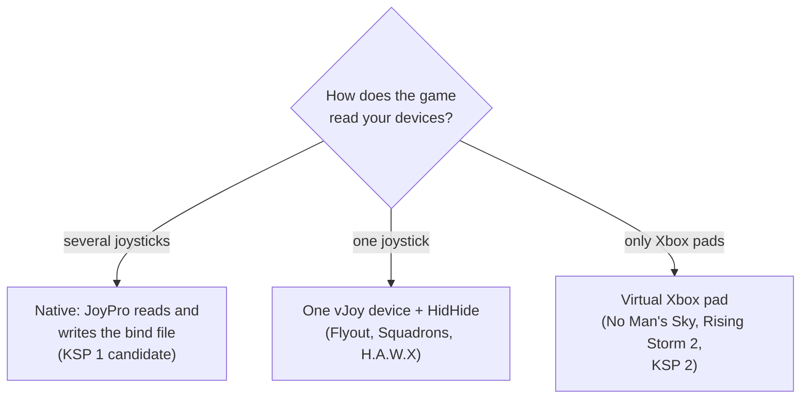

These games are researched but not integrated: JoyPro knows how they read joysticks and, where it was found, where
they keep their binds, but it has no import or export for them yet. Most of them read only one joystick or only Xbox
pads, so the planned route is JoyPro's virtual joystick or virtual Xbox pad. This page sums up per game what is known
and what you can do today.

:::video game-other-games "Other games: what JoyPro knows and plans"
:::

{{game-card}}

:::layer beginner
## What JoyPro does for these games today

Nothing in the game itself yet. These titles are not in JoyPro's game list, so you cannot import from them, export to
them or switch them to the virtual joystick on the [[gui:vjoy|Virtual Joystick]] page. Your profile can still hold
your sticks, relations and the binds of your supported games; once a title is supported, its actions join the same
relations.

| Game | How it reads devices | Route JoyPro plans |
|---|---|---|
| **Flyout** | any joystick, but all merged into one; stick and throttle are not told apart | one vJoy device, binds made in the game |
| **No Man's Sky** | no flight stick; keyboard, mouse and pads (Steam Input or XInput) | virtual Xbox pad |
| **Kerbal Space Program** | several joysticks; binds by device name and number | native integration; vJoy against shifting numbers |
| **Kerbal Space Program 2** | joystick support missing or broken | virtual Xbox pad, or a community mod |
| **Star Wars: Squadrons** | 3 to 4 devices by name, unreliable | one vJoy device |
| **Rising Storm 2: Vietnam** | no joystick, only an Xbox pad | virtual Xbox pad plus the game's pad binds |
| **H.A.W.X / H.A.W.X 2** | one device only | one vJoy device, binds made in the game |

## Flyout

A Unity flight game in Early Access. It accepts any joystick, but reads the axes of all of them as one device, so the
community rule is "only one game controller connected". Gear and trim are bindable. Where the game stores its binds
is not confirmed yet. **Today**: keep one controller connected and bind it in the game.

## No Man's Sky

The game has no flight-stick support. Pads go through Steam Input (Options > Controls > "Remap via Steam Input") or
XInput; the keyboard binds are in a text file. **Planned**: the virtual Xbox pad gives your HOTAS two sticks and two
triggers on the game's default pad layout; a real throttle axis cannot be kept, because the triggers are thrust and
brake. There is no file to write.

## Kerbal Space Program 1 and 2

**KSP 1** reads several joysticks; each axis has a primary and a secondary slot, buttons carry the device number in
their name and move when the device order changes, and binds are lost when a device was off at launch. **Planned**: a
native integration by device name; the virtual joystick against shifting numbers. **Today**: bind in the game, or use
the AFBW Revived mod. **KSP 2** has missing or broken joystick support and its development has stopped: the virtual
Xbox pad or the Inputbinder mod are the routes; JoyPro does not plan an integration.

## Star Wars: Squadrons

Reads DirectInput sticks and pads, lists 3 to 4 devices by name, but players report skipped devices, mixed-up Z axes
between devices, lost throttle binds after a restart and input from devices that are not selected. The binds use the
text format of the Battlefield family, synced with EA's servers. **Planned**: one vJoy device, written as the game's
first joystick, which avoids the device list and the mix-ups. **Today**: players cancel the game's fixed stick dead
zone (about 15-20 %) with a curve.

## Rising Storm 2: Vietnam

An Unreal Engine 3 shooter with helicopters; it reads keyboard, mouse and an Xbox pad, no joystick. The pad binds are
plain text lines in `ROInput.ini`. **Planned**: like [[game:hll-vietnam]], pad actions with the game's pad keys, the
pad binds of the helicopter commands written into `ROInput.ini`, and the virtual Xbox pad.

## H.A.W.X and H.A.W.X 2

Both read only one device: with a stick and a throttle you get one or the other. The binds sit in a binary profile
nobody has decoded, so JoyPro cannot write them. H.A.W.X 2 needs Ubisoft Connect with an account login on its first
start. **Planned**: the whole HOTAS on one vJoy device, real devices hidden by HidHide, bound in the game's controls
menu. At most JoyPro could set the dead zone in H.A.W.X 2's `settings.ini`.

:::ingame What you see in these games
Nothing changes in these games through JoyPro yet. When a title gets the virtual joystick, its controls menu will show
one device, "vJoy Device", with the binds you make there; with the virtual Xbox pad it shows an Xbox controller.
:::

:::picture ingame-other-games-controls "Other games: the controls menu with the exported binds"
:::

## What you do yourself

- Use the game's own controls menu and, where the game needs it, keep only one controller connected.
- For the supported one-device games, see [[game:battlefield]] (vJoy) and [[game:ace-combat]] /
  [[game:hll-vietnam]] (Xbox pad): the same virtual modes are the plan here.
- Ask for a title on JoyPro's Discord or GitHub: a supported game usually needs one look at its real bind file after
  one start.

## Common pitfalls

- **The game is missing in JoyPro's lists**: expected; it is documented only.
- **Several devices work badly in the game**: that is the game's limit, not your devices; one device at a time works.
:::

:::layer advanced
## What is known about the files

| Game | Binds | Notes |
|---|---|---|
| Flyout | not confirmed yet; user data under `%USERPROFILE%\AppData\LocalLow\Stonext Games\Flyout\` | probably Unity's player settings or a file there |
| No Man's Sky | keyboard: `<install>\Binaries\SETTINGS\TKGAMESETTINGS.MXML` (XML); pad: Steam Input | Steam manages the pad configurations; JoyPro would not write them |
| Kerbal Space Program | `<install>\settings.cfg` (text, written on exit) | `INPUT_DEVICES` gives each joystick name its number; axes with name, axis, invert, sensitivity, dead zone |
| Kerbal Space Program 2 | `%USERPROFILE%\AppData\LocalLow\Intercept Games\Kerbal Space Program 2\Global\InputBindings.json` | Unity Input System overrides |
| Star Wars: Squadrons | Steam: `%USERPROFILE%\Documents\STAR WARS Squadrons Steam\settings\ProfileOptions_profile_synced`; EA app: `...\STAR WARS Squadrons\settings\` | `GstKeyBinding` lines plus `deviceid`; synced with EA, the game asks whether to upload a local change |
| Rising Storm 2: Vietnam | `%USERPROFILE%\Documents\My Games\Rising Storm 2\ROGame\Config\ROInput.ini` | `Bindings=(Name="XboxTypeS_LeftY",Command="Axis aBaseY ...")`; an absolute collective via `ROGame.ini` |
| H.A.W.X | `%USERPROFILE%\Saved Games\Tom Clancy's H.A.W.X\Profiles\` | binary profile, not decoded |
| H.A.W.X 2 | `%USERPROFILE%\Saved Games\Tom Clancy's H.A.W.X 2\Profiles`, `<install>\Data_PC\Settings\settings.ini` | the ini holds `[Input] DeadZone` and `MouseSensitivity`; the profile goes through Ubisoft Connect |

## Export modes, never touched

JoyPro writes nothing into these games, so no export mode applies and nothing of theirs is ever changed. The rules of
every JoyPro export (close the game first, a backup before the first write, only cataloged actions, never a device
that is not connected) will hold for them as well once they are integrated: see the
[[page:flows/export.html|export flow]].

## Granularity, axes, watcher

- No per-aircraft binds are known for these games: one set of binds per game (Rising Storm 2's helicopter commands sit
  in the same file as the infantry ones).
- Axis settings the games offer themselves: KSP 1 per axis (sensitivity, dead zone, invert), H.A.W.X 2 one dead zone,
  Squadrons a fixed stick dead zone. None of them is written by JoyPro.
- No watcher, HUD actions or force feedback for these titles: there is nothing JoyPro manages in them.
:::

:::layer technical
## How a documented game becomes supported

Every title here follows the same template ([[doc:virtual-joystick]] and the one-device notes in the repository):

1. **Detection**: Steam app id or registry key, process names (for the watcher and HidHide's block list), the
   settings paths, Steam Cloud or server-synced copies.
2. **Input capability**: DirectInput or not, how many devices, the limits (buttons, hats, axes), whether a device with
   Rx / Ry is taken for a pad; XInput; GameInput.
3. **Target**: vJoy (DirectInput binds writable), Xbox pad (XInput only; the game's pad layout first), or document
   only. The integration declares `IGameDeviceLimit` (`MaxJoysticks`, `SuggestedMode`, `DeviceLimitNote`,
   `AvoidVJoyAxes`) so [[cli:vjoy status]], the Virtual Joystick page and the export suggest the virtual mode.
4. **Command list**: `DB\<Game>\actions.tsv`, built by `engine <game> refresh-db` from the game's own files; for a pad
   game the 5th column holds the default pad key as an Unreal key name.
5. **Writer**, only when the file is understood: keep unknown lines, write only while the game is closed, back up
   first, write every profile variant, check after one launch that the game or a cloud copy did not undo it.
6. **Virtual mode**: [[cli:vjoy mode]] `<game> virtual|xbox`; the planner places the inputs and lists what does not
   fit; HidHide hides the real devices from that game only.

### Known limits

- Flyout, No Man's Sky, KSP 1 and 2, Squadrons and Rising Storm 2 were not installed for the research; their facts
  come from public sources.
- H.A.W.X 2 is installed but was not started (it needs a Ubisoft Connect login); whether its controls menu lists the
  vJoy device and where its profile lands are not confirmed yet.
- KSP 1 needs one real `settings.cfg` with known binds (Unity's axis numbering) before a writer.
- Squadrons needs a survey of its joystick numbering like Battlefield's.
- [[cli:vjoy mode]] accepts only games in JoyPro's game list, so none of these titles can be switched to a virtual
  mode yet.
:::
