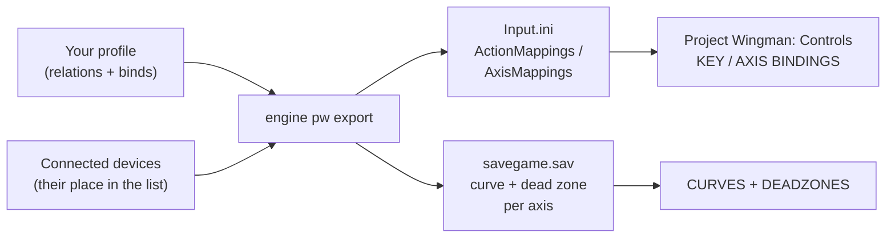

Project Wingman is an arcade air combat game on Unreal Engine 4. It reads several DirectInput devices at once and
keeps the binds in a plain `Input.ini`, each named after the device and its place in the game's device list; curves
and dead zones live in the save game. JoyPro reads both into your profile and writes them back. Keyboard, mouse,
gamepad and hats stay as the game has them.

:::video game-project-wingman "Project Wingman: import, relations, export"
:::

{{game-card}}

:::layer beginner
## What JoyPro does for Project Wingman

- **Import**: every joystick bind of the flight actions (pitch, roll, yaw, thrust, the two view axes and the buttons)
  comes into your profile on your real devices, with invert, curve and dead zone.
- **Relations**: "Fire missile" in Project Wingman can be the same relation as the weapon release of your other games.
- **Export**: JoyPro writes your binds into `Input.ini` and the curves and dead zones into the save game.

## Import your Project Wingman binds

1. Start the game once if you never did, so its folder exists.
2. Open **Start**. If the Project Wingman card asks for a command list, press **Build List**: JoyPro reads the flight
   actions from the game's own files.
3. Press **Import** on the card, keep **Add to my profile (recommended)**, press **Import now**.

## Build and check relations

Join the Project Wingman actions with your other games on the **Relations** page
([[page:flows/relations.html|relations flow]]), then run **Check** on the Export page: it finds one button that does
two things in the game.

## Export to Project Wingman

1. **Close Project Wingman.** JoyPro refuses to write while it runs.
2. Open **Export** and tick the Project Wingman tile.
3. Keep **Replace on my devices** with **Also clear my other devices**, or pick **Update, keep the game's binds** if
   you also bind in the game. Press **Export now** on the tile.

:::ingame What you see in Project Wingman
Open the game's **Controls**. **KEY BINDINGS** and **AXIS BINDINGS** show your binds in the next free slot of each row,
named after the device without spaces and its number, for example "VJOYDEVICE 8 BUTTON 24" or "VJOYDEVICE 8 AXIS 1",
with the **Invert** box ticked where you inverted. **CURVES + DEADZONES** shows the CURVE and DEADZONE JoyPro wrote
for each axis.
:::

:::picture ingame-project-wingman-controls "Project Wingman: the controls menu with the exported binds"
:::

## What you do yourself in Project Wingman

- **Export again after you add or remove a controller.** The game numbers a device by its place in its device list,
  and that place changes when a controller comes or goes. JoyPro computes it from the devices connected at the export.
- **Hats**: the game cannot bind a hat. Set **Hat Function 1 / 2** (WEAPON or VIEW) in **Controls > Miscellaneous**.
- Switch **Steam Input** off for the game; a Steam Input pad shows up as an extra device.

## Common pitfalls

- **Binds point at the wrong device**: a controller was added or removed since the export. Export again with your
  usual devices connected. The import warns when a device's number moved.
- **A hat bind is refused**: by design, see Hat Function above.
- **The throttle brakes in the lower half**: "Thrust Axis" is a centred axis in Project Wingman: above the centre it
  accelerates, below it brakes.
:::

:::layer advanced
## Files JoyPro reads and writes

| File | What it is |
|---|---|
| `%LOCALAPPDATA%\ProjectWingman\Saved\Config\WindowsNoEditor\Input.ini` | the binds, section `[/Script/Engine.InputSettings]`: `ActionMappings=(...)` and `AxisMappings=(...)` lines |
| `%LOCALAPPDATA%\ProjectWingman\Saved\SaveGames\savegame.sav` | curves and dead zones per axis action (`<Axis>Curve`, `<Axis>Deadzone`) and the hat functions |
| `<install>\ProjectWingman\Content\Paks\pakchunk0-WindowsNoEditor.pak` | read only: `DefaultInput.ini`, the game's default binds and the action list |
| `...\Input.ini.joypro-meta.json` | JoyPro's data of the exported binds (names, groups, tuning) for the next import |

The game writes `Input.ini` the moment a bind changes in its menu, and only the lists you changed; the others come
from the pak's defaults. Because a written list replaces the defaults, JoyPro writes the defaults of a missing list
first. Steam Cloud syncs the save folder.

## The export modes in Project Wingman

Only joystick mappings of cataloged flight actions are removed; keyboard, gamepad, mouse, menu rows and devices that
are not connected stay.

| Mode | What happens |
|---|---|
| **Only add** | A bind on an input the game uses for another flight action is not written (marked "Not written to the game"); the game's own form of a bind (Invert) stays. |
| **Update, keep the game's binds** | Also removes the game's mapping on an input the profile gives another action; the action's other mappings stay. |
| **Update, my profile wins** | Also removes the other joystick mappings of every action the profile binds, so a move fully moves. |
| **Replace on my devices** | The exported devices lose their other joystick mappings (a flight-only game). |
| **+ Also clear my other devices** | The same on the other connected devices. |

## What is never touched

- Keyboard, mouse and gamepad mappings, menu rows, hats.
- Devices that are not connected, the import's ignored devices and the vJoy device JoyPro tunnels into.
- Every other line of `Input.ini` (order and line ends stay) and every other byte of `savegame.sav`.

## Curves, dead zones, other settings

- **Per axis action, for all devices together**: CURVE (the menu's 0.00 to 2.00, 1.00 = straight) and DEADZONE
  (0 to 100 %) for pitch, roll, thrust, yaw and the two view axes. The game's defaults: pitch and roll 25 %, view 10 %,
  thrust and yaw 0 %.
- **Invert** per bind (the slot's Invert box).
- The game's formula is not known. JoyPro's preview assumes a rescaled dead zone and the curve as an exponent (not
  confirmed yet).
- **Global**: no aircraft profiles. No modifiers (the game has none), no force feedback.
- **Watcher**: `Input.ini` and `savegame.sav` are watched after the game closes ([[doc:sync-watcher|the watcher]]).
- **HUD**: while the game runs, the [[gui:hud|HUD]] names the action of each pressed button.
:::

:::layer technical
## Inside the Project Wingman integration

Code: `engine\Games\ProjectWingmanIntegration.cs`, `engine\Games\ProjectWingmanSaveGame.cs`,
`engine\AxisModels\ProjectWingman.cs` (axis model `projectwingman`).

- **Keys**: `Joystick_<name>_<place>_Axis<n>`, `..._Button<n>`. `<name>` is the DirectInput product name without
  spaces (`VPforce Rhino FFB Joystick` becomes `VPforceRhinoFFBJoystick`), not the HID string. `<place>` is the
  device's place in the game's list (Controls > Miscellaneous), which is DirectInput's order reversed; XInput pads are
  not in that list. `Axis<n>` counts the device's present axes from 0 in X Y Z Rx Ry Rz Slider Slider order;
  `Button<n>` counts from 0. A key with a comma in the name is quoted.
- **Invert** = `Scale=-1.000000`.
- **Defaults**: the `Android_*` keys of the pak's defaults are kept, because the menu shows one slot per mapping and
  those keys are the empty slots.
- **savegame.sav**: Unreal GVAS; FloatProperty `<Axis>Curve` (half the menu value) and `<Axis>Deadzone` (0..1), edited
  in place or added before the closing `None`. No checksum.
- **Command list**: [[cli:pw refresh-db]] reads the pak's `DefaultInput.ini` and your `Input.ini`: 6 axes and 14
  buttons.
- **Commands**: [[cli:pw paths]], [[cli:pw catalog]], [[cli:pw scan]], [[cli:pw import]], [[cli:pw export]] `--mode
  clean|add|merge|merge-overwrite --nuke-untouched-devices --dry-run`.

### Known limits

- The device number changes with your controllers: export again after a hardware change.
- Hats and modifiers are refused.
- The curve formula is a working assumption.
- One full in-game run of the test is still open; export and import were seen in the game.
- Tests: `engine\tests\smoke\projectwingman.ps1` (fixtures of the real shape); in the game
  `tools\e2e\games\ProjectWingmanSettings.ps1` (random axes, buttons, invert, curve and dead zone; the controls pages
  read back; the config and save folders restored).
:::
