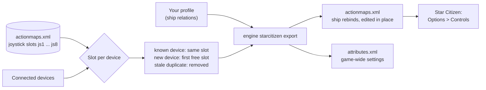

Star Citizen keeps all your controls in one file, `actionmaps.xml`, and numbers your sticks as joystick slots js1 to
js8. JoyPro reads the ship binds of that file into your profile and writes them back in place: only the ship actions
and their axis settings change, every other line stays as the game wrote it. A device keeps the slot the game already
gave it, so your binds do not jump from one stick to another.

:::video game-starcitizen "Star Citizen: import, relations, export"
:::

{{game-card}}

:::layer beginner
## What JoyPro does for Star Citizen

- **Import**: your ship binds on sticks, throttles and pedals come into your profile, with their dead zones, curves
  and inverts. The game's own default joystick binds on js1 come in too, so an export later does not lose them.
- **Relations**: one relation is one function in every game. "Landing gear" can be the same switch in Star Citizen,
  DCS and Elite Dangerous.
- **Export**: JoyPro edits `actionmaps.xml` in place. On-foot, vehicle and menu binds, mouse and gamepad binds stay as
  they are.

## Import your Star Citizen binds

1. Open **Start**. If the Star Citizen card asks for a command list, press **Build List**: JoyPro reads the game's
   actions from your installation (`Data.p4k`, read only). After a game patch, **Update** on the card adds new actions.
2. Press **Import** on the Star Citizen card. Keep **Add to my profile**. Tick **Also take the keyboard keys** only if
   you want your ship keys in JoyPro too.
3. Press **Import now**. **See my relations** opens what came in.

## Build and check relations

Each ship action is one entry in a relation. Join the same function of your other games with the
[[page:flows/relations.html|relations flow]], then press **Check** on the Export page: it finds one button that does
two things on your ship before the game does.

## Export to Star Citizen

1. **Close Star Citizen.** The game rewrites `actionmaps.xml` when it quits, so JoyPro refuses to write while it runs.
2. Open **Export** and tick the Star Citizen tile.
3. Keep **Replace on my devices** with **Also clear my other devices** if JoyPro is where you set up your sticks.
   Press **Export now** on the tile.

:::ingame What you see in Star Citizen
Start the game and open **Options > Controls** from the main menu. Pick your device (**Joystick / HOTAS 1**, **2** ...):
its dead zone and saturation are the ones you set in JoyPro; **Inversion Settings** and **Joystick Sensitivity
Curves** (Flight > Flight Movement) show your inverts, exponents and curves. Your ship binds are on the joystick
slot of each device. Game defaults that JoyPro switched off show as empty. The menu shows saturation 0.01 higher than
the file holds (0.87 shows as 0.88); the game keeps the exact value.
:::

:::picture ingame-starcitizen-controls "Star Citizen: the controls menu with the exported binds"
:::

## What you do yourself in Star Citizen

- Nothing else for the binds. Plug in every device you use before you export: a device that is not connected keeps
  its slot and its binds, but JoyPro cannot give it new ones.
- If the game sits in another folder than the detected one, set the path once on the Export page under *Options and
  paths (for experts)*, or link the folder in **Settings > Games**.

## Common pitfalls

- **"Star Citizen is running"**: quit the game (also from the launcher) and export again.
- **Binds landed on the wrong stick**: keep **Star Citizen: prefer local order** on (the default). Off, the slots
  follow the order Windows reports the devices in, which can move every bind of a device to another js number.
- **A device got no slot**: the game has eight joystick slots. JoyPro merges duplicate entries of one stick (the game's
  name and JoyPro's name) into one slot, but more than eight connected devices with binds do not fit.
- **A default bind came back on js1**: it comes back when the device on js1 is not connected at export time. Connect it
  and export again with Replace.
:::

:::layer advanced
## Files JoyPro reads and writes

| File | What it is |
|---|---|
| `<install>\LIVE\user\client\0\Profiles\default\actionmaps.xml` | your rebinds, the joystick slots (`<options type="joystick" instance="1..8" Product="...">`), the option groups per slot (invert, exponent, curve, sensitivity) and the device options (dead zone, saturation per physical axis) |
| `...\Profiles\default\attributes.xml` | game-wide settings (`<Attr name="..." value="..."/>`), only the values that differ from the game's defaults |
| `...\Profiles\default\actionmaps.jp` | JoyPro's copy of the written file with relation names as comments, read back by the next import |
| `...\Profiles\default\actionmaps.xml.joypro.json` | the axis settings JoyPro wrote last, so "Update" can tell a value you changed in the game from its own |
| `actionmaps.xml.jpbak`, `attributes.xml.jpbak` | copies from before the first write of an export, plus JoyPro's versioned backup store |

The export edits `actionmaps.xml` in place: only ship rebinds and the axis settings of the axis rebinds JoyPro writes
change. Other action maps, mouse and gamepad rebinds, activation modes, modifiers, other option groups and device
options stay byte for byte. A profile without Star Citizen binds leaves the file as it is.

## The joystick slots

Star Citizen names every joystick bind by its slot: `js1_button3`, `js2_x`. The file lists which device holds which
slot, by the device's DirectInput product name and product GUID.

- **Prefer local order** (on by default): a connected device the file already names keeps that slot. Other devices
  fill the free slots in the order Windows reports them.
- **One device, one slot**: the same stick listed twice (under the game's name and under JoyPro's instance name, or
  an old second entry) takes one slot. The export removes the duplicate entries and moves their binds to the slot the
  device keeps. Entries of devices that are not connected stay.
- Two connected devices of the same model stay apart.
- A device that changes slot takes its option groups (invert, curves) with it. A device that gets no slot loses the
  groups of its old slot, with a warning.

## The export modes in Star Citizen

Every mode changes only ship actions. On-foot, vehicle and menu maps stay byte for byte.

| Mode | What happens in the game |
|---|---|
| **Only add** | No game bind changes. An action whose joystick slot already holds a rebind or an active default keeps it. A bind on an input another ship action uses is not written and gets a mark "Not written to the game". |
| **Update, keep the game's binds** | Your input goes into the action's joystick slot (Star Citizen has one per action and input type). A game bind on an input you give another ship action is released: its rebind goes, or becomes an empty `js1_ ` when the action has a default, so the default does not come back. |
| **Update, my profile wins** | As above; with the keyboard option an action you bind also loses its keyboard rebind. |
| **Replace on my devices** | The written devices keep only your ship binds. With a device on js1, the game's js1 defaults your profile does not have are switched off. |
| **+ Also clear my other devices** | Connected devices without binds in your profile lose their ship binds; js1's defaults are switched off when js1 is not used. |

Options on the Export page (under *Options and paths (for experts)*):

- **Star Citizen: keep keyboard defaults** (on): the keyboard keeps the game's default keys. Off: your keyboard binds
  are written and the default keys they take are released.
- **Star Citizen: prefer local order** (on): see the joystick slots above.

## The game's default joystick binds

Star Citizen has default joystick binds that act on js1 until an action gets a rebind there (pitch on Y, yaw on X,
roll on Z rotation, a few buttons). The import takes every active default as a bind of the js1 device, so your profile
holds what the game really does. The export writes no rebind for a bind that equals the default (only real
differences). Replace and Also clear switch off the defaults your profile does not have with an empty rebind
`js1_ `, as the game's own menu writes a cleared bind, and only when the device on js1 is connected. So import, then
Replace + Also clear, leaves `actionmaps.xml` as it was.

## What is never touched

- On-foot, ground vehicle and menu binds (Star Citizen's ground vehicles count as their own vehicle class).
- Devices that are not connected: they keep their slot and their rebinds.
- The import's ignored devices and the vJoy device JoyPro tunnels into.
- Mouse and gamepad binds; the keyboard unless you export keyboard binds.
- Activation modes, modifiers, other option groups and device options.

## Ships, curves, game settings

- **Granularity**: one set of ship binds for every ship (the game has no per-ship binds).
- **Axis curves**, in two places as the game keeps them: dead zone and saturation per device and physical axis;
  invert, exponent (1 to 3), an 11-point curve and sensitivity per slot and option group. Exponent and curve exclude each
  other, as in the game's menu. A relation without Star Citizen values gets its JoyPro curve fitted: dead zone and
  saturation go to the device axis, the curvature becomes the closest exponent, or the curve when no exponent fits.
  There is no one-sided axis: the game's absolute and relative throttle are separate actions.
- **Update** keeps an axis value you changed in the game (with a warning); **Replace** and **my profile wins** set
  your profile's values. A neutral relation leaves the game's own value (free look keeps its default exponent 2.5).
- **Game-wide settings** (`attributes.xml`): HOTAS thrust invert toggle, the relative throttle trap time and threshold,
  the IFCS sensitivity modifiers, ESP on, strength and dampening, turret ESP, the flight defaults (sticky throttle,
  speed limiter, coupled, G-safe, auto precision, space brake), invert flight controller and Vibration. Set them in
  **Settings > Force feedback settings of the games** (pick Star Citizen) or with [[cli:ffb set]]. JoyPro changes only
  the lines you set, in place, and does not create the file. The ESP strength slider ends at 1.00, so JoyPro offers 0
  to 1.
- **Force feedback**: none. Vibration is the game's only such setting.
- **Watcher**: a bind or axis value you change in the game's menu is noticed after the game closes, and JoyPro asks
  whether to take it over. It compares `actionmaps.xml` (ship action maps only) and the settings JoyPro holds in
  `attributes.xml`.
- **HUD**: the HUD finds the game by its process and shows your Star Citizen binds.
:::

:::layer technical
## Inside the Star Citizen integration

Code: `engine\EngineStarCitizen.cs`, `engine\EngineStarCitizenTuning.cs`, the axis model
`engine\AxisModels\StarCitizen.cs` and the settings model `engine\FfbModels\StarCitizen.cs`.

- **Device names**: the slot's `Product` is the DirectInput product name and the product GUID, two spaces apart
  (`vJoy Device  {BEAD1234-0000-0000-0000-504944564944}`). A slot or `deviceoptions` block written under another name
  (an instance GUID) is not recognized by the game: it rewrites the slot with its product and drops the slot's option
  groups. JoyPro therefore writes the connected device's product name.
- **Command list**: [[cli:db refresh-starcitizen]] reads `Data\Libs\Config\defaultProfile.xml` from `Data.p4k` (or an
  extracted copy with `--source`) into `DB\StarCitizen\AllBinds.xml`: every action with its option group, the joystick
  option tree (parents and defaults, which groups show a curve) and the action's default joystick input.
  [[cli:starcitizen labels]] takes the game's names of the controls from `global.ini`.
- **Import**: [[cli:starcitizen import]] (`--include-keyboard`, `--device`, `--ignore-device`); every axis rebind gets
  the values the game uses (the slot's leaf group, else the nearest parent you set, else the game's default) and the
  device options of its axis, as its `game:StarCitizen` tuning. [[cli:starcitizen scan]] shows the same without
  changing the profile; [[cli:starcitizen list-devices]] lists the file's joystick slots.
- **Export**: [[cli:starcitizen export]] `--mode clean|add|merge|merge-overwrite --nuke-untouched-devices true|false
  --keep-keyboard-defaults true|false --prefer-local-order true|false --include-keyboard true|false --ignore-device <d>`.
  A new `deviceoptions` block goes before the first `<options>`; several relations on one option group or one physical
  axis with different values give a warning, and the first relation by name wins.
- **Game settings**: `engine ffb set --device * --game StarCitizen --param <Attr name>=<value>`; an existing line gets
  the value, a new one goes to its sorted place.
- **Backups**: [[cli:backups list]] lists the copies; **Undo last export** on the tile restores the newest.

### Known limits

- Eight joystick slots; the button limit per device is not known (sources conflict).
- Where the game wants a new `deviceoptions` block, the curve interpolation (the menu draws a smooth spline through
  the points), the exponent range and whether sensitivity applies to joysticks are not confirmed yet. The ranges of
  the game-wide settings are not in the game's readable files.
- Whether Vibration drives a DirectInput force feedback stick is not confirmed yet.
- Tests: `engine\tests\smoke\starcitizen.ps1` (catalog refresh, import of option groups and curves, import + export
  byte for byte, every axis setting, conflicts, slot changes, `attributes.xml` in place); in the game
  `tools\e2e\games\StarCitizenSettings.ps1` (main menu Options: settings, binds and curves) and
  `tools\e2e\games\StarCitizen.ps1` (export and import mode matrix).
:::
