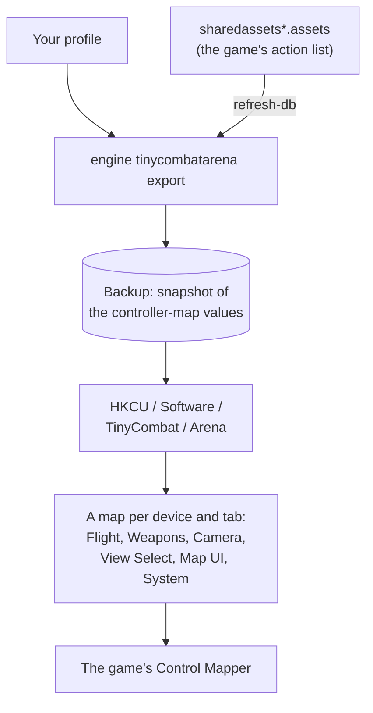

Tiny Combat Arena is a combat flight game with one set of binds for every aircraft. It keeps its
controls in the Windows registry (Unity's settings store): one Rewired joystick map per device and per tab of its
Control Mapper (Flight, Weapons, Camera, View Select, Map UI, System). JoyPro reads these maps into your profile and
writes your binds back into the right tab of each device.

:::video game-tiny-combat-arena "Tiny Combat Arena: import, relations, export"
:::

{{game-card}}

:::layer beginner
## What JoyPro does for Tiny Combat Arena

- **Import**: the joystick maps of your connected devices come into your profile, from every tab: axes with their
  invert, buttons, hat directions and buttons on an axis (for example Throttle Up / Down).
- **Relations**: one relation is one function, for every aircraft.
- **Export**: JoyPro writes each bind into the map of its tab (pitch into Flight, a gun into Weapons, a view into View
  Select) and leaves the rest of each map as it is.

## Import your binds

1. Start Tiny Combat Arena once, open the Control Mapper (the game then saves a map of every connected device) and
   close the game.
2. Open **Start**, press **Import** on the Tiny Combat Arena card, then **Import now**.

## Build and check relations

Build relations as for every game ([[page:flows/relations.html|relations flow]]). JoyPro has no hand-made function
table for this game yet: the setup wizard and Auto Assign use one derived from the game's own titles and categories.
Then run the [[page:flows/check.html|Check]] on the Export page.

## Export to Tiny Combat Arena

1. **Close Tiny Combat Arena.** JoyPro refuses to write while it runs (process `Arena`); the game saves all maps when
   you press Done in the Control Mapper.
2. Open **Export**, keep **Replace on my devices** with **Also clear my other devices**, and press **Export now** on
   the Tiny Combat Arena tile.

:::ingame What you see in Tiny Combat Arena
Open the game's Control Mapper and pick your device: your binds are on the tabs Flight, Weapons, Camera, View Select
and Map UI. The mapper names inputs by Rewired's numbering: "Axis 0" is the X axis, button 1 shows as "Button 0", the
first hat's up as "Hat 0 Up". The menu path to the mapper is not confirmed yet.
:::

:::picture ingame-tiny-combat-arena-controls "Tiny Combat Arena: the controls menu with the exported binds"
:::

## What you do yourself in Tiny Combat Arena

- **Start the game once** before the first import or export, so it creates its registry key. The very first start
  asks for a quick game setup and head tracking; answer as you like.
- **Curves**: the game's own joystick and rudder curves and the throttle speed are in its settings file; set them in
  the game, JoyPro does not write them.

## Common pitfalls

- **"Tiny Combat Arena is running"**: close the game and export again.
- **A device is skipped**: two connected devices of the same model cannot be told apart in the game's maps; JoyPro
  leaves them out with a warning.
- **Twist or throttle of a Logitech Extreme 3D or a T.16000M**: the game's Rewired recognizes these devices and keeps
  their maps under another key; JoyPro does not handle them yet.
- **A hat diagonal is missing**: JoyPro writes the four main hat directions only.
:::

:::layer advanced
## What JoyPro reads and writes

| Where | What it is |
|---|---|
| `HKCU\Software\TinyCombat\Arena` | Unity's settings of the game in the registry; the Rewired values are binary (UTF-8 text plus one zero byte), names end in `_h<hash>` |
| a value per device and tab with `dataType=ControllerMap` and the device's `hardwareIdentifier` in its name | the joystick map of one device on one tab (Rewired XML), for the player `Player` |
| `<install>\Arena_Data\sharedassets*.assets` | the game's Rewired action list: read only, for the command list |
| `%USERPROFILE%\AppData\LocalLow\TinyCombat\Arena\Settings\Controls.cfg` | the game's curves and throttle speed: not written |

Before every write JoyPro puts the player's controller-map values into the backup store; **Undo last export** writes
them back.

The tabs are Rewired map categories: 0 System, 3 Flight, 8 Weapons, 11 Camera, 4 View Select, 9 Map UI. Each action
goes to the tab of its action category (Flight Control to Flight, Weapon Control to Weapons, Camera Control to Camera,
View Control to View Select, Map Control to Map UI, Default to System).

## The export modes in Tiny Combat Arena

Tiny Combat Arena is a flight-only game: every assignable action counts as JoyPro's.

| Mode | What happens in the maps of your devices |
|---|---|
| **Only add** | Nothing of the game changes; a bind whose input already drives another action (or the other pole of an axis) is left out and listed. |
| **Update, keep the game's binds** | An action on an input you give another action loses it; the action keeps its other inputs. |
| **Update, my profile wins** | As above, and every action you bind leaves its other inputs on the connected devices JoyPro can read. |
| **Replace on my devices** | Every other assignable action of the written devices is released, on every tab. |
| **+ Also clear my other devices** | The other connected devices (one of a model) lose those actions; a device without saved maps gets empty ones, which changes nothing in the game because it gives unknown devices no default binds. |

## What is never touched

- The actions the player cannot assign (menu navigation and a few fixed actions).
- Keyboard and mouse maps, the calibration maps, input behaviours, the controller assignments and the game's
  settings file.
- Devices that are not connected, two or more devices of one model, the import's ignored devices and the vJoy device
  JoyPro tunnels into.

## Granularity, curves, the rest

- **Granularity**: global, one set of binds for every aircraft.
- **Axis curves**: not written (the game's curves live in `Controls.cfg`).
- **Keyboard and modifiers**: not written.
- **Force feedback, telemetry**: none.
- **Watcher**: a registry change notification on the game's key ([[doc:sync-watcher|the watcher]]).
- **HUD**: the [[gui:hud|HUD]] finds the game by its process (`Arena`).
:::

:::layer technical
## Inside the Tiny Combat Arena integration

Code: `engine\Games\TinyCombatArenaIntegration.cs` (registry key, player name, tabs, catalog layout) on top of
`engine\Games\RewiredMapIntegration.cs` (reading and writing Rewired joystick maps, shared with
[[game:nuclear-option|Nuclear Option]]).

- **Devices**: unknown devices get a zero `hardwareGuid` and `hardwareIdentifier` = `WindowsRawInput` + HID product
  string without whitespace + PID + VID. A device must be connected for the export, because the key is built from its
  HID product and VID/PID.
- **Elements**: axes X, Y, Z, Rx, Ry, Rz = 0 to 5, button n = 31 + n, hat h (1-based) Up / Right / Down / Left =
  160 + 4(h-1) + 0 to 3. The mapper writes `axisRange` 1 on button elements; JoyPro writes 1 too and compares buttons
  without it.
- **Command list**: [[cli:tinycombatarena refresh-db]] reads the Rewired InputManager from the first
  `Arena_Data\sharedassets*.assets` that parses; actions the player cannot assign are left out, axis actions get pole
  rows with the game's pole names (`DB\TinyCombatArena\actions.tsv`).
- **Commands**: [[cli:tinycombatarena paths]], [[cli:tinycombatarena catalog]], [[cli:tinycombatarena scan]],
  [[cli:tinycombatarena import]], [[cli:tinycombatarena export]] (short name `engine tca`); Undo with
  [[cli:backups restore]].

### Known limits

- Devices the game's Rewired recognizes (a non-zero `hardwareGuid`) are not handled.
- Hat diagonals and keyboard binds are not written.
- Tests: `engine\tests\smoke\tinycombatarena.ps1`; in the game `tools\e2e\games\TinyCombatArenaSettings.ps1` (Pitch,
  Roll and Yaw on random vJoy axes, two buttons and a hat direction show on the Flight, Weapons and View Select tabs,
  and an import after the game quit reads all of them back).
:::
