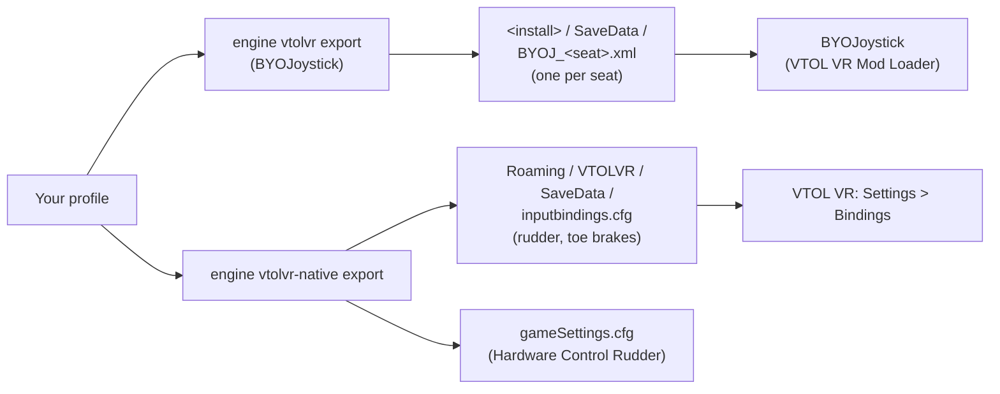

VTOL VR is a VR-only combat flight game: you fly with the VR controllers on the virtual stick and throttle. The game
itself binds only three axes of a physical device, the rudder and the two toe brakes, and keeps them in one file for
every aircraft. Full HOTAS support (stick, throttle, every switch, per aircraft and seat) comes from the free
BYOJoystick mod. JoyPro handles both as two games: **VTOL VR (BYOJoystick mod)** writes the mod's binding files,
**VTOL VR (native rudder and brakes)** writes the game's own file and its control settings.

:::video game-vtol-vr "VTOL VR: import, relations, export"
:::

{{game-card}}

:::layer beginner
## What JoyPro does for VTOL VR

- **With BYOJoystick**: every target the mod offers (stick and throttle axes, gear, flaps, weapons, countermeasures,
  radar, lights, MFD buttons and more) for each vehicle and seat, from your sticks, throttles and the keyboard.
- **Without the mod**: the game's own **Rudder**, **Wheel Brake L** and **Wheel Brake R**, plus the settings of its
  Controls menu (Hardware Control Rudder, VR dead zones, haptics).
- **Relations**: one relation is one function; the BYOJoystick export writes it into every seat file whose vehicle
  has that target.

## Install BYOJoystick (once)

1. Open **Start** and press **Install BYOJoystick** on the VTOL VR card. A panel shows what the mod is, its official
   source (the Steam Workshop, the source code on GitHub), its size, and whether the VTOL VR Mod Loader and the mod are
   on this PC.
2. Tick the box that you have read what BYOJoystick is and want to install it from the Steam Workshop, then press
   **Install BYOJoystick**. JoyPro backs up your BYOJ files and opens Steam: install the Mod Loader if Steam asks, then
   press **Subscribe** on the BYO Joystick page. Steam downloads the mod; JoyPro copies nothing of it.
3. Press **Check again**: JoyPro finds the mod and builds its VTOL VR command list from it.

## Import your binds

Press **Import** on the VTOL VR card (BYOJoystick) or on the card of the native part, then **Import now**. For
BYOJoystick, **Also take the keyboard keys** brings your keyboard binds too.

## Build and check relations

Build relations as for every game ([[page:flows/relations.html|relations flow]]); the setup wizard and Auto Assign
know the BYOJoystick targets. Then run the [[page:flows/check.html|Check]] on the Export page.

## Export to VTOL VR

1. **Close VTOL VR.** JoyPro refuses to write while the game runs (process `VTOLVR`).
2. Open **Export** and keep **Replace on my devices** with **Also clear my other devices** if JoyPro is where you set
   up your devices.
3. Press **Export now** on the VTOL VR tile (BYOJoystick) and, for the pedals, on the native tile.

:::ingame What you see in VTOL VR
In the game, **Settings** shows **Hardware Control Rudder** switched on when your profile sets it, and **Bindings**
lists **Rudder**, **Wheel Brake L** and **Wheel Brake R** with your device and its axis. The BYOJoystick binds are in
the mod's own window, per vehicle seat; its **Load** reads the files again.
:::

:::picture ingame-vtol-vr-controls "VTOL VR: the controls menu with the exported binds"
:::

## What you do yourself in VTOL VR

- **Start VTOL VR once with your pedals connected** and leave **Settings** with OK. The game then lists your devices
  and creates `gameSettings.cfg`; the native export writes only devices the game has listed and never creates the
  settings file.
- **Hardware Control Rudder** must be on, or the game ignores the rudder and brake axes. Switch it on in the game, or
  store it in JoyPro (*Advanced*) so the native export writes it.
- **BYOJoystick** needs the VTOL VR Mod Loader from Steam; JoyPro only opens the Steam pages.

## Common pitfalls

- **The rudder does nothing**: Hardware Control Rudder is off. The game reads it when a vehicle spawns.
- **Only one toe brake works, or both follow the throttle trigger**: the game takes the brakes from your pedals only
  when **Wheel Brake L** is bound. Bind both.
- **A toe brake brakes only on the second half of its travel**: the game reads a brake as 0 to 1. Set the axis range
  of that relation to *Positive* (*Advanced*); JoyPro warns about this case.
- **Two identical pedals**: the game keeps one map per device model, so both drive the same action.
- **A BYOJoystick bind vanished**: the mod drops targets a vehicle does not have when it loads a file.
:::

:::layer advanced
## Files JoyPro reads and writes

| File | What it is |
|---|---|
| `<install>\SaveData\BYOJ_<seat>.xml` | BYOJoystick binds of one vehicle seat: `AV42C`, `FA26B`, `F45A`, `AH94Front`, `AH94Rear`, `T55Front`, `T55Rear`, `EF24GFront`, `EF24GRear` |
| `%APPDATA%\Boundless Dynamics, LLC\VTOLVR\SaveData\inputbindings.cfg` | the game's own binds: Rewired joystick maps in a text file; Steam Cloud syncs it |
| `%APPDATA%\Boundless Dynamics, LLC\VTOLVR\SaveData\gameSettings.cfg` | the Settings > Controls values (`HARDWARE_RUDDER`, ...); Steam Cloud syncs it |
| `<library>\steamapps\workshop\content\3018410\3276352374\BYOJoystick.dll` | the installed mod: read only, for its target list |
| `<install>\VTOLVR_Data\level0` | the game's Rewired action list: read only, for the native command list |

The legacy file `<install>\SaveData\inputbindings.cfg` is never written. Every write is backed up first and done
atomically (temporary file, then replace): the game replaces a broken `inputbindings.cfg` by an empty one.

## The export modes in VTOL VR

| Mode | BYOJoystick (per seat file) | Native (inputbindings.cfg) |
|---|---|---|
| **Only add** | Nothing over the seat's binds: a bind on an input another target uses (with the same modifier state) is listed as not written. | Free axes only; a taken axis is listed as not written. |
| **Update, keep the game's binds** | The other target on your input loses it; everything else stays, also a moved target's old input. | The action on your axis is replaced; everything else stays. |
| **Update, my profile wins** | As above, and your targets leave their other inputs on connected devices (keys only with the keyboard option). | As above, and your actions leave their other axes on connected devices. |
| **Replace on my devices** | The devices JoyPro writes keep only your binds. | The other actions of the written devices are cleared. |
| **+ Also clear my other devices** | Connected devices without binds are cleared. | Connected devices without binds are cleared. |

## What is never touched

- Devices that are not connected, the import's ignored devices and the vJoy device JoyPro tunnels into.
- BYOJoystick: inputs JoyPro cannot read, and the seat's modifier button unless your profile brings its own.
- Native: button maps, keyboard and mouse maps, input behaviours, the calibration maps, the controller assignments and
  the System player. The BYOJoystick export does not write `gameSettings.cfg`.
- The keyboard, unless you export keyboard binds (BYOJoystick only).

## Seats, axes, settings

- **Granularity**: BYOJoystick per vehicle seat (a target goes into every seat that has it); the native part is global.
- **BYOJoystick axes**: invert and the mod's one **Deadzone** number per bind. On Joystick Pitch, Roll, Yaw and on
  Throttle, Power, Collective it is not a dead zone but the deflection the HOTAS needs to take the control from the
  other crew member in multiplayer; on SOI Slew X/Y and Articulate Tilt it cuts small values without rescaling;
  elsewhere the mod does not use it. No curves. See [[doc:axis-curves]].
- **Native axes**: invert, and for the toe brakes the axis range (Full or Positive). Dead zones and curves cannot be
  written.
- **Modifiers**: BYOJoystick knows one modifier button per seat file (binds that need it act only while it is held);
  a keyboard bind can have one modifier key. The native part has none.
- **Control settings**: [[gui:settings|Settings]] > *Force feedback settings of the games*, game **VTOL VR (control
  settings, VR haptics)**: Hardware Control Rudder, Thumb Control Rudder, Twist Rudder Deadzone, Thumbstick Deadzone,
  Thumbstick Mode, Toggle Grip, Flight Control Haptics, Overall Haptics. The native export writes them into
  `gameSettings.cfg`, also when the profile has no native binds.
- **Force feedback**: VTOL VR has no joystick force feedback; the haptics are the VR controllers'.
- **Watcher**: the BYOJ files, and `gameSettings.cfg` with the native part ([[doc:sync-watcher|the watcher]]).
:::

:::layer technical
## Inside the VTOL VR integration

Code: `engine\Games\VtolVrIntegration.cs` (BYOJoystick), `VtolVrMod.cs` (install status, target list),
`ClrMetadata.cs`, `VtolVrNativeIntegration.cs`, `engine\AxisModels\VtolVr.cs` (`byoj`, `vtolnative`),
`engine\FfbModels\VtolVr.cs` (the control settings).

- **BYOJoystick format**: .NET XML serialization, root `<Bindings>` with `<KeyboardBindings>` (`Target`, `Key`,
  `ModifierKey` as Unity KeyCode names) and `<JoystickBindings>` (`Target`, `JoystickId`, `Input`,
  `RequiresModifier`, `Invert`, `Deadzone`, `POVDirection`). `Input`: `X Y Z RX RY RZ`, `S1 S2`, `PoV1..PoV4`,
  `B1..B128`. Devices by **DirectInput instance GUID** (`JoystickId`).
- **Native format**: a text file with the root `RewiredSaveData` and `{key} = {value}` lines; the joystick map is
  Rewired XML (declared UTF-16 inside a UTF-8 file). Actions: 0 Rudder, 5 Wheel Brake L, 6 Wheel Brake R. A map is keyed
  by the device model: `hardwareIdentifier` = `WindowsRawInput` + HID product string without spaces + decimal PID +
  product GUID, `hardwareGuid` zero for devices Rewired does not know. The element is the n-th axis of the device.
- **Command lists**: [[cli:vtolvr refresh-db]] reads the targets from the installed `BYOJoystick.dll` without loading
  or running it (its metadata and string literals), then your own `BYOJ_*.xml`; without the mod there is no list.
  [[cli:vtolvr-native refresh-db]] reads the Rewired action list from `level0`.
- **Commands**: [[cli:vtolvr mod]] (`status`, `prepare --accept-license`), [[cli:vtolvr scan]],
  [[cli:vtolvr import]], [[cli:vtolvr export]], [[cli:vtolvr-native scan]], [[cli:vtolvr-native import]],
  [[cli:vtolvr-native export]], the settings with [[cli:ffb set]] `--device * --game VTOLVR`.

### Known limits

- No in-game run yet; BYOJoystick is tested with a stand-in DLL. Whether the mod loads in the current game version is
  not confirmed yet.
- Native: the axis order of devices Rewired does not know and the exact device identifier are taken from the game's
  code, not yet from a file the game wrote.
- BYOJoystick: hat diagonals, a button on an axis target and an axis on a button target are skipped with a warning.
- JoyPro ships no part of BYOJoystick; its command list exists only with the mod installed.
- Tests: `engine\tests\smoke\vtolvr.ps1` (import round trips, own values, game-wide settings, settings-only export).
:::
