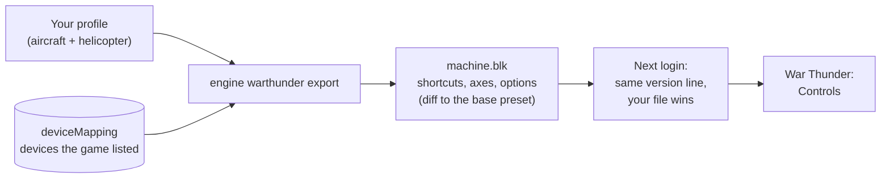

War Thunder keeps your controls in `machine.blk`, a text file that holds only what differs from the preset you
started from. JoyPro reads the aircraft and helicopter controls into your profile and writes them back in place: tank,
ship and menu controls stay as they are. The game also keeps a copy of the file on Gaijin's server; JoyPro writes so
that your exported file wins at the next login.

:::video game-war-thunder "War Thunder: import, relations, export"
:::

{{game-card}}

:::layer beginner
## What JoyPro does for War Thunder

- **Import**: the aircraft and helicopter shortcuts and axes on your devices come into your profile, with every value
  of the game's Axis setup dialog, and the game-wide control options (sensitivity, invert, WEP, autotrim, force
  feedback).
- **Relations**: one relation is one function in every game. "Gear" can be the same switch in War Thunder, DCS and
  IL-2.
- **Export**: JoyPro edits `machine.blk` in place. Tanks, ships, submarines, infantry and the menus are never
  touched.

## Import your War Thunder binds

1. Open **Start**. If the War Thunder card asks for a command list, press **Build List**: JoyPro reads the aircraft and
   helicopter actions from the game's archives (read only; 290 actions). **Settings > Games** can switch that off;
   JoyPro then uses its own shorter list.
2. Press **Import** on the War Thunder card. Keep **Add to my profile**. Tick **Also take the keyboard keys** if you
   want your flight keys in JoyPro too.
3. Press **Import now**. **See my relations** opens what came in.

## Build and check relations

Join the same function of your games with the [[page:flows/relations.html|relations flow]], then press **Check** on
the Export page. The plane's throttle and the helicopter's collective on one axis is fine in War Thunder; two
aircraft actions on one button are not.

## Export to War Thunder

1. **Close War Thunder.** The game saves the file now and then while it runs and when it quits, so JoyPro refuses to
   write while it runs.
2. Open **Export** and tick the War Thunder tile.
3. Keep **Replace on my devices** with **Also clear my other devices** if JoyPro is where you set up your sticks.
   Press **Export now** on the tile.

:::ingame What you see in War Thunder
Start the game and log in. In the hangar, press Esc and open **Controls**. Your binds are in the aircraft and
helicopter sections; the **Axis setup** dialog of an axis shows its dead zone, nonlinearity, multiplier, correction
and invert. The sensitivity rows, the force feedback multiplier and autotrim are listed in the Realistic and
Full-real control modes only. Clicking the Mouse aim / Simplified / Realistic / Full-real tabs changes your control
mode, it does not filter the list.
:::

:::picture ingame-war-thunder-controls "War Thunder: the controls menu with the exported binds"
:::

## What you do yourself in War Thunder

- **Let the game list every device once.** War Thunder numbers buttons and axes per device in its own table. Plug the
  device in, start the game and open **Controls**: the game then adds the device to `machine.blk`. JoyPro skips a
  device the game has not listed yet.
- Log in once before the first export, so the file of your account exists.

## Common pitfalls

- **"War Thunder is running"**: quit the game and export again.
- **A device was skipped**: the game has not listed it, two connected devices share its VID:PID, or its button or axis
  count differs from what the game recorded (all numbers would be off). Open Controls in the game with the device
  plugged in.
- **The old binds came back after login**: you restored a copy by hand. Use **Undo last export** instead: JoyPro then
  raises the file's version, so the server does not replace it.
- **Hat diagonals, mouse buttons and axis modifiers** cannot be written.
:::

:::layer advanced
## Files JoyPro reads and writes

| File | What it is |
|---|---|
| `%USERPROFILE%\Documents\My Games\WarThunder\Saves\<uid>\production\machine.blk` | your controls (`hotkeys{}`, `axes{}`, `params{}`, `deviceMapping{}`) and the game's settings blocks; `<uid>` is your account (`Saves\lastlogin.blk` names it; `Saves\last` before a login) |
| `...\production\machine.blk.joypro-meta.json` | JoyPro's names, groups and tuning of the written binds, read back by the next import |
| `machine.blk.jpbak` | the copy from before the first write, plus JoyPro's versioned backup store |
| an exported controls preset (`controls{}` at the top) | can be imported and exported too; game-wide options are written to `machine.blk` only |

`machine.blk` is a diff against the base preset named in `basePresetPaths`: the first block of a shortcut replaces the
preset's whole list for it, an empty `ID_X{}` means unbound, and a missing axis attribute means "the preset's value".
JoyPro writes cataloged shortcut blocks, `axisId` and the axis values of cataloged axes, and the single option keys
you set. Every other line keeps its text; `deviceMapping{}` is only read.

## The export modes in War Thunder

Only cataloged aircraft and helicopter controls count. A conflict is another of those on the same input.

| Mode | What happens in `machine.blk` |
|---|---|
| **Only add** | A shortcut is written only when no other aircraft or helicopter control uses that input; it never removes a block or replaces a bound axis. Skipped binds get a mark "Not written to the game". |
| **Update, keep the game's binds** | Your shortcuts go in beside the control's other shortcuts; only conflicts are removed (an axis of another control on your axis gets `axisId -1`). |
| **Update, my profile wins** | As above, and a control you bind loses its other shortcuts on connected devices the game lists (keyboard only with the keyboard option). |
| **Replace on my devices** | As above, and the other aircraft and helicopter shortcuts and axes of the written devices are released. |
| **+ Also clear my other devices** | The same for connected devices without binds in your profile. |

An empty `ID_X{}` is replaced when JoyPro binds the control. A control missing from the file gets a warning: your
shortcut then replaces the base preset's default for it.

## What is never touched

- Tank, ship, submarine, infantry and menu shortcuts and axes.
- `deviceMapping{}`, `config{}` and every settings line JoyPro does not set.
- Mouse binds, devices that are not connected, the import's ignored devices and the vJoy device JoyPro tunnels into.
- The keyboard unless you export keyboard binds.
- Relative control, keep value and the axis range stay as the file has them unless you set them.

## Aircraft, curves, game options

- **Granularity**: one set of controls for all aircraft and one for all helicopters (the game has no per-aircraft
  binds).
- **Modifiers**: the last button of a shortcut is the main input, other buttons and keys in the block are its
  modifiers. Up to three alternatives per shortcut.
- **Axis curves** in the game's own units, as the Axis setup dialog shows them: dead zone (0 to 0.5), nonlinearity (0
  to 3, shown as 1 to 4), multiplier, correction, invert, relative control with its sensitivity and step, keep value
  for disabled axis. A relation without War Thunder values gets its JoyPro curve fitted: multiplier = 1 / saturation X,
  dead zone scaled with it, the closest nonlinearity; a slider gets the travel between dead zone and saturation mapped
  onto the whole range. A value equal to the base preset's drops the line, as the game itself saves.
- **Game options**: roll, pitch and yaw sensitivity for aircraft and for helicopters, invert Y (aircraft, helicopter),
  invert throttle, hold throttle for WEP, autotrim, force feedback on (the game needs a restart) and its multiplier.
  Set them in **Settings > Force feedback settings of the games** (pick War Thunder) or with [[cli:ffb set]]. They are
  written also by an export without War Thunder binds; the import takes the file's values.
- **Cloud copy**: the game compares the first line `version:i=N` of the file with the server's at login. JoyPro keeps
  the version, so your new content is uploaded. **Undo last export** gives the restored file a version above the one it
  replaces, so the server's copy does not come back.
- **Telemetry force feedback**: the [[gui:ffb|Force Feedback]] page drives your force feedback stick from the game's
  local web server (`127.0.0.1:8111`, served by the running game; nothing to set up). Switch the game's own force
  feedback off for that stick.
- **Telemetry recording**: JoyPro can record a sortie from the same server and export it as CSV or for Tacview (a
  flat map around 0/0, as the game has no real geographic position).
- **Watcher**: a bind, axis value or option you change in the game is noticed after it closes; reordered keys or the
  game's diff style are no change.
- **HUD**: the HUD finds the game by its process and shows your War Thunder binds.
:::

:::layer technical
## Inside the War Thunder integration

Code: `engine\Games\WarThunderIntegration.cs`, `engine\Games\WarThunderVromfs.cs`, the axis model
`engine\AxisModels\WarThunder.cs` and the settings model `engine\FfbModels\WarThunder.cs`.

- **Devices**: `deviceMapping{ joystick{ devId:t="0738:2215" name:t="..." buttonsOffset:i= buttonsCount:i= axesOffset:i=
  axesCount:i= } }`. `devId` is the DirectInput product's VID:PID; the game matches devices by `devId` only, so two
  identical devices collapse into one. `joyButton` = buttonsOffset + local index (buttons, then four per hat: up,
  right, down, left); `axisId` = axesOffset + local index in DirectInput order (X, Y, Z, Rx, Ry, Rz, two sliders),
  then two per hat. [[cli:games devices]] shows what JoyPro sees per device.
- **Format**: BLK text, `name:type=value`, block names repeat (parsed as an ordered list), CRLF. Files with
  `controls.version` below 5 are legacy and not read.
- **Command list**: [[cli:warthunder refresh-db]] reads `shortcutsgroupaircraft.nut` and `shortcutsgrouphelicopter.nut`
  from `gui.vromfs.bin` and the titles from `lang.vromfs.bin` (`lang/controls.csv`), unpacked into a temporary folder
  that is deleted afterwards; only the ids and titles stay. `--no-game-archives` (Settings > Games: untick "War
  Thunder: read the full command list from the game's archives") uses JoyPro's own list of 116 actions; ids without
  `ID_` are axes. `--path` takes a folder with the control scripts as plain files.
- **Import / export**: [[cli:warthunder import]], [[cli:warthunder scan]]; [[cli:warthunder export]] `--mode
  clean|add|merge|merge-overwrite --nuke-untouched-devices --include-keyboard --ignore-device <d> --dry-run`.
- **Base presets**: without a table of the official presets' values, the export writes every tuned axis attribute
  explicitly (it never drops a line as "equal to the base"), so the file is right whatever the base preset is; the
  import uses the code defaults for attributes the file does not set.
- **Game options**: `engine ffb set --device * --game WarThunder --param <key>=<value>` (`joyFX`, `forceGain` 0..100,
  `aileronsMultiplier` ... in %, `invertY`, `invertYHelicopter`, `invertT`, `holdThrottleForWEP`, `autotrim`).
- **Telemetry**: [[cli:ffb telemetry setup]] and [[cli:telemetry record]]; JoyPro polls `/state` 20 times a second
  and `/indicators` every second request, only while the game runs.

### Known limits

- No shipped table of the base presets' values (see above).
- A watcher run missed a change of "hold throttle for WEP" once, and one sensitivity read back off by one.
- 128 buttons and 4 hats per device are read; hat diagonals, mouse buttons and axis modifiers are not written.
- Tests: in the game `tools\e2e\games\WarThunderSettings.ps1` (binds on vJoy axes, the Axis setup dialogs of pitch and
  throttle, the Controls page values, and the import of the file the game rewrote).
:::
