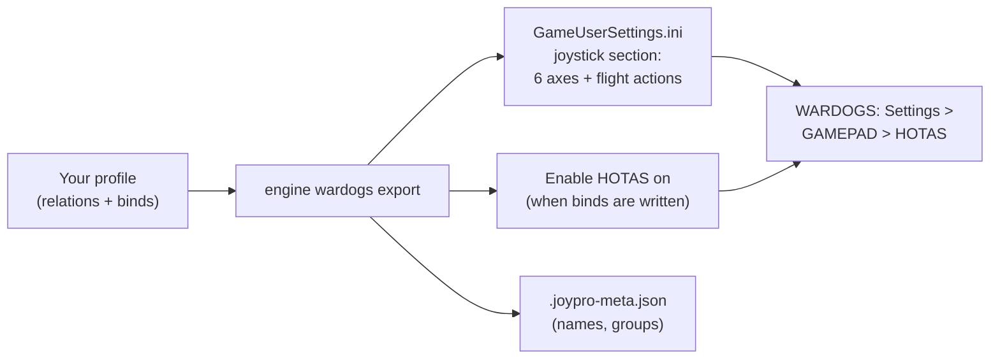

WARDOGS is a helicopter combat game on Unreal Engine 5. Its own joystick plugin reads every DirectInput device and
keeps the binds in one settings file: the six flight axes and the flight actions, each with the device it belongs
to. JoyPro reads that section into your profile and writes it back, together with the HOTAS page's sensitivity,
dead zone and the **Enable HOTAS** switch. Keyboard, mouse and every other part of the file stay as they are.

:::video game-wardogs "WARDOGS: import, relations, export"
:::

{{game-card}}

:::layer beginner
## What JoyPro does for WARDOGS

- **Import**: the binds of the HOTAS page come into your profile: Pitch, Roll, Yaw, the collective (Throttle), the two
  look axes and the flight actions (Fire, Flares, Reload, Horn, Ping ...), each on its device, with invert,
  sensitivity and dead zone.
- **Relations**: one relation can serve WARDOGS and your other games at once: "Collective" on your throttle lever in
  WARDOGS and in DCS's helicopters, for example.
- **Export**: JoyPro writes the helicopter binds into the game's settings file and switches **Enable HOTAS** on, so
  the game uses them.

## Import your WARDOGS binds

1. Open **Start**. If the WARDOGS card asks for a command list, press **Build List**: JoyPro builds it from your own
   settings file and its own axis table.
2. Press **Import** on the WARDOGS card. Keep **Add to my profile (recommended)**.
3. Press **Import now**. **See my relations** opens what came in.

## Build and check relations

On the **Relations** page, join WARDOGS actions with the same function of your other games, see the
[[page:flows/relations.html|relations flow]]. Then run **Check** on the Export page: it finds one button that does
two things in WARDOGS before the game does.

## Export to WARDOGS

1. **Close WARDOGS.** The game rewrites its whole settings file when it quits, so JoyPro refuses to write while it runs.
2. Open **Export** and tick the WARDOGS tile.
3. Keep **Replace on my devices** with **Also clear my other devices** if JoyPro is where you set up your sticks. Press
   **Export now** on the tile.

:::ingame What you see in WARDOGS
Start WARDOGS and open **Settings > GAMEPAD > HOTAS**. **Enable HOTAS** is on, each axis row shows your device and
axis with its invert box, **Sensitivity** and **Deadzone** sliders, and the actions show your buttons. The menu counts
action buttons from 0 but axis-half buttons from 1, so the same button can show two different numbers.
:::

:::picture ingame-wardogs-controls "WARDOGS: the controls menu with the exported binds"
:::

## What you do yourself in WARDOGS

- **Open the HOTAS page once** before the first export. JoyPro only writes into the game's joystick section; if the
  file has none yet, the export stops and asks you to open that page in the game.
- **Enable HOTAS** turns mouse and keyboard flight off while it is on. JoyPro switches it on whenever it writes binds.
  To keep it under your control, set it in **Settings > Force feedback settings of the games** (game WARDOGS): what you
  store there is written on every export.
- "Garage / Vendor" and "Free Look Reset" are not in JoyPro's list yet. Bind them once in the game, then press
  **Update** on the WARDOGS card: JoyPro adds the actions it finds in your file.

## Common pitfalls

- **"WARDOGS is running"**: close the game and export again.
- **A device shows NOT CONNECTED in the game**: the game names a device by VID:PID and its DirectInput name. Export
  again with the device connected: JoyPro repairs a name that differs from the connected device with the same VID:PID.
- **Two identical devices**: WARDOGS cannot tell them apart (they get the same name). Use the
  [[gui:vjoy|Virtual Joystick]] or keep only one of them in WARDOGS binds.
- **Binds do nothing in flight**: check **Enable HOTAS** on the HOTAS page; with it off the game ignores every
  joystick bind.
:::

:::layer advanced
## Files JoyPro reads and writes

| File | What it is |
|---|---|
| `%LOCALAPPDATA%\Wardogs\Saved\Config\WindowsClient\GameUserSettings.ini` | the binds in section `[/Script/WDJoystick.WDJoystickSettings]`; the game-wide switches **Enable HOTAS** (`bUseHOTASHelicopters`) and **Self-Centering Collective** (`bCollectiveSelfCentering`) in `[/Script/WDGame.WDUserSettings]` |
| `...\GameUserSettings.ini.joypro-meta.json` | JoyPro's data of the exported binds (relation names, groups, tuning), read back by the next import |
| `...\GameUserSettings.ini.jpbak` | the backup before the first write (also kept in JoyPro's backup store) |

The keyboard binds of the same file and of `Saved\SaveGames\EnhancedInputUserSettings.sav` are not read or written.
JoyPro reads nothing from the installation: your settings file is the source of the command list.

## The export modes in WARDOGS

The game uses one bind per action. Every mode works only on JoyPro's cataloged helicopter actions; other lines and
sections of the file never change.

| Mode | What happens |
|---|---|
| **Only add** | A bind goes in only where the action's slot is free and no other cataloged action uses that button or axis; otherwise it is skipped and marked "Not written to the game". A bound slot is never replaced. |
| **Update, keep the game's binds** | Your bind takes the action's slot (it replaces the input there). Another cataloged action on the same input loses it. A second line of the action stays. |
| **Update, my profile wins** | As above, and extra lines of the action go, so a moved action fully moves. |
| **Replace on my devices** | The devices you write keep only your binds of the cataloged actions. |
| **+ Also clear my other devices** | Connected devices without binds in your profile lose their cataloged binds. |

An export of a profile without WARDOGS binds writes only the game-wide settings you stored.

## What is never touched

- Keyboard and mouse binds, the keyboard save file, and every section outside the joystick section (except the two
  game-wide switches).
- Actions JoyPro does not catalog: their lines stay as they are.
- Devices that are not connected, the import's ignored devices and the vJoy device JoyPro tunnels into.
- Unknown fields of a bind line: they are kept as they are.

## Axes, sensitivity, dead zone

- **Global**: WARDOGS has no aircraft or vehicle profiles; the binds hold for every helicopter.
- **Per axis**: invert, **Sensitivity** (0.1 to 2.0, 1 = unchanged) and **Deadzone** (0 to 0.5), in the HOTAS page's
  own units, rounded to its two decimals. An import keeps them as the relation's WARDOGS tuning, so your other games
  keep their own curves.
- Without WARDOGS values JoyPro fits them from your base curve: the dead zone carries over, the sensitivity follows
  the slope up to the saturation. A slider's dead zone is not carried over, because WARDOGS treats the collective as a
  centred axis. Curvature and user curves cannot be expressed; the export warns.
- The game shows no preview and its formula is not known. JoyPro's preview assumes invert, a rescaled dead zone, then
  times sensitivity, clipped at full deflection (not confirmed yet).
- **Game settings**: **Enable HOTAS** and **Self-Centering Collective** (for two-stick setups: the collective returns
  to hover when you let go; leave it off for throttle levers), in **Settings > Force feedback settings of the games**.
  They are written only when the file already has the key. WARDOGS has no force feedback.
- **Watcher**: a bind you change on the HOTAS page is noticed after the game closes; JoyPro asks whether to take it
  over ([[doc:sync-watcher|the watcher]]).
- **HUD**: while WARDOGS runs, the [[gui:hud|HUD]] names the action of each pressed button.
:::

:::layer technical
## Inside the WARDOGS integration

Code: `engine\Games\WardogsIntegration.cs`, `engine\AxisModels\Wardogs.cs` (axis model `wardogs`),
`engine\FfbModels\Wardogs.cs` (the two game-wide switches).

- **File**: ASCII, CRLF, no BOM, first line `;METADATA=(Diff=true, UseCommands=true)`. Axis lines always all six, in
  the order Pitch, Throttle, Roll, Yaw, LookPitch, LookYaw; `ActionBindings=(Action=<action>,Binding=(...))` once per
  bound action, new lines after the last one. An axis is unbound with `DeviceIdentifier=""`; an action by deleting
  its line. Floats with six decimals. Names stay ASCII (a non-ASCII name would make the engine save UTF-16).
- **Field names**: most fields are hashed tokens (`_aaaa...`). JoyPro never hardcodes them: it finds each field by its
  place next to the readable anchors (`DeviceIdentifier`, `bInvert`, `Positive`, `Sensitivity`, `DeadZone`) and stops
  when the shape changes.
- **Devices**: `DeviceIdentifier="VID:PID:<DirectInput instance name>"`, VID and PID from the DirectInput product GUID,
  the name exactly as DirectInput reports it, spaces at the ends included (never trimmed). Axis numbers are the
  DIJOYSTATE2 slots (0 X, 1 Y, 2 Z, 3 Rx, 4 Ry, 5 Rz, 6/7 sliders); buttons count from 0.
- **Command list**: [[cli:wardogs refresh-db]] builds it from your settings file plus JoyPro's axes;
  [[cli:wardogs catalog]] lists it, [[cli:wardogs paths]] shows where JoyPro looks.
- **Import / export**: [[cli:wardogs scan]], [[cli:wardogs import]], [[cli:wardogs export]] `--mode
  clean|add|merge|merge-overwrite --nuke-untouched-devices --ignore-device <d> --dry-run`.
- **Game settings**: [[cli:ffb set]] `--device * --game Wardogs --param enableHotas=true` (or
  `selfCenteringCollective`).

### Known limits

- The full action list is not known; JoyPro lists the actions seen in real files.
- Hat directions as actions: the encoding is not confirmed yet.
- The response formula of Sensitivity and Deadzone is not known.
- Identical devices get the same identifier and collide.
- Tests: `engine\tests\smoke\wardogs.ps1`; in the game `tools\e2e\games\Wardogs.ps1` (binds),
  `WardogsSettings.ps1` (HOTAS page values) and `Watchdog.ps1` (the watcher).
:::
