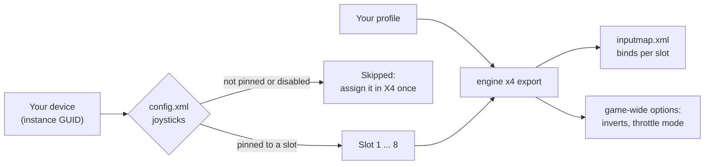

X4: Foundations keeps your binds in `inputmap.xml` and names a joystick by its slot (1 to 8), not by its name. Which
device sits in which slot is in `config.xml`. JoyPro reads the space flight binds into your profile and writes them
back in place, to the slots X4 has pinned to your devices. Inverts and the dead zone are game-wide in X4, so JoyPro
sets them from your relations for the whole game.

:::video game-x4 "X4: Foundations: import, relations, export"
:::

{{game-card}}

:::layer beginner
## What JoyPro does for X4

- **Import**: the space flight binds of your sticks, throttles and pedals come into your profile, with the game's
  inverts and throttle mode.
- **Relations**: one relation is one function in every game. "Boost" can be the same button in X4, Elite Dangerous
  and Star Citizen.
- **Export**: JoyPro edits `inputmap.xml` in place, on the slots of your devices. Menu, first-person, keyboard and mouse
  binds stay.

## Import your X4 binds

1. Open **Start**. If the X4 card asks for a command list, press **Build List**: JoyPro reads the game's controls
   from your installation (read only).
2. Press **Import** on the X4 card. Keep **Add to my profile**. Tick **Also take the keyboard keys** if you want your
   flight keys in JoyPro too.
3. Press **Import now**. **See my relations** opens what came in.

## Build and check relations

Join the same function of your games with the [[page:flows/relations.html|relations flow]], then press **Check** on
the Export page. Keep your joystick binds without modifiers: X4 takes no modifier on a joystick bind.

## Export to X4

1. **Close X4.** The game writes `inputmap.xml` and `config.xml` when a session ends, so JoyPro refuses to write while
   it runs.
2. Open **Export** and tick the X4 tile.
3. Keep **Replace on my devices** with **Also clear my other devices** if JoyPro is where you set up your sticks.
   Press **Export now** on the tile.

:::ingame What you see in X4
Start the game and open **Settings > Controls**. Your binds are in the controller / joystick column of each space
flight control, on your device's slot. **Invert Controller / Joystick Axes** shows the inverts JoyPro set, and the
bidirectional throttle, joystick dead zone and adaptive steering rows show your values. Auto-roll and rumble are in
the game settings.
:::

:::picture ingame-x4-controls "X4: Foundations: the controls menu with the exported binds"
:::

## What you do yourself in X4

- **Give every device a slot once.** In X4's controls settings, open **Manage Controllers/Joysticks** and assign each
  stick, throttle and pedal set to a slot, then leave the game normally. X4 then remembers the device in `config.xml`.
  A device without such an entry moves between slots from one session to the next, so JoyPro skips it ("assign the
  device to a slot in X4 once"). A device set to "none" there is skipped too.
- Plug your devices in before you export.

## Common pitfalls

- **"X4 is running"**: exit the game and export again.
- **A device was skipped**: it is not pinned to a slot in X4. Assign it under Manage Controllers/Joysticks.
- **A stick in slot 1 does gamepad things**: slot 1 is the gamepad slot of X4's default map, so a stick there inherits
  the stock gamepad binds. **Replace on my devices** removes them.
- **Buttons above 64 or a second hat do nothing**: X4 reads 64 buttons, 8 axes and one hat per device. JoyPro skips
  binds beyond that with a warning.
- **An invert was left alone**: one invert counts for every device on that control. When your relations disagree, or
  a gamepad is bound to the same control, JoyPro leaves the game's value and warns.
:::

:::layer advanced
## Files JoyPro reads and writes

| File | What it is |
|---|---|
| `%USERPROFILE%\Documents\Egosoft\X4\<id>\inputmap.xml` | the active binds (`<action>`, `<state>`, `<range>` per control and input) and the `<config>` params (inverts, dead zone, bidirectional throttle, adaptive steering). `<id>` is the Steam account's folder. |
| `...\X4\<id>\config.xml` | the device slots (`<joysticks>`) and game settings such as rumble, auto-roll and gamepad mode; read for the slots, edited in place for the settings |
| `...\X4\<id>\inputmap.xml.joypro-meta.json` | JoyPro's names, groups and tuning of the written binds, read back by the next import |
| `inputmap.xml.jpbak`, `config.xml.jpbak` | copies from before the first write, plus JoyPro's versioned backup store |

The file is written as text: the declaration, line endings, indentation, the section comments, `<config>`, the root
attributes and every untouched line stay byte for byte. A new line goes into its section after the last entry of the
same kind with a lower control number. JoyPro never touches the saved profiles `inputmap_1.xml` to `inputmap_5.xml`
or your saves. Steam Cloud syncs the folder; which files it syncs is not confirmed yet.

## The export modes in X4

A conflict is another flight control on the same slot and input. The map and detail-monitor twins of a control count
as the same control.

| Mode | What happens in `inputmap.xml` |
|---|---|
| **Only add** | Nothing is removed. A bind whose input another flight control has is not written and gets a mark "Not written to the game". |
| **Update, keep the game's binds** | Your lines go in beside the control's other inputs; only conflicts are removed. |
| **Update, my profile wins** | As above, and a control you bind loses its other lines on pinned slots of connected devices (with the keyboard option also its keyboard lines). |
| **Replace on my devices** | The flight binds of the written slots that are not in your profile are removed, also the stock gamepad flight binds on slot 1. |
| **+ Also clear my other devices** | The same for slots that `config.xml` pins to connected devices the export does not use. A slot without a pinned device is left alone: its device is unknown. |

X4's menu binds some controls together: "Toggle Travel Mode" sets the same input inside the map too, "Dock" also
undocks. JoyPro writes and removes such groups as the menu does, and never removes the first-person "Interact" twin.

## What is never touched

- Menu, map, first-person, options and accessibility controls; radial menu entries.
- Keyboard and mouse lines; the keyboard is written only with the keyboard option, only for flight controls, never
  with the keys X4's menu refuses (Escape, Delete, Ctrl+X/C/V ...).
- Slots of devices that are not connected or not pinned, gamepads, the import's ignored devices and the vJoy device
  JoyPro tunnels into.
- Every `<config>` line JoyPro does not set.

## Curves and game settings

- **Granularity**: one set of binds for every ship (the space flight controls).
- **Inverts** are one value per control for every device (`invert_steering_yaw`, `_pitch`, `_roll`,
  `invert_throttle`, `invert_strafe_*`). Your relation keeps DCS's direction; X4's own HOTAS maps count pitch, roll
  and throttle as inverted, so JoyPro sets the param to your invert turned over for those. It sets a param only when
  every JoyPro axis on that control agrees.
- **Bidirectional throttle** follows the throttle relation's **Slider**: Slider = forward only, no Slider = centre is
  zero thrust.
- **Dead zone**: X4 has one dead zone for every axis of every joystick. Relation dead zones are not written (the
  export says so); set the game's dead zone in **Settings > Force feedback settings of the games** (pick X4) or with
  [[cli:ffb set]]. The same place holds adaptive steering, rumble, auto-roll and gamepad mode. A setting you store there
  wins over the relations, with a warning when it reverses them.
- No per-axis curves or saturation in X4; no force feedback; no telemetry.
- **Watcher**: a bind or option you change in the game is noticed after it closes (`inputmap.xml` and `config.xml`),
  and JoyPro asks whether to take it over.
- **HUD**: the HUD finds the game by its process and shows your X4 binds.

## X Rebirth and X3

X Rebirth uses the same `inputmap.xml` words as X4, but its command list would need its own extraction from an
installation. X3 (Reunion, Terran Conflict, Albion Prelude) has another engine and an unknown file format. Both are
documented only: JoyPro does not import or export them.
:::

:::layer technical
## Inside the X4 integration

Code: `engine\Games\X4Integration.cs`, `engine\Games\X4CatalogSource.cs` and the settings model
`engine\FfbModels\X4.cs`.

- **Slots**: a bind names a source: `INPUT_SOURCE_JOYBUTTONS` (buttons and hat) or `INPUT_SOURCE_JOYAXES`, with no
  suffix for slot 1 and `_2` to `_8` for the others. `config.xml` maps devices to slots by DirectInput **instance
  GUID**, written in X4's own form (`{42cec570-0a3f-11f0-80-0b-44-45-53-54-00-00}`); `num` 0 to 7 is the slot,
  `disabled="1"` means none. JoyPro writes only to slots whose current, enabled entry matches a connected device.
- **Codes**: buttons 1 to 11 use X4's gamepad names (`INPUT_XBUTTON_A` ... `BIGBUTTON`), 12 to 64
  `INPUT_XBUTTON_12` ...; the hat `INPUT_XBUTTON_DPAD_*` (eight directions); axes `INPUT_JOYAXIS_X` ... `RZ`,
  `SLIDER1`, `SLIDER2`. Ranges get no `sgn`. Keyboard: `INPUT_KEYCODE_<DIK>` with `_SHIFT` / `_CONTROL`.
- **Command list**: [[cli:x4 refresh-db]] reads `gameoptions.lua` and the English text page from the `.cat/.dat`
  archives and the name tables of `X4.exe`, read only; 128 space flight controls (6 axes, 122 buttons). Rows read as
  "Yaw (Primary Steering Axis)", "Roll (Secondary Steering Axis)". [[cli:x4 catalog]] lists it, [[cli:x4 paths]]
  shows the files found.
- **Import / export**: [[cli:x4 import]], [[cli:x4 scan]]; [[cli:x4 export]] `--mode clean|add|merge|merge-overwrite
  --nuke-untouched-devices --include-keyboard --ignore-device <d> --dry-run`.
- **Game settings**: `engine ffb set --device * --game X4 --param <key>=<value>`; params are edited in place, a missing
  one is added as the last line of `<config>`. An export without X4 binds still writes the stored settings.

### Known limits

- Devices without a pinned slot are skipped; JoyPro does not pin them itself yet.
- Joystick modifiers are not written: their markup in the file is not confirmed yet.
- 64 buttons, 8 axes and one hat per device; eight slots, shared with gamepads.
- Rumble: the game's slider shows the value times 100 cut off (21 % shows as 20); the file keeps the exact value.
- Tests: `engine\tests\smoke\x4.ps1` (also the catalog refresh); in the game `tools\e2e\games\X4.ps1` (binds and mode
  matrix, in its own profile folder) and `tools\e2e\games\X4Settings.ps1` (inverts, throttle mode, game settings).
:::
