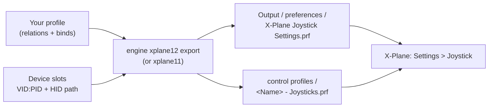

X-Plane keeps the assignments of all your devices in one preferences file inside its installation: an axis "use"
(pitch, throttle, flaps ...) per hardware axis, a command per button, and optional response curves. JoyPro reads that
file into your profile, joins it with your other games in relations and writes it back, changing only the flight
lines it manages. X-Plane 12 and X-Plane 11 are two games in JoyPro, each with its own installation, command list and
settings; both can be installed side by side.

:::video game-xplane "X-Plane: import, relations, export"
:::

{{game-card}}

:::layer beginner
## What JoyPro does for X-Plane

- **Import**: the axis uses, button commands, reverse flags and response curves of your devices come into your
  profile.
- **Relations**: one relation is one function in all your games ("Gear" in X-Plane, MSFS and DCS on the same button).
  X-Plane's flight commands come from its own `Commands.txt`.
- **Export**: JoyPro writes the joystick preferences of the version you export. X-Plane shows your assignments in
  **Settings > Joystick**.

## Import your X-Plane assignments

1. Open **Start**. The X-Plane 12 (or X-Plane 11) card shows the game's picture. If it asks for a command list, press
   **Build List**: JoyPro reads the installed X-Plane's `Resources\plugins\Commands.txt`.
2. Press **Import** on the card and choose **Add to my profile** (X-Plane has no keyboard binds in this file).
3. Press **Import now**. **See my relations** opens what came in.

## Build and check relations

On the **Relations** page the X-Plane command or axis of a relation sits next to the same function in your other
games. Use the [[page:flows/relations.html|relations flow]] to join them, then press **Check now** on the Export page
([[page:flows/check.html|the Check]]).

## Export to X-Plane

1. **Close X-Plane.** It rewrites its preferences when the settings window closes and when it quits. Both versions run
   as `X-Plane.exe`, so JoyPro refuses while either runs.
2. Open **Export**. Each installed version has its own tile.
3. Keep **Replace on my devices** with **Also clear my other devices** if JoyPro is where you set up your devices.
   Press **Export now** on the tile.

:::ingame What you see in X-Plane
Start X-Plane and open **Settings > Joystick**, then pick your device. Every axis shows the use JoyPro wrote, buttons
show their commands, and **Edit Response Curve** on an axis shows the stops and the interpolation JoyPro wrote.
:::

:::picture ingame-xplane-controls "X-Plane: the controls menu with the exported binds"
:::

## What you do yourself in X-Plane

- **Start X-Plane once with your devices connected, then quit it.** A version that was never started has no
  preferences file yet. The very first start flies the tutorial, and X-Plane writes its joystick preferences when it
  quits.
- **Calibrate in X-Plane.** Calibration and the null zone stay X-Plane's (Settings > Joystick); JoyPro never writes
  them.
- Plugin and aircraft commands are not in JoyPro's list: bind those in X-Plane, JoyPro leaves them alone.

## Common pitfalls

- **An axis does nothing ("Multiple axes assigned to yaw")**: X-Plane ignores a use that two connected axes share. The
  export warns; **Also clear my other devices** or Replace clears the other axis.
- **The throttle runs backwards**: X-Plane reverses throttle axes by itself. JoyPro writes your invert unchanged, so
  leave invert off unless your lever really runs the other way.
- **A curve you made in X-Plane changed**: in Update modes and Only add it stays when JoyPro's tuning is linear (with a
  warning); "my profile wins" and Replace write JoyPro's curve.
:::

:::layer advanced
## Files JoyPro reads and writes

| File | What it is |
|---|---|
| `<install>\Output\preferences\X-Plane Joystick Settings.prf` | the current assignments of all devices (line based) |
| `<install>\Output\preferences\control profiles\<Name> - Joysticks.prf` | saved control profiles, same format |
| `<file>.joypro.json`, `<file>.joypro-meta.json` | the inputs and curves JoyPro wrote; names, groups and tuning for the next import |
| `%LOCALAPPDATA%\x-plane_install_12.txt` / `_11.txt` | where X-Plane's installer lists its installs (read only) |

`X-Plane Keys.prf` (keyboard) is never touched. A version installed by Steam and never started is found in its Steam
folder. Another folder is set in **Settings > Games**.

## The export modes in X-Plane

| Mode | What happens in X-Plane |
|---|---|
| **Only add** | Free inputs only. A bind on an input with another use or command is not written and is listed; an axis use X-Plane has on another axis stays there (warning). |
| **Update, keep the game's binds** | Replaces the other use or command on your input and keeps everything else; an axis use moves (X-Plane ignores a use two axes share). |
| **Update, my profile wins** | Also releases the other axes and buttons of connected devices that hold a use or command you bind, with their curves. |
| **Replace on my devices** | Also releases every other flight axis and command on the devices you write. |
| **+ Also clear my other devices** | The connected devices you do not write lose their flight uses and commands. |

## What is never touched

- Slots of devices that are not connected, the import's ignored devices and the vJoy device JoyPro tunnels into.
- View, camera, VR and custom-command axes, plugin and aircraft commands, the keyboard.
- Calibration keys (`_joy_center`, `_joy_null`, raw calibration data), `_eq_pfc_*` and every other line.

## Curves and settings

- **Granularity**: one file for all aircraft (X-Plane can link aircraft to control profiles; JoyPro writes the files
  it finds).
- **Response curves** (axis model `xplane`): any number of stops with LINEAR, CATMULL_ROM or CUBIC_AVG, and the fixed
  ranges of throttle, prop and mixture axes (beta, feather, cutoff, FADEC ...). A curve set for all games becomes
  stops; an unchanged curve keeps its bytes. Tuning can be set for one version or for both (`family:xplane`).
- **Reverse**: `_joy_rev_axis`, your invert unchanged (X-Plane reverses throttles by itself).
- **Game settings** (Settings > **Force feedback settings of the games**): control response of pitch, roll and yaw;
  X-Plane 12 also the copilot axes and "control-loaded axes" for force feedback sticks; X-Plane 11 the stability
  augmentation; both the flap detents. Only lines the file already has are changed.
- **Force feedback**: X-Plane has none of its own; only the control-loaded switch.
- **Telemetry recording**: from X-Plane's UDP data output (port 49000), with position, so a Tacview track is possible.
- **Watcher**: changes in the preferences are noticed after X-Plane closes ([[doc:sync-watcher|the watcher]]).
:::

:::layer technical
## Inside the X-Plane integration

Code: `engine\Games\XPlaneIntegration.cs` (one instance per version), `engine\Games\XPlanePrf.cs`,
`engine\AxisModels\XPlane.cs`, `engine\FfbModels\XPlane.cs`, `engine\Games\LegacyGameIds.cs` (profiles from before
the split into two versions are migrated when loaded).

- **Lines**: `_joy_AXIS_use<i>` (use code), `_joy_rev_axis<i>`, `_joy_BUTN_use<i>` (command path, `sim/none/none` =
  free), `axis_response_curve<i>`. Global indices: axis = slot × 25 + axis, button = slot × 160 + button.
- **Devices**: slots `_joy_unique_id<slot> VID:<dec>PID:<dec>`; with identical devices the DirectInput HID interface
  path must equal `_joy_location<slot>`. Buttons are the device's buttons, then the first hat as 8 buttons clockwise
  from up; other hats are not mapped. Reads 160 buttons and 25 axes per device.
- **Use codes**: 0 to 66 in both versions; X-Plane 12 adds throttle 9, copilot pitch/roll/yaw/brakes/tiller and both
  wheel brakes. Codes 74 to 77 and the view axes are not cataloged.
- **Command list**: [[cli:xplane12 refresh-db]] / [[cli:xplane11 refresh-db]]: the version's axis table plus the flight
  command groups of `Commands.txt` (`sim/flight_controls`, `engines`, `autopilot`, `lights` ...; not `sim/view`,
  `operation`, `replay` ...).
- **Import / export**: [[cli:xplane12 import]], [[cli:xplane12 scan]], [[cli:xplane12 export]] (`--mode`,
  `--nuke-untouched-devices`, `--dry-run`), the same for [[cli:xplane11 export]]. Backup to `.jpbak` first.
- **Settings and curves**: [[cli:ffb set]] `--game XPlane12`, [[cli:binds tuning set]] `--scope game:XPlane12
  --curve-points 0:0,0.4:0.3,1:1`, [[cli:binds tuning preview]] (measured in X-Plane 12.4.3 within 0.0001).

### Known limits

- The meaning of use codes 74 to 77; the HID versus DirectInput axis order is inferred.
- X-Plane's Control Sensitivity without a curve is not in the preview.
- X-Plane 11 is checked against its installed files only; the in-game menu check is pending.
- Tests: `engine\tests\smoke\xplane.ps1`; in the game (X-Plane 12) binds and response curves passed 33 of 33 steps;
  `tools\e2e\games\XPlaneCurves.ps1` sweeps every axis against JoyPro's preview.
:::
