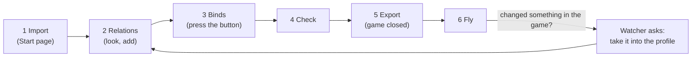

This is the short path through JoyPro. Each step links to its full page.

:::video first-steps "From install to the first flight"
:::

:::layer beginner
## The six steps

1. **Import.** Start page > your game's card > **Import** > **Import now**. JoyPro reads your binds and makes a
   profile. ([[page:flows/import.html|Import a game]])
2. **Relations.** Open **Relations**. Each relation is one function ("Gear Up/Down") with its action in every game.
   To cover a second game, open a relation and press **Add** on a suggestion, or let **Auto-build relations from all
   my actions...** do the whole profile. ([[page:flows/relations.html|Build relations]])
3. **Binds.** Open **Binds**, pick a relation and press **Record input**, then the button on your stick. Axes work the same
   way (move the axis); the curve and dead zone are below. ([[gui:binds|Binds page]])
4. **Check.** Press **Check** in the bottom bar and fix red cards. ([[page:flows/check.html|The Check]])
5. **Export.** Close the game, open **Export**, keep **Replace on my devices** + **Also clear my other devices**, tick
   the games, **Export ticked games**. ([[page:flows/export.html|Export]])
6. **Fly.** Start the game: your binds are in its controls menu. If you rebind something in the game, JoyPro asks
   after you close the game whether to take it over.

Something wrong? **Undo last export** on the game's tile puts the game's files back exactly as they were.
:::

:::layer advanced
## Faster ways

- **Set up my devices automatically...** (Start page) runs the setup wizard: your devices, their roles (left stick,
  throttle, pedals ...), your priorities (which aircraft first), then relations and binds for all your watched games.
- **Auto Assign** puts unbound relations on the best controls of a device; **Lay out with AI** takes wishes in plain
  words ("trim on the hat") and shows every change before it applies.
- **Follow input** (Relations and Binds pages): press a button and its relation opens.
:::
