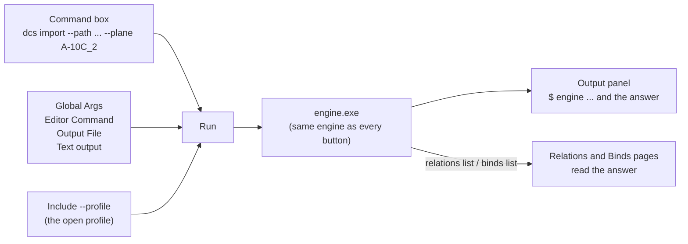

The Advanced page is the console for experts. Every feature a normal user needs has its own button on the other
pages; here you type the commands of JoyPro's engine yourself, exactly as the [[page:cli/index.html|engine command
line]] describes them, and the answer shows in the [[page:gui/output.html|Output]] panel.

:::video advanced-page "The Advanced Console"
:::

:::layer beginner
## Do I need this page?

Usually not. It is there for three cases:

- Someone (a helper on Discord, the wiki) asks you to run a command, for example `profile summary`, to see what is
  going on.
- You want to change many relations or binds at once in a text editor: **Relations Edit** and **Binds Edit**.
- You want a quick overview of your open profile: **Profile Summary**.

### Run a command

1. Type the command into **Command** without the word `engine`, for example `profile summary` or
   `relations list --game DCS`.
2. Leave **Include --profile** ticked: the command then works on the profile you have open.
3. Press **Run**. The answer appears in the **Output** panel at the bottom (press **Output** in the bottom bar if it is
   closed).

:::warn
Commands typed here can change your profile and your games exactly like the buttons do. Every profile change is a
version in the History (top bar), so you can go back; game files are backed up before an export.
:::
:::

:::layer advanced
## The boxes

| Box | What it adds | Engine option |
|---|---|---|
| **Editor Command** | The program that opens for **Relations Edit** / **Binds Edit** (and for hand-typed `relations edit` / `binds edit`). `{file}` stands for the temporary file, e.g. `code --wait {file}`. Empty: Notepad. | `--editor` (global) |
| **Output File** | Writes the answer of a hand-typed command into this file instead of the Output panel. Only for commands typed here; the buttons of the other pages never use it. | `--out` (global) |
| **Text output** | On (default): readable text. Off: JSON, as scripts read it. Only for commands typed here. | `--text` (global) |
| **Global Args** | Any other global options placed before the command, e.g. `--status true`. | the [[page:cli/index.html|global options]] |
| **Command** | The command and its options. Quotes keep a path with spaces together. | the [[page:cli/index.html|commands]] |
| **Include --profile** | Adds `--profile "<open profile>"`. Untick it for commands that do not need a profile (`db summary`, `games installs`). | `--profile` |

- `relations list` and `binds list` typed here also refresh the lists of the Relations and Binds pages with the answer.
- The command line of the last run is the first line of the Output panel (`$ engine --profile ... profile summary`):
  copy it to run the same in a terminal.
- **Relations Edit** writes all relations into a temporary JSON file, opens it in your editor and reads it back when the
  editor closes; the Relations, Binds and Modifiers pages reload. One undo step.
:::

:::layer technical
## Behind the page

View model: `MainWindowViewModel.cs` (`RunCustomCommandAsync`, `RelationsEditAsync`, `BindsEditAsync`,
`RunEngineSummaryAsync`, `RunProfileSummaryAsync`); the arguments are built in `RunEngineAsync`, the same method every
button of the GUI uses. A typed command is split by `TokenizeCli` (quotes respected), the global args go first, then
`--profile`, `--status`, `--benchmark`, `--history-note` (only for the GUI's own changes), `--out`, `--editor`, the
load-correction options of Settings and `--text`. A command that changes the profile runs with the profile lock and
creates a history version like any other change.

Engine: [[cli:summary]], [[cli:profile summary]], [[cli:relations edit]], [[cli:binds edit]], and every command of
the [[page:cli/index.html|engine command line]]. Reference: [[doc:gui-cli-parity|GUI and CLI parity]] (which button
runs which command).
:::

<!-- entry: bind:UseTextOutput -->
On (default): a command typed here answers in readable text. Off: it answers in JSON, as the GUI and scripts read it.
Only for commands typed on this page. Engine: global option `--text`.

<!-- entry: bind:CustomCommandIncludeProfile -->
On (default): the typed command gets `--profile "<open profile>"`, so it reads and changes the profile you have open.
Untick it for commands that need no profile (for example `db summary` or `games installs`).

<!-- entry: RunCustomCommandCommand -->
Runs the command typed in **Command** (with the global args, editor, output file and text options above) through the
engine and shows the answer in the Output panel. `relations list` and `binds list` also refresh the Relations and Binds
pages. A command that changes the profile is one undo step; one that writes into a game backs the game's files up
first, like the buttons.

<!-- entry: RelationsEditCommand -->
Opens all relations of the profile as one JSON file in your editor (**Editor Command**, or Notepad); when you close
the editor, JoyPro reads the file back and the Relations, Binds and Modifiers pages reload. One undo step. Engine:
[[cli:relations edit]]. In the game: nothing until the next export.

<!-- entry: BindsEditCommand -->
Opens all binds of the profile (relation, device, input, modifiers, axis settings) as one JSON file in your editor;
closing the editor reads it back and the pages reload. One undo step. Engine: [[cli:binds edit]]. In the game: nothing
until the next export.

<!-- entry: RunEngineSummaryCommand -->
A one-line count in the Output panel: `relations=..., binds=..., modifiers=...` of the profile the engine has loaded
(it runs without `--profile`, so it shows the profile the engine used last). Changes nothing. Engine: [[cli:summary]].

<!-- entry: RunProfileSummaryCommand -->
Shows the open profile's counts and status in the Output panel (it runs with `--profile`, so it is always the
profile you have open). Changes nothing. Engine: [[cli:profile summary]].
