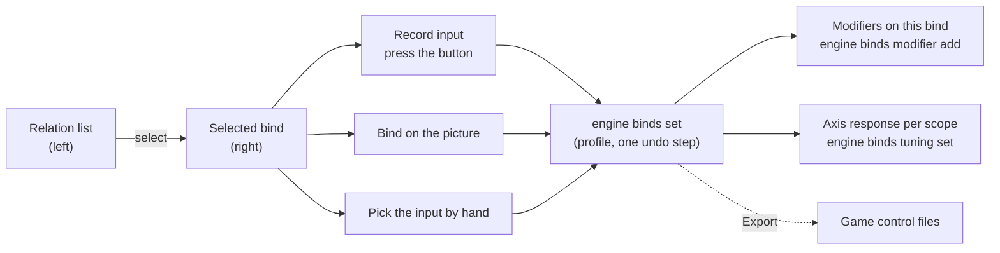
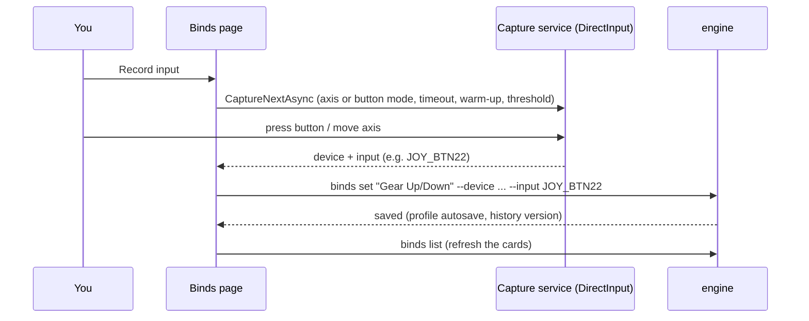

The Binds page puts each relation on a physical input: a button, a hat direction or an axis of one of your devices.
A relation says **what** happens ("Gear Up/Down" in every game and aircraft); its bind says **where** you press it
("Throttle - HOTAS Warthog, button 22"). Relations are made on the [[gui:relations|Relations]] page; the binds reach
the games when you export ([[page:flows/export.html|Export to your games]]).

:::video binds-page "The Binds page: record a button, add a modifier, shape an axis"
:::

:::layer beginner
## What you do here

1. **Pick a relation on the left.** Each card shows the relation's name, its button ("Throttle - HOTAS Warthog ·
   BTN 22") and a **not bound** chip when it has none yet.
2. **Press Record input** on the right, then press the button (or move the axis) on your stick. JoyPro waits up to
   6 seconds, takes the first input that changes and binds it at once. The card on the left now shows the new input.
3. Optional: a **modifier** (a shift button held at the same time, so one button does two jobs) and, for an axis, its
   **curve** (dead zone, how soft or sharp the stick feels).
4. When everything is bound, go to **Export** and write it into your games.

The page knows whether a relation is an axis or a button: an axis relation only takes an axis you move a long way,
a button relation only a button, hat or switch. The line under the title says what it is waiting for
("Looking for: axis").

:::tip Follow input
**Follow input** (on by default) does the opposite: press any button on your devices and the list jumps to the
relation bound to it. Press the same button again for the next relation on it. Handy to answer "what is this button
doing?". It pauses while Record runs, while you type and while the device picture is open.
:::

### Three ways to bind

| Way | When |
|---|---|
| **Record input** | the usual way: press the real button |
| **Bind on the picture** (**Visual assign**) | you see your device drawn with a marker on every button; click a marker, pick the relation, **Bind here** |
| **Pick the input by hand** | the device is not connected, or you want to type the input (`JOY_BTN22`, `JOY_X`) |

### Nothing to bind yet?

With no relations the page says **Nothing to bind yet** with **Go to relations**. Import a game on the
[[gui:start|Start]] page or make relations first.

:::ingame What a bind means in the game
After the export, the game's own controls menu shows the bound button on that action, in every aircraft the relation
covers. With a modifier, DCS shows it as a modifier combination (for example "JOY_BTN5 + JOY_BTN22"), IL-2 and Star
Citizen as their own modifier form. The axis curve becomes the game's own axis settings (DCS: Axis Tune; IL-2:
the response curve; Star Citizen: the axis's options), so you see the same curve in the game.
:::
:::

:::layer advanced
## Every part of the page

**Header tools**

- **Visual assign**: opens the device picture in place of the editor (see below).
- **Unbind selected input**: takes the selected bind's input off every relation that uses it.
- **Modifiers**: the modifier library ([[gui:modifiers|Modifiers]] page): rename, delete, see where they are used.
- **Put relations on my buttons automatically...** (Auto Assign): JoyPro places your relations on fitting controls
  (TMS on the TMS hat, gear on the gear lever, trim on the trim hat). Preview first, **Apply** changes, Ctrl+Z
  undoes it. Options: **Keep my layout**, **Re-assign bound relations**, **Only the selected relations**, how many
  modifiers at most, a mode switch for combat phases, devices that are not connected (**Search Catalog**, **Add**).
  Reference: [[doc:auto-assign]].
- **Lay out with AI...**: say in words how you like your controls ("throttle and left-hand stick, trim on the hat,
  curves softer for helis"); JoyPro shows every change it would make, ticked, before **Apply**. Works without the
  optional AI model for English phrases like the examples. Reference: [[doc:layout-with-ai]].
- **Set up my devices automatically...**: the [[gui:setup-wizard|Setup wizard]].
- **More**: refresh, show the selected bind in the Output panel, replace a device, import and export binds as JSON,
  save, merge another profile.

**The selected bind** (right side): the device picture (small), relation, device, input, axis or button, the
modifiers. **What it does** lists the relation's actions per game (read-only; **Open in Relations** changes them,
**Move...** sends one action to another button and leaves the rest here).

**Bind with your device**: **Record input**, **Cancel Record**, **Clear Input** (the relation keeps its modifiers and
curve, only the input goes), **Clear Modifiers**. **Pick the input by hand**: device and input lists, **Set Bind**,
**Refresh Options**, **Clear Bind**. **Recording settings**: timeout (ms), warm-up (ms), axis threshold (% of travel)
and "Also take a button that rests pressed when it is released" (for the middle position of a 3-way switch).

**Modifiers on this bind**: tick modifiers and **Attach Selected To Bind** / **Detach Selected From Bind**, or create
one (**Create a modifier**: name, device and input or **Record Modifier Input**, **Invert** for a switch that is
"on" when released). Its **x** closes it down to the title line (remembered); **Show** opens it again.

**Axis response: curve, dead zone, saturation** (axis relations only; it opens by itself when you pick an axis, and
stays closed for the next axis once you close it), see below. **Detent mode** (throttles with an
afterburner detent), see below. **Bind behavior (advanced)**: inverted, slider, double tap. **Unbind an input
everywhere (advanced)**: free one physical input in the whole profile.

## Axis curves per game and aircraft

An axis relation has one **base** curve that every game gets. On top of it you can give a **scope** its own curve:

| Scope | Example | Used for |
|---|---|---|
| Aircraft | DCS · F-16C | one aircraft of one game |
| Game | IL-2 Korea | every aircraft of a game |
| Game family | IL-2 family (Great Battles + Korea) | games that store curves the same way |
| All games (base) | | every game without its own curve |

A game uses the most specific one: aircraft, then game, then family, then the base. The panel shows the scope's
curve in blue and the base as a dashed orange line while the scope inherits. Each game has its own kind of curve
(DCS: dead zone, saturation X/Y, curvature or an 11-point user curve; IL-2: its own sensitivity and dead zones;
X-Plane: free curve points), so the sliders on the right change with the scope. When a game falls back to the base,
JoyPro fits that game's parameters to the base curve as closely as the game can express it.

Drag the white points to shape the curve, or use the sliders. Every setting also has a number box with its range
next to it ("0 .. 1"): type the exact value, or press Up / Down (Shift: ten steps) or turn the mouse wheel over the
box you are in; a number outside the range goes back to its nearest end when you press Enter or leave the box. The
**user curve** has 11 number boxes, one per 10 % of stick travel (0 % ... 100 %), in step with the white points on
the curve. Edits preview at once (also with the live position of your stick as a dot); **Save for this scope** stores
them. **Inherit (clear)** removes the scope's own settings. **Reload** reads them again.

**Copy to another axis...** puts the same settings on another bound axis in one step, e.g. Thrust Left to Thrust
Right: pick the axis, tick **Copy invert too** only if both should invert alike, then **Copy**. It goes to the same
scope of the other axis; one Ctrl+Z takes it back.

## Detent mode: one throttle for all aircraft

A throttle with an afterburner detent used to need one throttle relation per afterburner position. In detent mode
**one** throttle relation serves every aircraft: JoyPro bends the curve per aircraft so your device's detent is
exactly where that aircraft's afterburner starts (F-16C at 77 %, F-14 at 70 %, ...). Resting in the detent stays just
below the afterburner; pushing over it lights it.

1. **Calibrate detent...**: move the throttle to idle, then to the detent, then fully forward, then (optional) behind
   the idle detent (cut-off). **Confirm** each position; JoyPro reads the axis live. **Save calibration**.
2. Tick **Detent mode on**. Aircraft without afterburner get full power at the detent (or the relation's curve when
   you untick the second box).
3. Already have one throttle relation per aircraft? **Merge my throttle relations...** shows a plan per device axis;
   **Merge** joins them into one relation in detent mode; **Undo merge** takes it back.

The aircraft groups below show where each group's afterburner starts and where that number comes from; type your
own value and **Set**, or **Game data** to go back.

:::ingame Detent mode in the game
In every exported aircraft the throttle reaches the afterburner exactly at your device's detent. DCS gets a per
aircraft curve (dead zone and saturation, or the user curve), X-Plane curve points; games with one curve for every
aircraft get what most of the relation's aircraft need, and the export lists the rest.
:::

## Tips

- Ctrl+Z undoes every bind change, also after a restart ([[gui:header|History]]).
- A bind on a device that is not connected stays; the card shows it greyed and the export still writes it.
- **Replace the selected bind's device...** (More) moves every bind of that device to another one, input by input,
  with a preview: for a new stick of the same kind or one that got a new id.
- The same button on two relations is allowed; the [[gui:check|Check]] tells you where that means two jobs in one
  aircraft.
:::

:::layer technical
## Behind the page

View model: `MainWindowViewModel.cs` (bind list, record, set/clear, modifiers), `MainWindowViewModel.AxisTuning.cs`
(scopes, live preview with the linked `engine/AxisTuning.cs`), `MainWindowViewModel.Detent.cs`,
`MainWindowViewModel.AutoAssign.cs`, `MainWindowViewModel.LayoutWithAi.cs`, `MainWindowViewModel.LayoutWorkspace.cs`
and `MainWindowViewModel.VisualAssign.cs` (bind on the picture), `MainWindowViewModel.LiveInput.cs` (follow input),
`MainWindowViewModel.BindPeek.cs` (What it does), `MainWindowViewModel.MoveAction.cs`.

- **Capture**: `Services/JoystickCaptureService.cs` polls DirectInput; `Services/RecordButtonTracker.cs` takes only
  transitions, never a button that was already pressed when recording started (unless "Also take a button that rests
  pressed" is ticked). Analog keyboards' axes are ignored unless allowed in Settings > Devices. Details:
  [[doc:ui/live-input|Live input]].
- **Binds**: [[cli:binds list]], [[cli:binds show]], [[cli:binds set]] (device, input, `--inverted`, `--slider`,
  `--curvature`, `--deadzone`, `--saturation-x/-y`, `--double-tap`), [[cli:binds clear]] (`--input-only` for
  Clear Input), [[cli:binds unbind]], [[cli:binds import]] / [[cli:binds export]] (JSON).
- **Modifiers**: [[cli:binds modifier add]], [[cli:binds modifier remove]], [[cli:binds modifier list]].
- **Axis tuning**: [[cli:binds tuning show]], [[cli:binds tuning set]] (`--scope plane:DCS:F-16C_50` |
  `game:IL2Korea` | `family:il2` | `base`, `--param key=value`, `--curve-points`), [[cli:binds tuning clear]]. Stored
  per bind as `TuningOverrides` (scope -> `inv=0;sl=0;dz=0.05;sx=1;sy=1;cv=0.2`). Reference: [[doc:axis-curves]].
- **Detent mode**: [[cli:binds detent show]], [[cli:binds detent set]] (`--on/--off`, `--no-ab full|linear`),
  [[cli:binds detent calibrate]] (`--idle --detent [--full] [--cutoff]`, stored per device axis),
  [[cli:binds detent merge]] (plan; `--apply` merges as one history version). Gate data: `DB\Detents\throttle-gates.json`.
- **Auto Assign**: [[cli:devices kb]] (identify, list, show), [[cli:relations auto-assign]] (`--dry-run` for
  Preview, `--explain`, `--overwrite [--include-missing]`, `--relation`, `--max-modifiers`, `--add-device`,
  `--ignore-device`).
- **Lay out with AI**: [[cli:arrange ask]], [[cli:arrange apply --proposal]], [[cli:arrange prefs]].
- Every changing command runs with the profile, saves it and adds one version to the profile history (Undo).
:::

<!-- entry: GoRelationsCommand -->
Shown when the profile has no relations yet: opens the [[gui:relations|Relations]] page, where you make relations
(or let JoyPro build them) before you can bind anything.

<!-- entry: RefreshBindsCommand -->
Reads the profile's binds again (`engine binds list`, and the relations first when none are loaded) and rebuilds the
cards. Use it after you changed the profile outside this window (engine command, another JoyPro).

<!-- entry: ShowSelectedBindCommand -->
Prints everything about the selected bind into the Output panel: device, input, modifiers, axis settings and the
relation's actions (`engine binds show`; for a relation without a bind `engine relations show`). Changes nothing.

<!-- entry: click:ImportBindsJsonClicked -->
Picks a binds JSON file (made by **Export Binds JSON...** or `engine binds export`) and asks first: the file's binds
replace all binds of the profile, and relations without a bind in the file lose theirs (`engine binds import
--replace`). One undo step. In the game: the imported buttons are written at the next export.

<!-- entry: click:ExportBindsJsonClicked -->
Saves every bind of the profile (relation, device, input, modifiers, axis settings) as a JSON file
(`engine binds export`), for a backup, to share a layout or to edit with other tools. The profile does not change.

<!-- entry: SaveProfileCommand -->
Saves the profile now (Ctrl+S). JoyPro saves by itself after every change; this writes pending edits at once and
writes the file again (`engine profile save`).

<!-- entry: MergeProfileCommand -->
Adds the profile picked under **Add another profile...** in the profile bar to the open one: its relations, binds and
modifiers (`engine profile merge`). Asks first; with the same relation in both, the merge mode decides whose wins. A
copy of your profile is kept next to it before the merge.

<!-- entry: UndoLayoutCommand -->
Shown after **Apply** in Lay out with AI: takes the whole applied layout back in one step (the binds, curves and
settings are as before; the same as one Ctrl+Z).

<!-- entry: bind:IsSelected -->
The tick of one item in a list: in **Lay out with AI** one proposed change (only ticked changes are applied); in the
modifier list of **Modifiers on this bind** one modifier to attach, detach or delete.

<!-- entry: SearchAutoAssignCatalogCommand -->
Searches JoyPro's device catalog (about 320 sim devices) for the text typed next to it, for example "Orion"
(`engine devices kb list <text>`). Pick a result to add it as a device that is not connected.

<!-- entry: AddAutoAssignCatalogDeviceCommand -->
Adds the picked catalog device to Auto Assign as a device that is not connected yet: its binds go on a placeholder
device that you exchange for the real one once it is plugged in (`--add-device`).

<!-- entry: CloseAutoAssignLayoutCommand -->
Closes the device layout shown by **Layout** / **Show Layout** (what JoyPro knows about each input of that device).

<!-- entry: RemoveAutoAssignAddedDeviceCommand -->
Takes an added (not connected) catalog device out of Auto Assign again; nothing is placed on it.

<!-- entry: bind:AutoAssignIncludeMissing -->
With **Re-assign bound relations**: also moves the binds of devices that are not connected now onto the connected
devices. Off (default), binds on unplugged devices stay where they are (`--include-missing`).

<!-- entry: PreviewAutoAssignCommand -->
Shows every assignment Auto Assign would make, in plain words ("Hat 1 down (TMS hat down)"), and what stays free and
why. Nothing changes (`engine relations auto-assign --dry-run`).

<!-- entry: ApplyAutoAssignCommand -->
Makes the assignments (`engine relations auto-assign`) as one undo step and reloads the relations and binds. In the
game: the placed relations are on those buttons after the next export.

<!-- entry: FreeSelectedLayoutMarkerCommand -->
Bind on the picture: frees the selected input under the picked modifier combination, so no relation is bound there
any more (`engine binds clear`). The marker turns grey ("free"). In the game: that button does nothing there after the
next export (with Replace on my devices).

<!-- entry: RecordNextInputCommand -->
Waits for the next input on any device (6 s by default) and binds it to the selected relation at once
(`engine binds set`). An axis relation takes only an axis moved past the threshold (30 %), a button relation only a
button or hat that changes state. If you selected another relation while it waited, the input is kept in the fields
and **Set Bind** applies it. In the game: after the export that button does the relation's actions.

<!-- entry: CancelRecordInputCommand -->
Stops a running Record; nothing is bound.

<!-- entry: ClearModifiersFromSelectedBindCommand -->
Removes every modifier from the selected bind (`engine binds modifier remove --all`); the input stays. In the game:
the button then works without holding a shift button.

<!-- entry: SetSelectedBindCommand -->
Binds the selected relation to the device and input chosen by hand (and the behaviour flags of **Bind behavior**)
with `engine binds set`. One undo step.

<!-- entry: RefreshQuickBindOptionsCommand -->
Reads the connected devices and their inputs again (`engine devices list`, `engine devices inputs`) and refills the
device and input lists, for example after you plugged in a stick.

<!-- entry: ClearSelectedBindCommand -->
Removes the selected relation's bind (`engine binds clear`): input, modifiers and axis settings on it. The relation
and its actions stay. In the game: after the export the relation is on no button.

<!-- entry: OpenModifierManagerCommand -->
Opens the [[gui:modifiers|Modifiers]] page: every modifier of the profile, where it is used, rename and delete.

<!-- entry: ApplySelectedModifiersToBindCommand -->
Attaches the ticked modifiers to the selected bind (`engine binds modifier add`). In the game: the button only does
the relation while those modifiers are held (or switched on).

<!-- entry: DetachSelectedModifiersFromBindCommand -->
Takes the ticked modifiers off the selected bind (`engine binds modifier remove`); the modifiers themselves stay in
the profile.

<!-- entry: RefreshModifiersCommand -->
Reads the profile's modifiers and binds again (`engine binds modifier list`) and refreshes the modifier lists.

<!-- entry: bind:ModifierCreateInverted -->
Makes the new modifier inverted: it counts as held while its input is **released** (for a switch whose resting
position should be the "shifted" state).

<!-- entry: RecordModifierInputCommand -->
Waits for the next button or key (keyboard included) and fills it in as the new modifier's device and input. Nothing
is created until **Create Modifier**.

<!-- entry: CreateModifierOnSelectedBindCommand -->
Creates the modifier (name, device, input, invert) and attaches it to the relation chosen under "On relation" (or
keeps it as a temporary modifier until it is attached). Warns and stops when that input is already another
modifier. Engine: `engine binds modifier add`.

<!-- entry: DeleteSelectedModifiersEverywhereCommand -->
Deletes the ticked modifiers from every bind of the profile (`engine binds modifier remove` per relation). In the
game: those binds work without the shift button after the next export; binds that only differed by the modifier now
share one button (the Check shows it).

<!-- entry: ClearModifierSelectionCommand -->
Unticks every modifier in the list.

<!-- entry: ReloadAxisTuningCommand -->
Reads the selected axis relation's tuning again from the profile (`engine binds tuning show`) and drops unsaved
edits of the panel.

<!-- entry: bind:IsOn -->
A switch among a curve's parameters: **Invert** (the axis works the other way round) or **Slider** / "One-sided axis"
(throttle, brakes: no centre). Saved with **Save for this scope** as `--inverted` / `--slider`. In the game: the
axis's invert and slider settings of that game.

<!-- entry: SaveAxisTuningCommand -->
Stores the panel's curve for the chosen scope (`engine binds tuning set --scope ...`). For the base scope it also
updates the bind's own axis values. In the game: the next export writes this curve into the game's axis settings for
that aircraft, game or family.

<!-- entry: bind:DetentOn -->
Switches detent mode on or off for this throttle relation (`engine binds detent set --on/--off`). On: per aircraft
the curve is bent so your device's detent is where that aircraft's afterburner starts. In the game: after the
export, the afterburner starts exactly at the detent in every aircraft.

<!-- entry: ReloadDetentCommand -->
Reads the relation's detent settings, calibration and aircraft groups again (`engine binds detent show`).

<!-- entry: ConfirmDetentWizardStepCommand -->
Calibration: takes the throttle's live position for the shown step (idle, detent, full, cut-off) and goes to the
next step. Refuses positions that cannot be right (the detent at idle, "full" not beyond the detent).

<!-- entry: SkipDetentWizardStepCommand -->
Calibration: skips the optional step (full travel, or the cut-off behind idle for a throttle without one).

<!-- entry: SaveDetentWizardCommand -->
Stores the calibration for this device axis (`engine binds detent calibrate --idle --detent ...`). Every throttle
relation on that axis uses it.

<!-- entry: BackDetentWizardStepCommand -->
Calibration: back to the previous step to take that position again.

<!-- entry: CancelDetentWizardCommand -->
Closes the calibration without saving; the old calibration stays.

<!-- entry: ApplyDetentMergeCommand -->
Merges the throttle relations of this proposal into one relation in detent mode (`engine binds detent merge --apply`):
the first relation keeps its bind and curve, gets the other relations' aircraft (each with its old afterburner point)
and the others are removed. One history version.

<!-- entry: UndoDetentMergeCommand -->
Puts the profile back to the version the merge was made on: the throttle relations are as before (Redo or the
history brings the merge back).

<!-- entry: CloseDetentMergeCommand -->
Closes the merge helper; merges already made stay.

<!-- entry: bind:BindInverted -->
Axis only: the axis works the other way round. Saved with **Set Bind** (`--inverted`). DCS and IL-2 store it per
axis bind; other games get it through the axis tuning.

<!-- entry: bind:BindSlider -->
Axis only: a one-sided axis without a centre (throttle, brake, slider). Saved with **Set Bind** (`--slider`). In the
game: DCS's "Slider" option, IL-2's one-sided axis.

<!-- entry: bind:BindDoubleTap -->
Marks the bind as a double tap. Kept in the profile only (no game reads it from JoyPro's export); useful as a note
for cheat sheets and for virtual functions.

<!-- entry: bind:UnbindAll -->
With **Unbind**: frees the input in every relation that uses it. Off: only when exactly one relation uses it, so
nothing shared is removed by accident (`--all`).

<!-- entry: UnbindInputCommand -->
Frees the typed physical input (device optional: empty = that input on any device; game optional) in the whole
profile (`engine binds unbind`). In the game: no relation is on that button after the next export.

<!-- entry: bind:FollowInputOnBinds -->
**Follow input**: press a button or move an axis a long way and the list jumps to its relation; press it again for the
next relation on it (without modifiers first). Not while recording or typing. On by default; the same setting as on
the Relations page and in Settings > Binds, kept across restarts.

<!-- entry: OpenMoveActionForBindCommand -->
Right-click on a bind card: opens **Move to another button** with every action of the relation to pick from. Only the
picked action (with its aircraft) moves to the new input you press or pick; the other actions stay on this one. One
undo step. Engine: [[cli:relations item move-to-input]].

<!-- entry: ToggleVisualAssignModeCommand -->
**Visual assign**: shows the picture of your device with a marker on every button and axis in place of the editor, to
pick relations on it; the x on the picture closes it again.

<!-- entry: UnbindSelectedInputCommand -->
Takes the selected bind's input (device and input) off every relation that uses it, without a question first. The
relations and their actions stay; Ctrl+Z undoes it. Engine: [[cli:binds unbind]] `--all`. In the game: after the next
export that button does none of these actions.

<!-- entry: GoModifiersCommand -->
Opens the [[gui:modifiers|Modifiers]] page: the modifier library, where you rename and delete modifiers and see where
they are used.

<!-- entry: ToggleAutoAssignPanelCommand -->
Opens or closes **Put relations on my buttons automatically** (Auto Assign) on the Binds page; the first time it
detects your devices from the device catalog. Nothing changes before **Apply**. Engine: [[cli:devices kb]] `identify`.

<!-- entry: ToggleLayoutPanelCommand -->
Opens or closes **Lay out with AI** on the Binds page and reads the preferences this profile keeps
([[cli:arrange prefs]]). Say how you like your controls; JoyPro shows every change to binds, curves, force feedback
and vJoy before anything is applied.

<!-- entry: OpenSetupWizardCommand -->
Opens the [[gui:setup-wizard|Setup wizard]]: relations and binds for the games you watch in one go (device roles,
aircraft priorities, modifiers, how real), reviewed before anything changes. A wizard you closed before **Apply**
comes back as you left it.

<!-- entry: label:More -->
Opens the **More** menu: refresh the binds, show the selected bind in the Output panel, replace the selected bind's
device, import or export binds as JSON, save and merge the profile.

<!-- entry: OpenReplaceDeviceCommand -->
More menu: opens the **Replace device** window with the selected bind's device as the old device. Pick the new one;
every bind moves input by input, with a preview you can change per input. **Move binds** asks first and keeps a copy
of the profile next to it; the move is one undo step.

<!-- entry: UseLayoutExampleCommand -->
Lay out with AI: adds this example to your text (after a comma when there is text already); edit it before
**Preview**.

<!-- entry: bind:LayoutAddMissing -->
Lay out with AI: also makes relations for the important functions of your games that the profile does not have yet,
placed with the rest, like the Setup wizard (`--add-missing`). Remembered.

<!-- entry: AskLayoutCommand -->
Lay out with AI: **Preview** shows what JoyPro understood (your preferences, and what it did not understand) and every
change, grouped and ticked. Without the local AI it reads English phrases like the examples. Nothing changes yet.
Engine: [[cli:arrange ask]].

<!-- entry: ApplyLayoutCommand -->
Lay out with AI: applies the ticked changes in one engine call, so one Undo (Ctrl+Z) takes all of them back; your
preferences are kept in the profile. Engine: [[cli:arrange apply]]. In the game: the new binds and curves are written
at the next export.

<!-- entry: DiscardLayoutCommand -->
Lay out with AI: forgets the preview; nothing changes. Your kept preferences stay.

<!-- entry: ClearLayoutPreferencesCommand -->
Lay out with AI: **Forget all** removes every preference this profile keeps and discards the preview. Your binds stay
as they are. Engine: [[cli:arrange prefs]] `clear`.

<!-- entry: RemoveLayoutPreferenceCommand -->
Lay out with AI: **Forget** removes this one preference (a kept one also from the profile) and discards the shown
preview; press **Preview** again for a new one. Engine: [[cli:arrange prefs]] `remove`.

<!-- entry: bind:AllSelected -->
Lay out with AI: ticks or unticks every change of this group of the preview; only ticked changes are applied.

<!-- entry: DetectAutoAssignDevicesCommand -->
Auto Assign: recognises the connected devices from JoyPro's device catalog again and lists them (with the grips to
pick where several fit a base). Your picked grips and **Leave out** ticks stay. Engine: [[cli:devices kb]] `identify`.

<!-- entry: bind:IsIgnored -->
Auto Assign: **Leave out** keeps this device out, so nothing is assigned to it (`--ignore-device`).

<!-- entry: ShowAutoAssignDeviceLayoutCommand -->
Auto Assign: **Layout** shows what JoyPro knows about each input of this device from the catalog (its grip when one is
picked), with its picture. Changes nothing. Engine: [[cli:devices kb]] `show`.

<!-- entry: ShowAutoAssignCatalogLayoutCommand -->
Auto Assign: **Show Layout** shows what JoyPro knows about each input of the catalog device picked in the search.
Changes nothing. Engine: [[cli:devices kb]] `show`.

<!-- entry: bind:AutoAssignKeepMyLayout -->
Auto Assign (on by default): relations go back on the control they had before, also after a device got a new id. Off:
JoyPro places them without your layout as a guide (`--no-style`). Remembered.

<!-- entry: bind:AutoAssignOverwrite -->
Auto Assign: lays out the binds on these devices again, also of relations that are bound already (`--overwrite`).
Keyboard, vJoy and disconnected devices stay unless you tick **Also move binds of devices that are not connected**.
Remembered.

<!-- entry: bind:AutoAssignOnlySelected -->
Auto Assign: assigns only the relations selected in the list (`--relation`); the others keep their binds and their
controls stay taken. Remembered.

<!-- entry: ExplainAutoAssignCommand -->
Auto Assign: **Explain Selected** shows why the selected relations get their control: their slot, their previous
control and the best candidates with their score and what occupies them. A preview: nothing changes. Engine:
[[cli:relations auto-assign]] `--explain --dry-run`.

<!-- entry: OpenVisualAssignInLayoutCommand -->
Visual assign: **Edit markers** opens this device on the Layout page in marker editing: move the markers onto the real
parts, use your own photo or the marker assistant.

<!-- entry: bind:WorkspaceShows3D -->
Visual assign, for devices with a 3D view: shows the device in 3D. Drag to turn it, the wheel zooms, a double click
resets; drop a relation on a part to bind it.

<!-- entry: SelectVisualAssignComboCommand -->
Visual assign: picks this modifier combination (none, one modifier, several) for the selected input; **Bind here**
then binds with it. Each row shows what the input does under exactly those modifiers.

<!-- entry: BindSelectedLayoutMarkerCommand -->
Visual assign: **Bind here** binds the relation picked in the side list (or on the left) to the selected input, with
the picked modifier combination. A relation that had this input loses it first. Axes go only on axes, buttons on
buttons. Engine: [[cli:binds clear]] `--input-only`, [[cli:binds set]]. In the game: after the next export that input
does the relation's actions.

<!-- entry: OpenBindPeekInRelationsCommand -->
What it does: **Open in Relations** opens this relation in the relation editor on the [[gui:relations|Relations]]
page, where you change its actions.

<!-- entry: ToggleBindPeekCommand -->
What it does: **Show** / **Hide** the relation's actions per game (title, aircraft, axis or button). Read-only.

<!-- entry: ToggleExpandedCommand -->
What it does: the aircraft count of an action ("12 aircraft") shows or hides the names of its aircraft.

<!-- entry: OpenMoveActionForPeekCommand -->
What it does: **Move...** sends only this action (with its aircraft) to another input you press or pick; the
relation's other actions stay here. One undo step. Engine: [[cli:relations item move-to-input]]. In the game: after
the next export that action is on the new input.

<!-- entry: ClearSelectedInputCommand -->
**Clear Input** takes the input off the selected relation; the relation keeps its modifiers and axis curve. Ctrl+Z
undoes it. Engine: [[cli:binds clear]] `--input-only`. In the game: after the next export the relation is on no
button.

<!-- entry: bind:RecordReleaseOfHeldButtons -->
Recording settings: Record only takes a button that changes state, so a button already pressed when recording starts
(the middle of a 3-way switch, a mode switch) never counts. Ticked, letting it go counts as that button. Kept across
restarts.

<!-- entry: bind:AxisTuningUseControlPoints -->
Axis response, for games with free curve points (X-Plane): replaces dead zone, saturation and curvature with a curve
of any number of stops: x = axis travel, y = output, both 0..1, x increasing. Stored with **Save for this scope**
(`--curve-points`).

<!-- entry: RemoveAxisTuningControlPointCommand -->
Curve points: removes this stop from the curve; at least two stops stay. Nothing is stored until
**Save for this scope**.

<!-- entry: AddAxisTuningControlPointCommand -->
Curve points: adds a stop in the middle of the widest gap, between its two neighbours. Nothing is stored until
**Save for this scope**.

<!-- entry: ClearAxisTuningCommand -->
**Inherit (clear)** removes the chosen scope's own curve settings without a question; the scope then uses the next
broader one (aircraft, game, family, base). Not for the base. Ctrl+Z undoes it. Engine: [[cli:binds tuning clear]]. In
the game: the next export writes the inherited curve.

<!-- entry: bind:DetentNoAbFull -->
Detent mode: ticked (the default), aircraft without afterburner get full power at the detent. Off: they keep the
relation's curve over the whole travel. Saved in the profile at once (`--no-ab full|linear`). In the game: how far you
push those aircraft's throttle for full power.

<!-- entry: StartDetentWizardCommand -->
**Calibrate detent...** walks you through idle, the detent, full and (optional) the cut-off behind idle while JoyPro
reads the throttle axis live. Needs the relation bound to a device axis. Nothing is stored until **Save calibration**.

<!-- entry: OpenDetentMergeCommand -->
**Merge my throttle relations...** looks for per-aircraft throttle relations on one device axis and shows a merge plan
per axis. Nothing changes until **Merge**; **Undo merge** takes it back. Engine: [[cli:binds detent merge]].

<!-- entry: SetDetentGroupAbCommand -->
Detent mode, an aircraft group: **Set** gives every aircraft of the group the afterburner start you typed, in % of the
game's throttle (1..100); empty goes back to the game data. Engine: [[cli:binds detent set]] `--target`. In the game:
the afterburner starts at your detent for these aircraft.

<!-- entry: ResetDetentGroupCommand -->
Detent mode, an aircraft group: **Game data** removes your own afterburner values of these aircraft; they use the
start JoyPro's game data has. Engine: [[cli:binds detent set]].

<!-- entry: CloseBindModifiersCommand -->
The **x** of **Modifiers on this bind**: closes the panel down to its title line, so the axis response and the rest
of the page move up. JoyPro remembers it (also after a restart); **Show** opens it again.

<!-- entry: OpenBindModifiersCommand -->
**Show** on the closed **Modifiers on this bind** line: opens the modifier list of the bind again (remembered).

<!-- entry: PrepareAxisTuningCopyCommand -->
**Copy to another axis...** in the axis response: opens a small panel to pick another bound axis (the other side
first: Thrust Left offers Thrust Right). It copies the settings shown for the scope (dead zone, saturation X/Y,
curvature or the user curve, slider and the game's own settings) to the same scope of that axis.

<!-- entry: bind:AxisTuningCopyInvert -->
**Copy invert too** in Copy to another axis: off, the other axis keeps its own invert (left and right often differ
there); on, it gets this axis's invert as well.

<!-- entry: CopyAxisTuningToAxisCommand -->
**Copy** in Copy to another axis: writes the settings to the picked axis in one step, [[cli:binds tuning set]] for
the other relation with the same `--scope`. One Ctrl+Z takes it back; this axis keeps its values.
