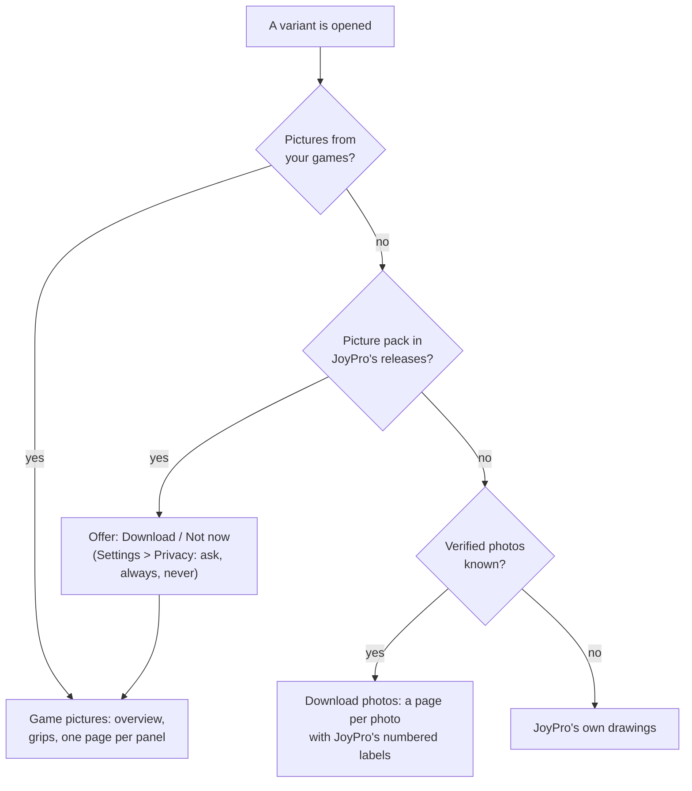

The Cockpits page is a reference of real and fictional cockpits, laid out like the cockpit chapter of a flight
manual: pick an aircraft, its version and seat, and read the overview, a page per grip (stick, throttle, cyclic,
collective) with the HOTAS table, and a page per panel. It changes nothing in your profile or your games; it helps you
decide which function goes on which button, and **Use this layout** opens the setup wizard with an aircraft's stick
and throttle layout.

:::video cockpits-page "The Cockpits page"
:::

:::layer beginner
## Three parts

- **Left: the picker.** A search box ("F-16", "Hornet", "TMS"), filters for **Kind**, **Game**, **Era**, **Role** and
  **Nation**, the list of aircraft and, under it, **Version / block / tranche** (for example F-16C Block 50).
- **Middle: the manual.** Tabs for the **Cockpit overview** and each grip, a **Panels** list with one page per panel,
  ◀ / ▶ for the previous and next page, and **Search this cockpit** ("battery", "autopilot").
- **Right (or above on a narrow window): the cockpit guide.** Every area, panel and control in plain words. **What
  does it do?** opens a control's explanation.

## What you see on a grip page

A drawing of the grip with numbered callouts and the **HOTAS table**: one row per control and direction (press, long
press, hold), one column per mode (NAV, A-A, A-G; or TGP, HUD). This is how the real aircraft uses each button, a good
model for your own binds.

## Pictures

Where your installed games have the aircraft, **Build pictures from my games** draws the game's cockpit with every
clickable control numbered and named as the game names it. For aircraft you do not own, JoyPro offers **picture
packs** to download, and for cockpits no game has, **verified photos** with JoyPro's labels on top.

:::ingame nothing is written
Nothing is written into a game. **Compare with my setup** marks in the HOTAS tables which functions your open profile
already binds for that game and aircraft, so you see at a glance what is still missing.
:::
:::

:::layer advanced
## Buttons of the variant

- **Compare with my setup**: with a profile open, each function in the HOTAS tables gets a mark when one of your
  relations holds it for that game and aircraft, with the relation's name and input. **Hide** takes the marks away.
- **Use this layout**: opens the setup wizard with the variant's stick and throttle layout as the model for your binds
  (its aircraft first in the priority list).
- **Export page (PNG)** / **All pages (PDF)**: the shown page, or every page of the variant, in your drawing style
  (Settings > Drawings) to `Documents\JoyPro2\Cockpits`; **Open folder** opens it.
- **Seat**: versions with two seats (front and back) have a page set per seat.

## Where the pictures come from

- **Build pictures from my games** reads the games' own files (DCS, X-Plane 12, MSFS 2020, IL-2 Great Battles, Nuclear
  Option, Star Citizen, War Thunder) and renders the cockpits on this PC. It takes about two seconds per picture; a
  big DCS module has 50 to 80. The pictures are kept with your game data, never in a game folder.
- The box next to it switches between **Picture from the game** and **JoyPro's drawing of it** (a line drawing traced
  from the render, in your drawing style). When several of your games have the aircraft, a second box picks the set.
- **Picture packs from JoyPro's releases** (the expander): cockpit pictures rendered from the games, for aircraft you
  cannot build yourself. **Download pictures for all my aircraft** or **Download all of this game** show the total size
  first; a download shows its progress and can be cancelled; a pack whose checksum does not match is not installed.
- **Verified photos**: for aircraft no game has good pictures of (airliners, spacecraft, some helicopters and jets),
  **Download photos** fetches every photo from its original address (or the web archive's copy), checks each against
  JoyPro's record and keeps it on this PC. The manual then has a page per photo with JoyPro's numbered labels and the
  photo's credit.
- **Photos** (under the pages): links to real photos. JoyPro asks before it loads any: **Yes**, **No**, **Always for
  cockpits**, **Never**.

## The cockpit guide

Area (left console, main panel, overhead) > panel ("ENG & JET START control panel") > control (every switch, button
and knob with its positions). A click on a control opens the page that shows it and rings its callout; a click on a
callout selects it in the guide. **Open all** / **Close all** open or close every area.
:::

:::layer technical
## Behind the page

- View model: `CockpitsViewModel.cs` (picker, filters, compare, use layout), `CockpitsViewModel.Pages.cs` (manual
  pages, export), `CockpitsViewModel.Guide.cs`, `CockpitsViewModel.Pictures.cs`, `CockpitsViewModel.PicturePacks.cs`,
  `CockpitsViewModel.VerifiedPhotos.cs`; the page view `ManualPageView`.
- Data: `DB\Cockpits\*.json` (aircraft, variants, controls, panels), `DB\Cockpits\drawings`, `line-drawings`,
  `guide`, `photo-labels` (one file per verified photo).
- On this PC: game pictures in `<data>\GameData\CockpitPictures\<game>\<aircraft>` (`pictures.json`, `index.json`),
  verified photos in `<data>\CockpitPhotos\<aircraft>`, linked photos in the download cache; the photo answers with the
  device photo answers (`cockpit:<aircraft>`).
- Engine: [[cli:cockpits]] (`list`, `search`, `get --json` for **Use this layout**, `compare` for **Compare with my
  setup**, `render` for PNG/PDF, `pictures build|status|check`, `photos`). Reference: [[doc:cockpits]],
  [[doc:privacy]].
:::

<!-- entry: ClearFiltersCommand -->
Empties the search box and sets **Kind**, **Game**, **Era**, **Role** and **Nation** back to "All": the whole list of
aircraft shows again.

<!-- entry: CancelPackDownloadCommand -->
Stops the picture pack download that is running. A pack that was not complete is not installed; packs already
finished stay.

<!-- entry: label:Download all of this game -->
Downloads every picture pack of this game from JoyPro's releases (shows the total size and asks first). Each pack is
checked against its checksum and unpacked into your game data; the manual pages of those aircraft then show the game's
pictures.

<!-- entry: CancelPhotoDownloadCommand -->
Stops downloading this cockpit's verified photos. Photos already downloaded and checked stay on this PC.

<!-- entry: OpenExportFolderCommand -->
Opens the folder the PNG and PDF exports went to (`Documents\JoyPro2\Cockpits`) in Explorer, creating it if needed.

<!-- entry: ClearCompareCommand -->
Hides the marks of **Compare with my setup**: the HOTAS tables and the guide show the cockpit without your binds again.

<!-- entry: bind:ShowDetails -->
Opens or closes the explanation of this control in the cockpit guide: what it does in plain words, "In the bigger
picture" (when and why the pilot uses it), its positions, the game's name for it and the commands to bind it with.

<!-- entry: PhotoAnswerCommand -->
Answers the photo question of this aircraft: **Yes** loads its photo links now, **No** does not, **Always for cockpits**
loads photos of every aircraft without asking, **Never** stops all cockpit photos (Settings > Privacy changes it back).
**Show the photos of this aircraft** after a No is the Yes.

<!-- entry: TryAgainCommand -->
Loads this photo again after it could not be loaded (the site was busy or refused for a moment).

<!-- entry: OpenPageCommand -->
Opens the page the photo is published on (with its author) in your browser.

<!-- entry: OpenCommand -->
Opens this source (a manual, a reference page) in your browser; the address is the tooltip.

<!-- entry: CompareCommand -->
Compares your open profile with this variant: every function in the HOTAS tables that one of your relations holds for
its games and aircraft gets a ✓ with the relation and input, and a line says how many functions are covered. Reads only;
needs an open profile. **Hide** takes the marks away. Engine: [[cli:cockpits]] `compare`.

<!-- entry: UseLayoutCommand -->
Opens the setup wizard with this variant: its aircraft goes to the top of the priority list (when it is in one of the
chosen games) and the plan places its functions as on this variant's stick and throttle, instead of the aircraft's
first variant. A wizard you left open before Apply takes it too. Nothing in your profile or your games changes until
Apply in the wizard. Engine: [[cli:cockpits]] `get <aircraft> <variant> --json`.

<!-- entry: ExportPageCommand -->
Saves the shown page as a PNG in your drawing style (Settings > Drawings) to `Documents\JoyPro2\Cockpits`, named after
the aircraft, variant and page; a file of the same name is replaced. **Open folder** opens it.

<!-- entry: ExportAllPagesCommand -->
Saves every page of this variant as one PDF in your drawing style (Settings > Drawings) to
`Documents\JoyPro2\Cockpits`. **Open folder** opens it.

<!-- entry: BuildPicturesCommand -->
Renders the cockpits of your installed games on this PC, every clickable control numbered and named as the game names
it. It takes a few minutes per game; the pictures are kept with your game data, never in a game folder, and the manual
pages use them. Engine: [[cli:cockpits]] `pictures build`.

<!-- entry: DownloadOfferedPacksCommand -->
Downloads the offered picture pack(s) from JoyPro's releases with a progress bar (**Cancel** stops). Each pack is
checked against its checksum and unpacked into your game data; the manual pages of those aircraft then show the game's
pictures.

<!-- entry: DismissPackOfferCommand -->
Closes the offer without downloading; JoyPro does not offer these packs again in this session.

<!-- entry: DownloadMyAircraftPacksCommand -->
Looks up the picture packs of every aircraft of your installed games that JoyPro knows and offers the ones not on this
PC yet with their total size; **Download** starts it.

<!-- entry: DownloadPhotosCommand -->
Downloads every verified photo of this cockpit from its original address (or the web archive's copy), checks each
against JoyPro's record and keeps it on this PC. The click also counts as your yes to this aircraft's photos; the
manual then has a page per photo with JoyPro's numbered labels.

<!-- entry: PreviousPageCommand -->
Goes to the previous page of the manual (stops at the first one).

<!-- entry: NextPageCommand -->
Goes to the next page of the manual (stops at the last one).

<!-- entry: ExpandAllGuideCommand -->
Opens every area and panel of the cockpit guide, so every control is listed.

<!-- entry: CollapseAllGuideCommand -->
Closes every area of the cockpit guide: only the areas are listed; open one to see its panels.

<!-- entry: label: -->
Opens or closes this area or panel of the cockpit guide. While a search filters the guide, the click clears the filter.

<!-- entry: OpenPhotoCommand -->
Opens the photo itself in your browser at full size, to look at it or save it from there.
