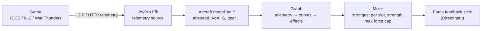
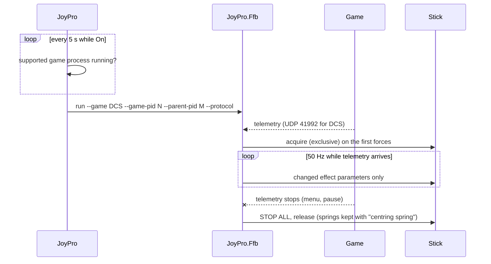

JoyPro reads live telemetry from the game you fly (airspeed, angle of attack, G, gear, guns, hits ...) and turns it
into forces on a force feedback stick such as the VPforce Rhino: stall buffet, stick weight under G, gear and flap
rumble, gun bursts, runway rumble, and a centring spring that stiffens with airspeed and follows the trim. What the
stick does is a graph of nodes that you can change. It works with DCS World, IL-2 Great Battles, IL-2 Korea and War
Thunder.

:::video ffb-page "Force feedback from telemetry: set up, test, tune"
:::

:::layer beginner
## Get forces in four steps

1. Switch the page's toggle to **On**. JoyPro now looks every 5 seconds for a supported game; nothing runs before.
2. Under **Device and forces** press **Refresh** and pick your force feedback stick. Leave **Strength** and **Max
   force** as they are for a start (the max force caps every effect, 60 % by default).
3. Press **↔ Direction test**. JoyPro gently pushes the stick and asks which way it went: answer with the buttons. It
   sets **Invert X / Y** for you and checks the centring spring and the trim.
4. Under **Game**, pick your game and press **Install** under **Telemetry export** (close the game first). This
   makes DCS or IL-2 send its telemetry to JoyPro (War Thunder sends it by itself). Then fly.

:::warn Switch the game's own force feedback off
JoyPro drives the stick itself. Switch off the game's force feedback for that stick (DCS: the aircraft's FFB option;
IL-2: Settings > Input devices; War Thunder: force feedback off), otherwise the game holds the device and JoyPro
cannot send forces.
:::

:::ingame What you feel
Near the stall the stick shakes; under G it gets heavy; gear and flaps rumble while they move; on the runway it
rumbles with speed; guns kick in bursts; hits (IL-2) jolt sideways. The centring spring gets stiffer the faster you
fly, and trim (the game's, or JoyPro's own trim buttons) moves its centre. In menus or when the game pauses, JoyPro
stops every effect and lets go of the stick (only the centring spring stays when JoyPro provides it).
:::
:::

:::layer advanced
## The Settings tab

**Device and forces**: device, **Strength** (all effects), **Max force** (hard cap per axis: no effect and no sum
of effects goes above it), **Direction** (Invert X / Invert Y, saved per device), **↔ Direction test**, **Centring**
("JoyPro provides the centring spring", needed for trim) and **Spring stiffness** (the plain spring on axes the graph
has no spring for).

**Direction test**, step by step (each step waits for **▶ Ready**; **■ Cancel** stops every force at any time):

```mermaid
flowchart TD
  A["▶ Start"] --> B["Push RIGHT 2 s (20 %)<br/>Which way did it move?"]
  B --> C["Push FORWARD 2 s<br/>Which way did it move?"]
  C --> D["Centring spring<br/>Does it spring back?"]
  D --> E["Trim: centre 35 % forward<br/>Did it move and stay?"]
  E --> F["Invert X / Y saved<br/>for this device"]
  B & C & D & E -.->|↻ Repeat this step| B
```

"It did not move" keeps that axis's setting and says what to check (on a VPforce stick: the Configurator's own spring
must be off for trim). **⏮ Start over** begins again. The test needs the stick to itself: it refuses while JoyPro's
force feedback runs for a game.

**Game**: pick a game, **Force feedback for this game**, its **Strength**, its **Graph** (*built-in* or one of your
graph files; **Open in editor**), the switches of the built-in graph's effects (buffet, gforce, gear, flaps,
speedbrake, runway, shake, guns, hits, spring), **Aircraft with their own graph or strength** (**Add aircraft**,
**Remove**) and **Telemetry export** (**Install**, **Remove**, **Dry run**). Strength multiplies: global x game x
aircraft, then the max force cap.

## The graph editor

The graph is how telemetry becomes force. Values flow left to right through wires, normalised to 0..1 (-1..1 where a
direction matters):

- **Telemetry** nodes read one key of the game (`ac.ias`, `ac.aoa`, `ac.g` ...) with min/max normalisation.
- **Group**, **Curve** (a Bezier curve you drag), maths and stateful nodes (low pass, slew limit, threshold) shape
  them.
- **Outputs** are the effects: constant force, periodic (sine, square, triangle, saw; strength and frequency mapped
  from the input), spring (stiffness, centre = trim), damper, friction. Outputs of one type on the same axis and slot
  compete (the strongest wins); different slots add up.
- **Inputs** from your devices: **Device button / hat** (any device; **⏺ Press the button now...** captures it),
  **Stick position**, **Trim** (**⇕ Assign trim buttons** asks for six buttons: trim to stick position, nose down,
  nose up, left, right, reset).

Pick a node type and **Add to the graph**, drag from a port to another to wire them, select and **Delete selected**.
**New from built-in** starts from a copy of JoyPro's flight graph; **Save** / **Save as** write a graph file,
**Load** / **Rescan** read them. Then pick that graph for a game or aircraft on the Settings tab.

## The telemetry inspector

Every telemetry key of the running game with its value, title and unit, live. Filter by key or title. Use it to see
which key to put into a Telemetry node and what range it has.
:::

:::layer technical
## Behind the page

View model: `MainWindowViewModel.FfbTelemetry.cs` (settings, games, aircraft, setup, the process),
`MainWindowViewModel.FfbDirectionTest.cs` (the test wizard), `FfbGraphEditorViewModel.cs` (the editor);
`Views/Controls/FfbGraphCanvas.cs`, `FfbCurveEditor.cs`. The force feedback runs in its own process,
`JoyPro.Ffb.exe` (`gui/JoyPro.Ffb`, graph engine in `gui/JoyPro.Ffb.Core`).

- **Lifecycle**: the process follows the game through its process handle and ends with the game or JoyPro. Every
  constant and periodic force has a duration of 0.3 s and is restarted, so a hung or killed process cannot leave a
  force on the stick. STOP ALL on telemetry timeout (0.5 s), game exit, JoyPro exit and any error.
- **Settings**: `<data>\Ffb\Telemetry\telemetry-ffb.json` (`<data>` = `%LOCALAPPDATA%\JoyPro2`); graphs in
  `<data>\Ffb\Telemetry\Graphs\*.jpffb.json` (format `joypro-ffb-graph`); last status in `status.json`.
- **Engine**: [[cli:ffb telemetry status]] (the page's state), [[cli:ffb telemetry config set]] /
  [[cli:ffb telemetry config clear]] (`--game`, `--plane`: per game and aircraft), [[cli:ffb telemetry effects]],
  [[cli:ffb telemetry setup dcs]] and the other games' setup (install, remove, `--dry-run`; the game file is backed up
  first).
- **Games**: DCS (an `Export.lua` line, UDP), IL-2 Great Battles and Korea (the game's telemetry device output, UDP),
  War Thunder (the game's local web server on port 8111, no setup needed). Games hidden in Settings > Games are not shown and not looked for.
- **Direction**: positive force pushes right on X and towards the pilot on Y; invert X / Y per device (by instance
  GUID) flips forces and the spring centre.

Reference: [[doc:ffb-telemetry]], recording the same telemetry: [[doc:telemetry-recording]].
:::

<!-- entry: FfbWizardReadyCommand -->
Direction test: starts the announced step (the push, the spring check or the trim move). Each step waits for this
button, so you can hold the stick loosely first. The stick moves gently (20 % for the pushes).

<!-- entry: FfbWizardAnswerCommand -->
Direction test: your answer to the shown question (right / left / it did not move; springs back or not; moved and
stayed or not). The answer to a push decides Invert X or Invert Y; at the end the found settings are saved for the
device.

<!-- entry: FfbWizardCancelCommand -->
Direction test: stops every force at once and ends the test without saving.

<!-- entry: FfbWizardCloseCommand -->
Closes the direction test panel (a running step is stopped first; the stick is released).

<!-- entry: RefreshFfbTelemetryStatusCommand -->
Saves changes still waiting, then reads the settings and the process state again (`engine ffb telemetry status`):
games, graphs, aircraft, the telemetry export state.

<!-- entry: bind:Enabled -->
Force feedback for the selected game on or off (saved in the settings file through `engine ffb telemetry config set`).
Off: JoyPro.Ffb does not drive the stick in that game.

<!-- entry: RemoveFfbTelemetryAircraftCommand -->
Removes the aircraft's own graph and strength (`engine ffb telemetry config clear --plane`); it uses the game's
settings again. A running force feedback reloads them.

<!-- entry: AddFfbTelemetryAircraftCommand -->
Adds the typed aircraft (as the game names it, for example F-16C_50; empty = the one flying now) with its own strength
and graph. In the game: that aircraft gets its own forces from the next reload.

<!-- entry: AddSelectedPaletteNodeCommand -->
Adds a node of the type picked in the list to the graph (telemetry, curve, maths, effect output, device button,
trim ...). Wire it up and save the graph.

<!-- entry: NewFromBuiltInCommand -->
Starts a new graph from a copy of JoyPro's built-in flight graph (buffet, G weight, gear, flaps, speed brake, runway,
shake, guns, hits, the spring with trim). Save it under a name to use it for a game or aircraft.

<!-- entry: LoadSelectedGraphCommand -->
Opens the picked graph file of the Graphs folder in the editor. Loading never switches force output on.

<!-- entry: SaveCommand -->
Saves the graph into its file (asks for a name the first time, like **Save as**). A game or aircraft that uses this
graph gets it at the next reload.

<!-- entry: SaveAsCommand -->
Saves the graph under the typed file name in the Graphs folder (`*.jpffb.json`).

<!-- entry: bind:IsOn -->
A switch among the selected node's settings, for example a Constant node's **Active**, **Invert**, a constant force's
"Invert direction" or a spring's "Invert centre". Changes what that node or effect does; saved with the graph.

<!-- entry: CancelCaptureCommand -->
Stops waiting for a button press (**Press the button now...** or **Assign trim buttons**); nothing is assigned.

<!-- entry: RemoveSelectedCurvePointCommand -->
Removes the selected middle point of the Curve node (the end points stay). Also: right-click a point or Delete.

<!-- entry: ResetCurveLinearCommand -->
Makes the selected Curve node a straight line again (output = input).

<!-- entry: bind:FfbTelemetryEnabled -->
The page's main switch (saved in the settings file). On: JoyPro checks every 5 seconds for a supported game and starts
its force feedback process while one runs. Off: nothing runs or polls. In the game: with On, your force feedback stick
gets JoyPro's forces while you fly.

<!-- entry: RefreshFfbTelemetryDevicesCommand -->
Lists the force feedback devices connected now so you can pick yours in **Device**. Read-only: nothing moves.

<!-- entry: bind:FfbTelemetryInvertX -->
Flips left and right for the forces (and the spring centre) of this device; saved per device. The **↔ Direction test**
sets it for you. In the game: a push to the right is felt to the right.

<!-- entry: bind:FfbTelemetryInvertY -->
Flips forward and back for the forces (and the spring centre) of this device; saved per device. The
**↔ Direction test** sets it for you.

<!-- entry: StartFfbDirectionTestCommand -->
Starts the direction test: JoyPro gently pushes the stick (20 %), asks which way it went and sets **Invert X / Y**; it
also checks the centring spring and the trim. It needs the stick to itself, so it refuses while JoyPro's force
feedback runs for a game.

<!-- entry: bind:FfbTelemetryCentringSpring -->
On (the default): while JoyPro drives the stick it keeps a centring spring, also while the game pauses, and trim moves
its centre. Off: JoyPro sends no spring; the stick's own centring acts and there is no trim from JoyPro. Saved in the
settings file.

<!-- entry: FfbWizardRetryCommand -->
Direction test: **↻ Repeat this step** does the same push, spring check or trim move once more, for example when you
did not hold the stick loosely.

<!-- entry: FfbWizardStartOverCommand -->
Direction test: **⏮ Start over** stops every force and begins the test again from the first step (after a finished
test it starts a new one).

<!-- entry: EditFfbTelemetryGameGraphCommand -->
**Open in editor**: opens the graph the selected game uses in the graph editor tab; the built-in graph opens as a copy
to save under your own name.

<!-- entry: FfbTelemetrySetupCommand -->
**Telemetry export** of the selected game: **Install** adds JoyPro's telemetry export to the game (the game file is
backed up first; other exports keep working), **Remove** takes it out again, **Dry run** shows what Install would
change. Close the game first. War Thunder needs none. Engine: [[cli:ffb telemetry setup]].

<!-- entry: RefreshGraphFilesCommand -->
Graph editor: **Rescan** reads the Graphs folder again, for example after you copied a graph file into it.

<!-- entry: FitCommand -->
Graph editor: **Fit** zooms so the whole graph is visible.

<!-- entry: DeleteSelectedCommand -->
Graph editor: deletes the selected wire, or else the selected node (also the Delete key). Save the graph to keep
the change.

<!-- entry: CaptureSelectedInputCommand -->
Graph editor, a selected device button node: **⏺ Press the button now...** waits for the next button or hat press on
any device (stick, throttle, panel); it becomes the node's input. Save the graph to keep it.

<!-- entry: AssignTrimButtonsCommand -->
Graph editor, a selected Trim node: asks for six buttons in turn (trim to stick position, nose down, nose up, left,
right, reset); wait to skip one. A button node is added for an input without one. Save the graph to keep them. In the
game: these buttons trim the stick's centring spring.
