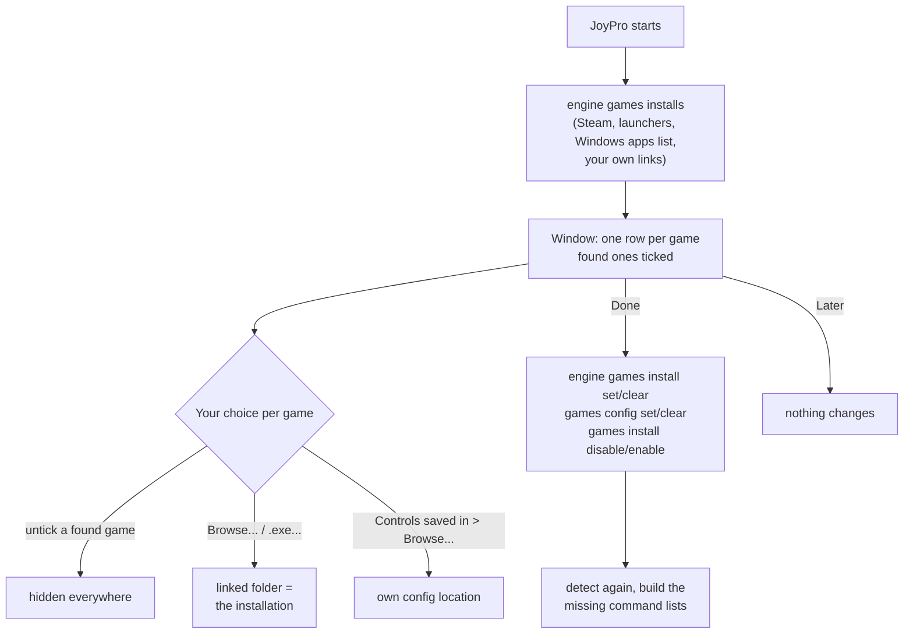

The window "Welcome to JoyPro2: your games" opens once at the first start, after JoyPro has looked for your games. It
lists every game JoyPro supports, found ones first. Here you say which games you have, link a game installed somewhere
JoyPro did not look, and point JoyPro to another folder for a game's controls. The same window opens again from
Settings > Games > **Run setup again**. The walk-through for a new user is on
[[page:getting-started/first-start.html|First start]].

:::video first-start-window "The first-start setup window"
:::

:::layer beginner
## One row per game

Each row has the game's cover, its name and a status:

- **Ticked, with a folder**: JoyPro found the game (the row says how: Steam, a known place, the Windows apps list).
- **Unticked**: JoyPro did not find it. That is fine if you do not have it; it is **not** hidden and JoyPro finds it
  as soon as you install it.

What you can do:

1. **Untick a found game** you do not have or do not care about: it is hidden everywhere in JoyPro (game cards, export
   tiles, the watcher, game lists). Your binds for it stay in the profile.
2. **A game installed somewhere else** (a portable copy, another drive): tick it and press **Browse...** next to
   **Installation** to pick its folder, or **.exe...** to pick the game's program or launcher.
3. **Controls saved in**: some games keep their controls in your user folders. If yours are elsewhere, for example
   `Saved Games\DCS.openbeta` instead of `Saved Games\DCS`, press **Browse...** there.
4. Press **Done**. **Later** closes the window and changes nothing.

:::tip
After **Done** JoyPro builds the command list of every game you have from your own installation. The Start page shows
the progress and a notice for any list still missing.
:::
:::

:::layer advanced
## Details

- A linked folder is checked against the game's marker files (`bin\DCS.exe`, `bin\game\Il-2.exe`, `X4.exe` ...): the row
  says "Marker found", or "Marker not found, but the folder is kept as you chose it". A linked folder counts as the
  installation for everything (import, export, command list) and detection never replaces it.
- **Use detected** (installation or config) forgets your link; JoyPro detects the game again.
- **I don't have it (hide it everywhere)** is offered for a game JoyPro did not find: without it, the game stays "not
  installed" and shows up by itself once installed; with it, the game is hidden like an unticked found game.
- Games that keep their controls in the installation (IL-2, Falcon BMS, X-Plane ...) show their config location
  read-only.
- Hidden games are listed at the end of Settings > Games with **Show again**.
:::

:::layer technical
## Behind the window

Window `Views/GameSetupWindow.axaml` (+ `.axaml.cs` for the folder pickers, Done and Later), view model
`MainWindowViewModel.GameSetup.cs`, rows `Models/GameSetupItem.cs`. The window opens once when `gameSetupDone` is not
set in `ui-settings.json` and the startup detection ([[cli:games installs]]) has answered. **Done** runs, per changed
row, [[cli:games install set]] (or `clear`), [[cli:games config set]] (or `clear`), then one
[[cli:games install disable]] / `enable` for the hidden and shown games, detects again, marks the setup done and starts
[[cli:db check-updates]] to build the missing command lists. Reference: [[doc:installs|Game installations]].
:::

<!-- entry: click:DoneClicked -->
Saves your choices and closes the window: linked folders and config locations are written
([[cli:games install set]], [[cli:games config set]]), unticked found games are hidden and ticked ones shown
([[cli:games install disable]] / `enable`), then JoyPro detects the games again and builds the command lists of the
games you have. If a step fails, the window stays open and says which game. The window does not open by itself again;
Settings > Games > **Run setup again** brings it back.

<!-- entry: bind:HasGame -->
"I have this game": ticked at the start for every game JoyPro found or you linked. Untick a found game you do not have
and **Done** hides it everywhere in JoyPro (your binds for it stay); tick a game you hid before and **Done** shows it
again. A game JoyPro did not find stays unticked and is only "not installed": it shows up by itself once installed.

<!-- entry: bind:ExplicitlyHidden -->
Shown for a game JoyPro did not find: ticked, **Done** hides it everywhere like an unticked found game. Without it the
game stays "not installed" and JoyPro finds it by itself once you install it.

<!-- entry: click:BrowseInstallClicked -->
**Installation** > **Browse...**: pick the folder of a game JoyPro did not find, for example a portable copy or one on
another drive. JoyPro takes the game's folder from what you pick (a launcher or `bin` folder works too), ticks the
game and checks it for the game's marker file. Nothing is written until **Done**; then the folder counts as the
installation.

<!-- entry: click:BrowseInstallExeClicked -->
**.exe...**: pick the game's program or its launcher instead of a folder; JoyPro links the game's folder next to it
and checks it for the game's marker file. Written with **Done**.

<!-- entry: UseDetectedFolderCommand -->
Shown when the row has a linked folder: forgets it, so JoyPro detects the game again by itself. Takes effect with
**Done** (`engine games install clear`).

<!-- entry: click:BrowseConfigClicked -->
**Controls saved in** > **Browse...**: pick where the game keeps its controls when it is not the detected place, for
example `C:\Users\Pilot\Saved Games\DCS.openbeta` instead of `Saved Games\DCS` (a folder for DCS and Star Citizen,
otherwise the file). Not offered for games that keep their controls in the installation or the Windows registry.
Written with **Done** ([[cli:games config set]]).

<!-- entry: UseDetectedConfigCommand -->
Shown when the row has your own config location: forgets it, so JoyPro looks for the game's controls in the detected
place again. Takes effect with **Done**.

<!-- entry: click:LaterClicked -->
Closes the window and changes nothing: no folder is linked and no game is hidden. The window does not open by itself
again at the next start; Settings > Games > **Run setup again** brings it back.
