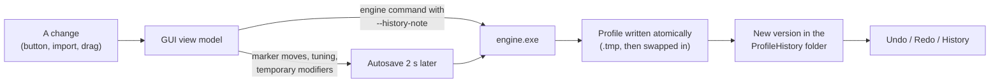

The profile bar sits above every page. It names the open profile and holds what works everywhere: open or start a
profile, the save state, Back and Forward, Undo and Redo, the profile's history, the **More** menu and the expert
**Options**. The bottom bar below every page switches between the pages. A notice under the bar tells you when devices
were moved to a new ID.

:::video profile-bar "The profile bar"
:::

:::layer beginner
## What is a profile?

A profile is one file (`.pr0file`) with everything you set up in JoyPro: your relations, which button does what
(binds), shift buttons (modifiers) and axis curves. You can have several profiles, but one is open at a time. Its name
is on the left of the bar; hover it to see where the file is.

## The buttons from left to right

- **Open profile...**: pick a `.pr0file` file.
- **New profile**: an empty profile. It gets a name with the date in `Documents\JoyPro2\profiles`; **More > Rename...**
  gives it yours. Easier: import a game on the Start page, which makes a profile for you.
- **Saved ✓**: JoyPro saves every change by itself. While it saves you see **Saving…**; when a save fails, **Not
  saved** with the reason (it tries again).
- **Back / Forward** (arrows): go to where you were before, like a browser (page, open relation, search, scroll
  position). They never change the profile.
- **Undo / Redo**: take back the last change of the profile, or do it again (Ctrl+Z, Ctrl+Y). The tooltip names the
  change ("Undo Adding relation").
- **History**: every saved version of the profile, to look at, compare, restore or keep.
- **More**: open the last profile, save a copy, rename, add another profile, reload, close, check for updates, about.
- **Options**: settings for experts (paths and how a profile is repaired when it loads).

## The bottom bar

One button per page: **Start**, **Relations**, **Binds**, **Modifiers**, **Layout**, **Export**, **HUD**, **Force
Feedback**, **Virtual Joystick**, **Statistics**, **Cockpits**, **Settings**, **Advanced**, plus **Check** and the
**Output** panel. Settings > Pages in the bottom bar hides pages you do not use and changes their order.
:::

:::layer advanced
## Undo, History and Back are three different things

| | What it walks through | Changes the profile? |
|---|---|---|
| **Back / Forward** | the places you were: page, sub-view, open relation or device, search texts, filters, scroll position (at most 50) | no |
| **Undo / Redo** | the profile's versions, one step at a time, also after a restart | yes |
| **History** | every version with what it changed; restore any of them | yes (a restore is a new version, so Undo goes back) |

Back and Forward also work with **Alt+Left** / **Alt+Right** and the mouse's back and forward buttons.

## The History panel

- Left: the versions, newest first ("Adding relation", "Import from DCS", "Before export to DCS"), with **now** on the
  version the profile is at and **kept** on versions you keep.
- **Details** shows what a version changed ("Relation 'Gear' renamed to 'Landing gear'"); **Compare** shows what
  differs between that version and the profile now.
- **Keep** protects a version from the clean-up; **Restore** makes the profile as it was then.
- **Clean up** thins out old versions of all profiles now: all of the last day, then fewer per hour, day and week.
  JoyPro also does this by itself in the background. Kept versions always stay.

## Device notice

When you open a profile and a device has a new ID (Windows gives devices new IDs now and then, or a new stick of the
same model), JoyPro moves its binds and shows a notice under the bar: which device moved where. **Undo** puts the binds
back on the old device, **Replace device...** opens the window to move binds yourself, input by input, **OK** closes
the notice.

## Replace device window

**Replace device...** (the notice, a device card on the Layout page, Settings > Devices) moves the binds of an old
device to another one:

- **Automatic**: the same product gets the same input ids; another device is matched by its parts.
- **Same input ids (1:1)**: button 5 stays button 5, X stays X.
- **By layout (device catalog)**: trigger to trigger, hat 2 to hat 2, throttle to throttle; buttons without a
  matching part go by their order (shown as a guess).
- When the new device already has binds on some inputs: **Keep both**, **Keep the new device's binds** or **Replace
  them with the old device's binds**.
- **Move binds** asks first, keeps a copy of the profile next to it and does it as shown (Undo takes it back);
  **Cancel** closes without a change.

:::ingame moved binds
Moving binds to another device changes nothing in a game until the next export; then the binds are written for the new
device. With **Replace on my devices** the old device's binds are cleared in the exported aircraft.
:::
:::

:::layer technical
## Behind the bar

- Profile commands: `MainWindowViewModel.cs` (`OpenLastProfileAsync`, `LoadProfileAsync`, `MergeProfileAsync`,
  `SaveLastProfileAsync`, `ClearWorkspace`, `RefreshAllAsync`), the menu's file dialogs in `Views/MainWindow.axaml.cs`.
- Autosave and history: `Services/AutosaveScheduler.cs`, `MainWindowViewModel.ProfileHistory.cs`, the store
  `engine/ProfileHistory.cs` in `%LOCALAPPDATA%\JoyPro2\ProfileHistory\<profile id>\` (`history.json`, one gzip blob
  per distinct content, `drafts.json`). Details: [[doc:profile-history]].
- Back / Forward: `Services/NavigationHistory.cs`, `MainWindowViewModel.NavigationHistory.cs`,
  `Views/MainWindow.Navigation.cs` ([[doc:ui/navigation]]).
- Device notice and Replace device: `MainWindowViewModel.DeviceReplace.cs`, `Views/ReplaceDeviceWindow.axaml`.
- Updates: `MainWindowViewModel.Updates.cs` ([[doc:updates]]).

Every GUI action runs `engine.exe` with `--profile <file>`, `--status`, `--benchmark` and the load-correction options
of **Options** (`--load-corrections`, `--auto-add-db-items`, `--remap-missing-devices`, `--correction-mode`,
`--correction-auto-threshold`). Engine: [[cli:profile load]], [[cli:profile merge]], [[cli:profile save-last]],
[[cli:profile summary]], [[cli:profile history]], [[cli:profile history show]], [[cli:profile history restore]],
[[cli:profile history keep]], [[cli:profile history prune]], [[cli:devices replace]], [[cli:devices auto-remap]].
:::

<!-- entry: NavigateBackCommand -->
Goes back to the place you were before: the page, its tab or panel, the open relation or device, search texts,
filters and scroll positions (also Alt+Left and the mouse's back button). The profile is not changed; the tooltip names
where it goes.

<!-- entry: NavigateForwardCommand -->
Goes forward again after **Back** (Alt+Right, the mouse's forward button). A new place you open clears Forward.

<!-- entry: OpenLastProfileCommand -->
Opens the profile you had open last (its path is the tooltip). Pending edits of the current profile are saved first.
Engine: `engine profile load`.

<!-- entry: ToggleProfileOptionsCommand -->
Closes the **Profile and engine options** panel (the **Options** button opens it again).

<!-- entry: MergeProfileCommand -->
Merges the **Merge profile file** into the open profile: relations, binds and modifiers are added; where both have the
same relation, the setting above decides which one wins. Asks first and keeps a copy of your profile next to it.
Engine: `engine profile merge <yours> <other> --mode left|right --save <yours>`.

<!-- entry: bind:AutoCreateProfileOnImport -->
On (default): an import or another change while no profile is open makes a new profile for it in
`Documents\JoyPro2\profiles`. Off: such commands stop with "Profile path required".

<!-- entry: bind:UseLoadCorrections -->
On (default): every engine command repairs the profile while it loads (`--load-corrections true`): actions whose
game command changed with a game update are matched to the current command, and missing devices are looked for. Off:
the profile is read exactly as stored; the two boxes next to it are then off too.

<!-- entry: bind:AutoAddDbItems -->
With load corrections: when an action is matched to a corrected command of the command list, that command is added to
the relation in its place (`--auto-add-db-items`). How sure a match must be: **Correction Mode** (strict, balanced,
aggressive) and **Auto Threshold** below; **Correction Report** writes what was changed to a file.

<!-- entry: bind:RemapMissingDevices -->
With load corrections: binds of a device that is not connected are moved to a connected device of the same model with
a new ID (`--remap-missing-devices`). The device notice under the bar lists what moved and offers Undo.

<!-- entry: bind:IncludeStatusUpdates -->
Keeps the engine's status and progress lines in the Output panel (`--status true`). Off: the busy area still shows them
while a command runs, but the Output keeps only the result.

<!-- entry: bind:IncludeBenchmark -->
Adds the engine's timings to every command's output (`--benchmark true`): how long loading, the command and saving
took. For finding slow steps.

<!-- entry: ToggleHistoryPanelCommand -->
Closes the History panel (the **History** button opens it again).

<!-- entry: DismissDeviceRemapNoticeCommand -->
Closes the notice about moved devices. The moved binds stay; Undo is then only possible through the History panel.

<!-- entry: click:CancelClicked -->
Closes the Replace device window without moving anything.

<!-- entry: SetThemeLightCommand -->
**Light** in the banner at the top: shows JoyPro in its light colours at once. The same choice as in Settings >
Appearance; kept for the next start.

<!-- entry: SetThemeDarkCommand -->
**Dark** in the banner at the top: shows JoyPro in its dark colours at once. Kept for the next start.

<!-- entry: SetThemeSystemCommand -->
**System** in the banner at the top: JoyPro follows the Windows setting for apps (light or dark). Kept for the next
start.

<!-- entry: click:OpenProfileClicked -->
Picks a JoyPro profile (`.pr0file`) and opens it. Pending edits of the profile that is open now are saved first, so
nothing is lost. Engine: [[cli:profile load]].

<!-- entry: click:NewProfileClicked -->
Starts an empty profile at once, without a dialog: it gets a name with the date in `Documents\JoyPro2\profiles`
(**More > Rename...** gives it yours). Pending edits of the open profile are saved first. Easier for a first profile:
import a game on the Start page, which makes one for you. Engine: [[cli:profile new]].

<!-- entry: UndoLastChangeCommand -->
Takes back the last change of the profile (Ctrl+Z); the tooltip names it ("Undo Adding relation"). Edits not saved
yet are saved first, so they are undone first. Works across restarts, one version of the History at a time. Your
games change only with the next export.

<!-- entry: RedoLastChangeCommand -->
Does the change you just undid again (Ctrl+Y); the tooltip names it. Enabled only when there is an undone change to
redo.

<!-- entry: bind:IsHistoryPanelOpen -->
Opens or closes the History panel below the bar: every saved version of this profile, newest first, with **Details**,
**Compare**, **Keep** and **Restore**. Only with a profile open. Opening it changes nothing.

<!-- entry: label:More -->
Opens the menu of the less used profile actions: **Open last profile**, **Save as...**, **Rename...**, **Add another
profile...**, **Reload**, **Close profile**, **Check for updates** and **About JoyPro**.

<!-- entry: click:SaveProfileAsClicked -->
**More > Save as...**: saves a copy of the open profile under a name and folder you choose; from then on JoyPro works
on the copy and remembers it as the last profile. The original file stays as it was. Engine: [[cli:profile save]].

<!-- entry: click:RenameProfileClicked -->
**More > Rename...**: gives the profile file another name or folder; its history goes along. When a profile with that
name exists, JoyPro asks first and keeps the replaced file as `<name>.pr0file.bak` next to it, with its history. A
file another program holds open stops the rename and nothing changes.

<!-- entry: click:MergeProfileClicked -->
**More > Add another profile...**: picks another `.pr0file` and merges its relations, binds and modifiers into the
open profile. Asks first and keeps a copy of your profile next to it; where both have the same relation, **Options**
decides which one wins. Needs an open profile. Engine: [[cli:profile merge]].

<!-- entry: RefreshAllCommand -->
**More > Reload**: reads the profile summary, the relations, binds and modifiers, the devices and the DCS aircraft
list again, for example after you changed the profile file outside JoyPro. Changes nothing. Engine:
[[cli:profile summary]].

<!-- entry: ClearWorkspaceCommand -->
**More > Close profile**: saves pending edits and closes the profile in JoyPro, so every page is empty. The file and
its history stay; **Open profile...** or **More > Open last profile** opens it again.

<!-- entry: CheckForUpdatesCommand -->
**More > Check for updates**: asks GitHub for the latest release of JoyPro and always says what it found. A newer
version is offered with what changed (**Update now**, **Later**, **Skip this version**); nothing is downloaded without
your click.

<!-- entry: OpenAboutCommand -->
**More > About JoyPro** and the version at the bottom right: opens Settings > About JoyPro and updates (version,
build, licence line, updates). When a newer version is on offer, the version corner names it.

<!-- entry: bind:ShowProfileOptions -->
**Options**: opens or closes the **Profile and engine options** panel below the bar, for experts: what wins when you
add another profile, the engine and profile paths, and how a profile is repaired when it loads. Normal use needs none
of it.

<!-- entry: SaveLastProfileCommand -->
Options panel: saves the open profile as the engine's own last profile (`last.pr0file`), the one engine commands use
when no profile is given. Your profile file is not changed. Engine: [[cli:profile save-last]].

<!-- entry: CleanUpHistoryCommand -->
History panel: thins out the old versions of all profiles now: all of the last day, then one per hour for 7 days, one
per day for 60 days, one per week after that. Kept versions always stay. JoyPro also does this by itself a minute
after start and every 6 hours; the status line says how much space it freed.

<!-- entry: ShowHistoryVersionChangesCommand -->
**Details** on a version: lists on the right what this version changed against the one before it ("Relation 'Gear'
renamed to 'Landing gear'"). Changes nothing.

<!-- entry: CompareHistoryVersionCommand -->
**Compare** on a version: lists on the right everything that differs between that version and the profile as it is
now. Changes nothing.

<!-- entry: ToggleHistoryKeepCommand -->
**Keep** on a version: a kept version is marked **kept** and never cleaned up. Click it again to let the clean-up
remove it like any other version.

<!-- entry: RestoreHistoryVersionCommand -->
**Restore** on a version: asks first, then makes the profile as it was then. The restore is a new version, so the
current state stays in the History and Undo (Ctrl+Z) brings it back. In the game: the restored binds arrive with the
next export.

<!-- entry: CloseHistoryCompareCommand -->
Closes the list of **Details** or **Compare** on the right of the History panel.

<!-- entry: OpenReplaceDeviceCommand -->
**Replace device...** in the notice about moved devices: opens the window to move the binds of a device to another one
yourself, input by input, with a preview, for example a new stick or a device JoyPro did not move by itself.

<!-- entry: UndoDeviceRemapCommand -->
**Undo** in the notice about moved devices: puts the binds back on the old devices and closes the notice. Works while
the move is still the last change; after other changes JoyPro opens the History panel instead, where you restore the
version before the move.

<!-- entry: CancelCommand -->
**Cancel** next to the progress bar at the bottom: stops a longer command before it writes anything. JoyPro offers it
only while the command still reads; the button says "Cancelling..." until it has stopped.

<!-- entry: GoStartCommand -->
Opens the Start page: your games with import, export, update and undo, the game watcher and the Setup wizard.

<!-- entry: GoRelationsCommand -->
Opens the Relations page: which game commands belong together, so one button does the same thing in every game and
aircraft.

<!-- entry: GoBindsCommand -->
Opens the Binds page: which button or axis of your devices does what, with recording and axis curves.

<!-- entry: GoModifiersCommand -->
Opens the Modifiers page: shift buttons, held down so the other buttons get a second job.

<!-- entry: GoLayoutCommand -->
Opens the Layout page: pictures of your devices with what every button does.

<!-- entry: GoExportCommand -->
Opens the Export page: write your binds into the games, the check, undo and the game config backups. Pressed while
the page is open, it reads the backup list again ([[cli:backups list]]).

<!-- entry: GoHudCommand -->
Opens the HUD page: the designer for an on-screen or streaming view of your sticks, throttles and pedals live.

<!-- entry: GoFfbTelemetryCommand -->
Opens the Force Feedback page: force feedback from the game's telemetry, its settings, the graph editor and the
telemetry inspector.

<!-- entry: GoVirtualJoystickCommand -->
Opens the Virtual Joystick page: per game one virtual vJoy joystick or Xbox pad instead of your real devices, with
HidHide and virtual functions.

<!-- entry: GoStatisticsCommand -->
Opens the Statistics page: your most played games, aircraft and ships, streaks and fun facts from your games' logs, on
this PC only. Shown only when Settings > Usage statistics > **Show the Statistics page in the bottom bar** is on.

<!-- entry: GoCockpitsCommand -->
Opens the Cockpits page: stick and throttle of real and fictional aircraft per version, with JoyPro's drawings, the
panels and sources.

<!-- entry: GoSettingsCommand -->
Opens the Settings page: games and their folders, devices, command lists, force feedback, appearance, updates and
problem reports. It cannot be hidden from the bar.

<!-- entry: GoAdvancedCommand -->
Opens the Advanced page, for experts: type engine commands yourself and see their output.

<!-- entry: ShowOpenHiddenPageCommand -->
**Show it always**, in the hint next to the bottom bar while a page you hid in Settings > Pages in the bottom bar is
open: shows that page in the bar for good again. Kept for the next start.

<!-- entry: bind:ReplaceModeAuto -->
Replace device window, default: the same product gets the same input ids; another device is matched by its parts
(trigger to trigger, hat to hat). The preview below updates at once.

<!-- entry: bind:ReplaceModeSame -->
Replace device window: button 5 stays button 5, X stays X. For the same product, or a device you set up the same way.
The preview updates at once.

<!-- entry: bind:ReplaceModeLayout -->
Replace device window: matches by the device catalog: trigger to trigger, hat 2 to hat 2, roll to roll, throttle to
throttle. Buttons without a matching part go by their order and are marked as a guess in the preview.

<!-- entry: bind:ReplaceMergeAdd -->
Shown when the new device already has binds on some of the target inputs, default: both binds stay on that input.
Fine when they are for different games or aircraft.

<!-- entry: bind:ReplaceMergeKeep -->
The new device keeps its own binds on those inputs; the old device's binds for them stay on the old device.

<!-- entry: bind:ReplaceMergeReplace -->
The new device's binds on those inputs are removed and the old device's binds take their place. Undo brings them
back.

<!-- entry: click:ApplyClicked -->
**Move binds**: asks first, keeps a copy of the profile next to it (`<profile>.before-device-replace-<time>.pr0file`)
and moves every bind and modifier of the old device to the new one as the preview shows, as one change, and closes the
window. The notice under the bar says how many moved and which stayed on the old device; its **Undo**
(or Ctrl+Z) takes it back. Engine: [[cli:devices replace]]. In the game: the binds are on the new device after the
next export.
