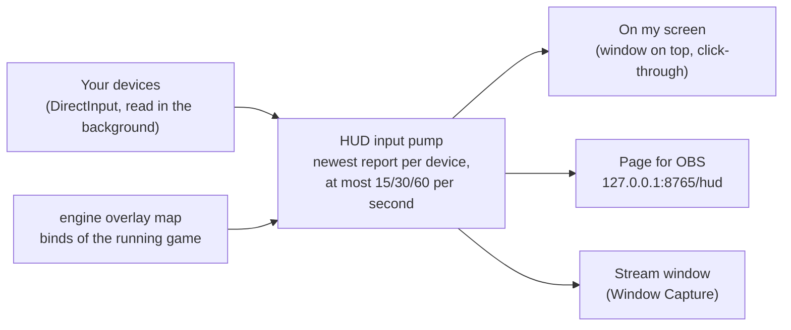
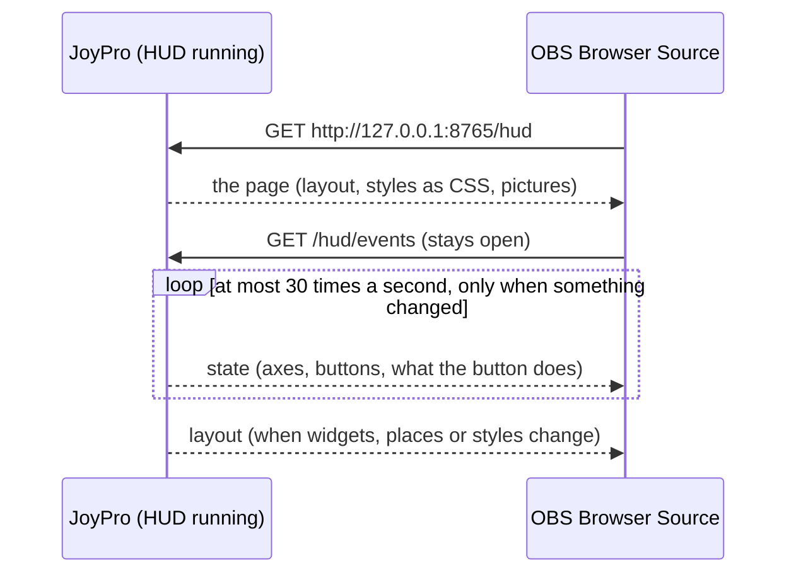

The HUD shows your devices on screen while you play, like a streamer's controller overlay: the stick picture tilts
with your stick, levers and axes move as bars, held buttons light up with their names, and a line says what the
pressed button does in the running game ("Gear Toggle"). It can show over the game, in OBS, or both, each with its
own widgets. This page is its designer.

:::video hud-page "The HUD designer: widgets, styles, OBS"
:::

:::layer beginner
## Start the HUD in three clicks

1. Open **HUD** in the bottom bar. The preview already moves when you move your stick.
2. Leave **On my screen (over the game)** ticked.
3. Press **Start HUD** (also on the [[gui:start|Start]] page). Start your game: the HUD sits on top of it and never
   takes the mouse or the keyboard away from the game.

**Stop HUD** (the same button) closes it. Everything you set here is kept and is there again after a restart.

### What is on the screen

- One **widget** per device: sticks, throttles and pedals are shown at the start, panels and keyboards are hidden
  (tick them in the **Widgets** list). Each widget can show the device's photo, the stick position, the axes as bars,
  the buttons and hats.
- The **aircraft widget**: the stick and throttle of the aircraft you fly, as the game draws them, moving with yours.
- The **game header**: the game or DCS aircraft with its picture.
- **What the button does**: the last pressed buttons with their action in the running game.

Drag a widget in the preview to move it; click it to change it on the right. **Arrange automatically** puts them
along the bottom: throttle and left-hand devices left, pedals in the middle, the right-hand stick right.

:::ingame What you see in the game
The HUD window is transparent and stays on top of windowed and borderless games. Clicks go through it to the game.
It is not in the task bar or Alt+Tab. Exclusive full screen hides it (a Windows limit): switch the game to
borderless. The pressed button's line names the action of that game and aircraft, for example "Weapon Release" in
the F-16C and "Fire guns" in IL-2.
:::
:::

:::layer advanced
## Where the HUD shows

The three outputs are independent of each other:

| Output | For | How |
|---|---|---|
| **On my screen (over the game)** | you | a transparent window on top of the game |
| **Page for OBS (Browser Source, transparent)** | your stream (recommended) | JoyPro serves a page on this PC only; **Copy** puts its address on the clipboard |
| **Stream window (Window Capture)** | streams with Window Capture | a normal window (may sit behind the game) with a transparent or chroma key background |

Untick **On my screen** to play with a clean screen while the stream still shows the HUD, or show other widgets on
each: every widget has two ticks, a monitor (your screen) and **OBS** (the stream). **Preview: My screen / The
stream** switches what the designer shows. **Updates per second at most** (15, 30 or 60; 30 is smooth and light).

## Set up OBS (Browser Source)

1. Tick **Page for OBS (Browser Source, transparent)** and press **Start HUD**.
2. Press **Copy** next to the address (`http://127.0.0.1:8765/hud`).
3. In OBS: *Sources* > **+** > **Browser**. Paste the address as *URL*, *Width* 1920, *Height* 1080. Nothing else is
   needed: the background is transparent, no custom CSS.
4. Optional: tick *Shutdown source when not visible* so OBS stops the page in scenes without it.

The page draws the widgets ticked for the stream, in the same places and styles as the app, on a 1920 x 1080 stage
scaled to the source. Port taken by another program? Pick another one under **Port** and copy the address again.

**Window Capture instead**: tick **Stream window**, pick the background (transparent, green, magenta, blue or your
colour). In OBS add *Window Capture* with *Capture Method: Windows 10 (1903 and up)*; with a colour add a *Chroma Key*
filter in that colour. If a transparent background shows black in your OBS, use the Browser Source or a colour.

## Widgets

**Widgets** lists every device plus the header, the binds ticker and the aircraft widget. **Reload devices** reads
the connected devices again; **Show all** ticks every widget for your screen; **Arrange automatically** and **Reset
places** put them in place.

Per widget (click it in the preview or the list):

- **Show on my screen**, **Show in the stream**, **Size**, **Style of this widget** (the HUD's style or any other).
- **Show**: name, kind (stick, throttle), picture, picture tilts with the stick, buttons light up, held buttons by
  name, axes and levers, axis names, axis values, stick position (gimbal), hats. The header widget: its picture.
- **Picture**: *Photo* (the manufacturer's picture, background cut away), *Layout* (your JoyPro layout picture from
  the [[gui:layout|Layout]] page, with the pressed buttons lit at their place), *Auto* (the photo when there is one).
- **Grip on this base**: for bases that take several grips (VPforce Rhino, Virpil WarBRD); the grip decides the
  picture and the button names.
- **Stick axes**: where X, Y and Twist of the stick element come from. *Automatic* takes the device's own axes; a grip
  that is a device of its own without axes takes them from the base it sits on.

**The aircraft widget**: stick, throttle, throttle travel bar, stick position, controls light up, held controls by
name; **Aircraft** (*Automatic*: the aircraft you fly, or any picture set on this PC) and **Moves with** (the stick and
throttle that move it). Its pictures come from the game's own cockpit pictures ([[gui:cockpits|Cockpits]] > Build
pictures from my games, or a picture pack), else JoyPro's line drawing of the real grip.

## The 40 styles

**Style** has 40 presets: *Glass*, *Neon*, *Minimal*, clean ones (*Frosted light*, *Streamer clean*, *Streamer
bold*, *Compact*, *Large text*, *Pastel*, *Outline only*), cockpit displays (*Military green HUD*, *Amber MFD*,
*Airliner PFD*, *Glass cockpit*, *Night vision*, *Red cockpit lighting*, *Vector wireframe*, *Retro terminal*,
*Warbird*, *Hologram*), games and genres (*Space sim orange*, *Holo cyan*, *Cyberpunk*, *Synthwave*, *Neon pink*,
*Racing*, *Tactical tan*, *Navy and gold*, *Stealth*, *Ghost*), colour themes (*Arctic*, *Desert*, *Ocean*,
*Sunset*, *Royal*, *Carbon*) and readability (*High contrast*, *High contrast light*, *Monochrome*, *Monochrome
light*). **›** steps to the next one.

Below: accent colours in one click, **Accent**, **Pressed** and **Opacity**, then the design options per element:
**Cards** (background, border, corners, shadow), **Text** (font, size, letter spacing, colours, **Bold names**),
**Stick element** (ring, square, crosshair, radar, dot; size, glow), **Bars and levers** (shapes, heights, the empty
part) and **Buttons and chips** (shapes). A changed option makes the style "own design (changed)": **Save style**
keeps it under your name, **Undo changes** goes back to the preset, **Export style...** / **Import style...** share it
as a file, **Delete** removes your own style.

## What the button does and the DCS aircraft

**What the button does**: how many lines, how long they stay (seconds), the font size, **Show device and button**
and **Only while a game runs**. **Click-through** lets mouse clicks pass through the HUD window (applies when the HUD
starts).

JoyPro finds the running game by its process (DCS, IL-2, Star Citizen and every other game it handles) and shows
only that game's binds. DCS also needs the aircraft: pick it under **DCS aircraft**, or **Install DCS hook** so DCS
tells JoyPro the aircraft at every mission start (a small Lua file plus one guarded line in `Export.lua`, backed up
first; **Remove** puts the file back byte for byte; close DCS first). **Check** says whether the hook is installed.

:::

:::layer technical
## Behind the page

View model: `MainWindowViewModel.Hud.cs` (devices, widgets, layout), `MainWindowViewModel.HudStyles.cs` (presets,
own styles, import/export), `MainWindowViewModel.HudStream.cs` (outputs, stream page, aircraft widget),
`MainWindowViewModel.HudAxes.cs` (stick axes), `MainWindowViewModel.Overlay.cs` (start/stop, running game, button
lines, DCS hook). Views: `Views/HudWindow.axaml`, `Views/Controls/HudSurface.axaml`, `HudElements.cs`, `HudPanel.cs`.
Presets: `Models/HudStylePresets.cs`.

- **Devices**: [[cli:hud devices]] gives each connected device's model, kind, hand, product picture, axes with their
  role, buttons with their names and control ids (`Controls`, for the aircraft widget) and the layout picture with
  button positions.
- **Binds of the running game**: [[cli:overlay map]] (`--game`, `--plane`, `--unit`): the bound buttons with
  modifiers and titles. A bind with modifiers shows while its modifiers are held; the bind with the most matching
  modifiers wins.
- **DCS hook**: [[cli:overlay dcs-hook status]] / `install` / `remove` (`--path`, `--dry-run`): `Scripts\JoyProOverlay.lua`
  plus one `pcall`-wrapped line in `Export.lua`; DCS sends the unit type to `127.0.0.1:1992` (UDP). The hook calls the
  export functions of other scripts (SRS, Tacview) it replaces.
- **Stream server**: `Services/HudStreamServer.cs`, `HudStreamHub.cs`, `Resources/hud-stream.html`; bound to
  127.0.0.1 only, requests with another host name are refused. `GET /hud` (page), `/hud/events` (Server-Sent Events:
  `layout`, `state`), `/hud/img/<id>` (pictures as PNG), `/hud/state` (JSON). Without a connected page it only
  listens.
- **Cost while you play**: `Services/HudInputPump.cs` keeps only the newest report per device and applies them at the
  chosen rate; elements redraw only on change; nothing is allocated per report; pictures are cut once (aircraft grips
  480 px high). Measured by the HUD soak test against CPU, allocation and memory budgets.
- **Settings**: `%APPDATA%\JoyPro2\hud.json` (places, sizes, per-widget ticks for screen and stream, the style with
  every option, own styles, outputs, port, background, update rate). Style files: `*.joypro-hudstyle.json`
  (`"format": "joypro-hud-style"`).

Reference: [[doc:hud]].
:::

<!-- entry: ToggleOverlayCommand -->
**Start HUD** / **Stop HUD**: starts the HUD with the outputs ticked above (on screen, the OBS page, the stream
window): reads the devices if needed, finds the running game and loads its binds (`engine overlay map`). Pressed
again it closes every output. In the game: the HUD appears over the game (windowed or borderless) and in OBS.

<!-- entry: CopyHudStreamUrlCommand -->
Copies the address of the OBS page (`http://127.0.0.1:<port>/hud`) to the clipboard. In OBS: *Sources* > **+** >
**Browser**, paste it as URL, width 1920, height 1080.

<!-- entry: LoadHudDevicesCommand -->
Reads the connected devices again (`engine hud devices`): new devices get a widget, the pictures and button names are
refreshed. Use it after plugging in a device.

<!-- entry: ShowAllHudDevicesCommand -->
Ticks every widget for your screen (also panels and keyboards that start hidden). Untick the ones you do not want in
the list.

<!-- entry: ResetHudLayoutCommand -->
Puts every widget back to its default place and size (the places you dragged are forgotten); what each widget shows
stays.

<!-- entry: bind:HudLookEditor.BoldTitles -->
Shows the widgets' names in bold. Part of the style: changes it to "own design (changed)" until saved.

<!-- entry: click:ImportHudStyleClicked -->
Reads a style file (`*.joypro-hudstyle.json`) and makes it one of your styles and the HUD's style. A name you already
use gets a number.

<!-- entry: click:ExportHudStyleClicked -->
Saves the current design as a style file (`*.joypro-hudstyle.json`) to share or keep; the HUD does not change.

<!-- entry: DeleteHudStyleCommand -->
Deletes the picked style of your own (presets cannot be deleted). Widgets that used it go back to the HUD's style;
the HUD keeps its current look.

<!-- entry: bind:OverlayShowDevice -->
Adds the device and button under each line of **What the button does** ("Throttle - HOTAS Warthog · BTN 22").

<!-- entry: bind:OverlayOnlyInGame -->
Shows the **What the button does** lines only while a supported game runs (on by default); off, they also show on
the desktop.

<!-- entry: bind:OverlayClickThrough -->
Mouse clicks pass through the HUD window to the game (on by default). Applied when the HUD starts: stop and start it
after changing this.

<!-- entry: InstallDcsHookCommand -->
Installs the DCS hook (`engine overlay dcs-hook install`): `Scripts\JoyProOverlay.lua` and one guarded line in
`Export.lua` (backed up first, other export scripts keep working). Close DCS first. In the game: from the next mission
start DCS tells JoyPro the aircraft you fly, and the HUD shows its binds and its stick and throttle.

<!-- entry: RemoveDcsHookCommand -->
Removes the DCS hook again (`engine overlay dcs-hook remove`): `Export.lua` is byte for byte as before. Close DCS
first. Pick the aircraft under **DCS aircraft** afterwards.

<!-- entry: DcsHookStatusCommand -->
Checks whether the DCS hook is installed in the DCS folder of Settings (`engine overlay dcs-hook status`). Changes
nothing.

<!-- entry: bind:SelectedHudWidget.Visible -->
Shows the selected widget on your screen (the monitor tick in the list).

<!-- entry: bind:SelectedHudWidget.StreamVisible -->
Shows the selected widget in the stream: the OBS page and the stream window (the OBS tick in the list).

<!-- entry: bind:SelectedHudWidget.ShowName -->
Shows the device's name on its widget.

<!-- entry: bind:SelectedHudWidget.ShowHeaderPicture -->
Game header widget: shows the picture of the game or DCS aircraft next to its name.

<!-- entry: bind:SelectedHudWidget.ShowKind -->
Shows the device's kind under its name (stick, throttle, pedals, panel).

<!-- entry: bind:SelectedHudWidget.ShowPicture -->
Shows the device's picture (the photo or your layout picture, see **Picture**).

<!-- entry: bind:SelectedHudWidget.Tilt -->
Tilts and twists the device picture with the stick, as if the real stick moved.

<!-- entry: bind:SelectedHudWidget.ShowButtons -->
Device widget: held buttons light up (on the button grid, or on the layout picture at their place). Aircraft widget
(**Controls light up**): the aircraft's control that your pressed button stands for lights up on its stick or
throttle (the Warthog's TMS up lights the A-10C's TMS).

<!-- entry: bind:SelectedHudWidget.ShowChips -->
Device widget: held buttons show as chips with their names from the device catalog ("Trigger second detent").
Aircraft widget (**Held controls by name**): the aircraft's held controls by name under the grips.

<!-- entry: bind:SelectedHudWidget.ShowAxes -->
Device widget: every axis and lever moves as a bar. Aircraft widget (**Throttle travel bar**): a bar next to the
throttle with your lever's position.

<!-- entry: bind:SelectedHudWidget.ShowLabels -->
Writes each axis's name next to its bar (roll, pitch, twist, left lever).

<!-- entry: bind:SelectedHudWidget.ShowValues -->
Writes each axis's value next to its bar.

<!-- entry: bind:SelectedHudWidget.ShowGimbal -->
Shows the stick element: a dot in a ring (or the style's shape) at the stick's position, with a tick for the twist.

<!-- entry: bind:SelectedHudWidget.ShowHats -->
Shows the hats; the pressed direction lights up.

<!-- entry: bind:SelectedHudWidget.ShowStick -->
Aircraft widget: shows the aircraft's own stick picture, tilting with your stick.

<!-- entry: bind:SelectedHudWidget.ShowThrottle -->
Aircraft widget: shows the aircraft's own throttle picture, sliding with your throttle's first lever.

<!-- entry: bind:HudOnScreen -->
Shows the HUD as a transparent window on top of the game (on by default). Untick it to keep your own screen clean while
the stream still shows the HUD. While the HUD runs the change applies at once. In the game: the HUD appears or goes away
over a windowed or borderless game.

<!-- entry: bind:HudStreamBrowser -->
While the HUD runs, JoyPro serves it as a web page on this PC only (`http://127.0.0.1:<port>/hud`) for an OBS Browser
Source: transparent background, no custom CSS. Ticked, the address with **Copy** and the **Port** show below.

<!-- entry: bind:HudStreamWindow -->
While the HUD runs, opens a window of its own for OBS's Window Capture (not on top, so it may sit behind the game), with
a transparent background or a chroma key colour picked below. In OBS: capture method Windows 10 (1903 and up), and a
Chroma Key filter for a colour.

<!-- entry: bind:Visible -->
The monitor tick of a widget in the list: shows it on your screen (the HUD over the game).

<!-- entry: bind:StreamVisible -->
The OBS tick of a widget in the list: shows it in the stream (the OBS page and the stream window).

<!-- entry: ArrangeHudCommand -->
Places the device widgets shown on your screen along the bottom: throttle and left-hand devices left, pedals in the
middle, the right-hand stick right; what does not fit goes a row up. The new places are kept.

<!-- entry: NextHudStyleCommand -->
Switches the HUD to the next entry of the **Style** list (presets, then your own styles; after the last it starts
again).

<!-- entry: SetHudAccentCommand -->
Gives the style this accent colour. The HUD takes it at once; the style shows as "own design (changed)" until you save
it.

<!-- entry: SaveHudStyleCommand -->
Keeps the current design as your own style under the name typed next to it, and makes it the HUD's style. A preset's
name is refused; your style of the same name is replaced.

<!-- entry: ResetHudStyleCommand -->
Puts the design back to the style you had before the changes made by hand: the style picked, saved or imported last
(or the HUD's design when JoyPro started).

<!-- entry: bind:HudPreviewStream -->
**My screen** / **The stream**: what the designer's preview shows, the widgets ticked for your screen or those ticked
for the stream. Only the preview changes; the choice is kept for the next start.
