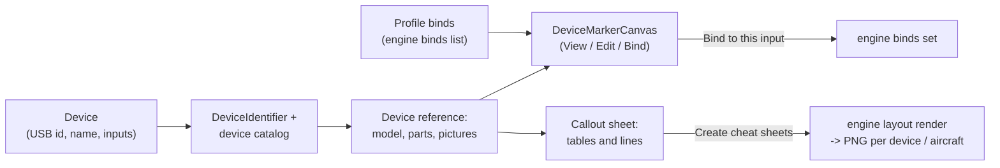

The Layout page shows a picture of each of your devices with what every button, hat and axis does. It has two
sections, switched at the top: **Device pictures** (one device at a time: look, fix the markers, bind on the picture)
and **Cheat sheets** (printable pictures of all your devices, per aircraft). Nothing on this page changes a game,
except a bind you make in **Bind** mode, which goes into your profile like any other bind.

:::video layout-page "The Layout page"
:::

:::layer beginner
## Device pictures

- **Left: your devices.** One card per stick, throttle, pedals or panel, with its model and "Your layout · 47
  markers" or "Reference picture". Click a card to show its picture. **Model...** says which model it is (if JoyPro
  guessed wrong); the swap button moves its binds to another device.
- **Middle: the picture.** JoyPro's drawing of the device, the maker's photo or your own photo, with a label at every
  input that says what it does ("Weapon Release", "Gear Up/Down").
- **Right: the selected input** (click a label or a row of the legend) and the **legend**: every input of the device
  with its bind, "7 of 25 inputs bound".

## The three modes

- **View** (V): look at what every input does.
- **Edit** (E): drag the labels onto the real buttons, use your own photo, start the marker assistant.
- **Bind** (B): click an input, pick a relation on the right, **Bind to this input**. The bind goes into your profile.

## Cheat sheets

Pictures of your devices with every bind written next to the buttons, to print or to keep on a second screen. Tick the
devices, games and aircraft, choose **Overview per device** and/or **One per aircraft**, press **Create cheat sheets**.
The pictures (PNG) go into the output folder; the preview shows them.

:::ingame cheat sheets and Bind mode
A cheat sheet shows what the buttons do in one aircraft, with that game's own names for the commands when you pick it
in the preview box. A bind made in **Bind** mode is written into the game at the next export, like a bind recorded on
the Binds page.
:::
:::

:::layer advanced
## Which picture is shown

1. Your own layout file (a JoyPro 1 layout, a picture you chose).
2. Your photo of the device.
3. The maker's reference photos (one per view), downloaded only after your yes.
4. JoyPro's drawing of the device.
5. The outline of its kind (stick, throttle, pedals ...).

The picture strip above the canvas has a button per picture of the device. The box next to the 3D button picks the
drawing style: **Lines** or flat colours under bold outlines (colours in Settings > Drawings). Devices with a 3D model
get **3D view**: drag to turn, the wheel zooms, a double click resets. The flat drawing is what the cheat sheets print
and what Edit mode works on.

## Which model is it?

JoyPro identifies a device by its USB id, its name and the inputs it reports, against a catalog of several hundred
models. When it cannot tell (a base with exchangeable grips, one USB id for several products, an unknown device), it
asks over the picture: **Which one is it?** with tiles of the candidates, **Most likely** first, **Keep the most
likely**, **Not listed: search the catalog**, **Not now**. For an unknown device you also pick its kind. **Model... >
Choose another model...** asks again at any time.

## The marker assistant

When the shown picture knows no position of a part ("No positions on this picture yet"), the marker assistant places
them in a minute:

1. **Place the markers** (or **Place them** when only a few are missing).
2. Press a button or hat direction on the device (other devices are ignored), or **More > Axis** and move an axis.
3. Click the part's spot on the picture.
4. Repeat; **Finish** saves.

Without the device at hand, **Now place: X** names the next input; a click puts it there, **Later** asks for it after
the others, and the inputs without a place are chips you can drag onto the picture. **Undo** takes the last placement
back; **Skip** goes to the next input; **Stop** pauses. **More** holds Axis, Stop, **Add control** (a control JoyPro does
not know: button, switch, hat, mini-stick, encoder, axis) and **Remove from picture**.

### Detected spots (experimental)

**More > Detected spots (experimental)** draws thin dashed rings on the spots of a photo that look like buttons, hats
or switches. A click (or a dropped chip) near a ring puts the marker on the ring's centre. JoyPro does not know which
input a spot is, so it places nothing by itself; it works on photos, not on JoyPro's drawings, and runs offline.

## Tables and lines

On a picture with known positions, **Tables** (toolbar) draws JoyPro 1's cheat sheet look: a table per group of
controls around the picture, lines to the parts, the bound relation per row and the modifier bind in a second column.
The preview box picks what the rows show: **Relation names**, or one game and aircraft with that game's own menu
titles. In Edit mode you drag a table (it gets pinned), its right edge, a line's segment or a spot; the side panel
has **Modifier column**, **Row + / Row −**, **Pinned**, **Re-route line**, **Remove line**, **Split into single
tables**, **Group again**, **Auto arrange** and **Reset**. A relation dragged from **Drag a relation onto a row** and
dropped on a row binds it there.

## Several views on one page

**Several views** puts more pictures of one device on a page (front and side, so every button is covered): **Add
view**, **Your image...**, **Arrange**, **Edit this view**, **Remove view**, **Remove page**, **Back to one picture**.
The page format is A4 or Letter for printing, 16:9 / 21:9 / 32:9 for a screen. The cheat sheets print the page.

## Correcting JoyPro

When an input is missing or on the wrong spot, fix it in Edit mode (drag, **Add control**, **Remove from picture**,
rename in the legend). Everything is kept on this PC as your layer over JoyPro's data. **Send correction to JoyPro...**
saves the change as a small file and opens a prefilled issue form on GitHub; you decide there whether to send it.
**Model... > Reset to JoyPro's default...** removes all your changes of a device (asks first; **Undo the reset** puts
them back).

## Keys

V / E / B modes, N place marker (layout file), Del remove, Ctrl+Z / Ctrl+Y undo and redo, Ctrl+S save, + / - zoom,
0 or F fit, arrows nudge in Edit mode (Shift: 10 px), Alt drags without snapping, a dropped picture file becomes your
photo of the device.
:::

:::layer technical
## Behind the page

- View models: `MainWindowViewModel.LayoutWorkspace.cs` (modes, undo, bind and free), `LayoutReference.cs` (the
  reference picture, save, assistant host), `LayoutCallouts.cs` (tables and lines), `MultiView.cs`,
  `CheatSheets.cs`, `ReferencePhotos.cs`, `Device3D.cs`, `DeviceIcons.cs`, `ModelChoice.cs`, `LayoutReset.cs`,
  `UnmappedPress.cs`; `DeviceReferenceViewModel*.cs`, `MarkerAssistantViewModel.cs`, `SheetStyleViewModel.cs`. The
  canvas: `Views/Controls/DeviceMarkerCanvas.cs`, `CalloutSheetCanvas.cs`, `MultiViewCanvas.cs`.
- On this PC (`<data>\DeviceReference`): `grips.json` (model answers), `Layouts\` (your positions per picture),
  `Callouts\` (tables and lines), `MultiView\`, `ReferencePhotos\<model>\` (checked by SHA-256), `Corrections\`,
  `ResetBackups\`; your device definitions in `<data>\Devices`. The global sheet style in `sheet-style.json`.
- Engine: [[cli:layout suggest]] (find a picture for each device, a layout on a picture you chose),
  [[cli:layout render]] (the cheat sheets), [[cli:layout image]] (the layout file a profile uses),
  [[cli:layout template-inspect]] / [[cli:layout template-save]] (the layout-file editor), [[cli:layout callouts]],
  [[cli:layout multiview]], [[cli:layout titles]] (game menu titles), [[cli:hud devices]] (models of the connected
  devices), [[cli:devices reference]] (identification, detected spots), [[cli:binds list]].
- Reference: [[doc:device-reference]], [[doc:ui/layout-redesign]], [[doc:devices]].
:::

<!-- entry: RemoveUserPhotoCommand -->
Removes your own photo of this model; the picture falls back to the maker's photo or JoyPro's drawing. Your marker
positions on other pictures stay.

<!-- entry: ResetMarkersCommand -->
Removes your marker positions on the shown picture: on a photo the markers go (until placed again), on JoyPro's drawing
they go back where JoyPro puts them.

<!-- entry: SkipCommand -->
Skips the input the marker assistant asks for now and goes to the next one (the skipped input stays without a place).

<!-- entry: StopCommand -->
Pauses the marker assistant: it stops waiting for a press. **Start** goes on, **Finish** saves what was placed.

<!-- entry: click:CloseAssistantClicked -->
Closes the marker assistant (it stops first). Placements already made stay on the picture as unsaved changes; **Save
markers** keeps them.

<!-- entry: bind:UsesOwnStyle -->
Gives the shown device a style of its own (a copy of the global sheet style to change): colours, font and markers of
its cheat sheet. It is stored with the device's sheet (or next to its .layout file) and travels with **Share layout...**.
Unticked, the device uses the global style again.

<!-- entry: ChooseAnotherModelCommand -->
Asks **Which one is it?** again for this device, with its candidates (its identification, the grips of its base, the
models of its USB id and maker), and a catalog search one click away. Use it when JoyPro shows the wrong model.

<!-- entry: NotMyDeviceCommand -->
Says the shown model is wrong: the device is treated as unknown and kept as its kind (stick, throttle ...) until you
pick its model in the question over the picture.

<!-- entry: UndoModelChoiceCommand -->
Brings back the earlier model answer of this device (or JoyPro's own identification).

<!-- entry: UndoLayoutResetCommand -->
"Undo the reset of <device>": puts back everything **Reset to JoyPro's default...** moved away (marker positions,
tables and lines, renamed parts, your photo, your definition and the profile's layout file, `engine layout image
--set`).

<!-- entry: click:BrowseLayoutPictureClicked -->
Picks a picture file of the device for **Use picture** (fills the box above it).

<!-- entry: UseLayoutPictureCommand -->
Builds a layout on the picture you chose (file or image address): the engine puts the device's real buttons and axes on
it as markers and, with a profile open, stores it as the device's layout for the cheat sheets. Engine: `engine layout
suggest --device <d> --backdrop <picture> --apply`.

<!-- entry: bind:LayoutSuggestIncludeConnected -->
**Suggest** looks for pictures of the connected devices (on by default). Kept for the next start.

<!-- entry: bind:LayoutSuggestIncludeProfileDevices -->
**Suggest** also looks for pictures of the devices your profile has binds for, connected or not. Kept for the next
start.

<!-- entry: bind:LayoutSuggestApplyToProfile -->
**Suggest** stores the picture it picks for each device in the profile (the layout file the cheat sheets use). Kept
for the next start.

<!-- entry: OpenSelectedLayoutInEditorCommand -->
Opens the layout file of the picked suggestion in the layout-file editor (markers, tables and lines of a .layout, JoyPro
1 style): it loads the file and shows it on the canvas. Engine: `engine layout template-inspect`.

<!-- entry: LoadLayoutEditorSourceCommand -->
Loads the file in **Layout file** again into the layout-file editor (after you changed it outside JoyPro or typed
another path).

<!-- entry: UndoLayoutEditCommand -->
Takes back the last marker move or edit on the picture (Ctrl+Z on the Layout page); the tooltip names it.

<!-- entry: RedoLayoutEditCommand -->
Does the undone marker edit again (Ctrl+Y).

<!-- entry: SaveWorkspaceCommand -->
Saves the shown picture: the marker positions, tables and lines (the cheat sheets use them from then on); for a layout
file it writes the file. The autosave also keeps them; Save clears the edit undo.

<!-- entry: AcceptReferencePhotosCommand -->
Downloads every reference photo JoyPro knows for these connected devices, in the background with a progress bar; each
is checked against JoyPro's record. It counts as your yes for these devices.

<!-- entry: DismissReferencePhotosCommand -->
Not now: no photos are downloaded; JoyPro asks again in the next session.

<!-- entry: RemoveMultiViewCommand -->
Removes the selected view from the page (its own tables and lines stay with its picture).

<!-- entry: ChooseDeviceIconCommand -->
Makes this picture the device's icon (on the device cards, in the bind list and on the HUD); **Automatic** lets JoyPro
choose again.

<!-- entry: CloseReferenceAssistantCommand -->
Closes the marker assistant over the picture (it stops first). Placements already made stay as unsaved changes; **Save**
keeps them.

<!-- entry: AcceptDevice3DCommand -->
Downloads the 3D views of these connected devices from JoyPro's releases (checked, kept on this PC); **3D view** then
appears on the Layout page and the Bind page's picture.

<!-- entry: DismissDevice3DCommand -->
Not now: the 3D views are not downloaded; the offer comes back in a later session.

<!-- entry: ChooseClassCommand -->
For a device JoyPro does not know: says what kind of device it is (stick, throttle, pedals, panel ...). "Likely" marks
JoyPro's guess. The picture then shows the outline of that kind and the marker assistant can name its parts.

<!-- entry: ToggleFindCommand -->
Opens a search of the whole device catalog when the right model is not among the tiles; pick it from the results.

<!-- entry: CancelPendingPressCommand -->
Stops mapping a hat's press: JoyPro stops waiting for the press and the row stays "not mapped".

<!-- entry: bind:IsSelected -->
A modifier chip of the layout-file marker: ticked, the marker shows the bind with this modifier held.

<!-- entry: bind:LayoutEditorNewTableDropShadow -->
The new or selected table of the layout file gets a drop shadow on the cheat sheet.

<!-- entry: AddLayoutEditorTableCommand -->
Adds a legend table to the layout file with the name, kind (panel: an empty box behind labels; list: filled with the
binds), size and background colour above. It shows on the picture with **Tables and lines** on, where you can drag it.

<!-- entry: ApplySelectedLayoutEditorTableDraftCommand -->
Gives the selected table the values above (name, kind, size, background colour and opacity, shadow).

<!-- entry: RemoveSelectedLayoutEditorTableCommand -->
Removes the selected table from the layout file.

<!-- entry: bind:LayoutPlaceTableMode -->
On: the next click on the picture puts the table there.

<!-- entry: bind:LayoutPlaceConnectorSourceMode -->
On: the next click on the picture sets the start of a connector line (the real button the line comes from).

<!-- entry: bind:LayoutPlaceConnectorPointMode -->
On: each click on the picture adds a corner to the line, so it can go around other parts.

<!-- entry: ClearLayoutEditorConnectorSourcePointCommand -->
Forgets the picked start point of the new connector line.

<!-- entry: AddLayoutEditorConnectorCommand -->
Adds a connector line from the picked start to the label of the chosen input, with the name, colour, width, route and
corner points above.

<!-- entry: ApplySelectedLayoutEditorConnectorDraftCommand -->
Gives the selected connector line the values above (target input, colour, width, route, corner points).

<!-- entry: RemoveSelectedLayoutEditorConnectorCommand -->
Removes the selected connector line from the layout file.

<!-- entry: bind:LayoutSelectAllDevices -->
Ticks every device for the cheat sheets.

<!-- entry: bind:LayoutSelectNoneDevices -->
Unticks every device; with none ticked, every device with a picture gets a sheet.

<!-- entry: bind:LayoutIncludeOverview -->
Makes an overview sheet per device with the relations bound on it (`--include-overview`).

<!-- entry: bind:LayoutIncludePlanes -->
Makes one sheet per device and aircraft, with that aircraft's binds (`--include-planes`).

<!-- entry: bind:LayoutSkipMissing -->
Leaves out devices without a picture, also ticked ones, and makes the sheets of the others (`--skip-missing-layouts`).
Off, a ticked device without a picture stops the export with a note. The options of this section and the output
folder are kept for the next start.

<!-- entry: bind:LayoutSelectAllGames -->
Ticks every game of the profile for the per-aircraft sheets.

<!-- entry: bind:LayoutSelectNoneGames -->
Unticks every game.

<!-- entry: bind:LayoutSelectAllPlanes -->
Ticks every aircraft of the ticked games.

<!-- entry: bind:LayoutSelectNonePlanes -->
Unticks every aircraft; with none ticked, all aircraft of the games get a sheet.

<!-- entry: bind:LayoutDrawMarkers -->
Draws the markers (dot and symbol per input kind) on the sheets of layout files (`--draw-markers`).

<!-- entry: bind:LayoutDrawLegendTable -->
Adds a legend table to the sheets of layout files, with the size and rows set below (`--draw-legend-table`).

<!-- entry: click:BrowseLayoutExportFolderClicked -->
Picks the folder the cheat sheets are written to (empty: JoyPro's LayoutExport folder).

<!-- entry: OpenCheatSheetFolderCommand -->
Opens the cheat sheet output folder in Explorer.

<!-- entry: OpenCheatSheetCommand -->
Opens this cheat sheet (PNG) in your picture viewer, to look at it full size or print it.

<!-- entry: AnswerPhotoConsentCommand -->
Answers the question about the maker's photo: **Yes** downloads and shows it for this model, **No** keeps JoyPro's
drawing, **Always for all my devices** allows the photos of every device, **Never** stops them all (and forgets the
yes answers). Settings > Privacy changes it back.

<!-- entry: StartCommand -->
The marker assistant waits for the next press: press a button or hat direction on the shown device (presses of other
devices are ignored), then click its spot on the picture. After 30 seconds without a press it stops and says so.

<!-- entry: CaptureAxisCommand -->
The marker assistant waits for an axis: move one axis of the device all the way, then click its spot on the picture.

<!-- entry: UndoCommand -->
Takes the marker assistant's last placement back: the part goes to where it was before, or back among the chips when it
had no place. Ctrl+Z on the page does the same.

<!-- entry: FinishCommand -->
Stops the marker assistant and saves the marker positions of the shown picture. When the device was unknown or got new
inputs, it is also saved as your device definition (**Export...** shares it).

<!-- entry: ApplyPresetCommand -->
Gives the sheet style (the global one, or the shown device's own style when it has one) every colour, the font and the
drawing of the preset picked above. The editor and the cheat sheets use it at once; it is saved right away.

<!-- entry: DeletePresetCommand -->
Deletes the picked preset of your own (shown only for your own presets; JoyPro's presets cannot be deleted). The style
in use does not change.

<!-- entry: SavePresetCommand -->
Keeps the current sheet style as a preset under the name typed above, to apply it again later (in both style panels).
A name of JoyPro's presets is refused; your preset of the same name is replaced.

<!-- entry: AddModifierCommand -->
Adds a row for a modifier colour ("Modifier 1" with the next colour of a palette). Type the modifier as your binds name
it (LAlt, Shift A): its markers and the bar over its column get that colour.

<!-- entry: label: -->
Removes this modifier colour from the sheet style; markers of binds with that modifier get the colour of their kind
again.

<!-- entry: ShowDevicePicturesSectionCommand -->
Shows the **Device pictures** section: one device at a time with what its inputs do, where you edit the markers and bind
on the picture.

<!-- entry: ShowCheatSheetsSectionCommand -->
Shows the **Cheat sheets** section: printable pictures of your devices with what every button does. Making them changes
no game.

<!-- entry: SuggestLayoutsCommand -->
**Find my devices** (the refresh button above the list, or **Suggest**): looks for a picture of every connected device
(and of the profile's devices, as ticked under **Where JoyPro looks**) and lists them on the left. Engine:
[[cli:layout suggest]].

<!-- entry: click:LayoutModelMenuClicked -->
Opens the device's model menu: **Choose another model...**, **This is not my device**, **Undo the last model choice**,
**Reset to JoyPro's default...** and, after a reset, its undo.

<!-- entry: ResetDeviceLayoutCommand -->
Removes everything you changed of this device's picture: marker positions, tables and lines, renamed parts, your photo,
your own definition, and the layout file the profile uses (the file itself stays). Asks first; **Undo the reset** puts
it all back. Engine: [[cli:layout image]] `--clear`.

<!-- entry: OpenReplaceDeviceCommand -->
Opens **Replace device** with this device as the old one: its binds move to another device input by input, with a
preview first. Needs an open profile; applying is one change in the History. Engine: [[cli:devices replace]].

<!-- entry: click:OldLayoutsClicked -->
Picks your JoyPro 1 folder (or its LayoutImages folder): JoyPro copies the .layout files with your pictures and shows
them for the devices they were made for. The old folder is only read.

<!-- entry: OpenLayoutBackdropWebSearchCommand -->
Opens an image search for the selected device's maker and model in your browser. Save a good picture (or copy its image
address), put it into the box below and press **Use picture**. Engine: [[cli:layout identify]].

<!-- entry: OpenCommunityLayoutFolderCommand -->
Opens the folder for community cheat sheets you received (JoyPro creates it if needed). Picture files you put there
are offered as 2D layouts of their devices in the picture strip.

<!-- entry: ApplySelectedLayoutSuggestionsCommand -->
Uses the picked suggestions' layout files for the cheat sheets and ticks those devices there (with nothing picked: every
suggestion that has a layout file). The picks are kept for the next start, until the device's picture is reset or
another layout replaces it.

<!-- entry: SetLayoutCanvasModeCommand -->
Switches the picture's mode: **View** (V) shows what every input does, **Edit** (E) moves markers and opens the edit
tools, **Bind** (B) binds a relation to a clicked input.

<!-- entry: bind:LayoutPlaceMarkerMode -->
Place marker (N, layout files in Edit mode): the next click on the picture puts a new marker there, with the input,
type and modifiers set in the panel on the right.

<!-- entry: bind:LayoutSnapEnabled -->
Dragged markers snap to the other markers (on by default). Hold Alt while dragging to place one freely. Kept for the
next start, like the other switches of this bar.

<!-- entry: bind:LayoutShowGrid -->
Shows a 10 px grid on the picture and snaps dragged markers to it. Kept for the next start.

<!-- entry: bind:LayoutShowOverlays -->
Shows the legend tables and connector lines of the layout file on the picture, the way the cheat sheets draw them; edit
them under **Tables, lines and label style** on the right. Kept for the next start.

<!-- entry: CalloutAutoArrangeCommand -->
Arranges the tables and lines again; pinned tables (the ones you moved) stay where they are. Ctrl+Z takes it back.

<!-- entry: bind:LayoutCalloutsEnabled -->
On (default): tables around the picture with lines to the parts, like JoyPro 1's cheat sheets. Off: labels at the
markers. Offered on pictures with known positions. Kept for the next start.

<!-- entry: OpenMultiViewCommand -->
**Several views**: opens the device's page with several pictures (front and side, so every button is covered), or
starts one with the shown picture. The picture needs placed markers first. The cheat sheets print the page. Engine:
[[cli:layout multiview]].

<!-- entry: bind:WorkspaceShows3D -->
Shows JoyPro's 3D view of the device: drag to turn it, the wheel zooms, a double click resets. Off: the flat drawing,
which is what the cheat sheets print and what Edit mode works on. Kept for the next start.

<!-- entry: AlwaysReferencePhotosCommand -->
Downloads the offered reference photos now and switches on **Download reference photos automatically** (Settings >
Privacy): the photos of every device that appears are downloaded in the background from then on.

<!-- entry: NeverReferencePhotosCommand -->
Says no to the photos of these devices (kept per model): nothing is downloaded and JoyPro's drawings stay. Settings >
Privacy can ask again.

<!-- entry: label:Add view -->
Lists the device's other pictures (JoyPro's drawings and the photos) that are not on the page yet; the one you pick is
added with its markers, tables and lines. A picture without placed markers cannot be added.

<!-- entry: click:MultiViewImageClicked -->
Adds an image of your own to the page as a view (a photo of the side, a label). It is copied into JoyPro's folder and
has no markers.

<!-- entry: ArrangeMultiViewCommand -->
Puts the views side by side, as big as the page allows; the page is saved at once.

<!-- entry: EditMultiViewCommand -->
Opens the selected view's picture in the normal editor (Edit mode) to change its markers, tables and lines; the page
shows the changes afterwards. Not for images of your own.

<!-- entry: DeleteMultiViewPageCommand -->
Removes the page with several views (asks first). The device shows its one picture again; the views' markers, tables
and lines stay with their pictures.

<!-- entry: CloseMultiViewCommand -->
Shows the one picture again. The page with several views stays saved and the cheat sheets still print it.

<!-- entry: SelectWorkspacePictureCommand -->
Shows this picture of the device: your layout, your photo, a maker's photo, JoyPro's drawing or a 2D layout. Picking a
reference picture instead of a 2D layout gives the device its earlier layout back.

<!-- entry: DownloadReferencePhotoCommand -->
Downloads the maker's product photo this drawing was made from, kept on this PC only. Without your yes for this model it
asks first and downloads after a **Yes**. The photo then shows, with JoyPro's markers when they fit it.

<!-- entry: ShowReferencePhotoInFolderCommand -->
Opens Explorer with the downloaded reference photo selected.

<!-- entry: OpenDeviceIconPickerCommand -->
Opens the icon picker: one tile per picture of the device (line drawings also cel-shaded and two-colour), **Automatic**,
and **Your own picture...**. The icon shows on the device cards, in the bind list and on the HUD.

<!-- entry: SaveDeviceAliasCommand -->
Keeps the name typed in the box as your name for this device (Enter does the same). JoyPro shows it everywhere instead
of the device's name; the games keep getting the real device. Needs an open profile and is a change in its History.
Engine: `engine devices alias set`.

<!-- entry: ClearDeviceAliasCommand -->
Takes your name for this device back: the device's real name shows again everywhere. Engine: `engine devices alias
clear`.

<!-- entry: CloseDeviceIconPickerCommand -->
Closes the icon picker; the icon stays as it is.

<!-- entry: click:DeviceIconFileClicked -->
Makes a picture file of your own the device's icon: cut out of a plain background and cropped square.

<!-- entry: SkipNextCommand -->
**Later**: the marker assistant asks for this input after the others.

<!-- entry: bind:ShowMoreTools -->
Shows the marker assistant's rarely used tools: **Axis**, **Stop**, **Detected spots (experimental)**, **Add control**
and **Remove from picture**.

<!-- entry: bind:#RootWindow.DataContext.DeviceReference.ShowDetectedSpots -->
Draws dashed rings on the spots of a photo that look like buttons, hats or switches; a click (or a dropped chip) near a
ring puts the marker on its centre. JoyPro does not know which input a spot is, so it places nothing by itself.

<!-- entry: AddControlCommand -->
Adds a control JoyPro does not know, of the kind picked in the box (button, switch, hat, mini-stick, encoder, axis,
wheel): press or move each of its inputs as asked, then click its spot on the picture. **Finish** saves it as your
device definition.

<!-- entry: RemoveSelectedCommand -->
Takes the picked part off the picture (JoyPro put it on the wrong spot): it is not shown there any more. Place it again
with **Start** or a click after picking it; **Undo** brings it back.

<!-- entry: AlwaysDevice3DCommand -->
Downloads the offered 3D views now and sets **Pictures from JoyPro's releases** (Settings > Privacy) to always: 3D views
and the Cockpits page's picture packs are downloaded without asking from then on.

<!-- entry: NeverDevice3DCommand -->
Sets **Pictures from JoyPro's releases** (Settings > Privacy) to never: JoyPro stops looking for 3D views and cockpit
picture packs; the flat drawing stays.

<!-- entry: PlaceMissingMarkersCommand -->
Starts the marker assistant for the inputs that have no place on the picture yet: press each one on the device, then
click its spot.

<!-- entry: SendCorrectionCommand -->
Saves your positions and controls (what differs from JoyPro's data) as a small file and opens a prefilled issue form on
JoyPro's GitHub page in your browser; you decide there whether to send it. Nothing is sent by JoyPro itself.

<!-- entry: OpenReferenceAssistantCommand -->
Opens the marker assistant over the picture (switches to Edit mode): press each button of the device and click where
it is. For unknown devices it also names the parts. Every placement can be undone with Ctrl+Z.

<!-- entry: click:ReferenceLayoutImportClicked -->
Imports marker positions someone shared (a joypro-device-layout .json): they are kept for their model and photo, with
the tables and lines, a photo inside the file and a page with several views when the file has them.

<!-- entry: ChooseCandidateCommand -->
Picks this model as the device (a tile of **Which one is it?** or a catalog search result). The picture shows it at
once and JoyPro remembers the answer.

<!-- entry: KeepBestCandidateCommand -->
Takes the first tile (**Most likely**) as the device's model and does not ask again.

<!-- entry: DismissQuestionCommand -->
Closes the question without an answer; it comes back when the device is shown again.

<!-- entry: AddLayoutEditorMarkerCommand -->
Adds a marker in the middle of the layout file's picture with the input, type and modifiers set below (or switch on
**Place marker** and click the spot). Ctrl+Z takes it back.

<!-- entry: MapPendingPressCommand -->
Says that this bound input is the hat's press. It is saved as your definition of the device, and the legend and tables
show the press from then on.

<!-- entry: ApplySelectedLayoutEditorMarkerDraftCommand -->
Gives the selected marker of the layout file the input, type and modifiers set above. An input another marker already
has is refused. Ctrl+Z takes it back.

<!-- entry: RemoveSelectedLayoutEditorMarkerCommand -->
Removes the selected marker from the layout file (Del). Ctrl+Z brings it back; **Save** writes the file.

<!-- entry: SelectVisualAssignComboCommand -->
Picks the modifier combination the next bind gets (none, one modifier, several held together). **Bind to this input**
binds with it, and the list shows what fits.

<!-- entry: BindSelectedLayoutMarkerCommand -->
Binds the relation picked in the list (or on the left) to the selected input, with the picked modifier combination. The
input's earlier relation is freed first; buttons take button relations, axes axis relations. The change goes into your
profile and its History. Engine: [[cli:binds set]]. In the game: written at the next export.

<!-- entry: FreeSelectedLayoutMarkerCommand -->
Removes the bind from the selected input: the relation keeps its other settings but loses this input. The change goes
into your profile and its History. Engine: [[cli:binds clear]] `--input-only`. In the game: gone after the next export.

<!-- entry: CalloutToggleModifierColumnCommand -->
Shows or hides the selected table's second column with the modifier bind (not for grids of keys). Ctrl+Z takes it back.

<!-- entry: CalloutAddRowCommand -->
An axis table gets one more zone row (0-20 %, 20-40 % ...); other tables show a row hidden before.

<!-- entry: CalloutRemoveRowCommand -->
Removes the last zone row of an axis table, or hides the last row of another table (one row always stays).

<!-- entry: CalloutTogglePinCommand -->
Pins the selected table (or unpins it): a pinned table stays where it is when the tables are arranged again. Moving a
table pins it.

<!-- entry: CalloutRerouteLineCommand -->
Draws a fresh line from the selected table's spot to the table, without your bends; it also brings back a removed line.

<!-- entry: CalloutDeleteLineCommand -->
Removes the selected line, or the selected table's line (Del). Drag from the table's round handle to a spot to add one,
or use **Re-route line**.

<!-- entry: CalloutSplitGroupCommand -->
Turns the selected grid of keys (or the table of parts on one spot) into one table per part, each with its own line.
**Group again** undoes it.

<!-- entry: CalloutRegroupCommand -->
Keys and parts on one spot share their tables again: undoes every **Split into single tables**.

<!-- entry: CalloutResetLayoutCommand -->
Puts back JoyPro's arrangement of the tables and lines, also pins, widths, rows and bent lines; the choice of modifier
combinations and the sheet style stay. Ctrl+Z brings yours back.

<!-- entry: click:ReferencePhotoClicked -->
Picks a photo of your own of this device (PNG, JPG, WebP, BMP): JoyPro copies it into its own folder and shows it. Place
its markers with the marker assistant. Dropping a picture file on the picture does the same.

<!-- entry: ResetReferenceMarkersCommand -->
Removes your marker positions on the shown picture: JoyPro's own positions show again where it has them, otherwise the
markers go until placed again. Ctrl+Z brings yours back until you save.

<!-- entry: bind:DeviceReference.VendorPhotosEnabled -->
Your answer for this model's maker photo: ticked, JoyPro downloads the maker's product photo from the maker's site
(kept on this PC only) and shows it; unticked, JoyPro's drawing shows. Settings > Privacy sets ask, always or never for
all devices.

<!-- entry: SaveDefinitionCommand -->
Keeps the shown device as your own device definition: the names you gave the parts, inputs you added and the markers on
JoyPro's drawing. JoyPro uses it for this device from then on.

<!-- entry: click:ReferenceExportClicked -->
Saves the shown device as a definition file (JSON) to share or to send to JoyPro: its parts with your names, new inputs
and the marker positions on the drawing.

<!-- entry: click:ReferenceImportClicked -->
Adds the devices of a definition file (JSON) to your device definitions and shows the first one. A file that is not a
definition is refused with a message.

<!-- entry: click:ReferenceLayoutExportClicked -->
Saves the marker positions of the shown picture as a file to share, with its tables and lines and the page with several
views. The maker's photo goes by its address only; your own photo goes inside the file.

<!-- entry: bind:LayoutCombinePages -->
Also makes a page per aircraft (and for the overview) with the sheets of all devices under each other: All devices.png
(`--combine`).

<!-- entry: RefreshCheatSheetPreviewsCommand -->
Shows the newest pictures of the output folder in the preview, also those of earlier sessions.

<!-- entry: RenderLayoutCommand -->
Makes the cheat sheets (PNG) into the output folder with the ticked devices, games, aircraft and the sheet style, and
shows them in the preview. Unsaved layout-file edits are saved first; a ticked device without a picture stops it with a
message. Games are not touched. Engine: [[cli:layout render]].
