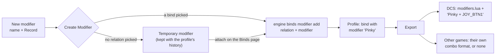

A modifier is a shift button: while you hold it, your other buttons do something else. One button, several jobs. The
Modifiers page lists the shift buttons of your profile, shows where each one is used, and makes, renames and deletes
them. You put a modifier on a bind on the [[gui:binds|Binds page]]; the export writes it into each game that knows
modifiers.

:::video modifiers-page "The Modifiers page"
:::

:::layer beginner
## What a modifier is

Most sticks have fewer buttons than a modern aircraft has functions. A modifier doubles them: pick one button as the
shift button (often the pinky lever), and every other button gets a second job while you hold it.

- Without the shift button held: the trigger fires the gun.
- With the shift button held: the same trigger releases the weapon.

## The page

- **Left: Modifier Library.** One card per modifier: a tick box, the key cap of its button ("BTN 5"), its name, its
  device and how many relations use it ("3 binds").
- **Right, top: the picked modifier.** Its key cap, device and **Used In Relations**: every relation that has it.
- **New modifier.** Type a name ("Pinky"), press **Record Modifier Input** and press the shift button on your device,
  then **Create Modifier**.
- **Rename** and **Delete the ticked modifiers** at the bottom.

## Making your first modifier

1. Type a name, for example *Pinky*.
2. Press **Record Modifier Input** and press the button you want as the shift button.
3. Press **Create Modifier**.
4. Go to the **Binds** page, pick a relation and attach the modifier to its bind. Only then does the modifier do
   something in a game.

:::ingame holding the shift button
After the next export, the bind needs the shift button held: in DCS the modifier shows in the aircraft's modifier list
and in the control cell as "Pinky + JOY_BTN1". Games without modifiers (see the game pages) get the bind without it,
and the Check names such binds.
:::
:::

:::layer advanced
## Details

- **Temporary modifiers.** A modifier that is not on any bind yet cannot be stored in the profile file itself (the
  profile keeps modifiers with their binds). JoyPro keeps it with the profile's history (`drafts.json`) until you attach
  it on the Binds page; it comes back when you open the profile again.
- **Invert.** Ticked, the modifier is active while the button is **not** held (a "shift up" layer).
- **The same button twice** is refused: when another modifier already uses the device and input, **Create Modifier**
  says so ("input already used by modifier 'Shift'").
- **Rename** changes the modifier's name in every bind that uses it (with a bind picked on the Binds page, the engine
  gets that relation as the place to start). Games see the new name at the next export.
- **Delete** takes the ticked modifiers off every bind in the profile. The binds stay, without the modifier. JoyPro asks
  first and **Undo** (Ctrl+Z) puts them back.
- A modifier button that is also bound as a normal button is reported by the [[page:flows/check.html|Check]].
- Several modifiers can be combined ("Shift A + Shift B"); the Layout page's Bind mode lists every combination of an
  input under **With modifiers**.

:::

:::layer technical
## Behind the page

View model: `MainWindowViewModel.cs` (`RefreshModifiersAsync`, `CreateModifierOnSelectedBindAsync`,
`RenameModifierAsync`, `DeleteSelectedModifiersEverywhereAsync`, `RecordModifierInputAsync`), the temporary modifiers
in `pendingModifiersByName`, kept by the autosave ([[doc:profile-history]]). A modifier is written as a reformer string
(name, device, input, inverted) on a bind.

Engine: [[cli:binds modifier list]] fills the library, [[cli:binds modifier add]] puts a modifier on a relation's
bind, [[cli:binds modifier rename]] and [[cli:binds modifier remove]] change and delete it; the page re-reads
[[cli:binds list]] afterwards. Recording uses the same capture service as the Binds page (DirectInput and the keyboard,
the record time-out and warm-up from Settings > Binds).

Per game: DCS writes the modifiers into `<aircraft>\modifiers.lua` and the `reformers` of each bind; IL-2 and the
registry games use their own combo syntax where they have one, and the re-import brings the names back
([[page:flows/import.html|Import]]).
:::

<!-- entry: RefreshModifiersCommand -->
Reads the modifiers of the profile again (`engine binds modifier list`, and the binds when needed) and rebuilds the
cards with their usage counts. Changes nothing.

<!-- entry: ClearModifierSelectionCommand -->
Unticks every modifier card. Only the ticks change (they decide what **Delete Selected** removes and what the Binds
page attaches).

<!-- entry: GoBindsCommand -->
Back to the Binds page, where you attach and detach modifiers on a relation's bind.

<!-- entry: RecordModifierInputCommand -->
Waits for the next press (device button or keyboard key, with the record time-out of Settings > Binds) and fills
**Device** and **Input** with it. Press it, then press the shift button. Nothing is saved yet.

<!-- entry: CreateModifierOnSelectedBindCommand -->
Makes the modifier from name, device, input and **Invert**. With a relation picked (the bind on the Binds page) it goes
straight onto that bind (`engine binds modifier add`, one undo step); otherwise it is a temporary modifier kept with
the profile until you attach it. An input another modifier already uses is refused. In the game: nothing until the
modifier is on a bind and exported.

<!-- entry: RenameModifierCommand -->
Gives the modifier in **From** the name in **To**, in every bind that uses it (`engine binds modifier rename`; a
temporary modifier is renamed in place). In the game: the new name shows after the next export (DCS modifier list).

<!-- entry: DeleteSelectedModifiersEverywhereCommand -->
Takes every ticked modifier off every bind of the profile (`engine binds modifier remove` per relation); the binds
stay, without the shift. Asks first; Ctrl+Z brings them back. In the game: after the next export those binds work
without holding the shift button.

<!-- entry: bind:ModifierCreateInverted -->
The new modifier is active while its button is **not** held. Useful for a two-position switch: one position is the
normal layer, the other the shifted one.

<!-- entry: bind:IsSelected -->
Ticks the modifier for **Delete Selected** and for attaching on the Binds page (several at once make a combination).
