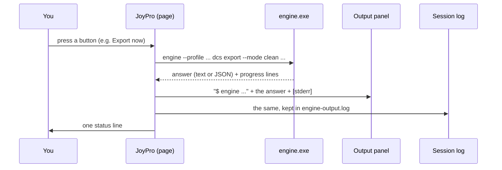

Every button in JoyPro runs a command of JoyPro's engine. The status line at the bottom says the short result
("Exported 5 of 6 games"); the **Output** panel shows the details: the exact command and everything the engine
printed. It is the first place to look when something did not do what you expected.

:::video output-panel "The Output panel"
:::

:::layer beginner
## Open and close it

- Press **Output** in the bottom bar (next to the page buttons). The panel opens under the page; press it again to
  close it.
- Drag the thin line above the panel to make it taller or smaller. JoyPro keeps the height for the next start.
- The text can be selected and copied (Ctrl+A, Ctrl+C), for example to paste it into a problem report.

### What you see

1. The first line starts with `$ engine` and is the exact command JoyPro ran, with your profile and every option.
2. Then the engine's answer: what it read, what it changed, the files it wrote, warnings.
3. Under `[stderr]`: errors and the progress lines, when there were any.

:::tip
A red status line or "see Output" means the details are here. For a problem report use Settings > **Report a
problem**: it collects the Output's session log and everything else needed, so you do not have to copy it by hand.
:::
:::

:::layer advanced
## Good to know

- The panel shows the **last** command a button or the [[page:gui/advanced.html|Advanced Console]] ran. Background
  checks (the game config watcher, the usage harvest, the HUD's device list) do not replace it, so what you clicked last
  stays readable.
- Very long answers are cut in the panel with "... n more characters are not shown here"; the whole answer is in the
  session log, which goes into the support file of Settings > Report a problem.
- With **Text output** off on the Advanced page, a typed command answers in JSON here.
- Copy the `$ engine ...` line into a terminal in JoyPro's folder to run the same command by hand (see
  [[page:cli/index.html|Engine command line]]).
:::

:::layer technical
## Behind the panel

`MainWindow.axaml` (the `EngineOutputExpander` and its `GridSplitter`; the height is kept in `ui-layout.json` by
`MainWindow.axaml.cs`), `MainWindowViewModel.cs`: `RunEngineAsync` sets `LastCommandText` and `OutputText` from
`BuildOutputText` (`$ <command>`, an optional `[gui-note]`, stdout, then `[stderr]`), `LimitOutputPane` cuts the pane
text, `AppendSessionLog` writes the session log `engine-output.log` (progress lines thinned to a few per step) in the
log folder. Background runs (`background: true`) only go to the session log. Reference: [[doc:logging|Logging]].
:::

<!-- entry: bind:EngineOutputExpanded -->
Opens or closes the Output panel under the page. It shows the exact engine command of the last action (`$ engine ...`)
and everything the engine printed, errors under `[stderr]`. Drag the line above it to change its height (kept for the
next start). Changes nothing in the profile or the games.
