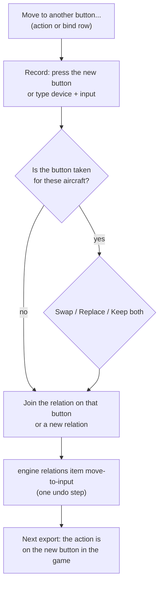
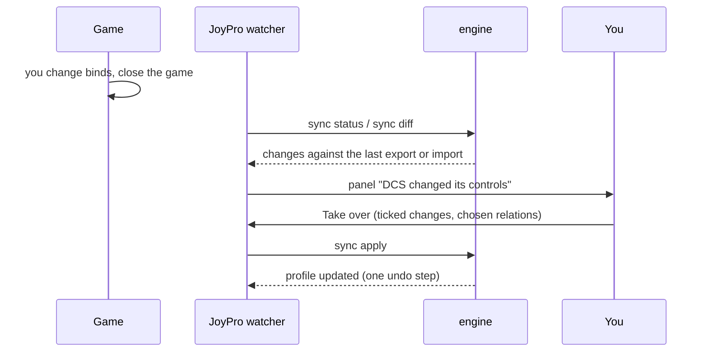

Some windows and panels show over whatever page is open: a question before JoyPro changes game files or the profile,
the changes a game made to its controls (the game watcher), **Move to another button** for a single action, and the
update prompt. This page describes each of them and every button in them.

:::video dialogs "Dialogs and notices"
:::

:::layer beginner
## Confirmation windows

Before JoyPro does something that removes binds, overwrites files or replaces a lot of your profile, it asks. The
window names what happens ("Export to DCS with Replace? Binds of your devices that are not in your profile are
removed.") and offers:

- the main answer (for example **Export**, **Delete**, **Merge**),
- sometimes a second way (for example **Export first**),
- **Cancel**: nothing happens.

Some questions have **Do not ask again**. Settings > Confirmations lists them and switches them back on.

## The game watcher: "DCS changed its controls"

When you change binds inside a game and close it, JoyPro notices (if the game watcher is on, Start page). A panel
lists every change ("Landing Gear Up/Down: now on Throttle BTN 22") with a tick and the relation it belongs to:

- **Take over**: the ticked changes go into your profile.
- **Not now**: JoyPro keeps them and asks again later.
- **Ignore these**: your profile stays as it is; the next export writes your profile over the game's changes.

## Move to another button

A relation is one button with all its actions. To move only one of them (one game's action) to another button, right-click
the action (Relations page) or a bind row (Binds page) and choose **Move to another button...**. Press the new button
(or pick device and input), then **Move**.

## Updates

At start (and with **More > Check for updates**) JoyPro asks GitHub for a newer version. The prompt shows what is new
with **Update now**, **Later**, **Skip this version** and **Release page**.
:::

:::layer advanced
## Move to another button in detail

- The action joins the relation that already uses the new button; if none does, it gets a relation of its own named
  after it.
- **Keep the modifiers (Shift)**: the action keeps the shift buttons of its old bind (shown only when it had some).
- When the new button already has an action of the same aircraft, one aircraft cannot have two actions in one relation;
  you choose:
  - **Swap**: the other action goes to the old button.
  - **Replace**: the other action leaves that button and is unbound.
  - **Keep both**: the moved action gets its own relation on the same button; both fire when you press it.
- A preview line says what will happen; **Move** is one undo step (Ctrl+Z).

## The game watcher in detail

Where several relations use the changed button, each row has a box to pick the relation, or **New relation** with a
name. Unticked rows count as ignored.

## Updates in detail

- **Update now** downloads the installer, checks it and starts it; JoyPro closes and starts again. Profiles and
  settings stay.
- **Later** asks again at the next start; **Skip this version** stops the question at start for this version (the
  manual check still shows it).
- After a manual check without news, the prompt says so and has **OK**.
:::

:::layer technical
## Behind the windows

- Confirmations: `Views/ConfirmWindow.axaml`, `MainWindowViewModel.Confirm.cs` (`ConfirmAsync` with an optional third
  answer), the remembered answers in `MainWindowViewModel.Confirmations.cs` (Settings > Confirmations).
- Game watcher: `MainWindowViewModel.GameSync.cs`; engine [[cli:sync status]], [[cli:sync diff]], [[cli:sync apply]],
  [[cli:sync accept]] ([[doc:sync-watcher]]).
- Move to another button: `MainWindowViewModel.MoveAction.cs`; engine [[cli:relations item move-to-input]].
- Updates: `MainWindowViewModel.Updates.cs`, the GitHub releases API ([[doc:updates]]).
:::

<!-- entry: click:ConfirmClicked -->
The main answer of a confirmation window; its text names the action ("Export", "Delete", "Merge", "Restore"). JoyPro
goes on with it. With **Do not ask again** ticked, this question is answered like this from now on.

<!-- entry: click:SecondaryClicked -->
A second way of going on, shown only where a question has one (for example "Export first" before an import, so changes
made in JoyPro are not lost). Its text says what it does.

<!-- entry: click:CancelClicked -->
Closes the question; nothing happens (also Esc).

<!-- entry: bind:IsSelected -->
Ticks this game change for **Take over**. Unticked changes are treated as ignored when you take over the others.

<!-- entry: bind:MoveActionKeepModifiers -->
The moved action keeps the modifiers (shift buttons) of its old bind on the new button. Unticked, it is bound to the new
button without them.

<!-- entry: bind:IsMoveActionSwap -->
The new button is taken for these aircraft: the action that is there goes to the old button of the moved action (the
two trade places).

<!-- entry: bind:IsMoveActionReplace -->
The new button is taken: the action that is there leaves it and is not bound any more (in the game it has no button
after the next export).

<!-- entry: bind:IsMoveActionKeepBoth -->
The new button is taken: the moved action gets a relation of its own on the same button, so both actions fire when you
press it in the game.

<!-- entry: CancelMoveActionCommand -->
Closes **Move to another button** without a change (a recording that runs is stopped).

<!-- entry: CloseUpdatePromptCommand -->
Closes the update message that has nothing to install (for example "JoyPro is up to date").

<!-- entry: DontAskAgainBox -->
Shown only on questions you may switch off. Tick it and confirm with the main answer: from then on JoyPro does this
without asking (with **Cancel** the tick is not kept). Settings > Confirmations lists these questions and **Ask
everything again** turns them back on.

<!-- entry: TakeOverGameChangesCommand -->
Puts the ticked changes the game made into the relations chosen in each row (or a **New relation** with the name you
typed); unticked rows count as ignored. One undo step (Ctrl+Z). If an action ends up in two relations, the notice says
so and the check lists it. Engine: [[cli:sync apply]]. In the game: nothing changes; the game already has these binds.

<!-- entry: PostponeGameChangesCommand -->
Closes the panel and keeps the game's changes as they are: nothing goes into the profile and nothing counts as seen.
JoyPro offers them again after the game's next change or the next start.

<!-- entry: IgnoreGameChangesCommand -->
Your profile stays as it is and the game's current controls count as known ([[cli:sync accept]]), so JoyPro does not
ask about these changes again. In the game: the next export writes your profile over the changes you made in the game.

<!-- entry: RecordMoveActionInputCommand -->
**Move to another button**: press it, then press the new button (or move the new axis for an axis action) on your
device; device and input are filled in. It uses the same recording settings as the Binds page. Press it again while
it waits to stop the recording.

<!-- entry: ApplyMoveActionCommand -->
Moves the action to the new button: it joins the relation already on that button, or gets a relation of its own, and
with a taken button your choice (swap, replace, keep both) is applied. One undo step (Ctrl+Z). Engine:
[[cli:relations item move-to-input]]. In the game: the action is on the new button after the next export; an import
before that brings the old button back.

<!-- entry: OpenReleasePageCommand -->
Opens the GitHub page of the offered release in your browser, to read the notes or download the installer yourself.
Also offered when an update failed.

<!-- entry: SkipUpdateVersionCommand -->
Closes the offer; JoyPro does not offer this version at start again. **Check for updates** still shows it, and
Settings > About JoyPro and updates > **Offer it again** takes the skip back. Saved in JoyPro's settings.

<!-- entry: UpdateLaterCommand -->
Closes the offer without updating. The check at the next start offers the version again; Settings > About JoyPro and
updates > **Install update** installs it before that.

<!-- entry: UpdateNowCommand -->
Downloads the new version with a progress bar, checks the download, closes JoyPro, installs the version and starts
JoyPro again. Your profiles and settings stay. If the download or the check fails, JoyPro stays as it is and the
message says why, with **Release page** to download it yourself.
